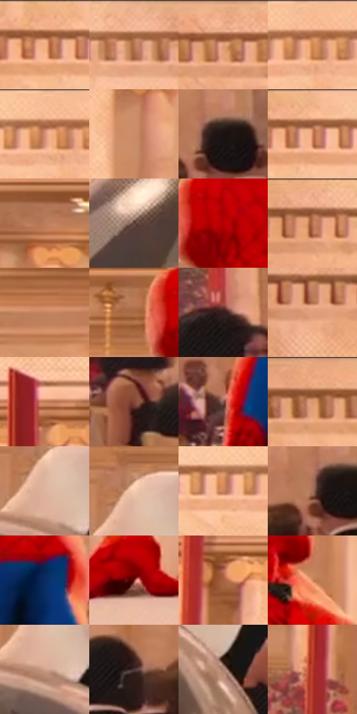

# 电影参考 603

- 状态：常规／活跃；来源世界：miles-home。
- 视角：near-level；景别：medium；场景：interior。
- 时段：interior-time-unknown（外观依据，中置信度；具体时间／晨昏未知）；光照：interior-mixed。
- 材质候选：skin, hair, fabric, stone, wood, metal, glass, ceramic（帧级，不是像素分割）。
- 明暗组：middle；L* P5/P50/P95：11.04619 / 57.58189 / 81.47173。
- 资格门禁：无附加门禁。
- 原截图 SHA-256：`7aac8ea36e2bc5cb1ac10563f208cbffc17ea8766f43a99b1646369344024f54`；尺寸：2880 × 1210。
- sRGB 像素 SHA-256：`670469a7b805df3fe787b8b3930b61b7a2d99b786568a59b237a4874456f1d78`。

## 观察与迁移

暖厅石柱、金属餐罩和餐具各有高光响应，白布不发塑料亮。

餐罩以暖灰金属底、白色椭圆灯光映像、弯曲暗条和环形窄边表达曲率，下沿保留接触暗部。不是随机白光斑；背景暖厅和两侧衣料在罩面形成压缩映色。镜面反射、金属实体和画面细网分层，不猜反射系数。

本公开版保存32个128×128原像素色卡上下文；图集格子并非原场景相邻位置。原rect、图集tile和像素SHA见 `data/palette-crops.json`。上下文不足时不得批准替色，不能以小样推断完整构图。

## 实测色卡

颜色比例分母为保留采样像素，不是材料面积；全部 32 色参与全库匹配。表内四舍五入仅用于阅读，原精度在 JSON。

| ID | HEX | Lab | 原图 xy | 像素数 | 比例 | 明度角色 |
| --- | --- | --- | --- | ---: | ---: | --- |
| 603-S01 | #D6946D | [66.963142, 20.447946, 30.573807] | [712, 56] | 10438 | 5.379192% | light |
| 603-S02 | #B3734F | [54.461399, 21.418106, 30.225053] | [1976, 56] | 8832 | 4.551545% | midtone |
| 603-S03 | #EFAE87 | [76.299338, 19.086231, 29.377661] | [2788, 28] | 8201 | 4.226361% | light |
| 603-S04 | #F5B78F | [79.194444, 17.520652, 29.096777] | [1216, 28] | 8171 | 4.210901% | light |
| 603-S05 | #F8BF99 | [81.577443, 15.573727, 27.063434] | [1196, 28] | 8147 | 4.198532% | highlight |
| 603-S06 | #CA8C69 | [63.619085, 19.534976, 28.140181] | [728, 416] | 8034 | 4.140298% | light |
| 603-S07 | #1B1312 | [6.706599, 3.619524, 1.92851] | [2752, 724] | 7920 | 4.081549% | deep-shadow |
| 603-S08 | #9A5C3C | [45.431215, 22.1843, 28.996375] | [756, 52] | 7732 | 3.984663% | midtone |
| 603-S09 | #BB7D5D | [58.060496, 20.464297, 27.212437] | [2640, 300] | 7708 | 3.972295% | midtone |
| 603-S10 | #63463C | [32.612161, 10.962462, 10.95086] | [1252, 928] | 7570 | 3.901177% | shadow |
| 603-S11 | #B30105 | [37.150801, 61.350453, 49.486985] | [1096, 316] | 7378 | 3.802230% | shadow |
| 603-S12 | #BD7651 | [56.458734, 24.097558, 31.888245] | [532, 64] | 6876 | 3.543526% | midtone |
| 603-S13 | #C38462 | [60.77196, 20.37677, 28.136126] | [2384, 376] | 6874 | 3.542496% | light |
| 603-S14 | #AA6B45 | [51.259293, 21.263787, 31.55794] | [1004, 304] | 6210 | 3.200305% | midtone |
| 603-S15 | #371E1B | [14.513276, 11.782022, 7.251231] | [2152, 764] | 5982 | 3.082806% | deep-shadow |
| 603-S16 | #E09E79 | [70.653073, 20.250806, 29.119647] | [232, 96] | 5958 | 3.070438% | light |
| 603-S17 | #C27E56 | [59.035031, 22.185778, 32.499168] | [1368, 232] | 5849 | 3.014265% | midtone |
| 603-S18 | #844734 | [37.227413, 24.090142, 22.827629] | [2376, 904] | 5679 | 2.926656% | shadow |
| 603-S19 | #825C4F | [42.711286, 13.759333, 13.665871] | [788, 848] | 5606 | 2.889035% | midtone |
| 603-S20 | #EAA47C | [73.221423, 21.319402, 31.08799] | [2300, 28] | 5591 | 2.881305% | light |
| 603-S21 | #DFB49D | [76.537765, 12.256464, 17.627411] | [1584, 740] | 5326 | 2.744738% | light |
| 603-S22 | #F5CAAE | [84.335284, 11.214609, 19.700966] | [1588, 696] | 5111 | 2.633939% | highlight |
| 603-S23 | #CB855B | [61.852061, 22.493136, 33.544476] | [1108, 80] | 4872 | 2.510771% | light |
| 603-S24 | #A46F58 | [51.800639, 18.230787, 21.314349] | [2716, 740] | 4672 | 2.407701% | midtone |
| 603-S25 | #092C60 | [18.815139, 10.092527, -34.293777] | [1312, 660] | 4639 | 2.390695% | deep-shadow |
| 603-S26 | #70221F | [25.829022, 34.182111, 21.114189] | [804, 1036] | 4046 | 2.085094% | shadow |
| 603-S27 | #AA6343 | [49.346772, 25.57881, 30.327578] | [620, 292] | 4046 | 2.085094% | midtone |
| 603-S28 | #D98A61 | [64.799746, 25.99345, 34.367695] | [1232, 484] | 3828 | 1.972748% | light |
| 603-S29 | #CDA08A | [69.43951, 13.576128, 17.864615] | [1596, 784] | 3447 | 1.776401% | light |
| 603-S30 | #503B39 | [27.099387, 8.911293, 4.833507] | [2576, 780] | 3383 | 1.743419% | shadow |
| 603-S31 | #AD8271 | [58.078143, 14.170093, 15.646072] | [1788, 916] | 3148 | 1.622312% | midtone |
| 603-S32 | #B6372C | [42.55518, 50.426323, 35.86831] | [560, 632] | 2770 | 1.427511% | midtone |

## 色阶与空间分布

- 采样 ROI：`[0.01, 0.02, 0.98, 0.94]`；步长：4；样本数：194044。
- 排除区：`[]`。
- 深暗、暗、中、亮、高光五段计数：`[16540, 28673, 65424, 68423, 14984]`。
- RGB 各 256 箱、L* 100 箱、13×5 色相明度表和 3×3 空间统计全部保存在 [总数据](../film-library.json)。
- [可视化档案](../../references/library.html)按需绘制直方图，不存 2,094 张重复图表图片。

## 纹理特征占比

**这是分块图像特征的面积占比，不是波点／排线／丝网／错版的精确语义覆盖率。** 窗格、发丝、织物也会产生方向或周期特征。
原图 ROI 像素 3109722；已测块覆盖 3109722（100.0000%）；未测 0。

| 特征 | 块覆盖像素 | 占已测面积 | 阈值敏感范围 |
| --- | ---: | ---: | --- |
| low-contrast | 0 | 0.0000% | 0.0000% ~ 0.0000% |
| directional-structure | 1052378 | 33.8415% | 22.5646% ~ 45.2267% |
| periodic-structure | 2024576 | 65.1047% | 54.7733% ~ 75.8548% |
| mixed-detail | 32768 | 1.0537% | 0.0000% ~ 1.5806% |

阈值敏感范围不是统计置信区间。逐块坐标、尺度、对比、方向一致性、频谱集中度、频率与角度见 [全量特征记录](../texture-features.jsonl)，以帧号定位。
四种印刷层的真实像素覆盖仍标为 `null`，不能填 0，也不能拿上表代替。不得据这些代理测量删除唯一证据。

[测量方法与保留策略](../../references/library-retention.md) · [分类索引](../archive/README.md)
