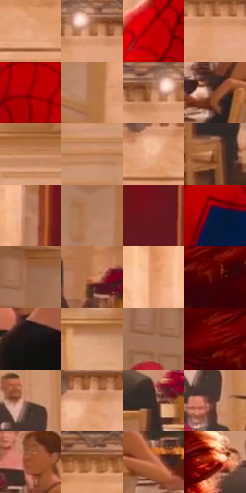

# 电影参考 604

- 状态：常规／活跃；来源世界：miles-home。
- 视角：near-level；景别：medium；场景：interior。
- 时段：interior-time-unknown（外观依据，中置信度；具体时间／晨昏未知）；光照：interior-mixed。
- 材质候选：skin, hair, fabric, stone, wood, metal, glass, ceramic（帧级，不是像素分割）。
- 明暗组：middle；L* P5/P50/P95：10.65183 / 53.31742 / 74.08264。
- 资格门禁：无附加门禁。
- 原截图 SHA-256：`f04aaf4181a5ac669d6ef37986e4a3f86422f3dcc59b7b0304981cf93effa48d`；尺寸：2880 × 1204。
- sRGB 像素 SHA-256：`905f343d070116dc2ed3cc5a8133b671ec73a0638161b7c2c0ebdcbd95bc8403`。

## 观察与迁移

暖厅石柱、金属餐罩和餐具各有高光响应，白布不发塑料亮。

红蓝衣料、铜红发与黑裙分别从浅暖厅墙分离，发缘暖亮带与服装受光边有光照依据，不自动叫错版。圆柱有连续转折，墙板线脚为平面层级；背景人群软化，焦点人物轮廓与细纹优先。

本公开版保存32个128×128原像素色卡上下文；图集格子并非原场景相邻位置。原rect、图集tile和像素SHA见 `data/palette-crops.json`。上下文不足时不得批准替色，不能以小样推断完整构图。

## 实测色卡

颜色比例分母为保留采样像素，不是材料面积；全部 32 色参与全库匹配。表内四舍五入仅用于阅读，原精度在 JSON。

| ID | HEX | Lab | 原图 xy | 像素数 | 比例 | 明度角色 |
| --- | --- | --- | --- | ---: | ---: | --- |
| 604-S01 | #E7A680 | [73.430764, 19.46225, 29.161186] | [2612, 156] | 9878 | 5.127486% | light |
| 604-S02 | #A9683E | [50.317278, 21.995728, 34.240766] | [1532, 76] | 8209 | 4.261139% | midtone |
| 604-S03 | #C70005 | [41.464757, 66.498182, 53.978487] | [948, 440] | 8166 | 4.238819% | midtone |
| 604-S04 | #E39E74 | [70.904767, 20.965919, 32.199773] | [1360, 116] | 7976 | 4.140194% | light |
| 604-S05 | #A50004 | [34.005297, 57.871179, 46.574422] | [1116, 212] | 7491 | 3.888439% | shadow |
| 604-S06 | #B3744B | [54.642039, 20.529255, 32.660357] | [340, 272] | 7097 | 3.683921% | midtone |
| 604-S07 | #CC926F | [65.393252, 17.675334, 27.218129] | [1480, 68] | 6844 | 3.552593% | light |
| 604-S08 | #814731 | [36.736873, 22.551165, 23.923219] | [1480, 976] | 6757 | 3.507433% | shadow |
| 604-S09 | #C5855C | [61.151202, 20.100542, 31.966485] | [2340, 340] | 6689 | 3.472136% | light |
| 604-S10 | #BE7B52 | [57.774968, 21.841378, 33.006018] | [1744, 500] | 6634 | 3.443586% | midtone |
| 604-S11 | #F2B893 | [79.195555, 16.259711, 26.924891] | [1924, 144] | 6566 | 3.408289% | light |
| 604-S12 | #985C37 | [45.091448, 20.942937, 31.3402] | [2464, 1084] | 6554 | 3.402060% | midtone |
| 604-S13 | #BE8665 | [60.727958, 17.511478, 26.305237] | [600, 308] | 6142 | 3.188198% | light |
| 604-S14 | #B37E61 | [57.434623, 16.993688, 23.970968] | [284, 180] | 6141 | 3.187679% | midtone |
| 604-S15 | #67161A | [22.06276, 35.766324, 19.456478] | [712, 324] | 6126 | 3.179893% | shadow |
| 604-S16 | #041A45 | [10.51344, 10.943665, -29.454484] | [956, 788] | 6048 | 3.139405% | deep-shadow |
| 604-S17 | #9B674C | [48.501578, 17.742545, 23.709748] | [188, 540] | 5993 | 3.110855% | midtone |
| 604-S18 | #D1835A | [62.108338, 25.953069, 34.564555] | [1308, 860] | 5845 | 3.034031% | light |
| 604-S19 | #DD9669 | [68.173814, 21.841374, 34.441347] | [508, 88] | 5741 | 2.980047% | light |
| 604-S20 | #4C0103 | [13.017258, 33.083435, 19.155562] | [2136, 764] | 5597 | 2.905299% | deep-shadow |
| 604-S21 | #1A1615 | [7.656229, 1.746158, 1.354572] | [1872, 972] | 5426 | 2.816536% | deep-shadow |
| 604-S22 | #D59C7A | [68.990357, 17.03216, 26.156286] | [2652, 336] | 5398 | 2.802002% | light |
| 604-S23 | #A27157 | [52.041651, 16.142132, 22.166909] | [112, 568] | 5392 | 2.798887% | midtone |
| 604-S24 | #7D0A07 | [25.544776, 45.443853, 34.966175] | [2076, 712] | 5339 | 2.771376% | shadow |
| 604-S25 | #C08D71 | [62.886221, 15.758852, 22.539264] | [2544, 692] | 5295 | 2.748536% | light |
| 604-S26 | #D39167 | [65.812478, 20.295687, 32.269193] | [1960, 108] | 5271 | 2.736078% | light |
| 604-S27 | #3D2822 | [18.476382, 8.917833, 7.904243] | [2432, 880] | 4937 | 2.562705% | deep-shadow |
| 604-S28 | #56352D | [25.905501, 13.755665, 11.195113] | [2564, 768] | 4824 | 2.504049% | shadow |
| 604-S29 | #9D502E | [42.920528, 29.216998, 33.988824] | [1492, 848] | 4643 | 2.410095% | midtone |
| 604-S30 | #AD7758 | [54.84956, 17.486171, 25.525599] | [2716, 44] | 4181 | 2.170279% | midtone |
| 604-S31 | #BE6746 | [53.050871, 31.83187, 33.804838] | [1608, 968] | 3706 | 1.923716% | midtone |
| 604-S32 | #B93022 | [42.072545, 53.655532, 41.01965] | [2280, 788] | 1742 | 0.904240% | midtone |

## 色阶与空间分布

- 采样 ROI：`[0.01, 0.02, 0.98, 0.94]`；步长：4；样本数：192648。
- 排除区：`[]`。
- 深暗、暗、中、亮、高光五段计数：`[21222, 35720, 67174, 66319, 2213]`。
- RGB 各 256 箱、L* 100 箱、13×5 色相明度表和 3×3 空间统计全部保存在 [总数据](../film-library.json)。
- [可视化档案](../../references/library.html)按需绘制直方图，不存 2,094 张重复图表图片。

## 纹理特征占比

**这是分块图像特征的面积占比，不是波点／排线／丝网／错版的精确语义覆盖率。** 窗格、发丝、织物也会产生方向或周期特征。
原图 ROI 像素 3092958；已测块覆盖 3092958（100.0000%）；未测 0。

| 特征 | 块覆盖像素 | 占已测面积 | 阈值敏感范围 |
| --- | ---: | ---: | --- |
| low-contrast | 108032 | 3.4928% | 2.9631% ~ 3.4928% |
| directional-structure | 1019904 | 32.9750% | 20.7253% ~ 48.4031% |
| periodic-structure | 1948638 | 63.0024% | 48.6338% ~ 75.2522% |
| mixed-detail | 16384 | 0.5297% | 0.0000% ~ 0.5297% |

阈值敏感范围不是统计置信区间。逐块坐标、尺度、对比、方向一致性、频谱集中度、频率与角度见 [全量特征记录](../texture-features.jsonl)，以帧号定位。
四种印刷层的真实像素覆盖仍标为 `null`，不能填 0，也不能拿上表代替。不得据这些代理测量删除唯一证据。

[测量方法与保留策略](../../references/library-retention.md) · [分类索引](../archive/README.md)
