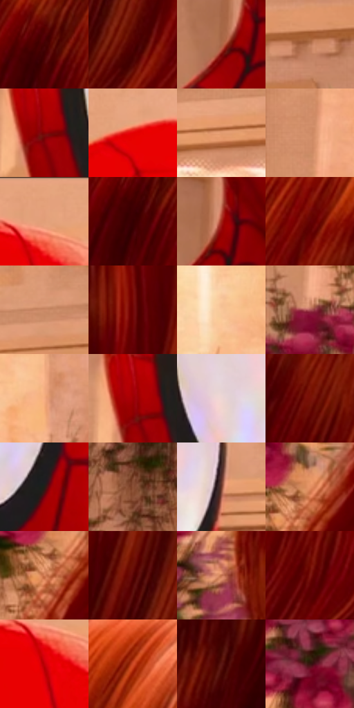

# 电影参考 605

- 状态：常规／活跃；来源世界：miles-home。
- 视角：near-level；景别：close-up；场景：interior。
- 时段：interior-time-unknown（外观依据，中置信度；具体时间／晨昏未知）；光照：interior-mixed。
- 材质候选：skin, hair, fabric, stone, wood, metal, glass, ceramic（帧级，不是像素分割）。
- 明暗组：middle；L* P5/P50/P95：9.36936 / 40.51859 / 82.42767。
- 资格门禁：无附加门禁。
- 原截图 SHA-256：`d04cc972860bc8ad3307d55b0cffb5c825392918935a4bd5df57189570e81dc5`；尺寸：2880 × 1206。
- sRGB 像素 SHA-256：`88ca23bca099d11fc19773b7c1fa62cd1bdfeaf6c446a3b98f9d0911a80f6880`。

## 观察与迁移

暖厅石柱、金属餐罩和餐具各有高光响应，白布不发塑料亮。

红面罩大色面、黑色服装网纹、白眼片与黑领结各有职责，眼片带浅色映光；右侧前景红发用宽暖亮带及暗束表达丝滑反射。紫红花团和暗绿枝叶是背景点缀，网纹不等于排线，不能把所有红物体同材质化。

本公开版保存32个128×128原像素色卡上下文；图集格子并非原场景相邻位置。原rect、图集tile和像素SHA见 `data/palette-crops.json`。上下文不足时不得批准替色，不能以小样推断完整构图。

## 实测色卡

颜色比例分母为保留采样像素，不是材料面积；全部 32 色参与全库匹配。表内四舍五入仅用于阅读，原精度在 JSON。

| ID | HEX | Lab | 原图 xy | 像素数 | 比例 | 明度角色 |
| --- | --- | --- | --- | ---: | ---: | --- |
| 605-S01 | #430102 | [10.702482, 30.292812, 16.023538] | [1940, 432] | 9743 | 5.039153% | deep-shadow |
| 605-S02 | #4F0103 | [13.774715, 33.983896, 20.29793] | [2652, 892] | 8425 | 4.357473% | deep-shadow |
| 605-S03 | #AA6746 | [50.32355, 23.584918, 29.844882] | [608, 792] | 8260 | 4.272134% | midtone |
| 605-S04 | #BD7C5A | [58.013118, 21.56498, 28.870813] | [1304, 276] | 7896 | 4.083870% | midtone |
| 605-S05 | #850203 | [26.84331, 49.087086, 38.454139] | [620, 468] | 7811 | 4.039908% | shadow |
| 605-S06 | #E50003 | [47.841705, 73.860543, 61.070162] | [744, 84] | 7684 | 3.974222% | midtone |
| 605-S07 | #E29B71 | [70.040682, 21.892066, 32.666842] | [2576, 76] | 7144 | 3.694930% | light |
| 605-S08 | #D4916D | [66.024156, 21.263232, 29.308426] | [36, 124] | 7067 | 3.655105% | light |
| 605-S09 | #E5A17B | [71.947771, 20.835227, 29.848966] | [912, 44] | 6786 | 3.509770% | light |
| 605-S10 | #350000 | [6.839155, 26.084422, 10.80712] | [1924, 472] | 6636 | 3.432189% | deep-shadow |
| 605-S11 | #9E2416 | [35.184814, 48.842439, 38.920631] | [636, 756] | 6542 | 3.383571% | shadow |
| 605-S12 | #620203 | [18.573067, 39.267171, 27.303763] | [2136, 372] | 6530 | 3.377365% | deep-shadow |
| 605-S13 | #CC8A69 | [63.373519, 21.441794, 27.862968] | [1380, 96] | 6512 | 3.368055% | light |
| 605-S14 | #700404 | [22.093698, 42.843225, 31.754638] | [2544, 628] | 6461 | 3.341678% | shadow |
| 605-S15 | #FAC699 | [83.450591, 12.683169, 29.614877] | [1672, 116] | 6179 | 3.195825% | highlight |
| 605-S16 | #9D3643 | [38.22336, 43.719071, 15.624776] | [44, 372] | 6168 | 3.190136% | shadow |
| 605-S17 | #F5AC81 | [76.3792, 21.910064, 32.787794] | [1748, 232] | 6073 | 3.141001% | light |
| 605-S18 | #9D0003 | [32.206647, 55.785076, 44.96708] | [608, 444] | 5980 | 3.092901% | shadow |
| 605-S19 | #EED6D3 | [87.472757, 7.803227, 4.509256] | [744, 460] | 5909 | 3.056179% | highlight |
| 605-S20 | #781106 | [24.978151, 42.310075, 34.440858] | [2216, 516] | 5860 | 3.030836% | shadow |
| 605-S21 | #241E17 | [11.726242, 1.473305, 5.878156] | [888, 572] | 5759 | 2.978598% | deep-shadow |
| 605-S22 | #925738 | [43.084597, 21.270389, 28.165118] | [44, 964] | 5397 | 2.791369% | midtone |
| 605-S23 | #6C382A | [29.873236, 21.547981, 18.945536] | [1116, 500] | 5278 | 2.729821% | shadow |
| 605-S24 | #E59165 | [67.911707, 27.402474, 36.443639] | [1740, 840] | 5044 | 2.608795% | light |
| 605-S25 | #D68058 | [62.034308, 29.432134, 35.692351] | [1708, 884] | 5009 | 2.590692% | light |
| 605-S26 | #590403 | [16.591846, 36.00898, 24.399402] | [2592, 804] | 4888 | 2.528110% | deep-shadow |
| 605-S27 | #C1714D | [55.772463, 28.164866, 33.35634] | [1732, 612] | 4735 | 2.448977% | midtone |
| 605-S28 | #7C1713 | [26.581144, 42.116457, 30.041646] | [2784, 896] | 4317 | 2.232785% | shadow |
| 605-S29 | #C30106 | [40.639481, 65.407093, 52.756978] | [896, 128] | 4196 | 2.170203% | midtone |
| 605-S30 | #CF4B27 | [50.035181, 50.485875, 47.518383] | [2224, 224] | 3990 | 2.063658% | midtone |
| 605-S31 | #5A1713 | [19.367018, 30.305705, 20.25233] | [2380, 936] | 3515 | 1.817984% | deep-shadow |
| 605-S32 | #36150F | [11.656926, 15.91033, 11.306914] | [1552, 796] | 1552 | 0.802706% | deep-shadow |

## 色阶与空间分布

- 采样 ROI：`[0.01, 0.02, 0.98, 0.94]`；步长：4；样本数：193346。
- 排除区：`[]`。
- 深暗、暗、中、亮、高光五段计数：`[44675, 51049, 41192, 44677, 11753]`。
- RGB 各 256 箱、L* 100 箱、13×5 色相明度表和 3×3 空间统计全部保存在 [总数据](../film-library.json)。
- [可视化档案](../../references/library.html)按需绘制直方图，不存 2,094 张重复图表图片。

## 纹理特征占比

**这是分块图像特征的面积占比，不是波点／排线／丝网／错版的精确语义覆盖率。** 窗格、发丝、织物也会产生方向或周期特征。
原图 ROI 像素 3098546；已测块覆盖 3098546（100.0000%）；未测 0。

| 特征 | 块覆盖像素 | 占已测面积 | 阈值敏感范围 |
| --- | ---: | ---: | --- |
| low-contrast | 129074 | 4.1656% | 2.1151% ~ 6.6318% |
| directional-structure | 1482112 | 47.8325% | 35.8486% ~ 57.0776% |
| periodic-structure | 1443712 | 46.5932% | 40.8073% ~ 52.9384% |
| mixed-detail | 43648 | 1.4087% | 0.0000% ~ 4.5812% |

阈值敏感范围不是统计置信区间。逐块坐标、尺度、对比、方向一致性、频谱集中度、频率与角度见 [全量特征记录](../texture-features.jsonl)，以帧号定位。
四种印刷层的真实像素覆盖仍标为 `null`，不能填 0，也不能拿上表代替。不得据这些代理测量删除唯一证据。

[测量方法与保留策略](../../references/library-retention.md) · [分类索引](../archive/README.md)
