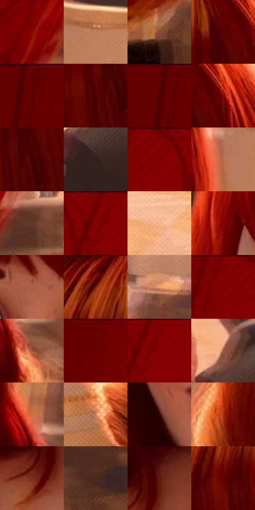

# 电影参考 606

- 状态：常规／活跃；来源世界：miles-home。
- 视角：near-level；景别：close-up；场景：interior。
- 时段：interior-time-unknown（外观依据，中置信度；具体时间／晨昏未知）；光照：interior-mixed。
- 材质候选：skin, hair, fabric, stone, wood, metal, glass, ceramic（帧级，不是像素分割）。
- 明暗组：dark；L* P5/P50/P95：9.98593 / 25.84686 / 71.14379。
- 资格门禁：无附加门禁。
- 原截图 SHA-256：`bb4e79771b6accb07720d1c02b8965c2e114a3e56b00231a4a70780cdba190d8`；尺寸：2880 × 1208。
- sRGB 像素 SHA-256：`c6d20e64e6745f295e0f601a4fbc22019a16bfad98774426e8d03bbf0e3ee1c7`。

## 观察与迁移

暖厅石柱、金属餐罩和餐具各有高光响应，白布不发塑料亮。

蓝眼位于桃色脸部中间调，铜橙发光过渡到暗红卷发；雀斑保持人物识别。左侧红色面罩阴影排线更明显，肤色亮面较净，椅背与远人低对比；纹理强度按对象和焦点分配，不整幅覆盖同一密度。

本公开版保存32个128×128原像素色卡上下文；图集格子并非原场景相邻位置。原rect、图集tile和像素SHA见 `data/palette-crops.json`。上下文不足时不得批准替色，不能以小样推断完整构图。

## 实测色卡

颜色比例分母为保留采样像素，不是材料面积；全部 32 色参与全库匹配。表内四舍五入仅用于阅读，原精度在 JSON。

| ID | HEX | Lab | 原图 xy | 像素数 | 比例 | 明度角色 |
| --- | --- | --- | --- | ---: | ---: | --- |
| 606-S01 | #8A0202 | [27.987889, 50.425957, 40.298024] | [908, 804] | 9756 | 5.045876% | shadow |
| 606-S02 | #BB7E5F | [58.334909, 20.103778, 26.451413] | [2560, 244] | 9258 | 4.788307% | midtone |
| 606-S03 | #854832 | [37.577066, 23.785919, 24.495231] | [856, 988] | 8355 | 4.321269% | shadow |
| 606-S04 | #590202 | [16.366918, 36.595099, 24.527628] | [2220, 104] | 7807 | 4.037839% | deep-shadow |
| 606-S05 | #640001 | [18.85328, 40.330481, 28.568924] | [208, 32] | 7688 | 3.976291% | deep-shadow |
| 606-S06 | #4F0201 | [13.876054, 33.545439, 21.245984] | [2184, 228] | 7265 | 3.757512% | deep-shadow |
| 606-S07 | #600002 | [17.882423, 39.224014, 26.771951] | [180, 28] | 7134 | 3.689758% | deep-shadow |
| 606-S08 | #740202 | [22.868617, 44.375862, 33.670335] | [2280, 96] | 6850 | 3.542871% | shadow |
| 606-S09 | #3E0001 | [9.211633, 29.191254, 14.137432] | [2224, 204] | 6747 | 3.489599% | deep-shadow |
| 606-S10 | #31201B | [14.203692, 7.412064, 6.682627] | [1480, 216] | 6705 | 3.467876% | deep-shadow |
| 606-S11 | #810101 | [25.840351, 48.146008, 38.017211] | [548, 28] | 6610 | 3.418742% | shadow |
| 606-S12 | #B66D4D | [53.406844, 25.828078, 30.100841] | [2444, 288] | 6263 | 3.239271% | midtone |
| 606-S13 | #64392A | [28.910984, 17.359778, 17.471378] | [1044, 792] | 6208 | 3.210824% | shadow |
| 606-S14 | #6D0001 | [21.035551, 42.853072, 31.626595] | [644, 40] | 6206 | 3.209790% | shadow |
| 606-S15 | #F5B992 | [79.721477, 16.789866, 28.214253] | [2564, 980] | 6170 | 3.191170% | light |
| 606-S16 | #850402 | [26.959844, 48.714928, 38.964103] | [1660, 296] | 6157 | 3.184447% | shadow |
| 606-S17 | #AC6145 | [49.193896, 27.669031, 29.066521] | [1904, 400] | 6077 | 3.143070% | midtone |
| 606-S18 | #460101 | [11.459043, 31.176373, 17.598971] | [2032, 56] | 5990 | 3.098073% | deep-shadow |
| 606-S19 | #EAA073 | [72.145367, 22.609364, 34.4883] | [2792, 440] | 5773 | 2.985839% | light |
| 606-S20 | #7D0101 | [24.90647, 47.054118, 36.806606] | [496, 28] | 5729 | 2.963082% | shadow |
| 606-S21 | #A44F36 | [43.876641, 33.096709, 30.883083] | [2496, 760] | 5722 | 2.959461% | midtone |
| 606-S22 | #680101 | [19.915027, 41.201894, 30.043745] | [320, 40] | 5466 | 2.827056% | deep-shadow |
| 606-S23 | #790001 | [23.896606, 46.16071, 35.500967] | [676, 28] | 5408 | 2.797058% | shadow |
| 606-S24 | #975842 | [44.166519, 23.675525, 23.850916] | [1464, 112] | 5378 | 2.781542% | midtone |
| 606-S25 | #CD6E45 | [56.648307, 34.077018, 39.133934] | [2448, 664] | 5081 | 2.627931% | midtone |
| 606-S26 | #CF815C | [61.430832, 26.381974, 32.573981] | [1444, 912] | 4925 | 2.547247% | light |
| 606-S27 | #2E0200 | [5.640609, 21.459999, 8.866154] | [1768, 764] | 4590 | 2.373982% | deep-shadow |
| 606-S28 | #AD300F | [39.640138, 49.304274, 46.799961] | [1512, 664] | 4343 | 2.246232% | shadow |
| 606-S29 | #7C2D1B | [30.015674, 33.284455, 28.923218] | [1684, 1116] | 4292 | 2.219855% | shadow |
| 606-S30 | #4C2A20 | [21.196453, 14.588147, 13.294616] | [1060, 1008] | 4264 | 2.205373% | shadow |
| 606-S31 | #5E170B | [20.113399, 31.478995, 25.57367] | [1736, 1044] | 3361 | 1.738334% | shadow |
| 606-S32 | #650504 | [19.577005, 39.383369, 28.245739] | [2028, 192] | 1768 | 0.914423% | deep-shadow |

## 色阶与空间分布

- 采样 ROI：`[0.01, 0.02, 0.98, 0.94]`；步长：4；样本数：193346。
- 排除区：`[]`。
- 深暗、暗、中、亮、高光五段计数：`[62153, 73662, 40257, 15138, 2136]`。
- RGB 各 256 箱、L* 100 箱、13×5 色相明度表和 3×3 空间统计全部保存在 [总数据](../film-library.json)。
- [可视化档案](../../references/library.html)按需绘制直方图，不存 2,094 张重复图表图片。

## 纹理特征占比

**这是分块图像特征的面积占比，不是波点／排线／丝网／错版的精确语义覆盖率。** 窗格、发丝、织物也会产生方向或周期特征。
原图 ROI 像素 3104134；已测块覆盖 3104134（100.0000%）；未测 0。

| 特征 | 块覆盖像素 | 占已测面积 | 阈值敏感范围 |
| --- | ---: | ---: | --- |
| low-contrast | 1038720 | 33.4625% | 30.8234% ~ 34.5181% |
| directional-structure | 650112 | 20.9434% | 10.5562% ~ 30.2709% |
| periodic-structure | 1338630 | 43.1241% | 38.0192% ~ 51.3011% |
| mixed-detail | 76672 | 2.4700% | 0.8866% ~ 3.6246% |

阈值敏感范围不是统计置信区间。逐块坐标、尺度、对比、方向一致性、频谱集中度、频率与角度见 [全量特征记录](../texture-features.jsonl)，以帧号定位。
四种印刷层的真实像素覆盖仍标为 `null`，不能填 0，也不能拿上表代替。不得据这些代理测量删除唯一证据。

[测量方法与保留策略](../../references/library-retention.md) · [分类索引](../archive/README.md)
