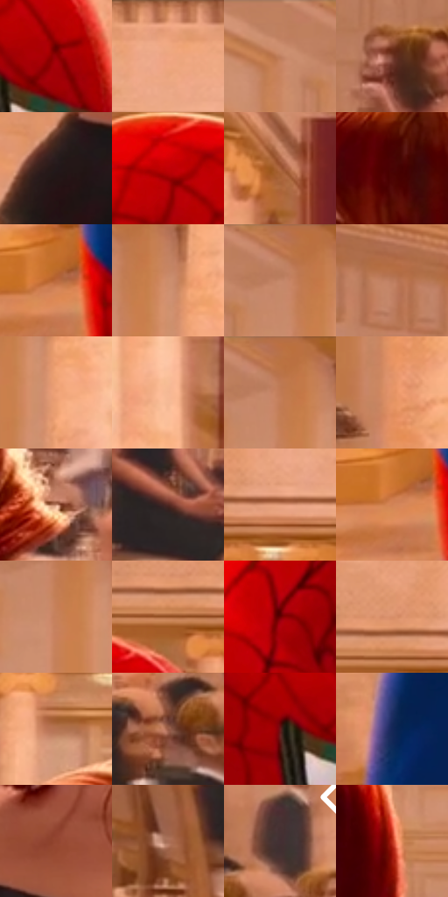

# 电影参考 607

- 状态：常规／活跃；来源世界：miles-home。
- 视角：near-level；景别：medium；场景：interior。
- 时段：interior-time-unknown（外观依据，中置信度；具体时间／晨昏未知）；光照：interior-mixed。
- 材质候选：skin, hair, fabric, stone, wood, metal, glass, ceramic（帧级，不是像素分割）。
- 明暗组：middle；L* P5/P50/P95：12.48484 / 53.80869 / 75.31057。
- 资格门禁：无附加门禁。
- 原截图 SHA-256：`4944a5d95d0a48ef3fb78f9b8cd7f6d8308bc5cbc6c04ef6834db2331a24fb18`；尺寸：2880 × 1208。
- sRGB 像素 SHA-256：`904be32c05686c06b1d8f09c41f09161724643694ca80ac130fba67008aacd87`。

## 观察与迁移

暖厅石柱、金属餐罩和餐具各有高光响应，白布不发塑料亮。

红蓝衣服与黑裙分别提供高色彩和深暗锚点，暖白柱列背景、铜色发缘构成分离。背景桌椅、人脸概括成较软的组块；与604可比同类材料，但姿态、机位和取景有变化，不当严格同曝光实验。

本公开版保存32个128×128原像素色卡上下文；图集格子并非原场景相邻位置。原rect、图集tile和像素SHA见 `data/palette-crops.json`。上下文不足时不得批准替色，不能以小样推断完整构图。

## 实测色卡

颜色比例分母为保留采样像素，不是材料面积；全部 32 色参与全库匹配。表内四舍五入仅用于阅读，原精度在 JSON。

| ID | HEX | Lab | 原图 xy | 像素数 | 比例 | 明度角色 |
| --- | --- | --- | --- | ---: | ---: | --- |
| 607-S01 | #930104 | [29.999211, 53.025766, 41.952178] | [1248, 332] | 9379 | 4.850889% | shadow |
| 607-S02 | #EFA882 | [74.806989, 21.759833, 30.069057] | [1628, 52] | 9377 | 4.849855% | light |
| 607-S03 | #C28262 | [60.175846, 21.066961, 27.337924] | [216, 44] | 9113 | 4.713312% | light |
| 607-S04 | #773C2C | [32.561124, 24.173701, 21.441683] | [1600, 712] | 8332 | 4.309373% | shadow |
| 607-S05 | #221919 | [9.841674, 4.480023, 1.708631] | [1900, 972] | 8202 | 4.242136% | deep-shadow |
| 607-S06 | #C10004 | [40.163824, 64.988929, 52.99902] | [1104, 236] | 7106 | 3.675276% | midtone |
| 607-S07 | #A8613C | [48.514336, 25.340604, 33.164185] | [916, 72] | 7044 | 3.643210% | midtone |
| 607-S08 | #480204 | [12.158259, 31.498816, 17.416781] | [2120, 440] | 6794 | 3.513908% | deep-shadow |
| 607-S09 | #BB693D | [52.957906, 28.954893, 38.47321] | [536, 1076] | 6709 | 3.469945% | midtone |
| 607-S10 | #CD8D6B | [64.236335, 20.40715, 27.913836] | [384, 92] | 6643 | 3.435809% | light |
| 607-S11 | #C17950 | [57.649808, 24.030291, 34.024553] | [312, 28] | 6613 | 3.420293% | midtone |
| 607-S12 | #BB7B5C | [57.564978, 21.477064, 27.128794] | [124, 428] | 6394 | 3.307025% | midtone |
| 607-S13 | #EDA176 | [72.764164, 23.543014, 33.757918] | [408, 160] | 6378 | 3.298749% | light |
| 607-S14 | #F4B894 | [79.417512, 17.147943, 26.727994] | [576, 120] | 6243 | 3.228926% | light |
| 607-S15 | #BA734A | [55.275263, 23.952586, 34.183448] | [332, 44] | 6237 | 3.225823% | midtone |
| 607-S16 | #E39366 | [68.139486, 25.616802, 36.145391] | [404, 612] | 5989 | 3.097556% | light |
| 607-S17 | #C58B70 | [62.934012, 18.777776, 23.256481] | [2468, 752] | 5743 | 2.970323% | light |
| 607-S18 | #532822 | [21.844934, 19.28619, 13.011513] | [1692, 936] | 5727 | 2.962047% | shadow |
| 607-S19 | #DE9A77 | [69.452454, 21.40118, 28.578641] | [1348, 136] | 5533 | 2.861709% | light |
| 607-S20 | #D28255 | [61.934644, 26.516765, 37.066584] | [516, 1092] | 5488 | 2.838435% | light |
| 607-S21 | #C6805B | [60.071031, 23.166676, 31.1685] | [332, 124] | 5251 | 2.715857% | light |
| 607-S22 | #9B572C | [44.187966, 24.375135, 36.39503] | [1240, 160] | 5231 | 2.705512% | midtone |
| 607-S23 | #6B0103 | [20.654732, 42.09812, 30.256315] | [916, 620] | 5196 | 2.687410% | shadow |
| 607-S24 | #D68E68 | [65.471245, 23.229005, 31.359424] | [1256, 112] | 5184 | 2.681204% | light |
| 607-S25 | #B57352 | [54.758601, 22.51399, 28.978075] | [2092, 252] | 5183 | 2.680686% | midtone |
| 607-S26 | #965A46 | [44.575345, 22.479536, 21.991955] | [2692, 728] | 5024 | 2.598450% | midtone |
| 607-S27 | #6B1819 | [23.170004, 36.324898, 21.626215] | [1168, 360] | 4941 | 2.555522% | shadow |
| 607-S28 | #152657 | [16.667592, 12.165097, -31.76126] | [596, 940] | 4620 | 2.389499% | deep-shadow |
| 607-S29 | #94462F | [39.383088, 30.983238, 28.98172] | [2060, 880] | 4581 | 2.369328% | shadow |
| 607-S30 | #AA6E57 | [52.273044, 21.198976, 22.650054] | [2648, 1024] | 4043 | 2.091070% | midtone |
| 607-S31 | #432F33 | [21.819358, 9.864881, 1.055683] | [2788, 652] | 3421 | 1.769367% | shadow |
| 607-S32 | #B92D18 | [41.626899, 54.422107, 45.562736] | [2412, 504] | 1627 | 0.841497% | midtone |

## 色阶与空间分布

- 采样 ROI：`[0.01, 0.02, 0.98, 0.94]`；步长：4；样本数：193346。
- 排除区：`[]`。
- 深暗、暗、中、亮、高光五段计数：`[24142, 40670, 64882, 61514, 2138]`。
- RGB 各 256 箱、L* 100 箱、13×5 色相明度表和 3×3 空间统计全部保存在 [总数据](../film-library.json)。
- [可视化档案](../../references/library.html)按需绘制直方图，不存 2,094 张重复图表图片。

## 纹理特征占比

**这是分块图像特征的面积占比，不是波点／排线／丝网／错版的精确语义覆盖率。** 窗格、发丝、织物也会产生方向或周期特征。
原图 ROI 像素 3104134；已测块覆盖 3104134（100.0000%）；未测 0。

| 特征 | 块覆盖像素 | 占已测面积 | 阈值敏感范围 |
| --- | ---: | ---: | --- |
| low-contrast | 33408 | 1.0762% | 0.7175% ~ 2.1319% |
| directional-structure | 1097350 | 35.3512% | 24.5847% ~ 49.5321% |
| periodic-structure | 1940608 | 62.5169% | 49.7504% ~ 71.1722% |
| mixed-detail | 32768 | 1.0556% | 0.0000% ~ 2.1112% |

阈值敏感范围不是统计置信区间。逐块坐标、尺度、对比、方向一致性、频谱集中度、频率与角度见 [全量特征记录](../texture-features.jsonl)，以帧号定位。
四种印刷层的真实像素覆盖仍标为 `null`，不能填 0，也不能拿上表代替。不得据这些代理测量删除唯一证据。

[测量方法与保留策略](../../references/library-retention.md) · [分类索引](../archive/README.md)
