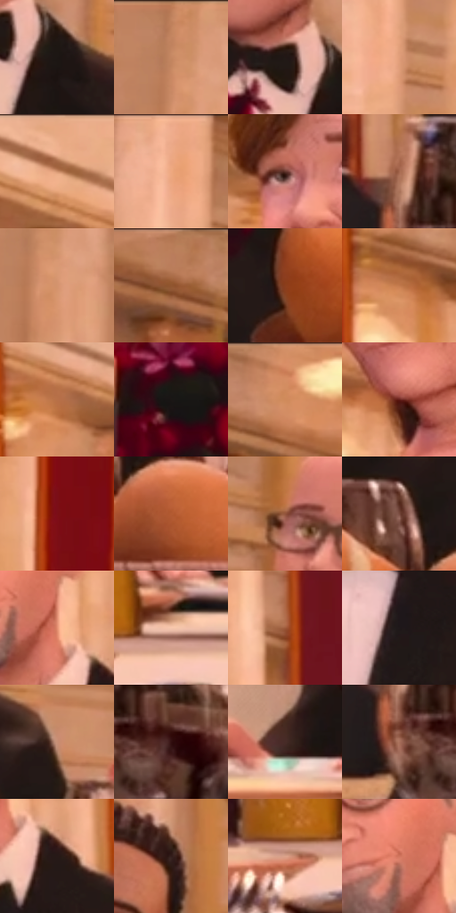

# 电影参考 608

- 状态：常规／活跃；来源世界：miles-home。
- 视角：low-angle；景别：medium；场景：interior。
- 时段：interior-time-unknown（外观依据，中置信度；具体时间／晨昏未知）；光照：interior-mixed。
- 材质候选：skin, hair, fabric, stone, wood, metal, glass, ceramic（帧级，不是像素分割）。
- 明暗组：middle；L* P5/P50/P95：7.85832 / 50.04167 / 77.26485。
- 资格门禁：无附加门禁。
- 原截图 SHA-256：`8a3587506d876bbbf590e666ecab4e37ea05fd7c930666451b7fb3db0202f1e9`；尺寸：2880 × 1206。
- sRGB 像素 SHA-256：`a3c5ff39893d0e4e74ea35cde800053b8a132e449f41f0a7b5ddb17212e9266e`。

## 观察与迁移

暖厅石柱、金属餐罩和餐具各有高光响应，白布不发塑料亮。

不同年龄、肤色与脸型共享暖厅光而不统一面部模板。酒杯用透明轮廓、亮边和深酒液分层，酒瓶暗红映光，金属花瓶偏金，面包哑光橙，篮筐是编织结构，瓷盘较硬亮、桌布较软；编织纹不能代替印刷排线。

本公开版保存32个128×128原像素色卡上下文；图集格子并非原场景相邻位置。原rect、图集tile和像素SHA见 `data/palette-crops.json`。上下文不足时不得批准替色，不能以小样推断完整构图。

## 实测色卡

颜色比例分母为保留采样像素，不是材料面积；全部 32 色参与全库匹配。表内四舍五入仅用于阅读，原精度在 JSON。

| ID | HEX | Lab | 原图 xy | 像素数 | 比例 | 明度角色 |
| --- | --- | --- | --- | ---: | ---: | --- |
| 608-S01 | #1C1614 | [7.869757, 2.581293, 2.371756] | [1200, 604] | 9321 | 4.820891% | deep-shadow |
| 608-S02 | #C48560 | [61.096261, 20.049604, 29.681883] | [324, 40] | 9290 | 4.804858% | light |
| 608-S03 | #221715 | [9.050222, 5.17256, 3.508402] | [1136, 568] | 8503 | 4.397815% | deep-shadow |
| 608-S04 | #E19E7A | [70.781051, 20.749724, 28.768844] | [616, 268] | 8323 | 4.304718% | light |
| 608-S05 | #F0B290 | [77.50942, 18.320508, 26.215281] | [1836, 44] | 8207 | 4.244722% | light |
| 608-S06 | #ECA884 | [74.513384, 20.781293, 28.550471] | [580, 48] | 7495 | 3.876470% | light |
| 608-S07 | #62372E | [28.18614, 18.089612, 13.904656] | [2572, 356] | 7314 | 3.782856% | shadow |
| 608-S08 | #A3664C | [49.26841, 21.713702, 24.899545] | [1784, 764] | 6844 | 3.539768% | midtone |
| 608-S09 | #D4946E | [66.752808, 19.733847, 29.714003] | [348, 116] | 6775 | 3.504081% | light |
| 608-S10 | #BA7D5D | [57.941033, 20.050276, 27.034202] | [1112, 28] | 6679 | 3.454429% | midtone |
| 608-S11 | #8B3E1C | [36.022122, 30.583137, 35.412341] | [1072, 828] | 6551 | 3.388226% | shadow |
| 608-S12 | #C3794C | [57.848187, 24.560603, 36.486891] | [2288, 448] | 6196 | 3.204618% | midtone |
| 608-S13 | #B87048 | [54.290335, 24.620288, 34.0181] | [2292, 292] | 6128 | 3.169448% | midtone |
| 608-S14 | #1A1615 | [7.656229, 1.746158, 1.354572] | [828, 572] | 6127 | 3.168930% | deep-shadow |
| 608-S15 | #D68862 | [63.990276, 25.940202, 32.72602] | [1252, 28] | 6101 | 3.155483% | light |
| 608-S16 | #621D17 | [22.081389, 30.780958, 21.189817] | [2624, 516] | 5782 | 2.990494% | shadow |
| 608-S17 | #7B0E16 | [25.516079, 44.394426, 27.100308] | [756, 112] | 5673 | 2.934118% | shadow |
| 608-S18 | #B35B31 | [48.62377, 32.519625, 39.624332] | [1340, 848] | 5395 | 2.790334% | midtone |
| 608-S19 | #90533B | [41.896297, 22.942059, 24.890133] | [1028, 368] | 5356 | 2.770163% | midtone |
| 608-S20 | #7A4B40 | [37.005402, 18.598482, 14.916448] | [1256, 748] | 5350 | 2.767060% | shadow |
| 608-S21 | #E48F71 | [67.527648, 29.087581, 29.448982] | [2036, 464] | 5270 | 2.725683% | light |
| 608-S22 | #F6C5AC | [83.182267, 13.951326, 19.172958] | [960, 1076] | 5258 | 2.719477% | highlight |
| 608-S23 | #9E5A3B | [45.49566, 24.946016, 29.769648] | [1636, 208] | 5198 | 2.688445% | midtone |
| 608-S24 | #1F191A | [9.491011, 3.193141, 0.403212] | [2040, 688] | 5186 | 2.682238% | deep-shadow |
| 608-S25 | #C88F75 | [64.331464, 18.345124, 22.412113] | [1336, 664] | 5076 | 2.625345% | light |
| 608-S26 | #310D0F | [8.785591, 18.495159, 7.119455] | [1884, 852] | 4747 | 2.455184% | deep-shadow |
| 608-S27 | #472B27 | [20.881785, 12.426253, 8.002807] | [1748, 1008] | 4672 | 2.416393% | shadow |
| 608-S28 | #A9705C | [52.727597, 20.180358, 20.348145] | [1788, 856] | 4470 | 2.311917% | midtone |
| 608-S29 | #271917 | [10.472535, 6.652893, 4.192375] | [2092, 528] | 4354 | 2.251921% | deep-shadow |
| 608-S30 | #331E1B | [13.894757, 9.8096, 6.302496] | [396, 380] | 4250 | 2.198132% | deep-shadow |
| 608-S31 | #DBA38A | [71.617511, 17.442928, 21.088919] | [860, 1104] | 4010 | 2.074002% | light |
| 608-S32 | #D2755D | [59.175621, 34.068094, 29.229333] | [1988, 432] | 3445 | 1.781780% | midtone |

## 色阶与空间分布

- 采样 ROI：`[0.01, 0.02, 0.98, 0.94]`；步长：4；样本数：193346。
- 排除区：`[]`。
- 深暗、暗、中、亮、高光五段计数：`[45801, 30762, 50942, 60666, 5175]`。
- RGB 各 256 箱、L* 100 箱、13×5 色相明度表和 3×3 空间统计全部保存在 [总数据](../film-library.json)。
- [可视化档案](../../references/library.html)按需绘制直方图，不存 2,094 张重复图表图片。

## 纹理特征占比

**这是分块图像特征的面积占比，不是波点／排线／丝网／错版的精确语义覆盖率。** 窗格、发丝、织物也会产生方向或周期特征。
原图 ROI 像素 3098546；已测块覆盖 3098546（100.0000%）；未测 0。

| 特征 | 块覆盖像素 | 占已测面积 | 阈值敏感范围 |
| --- | ---: | ---: | --- |
| low-contrast | 115250 | 3.7195% | 3.7195% ~ 3.7195% |
| directional-structure | 922368 | 29.7678% | 19.1966% ~ 40.0745% |
| periodic-structure | 2044544 | 65.9840% | 56.2060% ~ 74.4401% |
| mixed-detail | 16384 | 0.5288% | 0.0000% ~ 2.6438% |

阈值敏感范围不是统计置信区间。逐块坐标、尺度、对比、方向一致性、频谱集中度、频率与角度见 [全量特征记录](../texture-features.jsonl)，以帧号定位。
四种印刷层的真实像素覆盖仍标为 `null`，不能填 0，也不能拿上表代替。不得据这些代理测量删除唯一证据。

[测量方法与保留策略](../../references/library-retention.md) · [分类索引](../archive/README.md)
