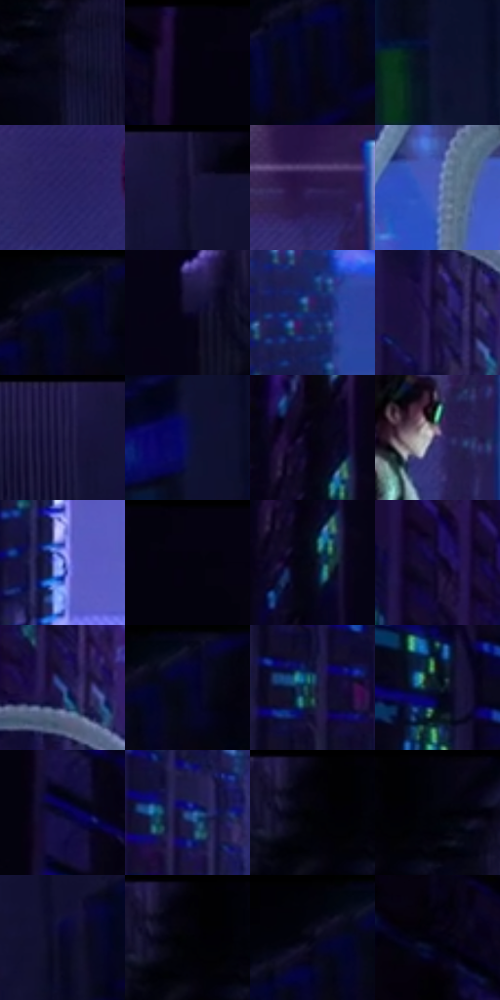

# 电影参考 609

- 状态：常规／活跃；来源世界：miles-home。
- 视角：near-level；景别：environment-wide；场景：industrial。
- 时段：interior-time-unknown（外观依据，中置信度；具体时间／晨昏未知）；光照：cool-interior。
- 材质候选：skin, hair, fabric, plastic, metal, screen（帧级，不是像素分割）。
- 明暗组：very-dark；L* P5/P50/P95：0.74999 / 5.66016 / 43.71957。
- 资格门禁：无附加门禁。
- 原截图 SHA-256：`f2488d7366e59924d2bb952977ff60a9ad94537a227dc49e322789dd0ada6fbf`；尺寸：2880 × 1210。
- sRGB 像素 SHA-256：`8fa9a0c1965a6338712301415fffdac48da22a40eca9dc6dad9d33c3ba156d39`。

## 观察与迁移

冷机房、软管与黑壳，细指示灯不变成全屏色块。

深蓝紫机柜占大暗区，青绿指示灯成小组，近人物青色屏幕形成局部亮源；浅灰青分节管与黑亮衣甲分开。地面有局部倒映，机柜格栅、电线、管道环节均为实体，不是城市窗灯或速度线。

本公开版保存32个128×128原像素色卡上下文；图集格子并非原场景相邻位置。原rect、图集tile和像素SHA见 `data/palette-crops.json`。上下文不足时不得批准替色，不能以小样推断完整构图。

## 实测色卡

颜色比例分母为保留采样像素，不是材料面积；全部 32 色参与全库匹配。表内四舍五入仅用于阅读，原精度在 JSON。

| ID | HEX | Lab | 原图 xy | 像素数 | 比例 | 明度角色 |
| --- | --- | --- | --- | ---: | ---: | --- |
| 609-S01 | #09081C | [2.850401, 4.468507, -11.222616] | [2264, 136] | 11844 | 6.103770% | deep-shadow |
| 609-S02 | #03020D | [0.829452, 1.827075, -4.168781] | [232, 28] | 10598 | 5.461648% | deep-shadow |
| 609-S03 | #050618 | [2.063458, 3.088389, -9.209325] | [2708, 152] | 10546 | 5.434850% | deep-shadow |
| 609-S04 | #0D1231 | [6.6829, 9.417802, -21.287006] | [2488, 836] | 9303 | 4.794273% | deep-shadow |
| 609-S05 | #2C2667 | [19.641548, 22.8476, -37.453588] | [1344, 340] | 9128 | 4.704088% | deep-shadow |
| 609-S06 | #161233 | [7.606913, 12.848994, -21.231972] | [2528, 44] | 8455 | 4.357259% | deep-shadow |
| 609-S07 | #2C1C4F | [15.117583, 21.476036, -28.756225] | [1544, 168] | 8313 | 4.284080% | deep-shadow |
| 609-S08 | #4E62B2 | [43.607042, 16.491565, -44.988811] | [1364, 556] | 8262 | 4.257797% | midtone |
| 609-S09 | #0C0D24 | [4.456306, 5.937746, -15.024329] | [2780, 44] | 7261 | 3.741935% | deep-shadow |
| 609-S10 | #0D0928 | [3.921126, 9.582689, -18.916603] | [2008, 88] | 6963 | 3.588361% | deep-shadow |
| 609-S11 | #19296B | [19.447823, 18.872483, -40.435207] | [1148, 880] | 6343 | 3.268846% | deep-shadow |
| 609-S12 | #1F1646 | [11.325723, 19.260245, -28.747608] | [908, 380] | 6168 | 3.178661% | deep-shadow |
| 609-S13 | #191440 | [9.617353, 17.083219, -27.327329] | [2448, 32] | 6072 | 3.129187% | deep-shadow |
| 609-S14 | #0B114D | [9.054911, 22.183531, -37.397255] | [2480, 588] | 5914 | 3.047762% | deep-shadow |
| 609-S15 | #050413 | [1.500377, 2.688403, -6.513012] | [1876, 108] | 5904 | 3.042609% | deep-shadow |
| 609-S16 | #3D3067 | [23.950708, 20.354664, -30.429927] | [1540, 408] | 5847 | 3.013234% | shadow |
| 609-S17 | #7688DD | [58.675451, 15.969115, -45.48485] | [960, 976] | 5435 | 2.800911% | midtone |
| 609-S18 | #050211 | [1.049113, 3.07417, -5.955217] | [288, 28] | 5365 | 2.764837% | deep-shadow |
| 609-S19 | #030515 | [1.644175, 2.216955, -7.641444] | [1888, 180] | 5172 | 2.665375% | deep-shadow |
| 609-S20 | #130B33 | [5.570944, 16.052619, -24.517135] | [764, 184] | 5164 | 2.661252% | deep-shadow |
| 609-S21 | #425094 | [36.047444, 15.254539, -39.239641] | [920, 264] | 5097 | 2.626724% | shadow |
| 609-S22 | #040622 | [2.452496, 5.970436, -16.594993] | [2808, 64] | 4874 | 2.511801% | deep-shadow |
| 609-S23 | #1A3046 | [19.121303, -0.963307, -16.356903] | [772, 812] | 4852 | 2.500464% | deep-shadow |
| 609-S24 | #0B1828 | [7.92673, 0.548999, -12.650134] | [480, 664] | 4679 | 2.411309% | deep-shadow |
| 609-S25 | #070732 | [3.859999, 13.637945, -26.567038] | [396, 364] | 4441 | 2.288656% | deep-shadow |
| 609-S26 | #274182 | [28.961122, 13.306413, -39.628164] | [908, 776] | 4175 | 2.151574% | shadow |
| 609-S27 | #020109 | [0.490777, 1.373832, -2.935217] | [2144, 28] | 4156 | 2.141782% | deep-shadow |
| 609-S28 | #03040F | [1.270646, 1.370548, -4.533999] | [2216, 28] | 3530 | 1.819175% | deep-shadow |
| 609-S29 | #070627 | [2.907234, 8.721196, -19.760775] | [2544, 216] | 3417 | 1.760941% | deep-shadow |
| 609-S30 | #010106 | [0.373108, 0.695202, -1.892085] | [2148, 32] | 2928 | 1.508936% | deep-shadow |
| 609-S31 | #02030A | [0.90272, 0.711755, -2.741004] | [2736, 28] | 2599 | 1.339387% | deep-shadow |
| 609-S32 | #020110 | [0.650477, 2.496059, -5.989483] | [120, 96] | 1239 | 0.638515% | deep-shadow |

## 色阶与空间分布

- 采样 ROI：`[0.01, 0.02, 0.98, 0.94]`；步长：4；样本数：194044。
- 排除区：`[]`。
- 深暗、暗、中、亮、高光五段计数：`[158454, 21952, 11941, 1433, 264]`。
- RGB 各 256 箱、L* 100 箱、13×5 色相明度表和 3×3 空间统计全部保存在 [总数据](../film-library.json)。
- [可视化档案](../../references/library.html)按需绘制直方图，不存 2,094 张重复图表图片。

## 纹理特征占比

**这是分块图像特征的面积占比，不是波点／排线／丝网／错版的精确语义覆盖率。** 窗格、发丝、织物也会产生方向或周期特征。
原图 ROI 像素 3109722；已测块覆盖 3109722（100.0000%）；未测 0。

| 特征 | 块覆盖像素 | 占已测面积 | 阈值敏感范围 |
| --- | ---: | ---: | --- |
| low-contrast | 228864 | 7.3596% | 3.8527% ~ 10.2697% |
| directional-structure | 363264 | 11.6816% | 4.9476% ~ 29.4591% |
| periodic-structure | 2401498 | 77.2255% | 65.7950% ~ 77.2255% |
| mixed-detail | 116096 | 3.7333% | 0.8932% ~ 7.7877% |

阈值敏感范围不是统计置信区间。逐块坐标、尺度、对比、方向一致性、频谱集中度、频率与角度见 [全量特征记录](../texture-features.jsonl)，以帧号定位。
四种印刷层的真实像素覆盖仍标为 `null`，不能填 0，也不能拿上表代替。不得据这些代理测量删除唯一证据。

[测量方法与保留策略](../../references/library-retention.md) · [分类索引](../archive/README.md)
