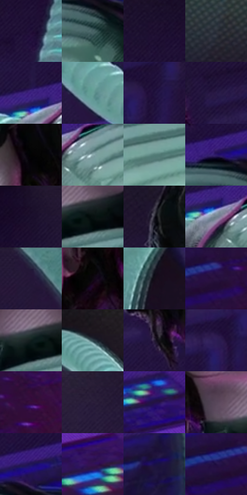

# 电影参考 610

- 状态：常规／活跃；来源世界：miles-home。
- 视角：low-angle；景别：medium；场景：industrial。
- 时段：interior-time-unknown（外观依据，中置信度；具体时间／晨昏未知）；光照：cool-interior。
- 材质候选：skin, hair, fabric, plastic, metal, screen（帧级，不是像素分割）。
- 明暗组：very-dark；L* P5/P50/P95：2.25411 / 12.58618 / 61.96805。
- 资格门禁：无附加门禁。
- 原截图 SHA-256：`be07b5079b3a4f31cb47ddddf5dce62caa347b68bf7a886d600fc32e9bfe843f`；尺寸：2878 × 1206。
- sRGB 像素 SHA-256：`bfb9ed5a508410ee82df2f40ad8822e45c08b3c99bd01b67f9f4712b9b93a653`。

## 观察与迁移

冷机房、软管与黑壳，细指示灯不变成全屏色块。

绿镜片可见眼睛，须分透色与映光；灰粉面部有定向排线，黑卷发与黑亮甲片各用不同高光组织。浅青胸板与分节管表现较柔亮的材质，紫色背景衬绿青局部；不凭外观断定材料配方，管肋不是动作符号。

本公开版保存32个128×128原像素色卡上下文；图集格子并非原场景相邻位置。原rect、图集tile和像素SHA见 `data/palette-crops.json`。上下文不足时不得批准替色，不能以小样推断完整构图。

## 实测色卡

颜色比例分母为保留采样像素，不是材料面积；全部 32 色参与全库匹配。表内四舍五入仅用于阅读，原精度在 JSON。

| ID | HEX | Lab | 原图 xy | 像素数 | 比例 | 明度角色 |
| --- | --- | --- | --- | ---: | ---: | --- |
| 610-S01 | #221239 | [9.546049, 18.411241, -22.39058] | [2104, 216] | 14547 | 7.523817% | deep-shadow |
| 610-S02 | #496366 | [40.0796, -8.814541, -4.833469] | [1816, 760] | 9248 | 4.783135% | midtone |
| 610-S03 | #1F1232 | [8.603777, 15.243925, -18.842755] | [2064, 136] | 8859 | 4.581941% | deep-shadow |
| 610-S04 | #2B2F39 | [19.399516, 0.932982, -6.933815] | [1108, 116] | 8567 | 4.430917% | deep-shadow |
| 610-S05 | #3B207F | [21.92532, 37.254637, -49.097695] | [1188, 772] | 8413 | 4.351267% | shadow |
| 610-S06 | #669F96 | [61.500052, -20.766214, -1.222414] | [852, 780] | 8262 | 4.273168% | light |
| 610-S07 | #21133E | [10.082791, 19.079933, -25.109958] | [2452, 268] | 8015 | 4.145418% | deep-shadow |
| 610-S08 | #291A47 | [13.6211, 19.433044, -25.679626] | [1816, 328] | 7501 | 3.879573% | deep-shadow |
| 610-S09 | #020303 | [0.764212, -0.261552, -0.09204] | [1624, 296] | 7149 | 3.697516% | deep-shadow |
| 610-S10 | #8BA9AD | [67.187642, -9.376306, -5.478493] | [1292, 840] | 7087 | 3.665450% | light |
| 610-S11 | #537D78 | [49.3277, -15.717865, -1.918348] | [1472, 844] | 7010 | 3.625625% | midtone |
| 610-S12 | #2D1969 | [16.858203, 31.97761, -43.297569] | [1748, 672] | 6967 | 3.603385% | deep-shadow |
| 610-S13 | #1B0F2A | [6.700742, 13.176619, -15.97227] | [2448, 28] | 6596 | 3.411501% | deep-shadow |
| 610-S14 | #071010 | [4.093194, -2.633863, -0.927366] | [1528, 680] | 6472 | 3.347367% | deep-shadow |
| 610-S15 | #201E29 | [11.928997, 3.909492, -7.050398] | [1128, 292] | 6438 | 3.329782% | deep-shadow |
| 610-S16 | #72818E | [53.200729, -2.525902, -8.84119] | [1212, 820] | 6321 | 3.269269% | midtone |
| 610-S17 | #231737 | [10.891888, 14.561024, -18.791704] | [2728, 48] | 6199 | 3.206169% | deep-shadow |
| 610-S18 | #0C070D | [2.341187, 2.207216, -1.897568] | [1664, 484] | 6082 | 3.145656% | deep-shadow |
| 610-S19 | #140D18 | [4.539253, 4.899685, -5.467873] | [272, 336] | 5677 | 2.936187% | deep-shadow |
| 610-S20 | #281340 | [11.184203, 21.621807, -24.704683] | [2512, 740] | 5436 | 2.811540% | deep-shadow |
| 610-S21 | #0F1D1C | [9.514222, -6.359153, -1.236959] | [1476, 680] | 5014 | 2.593278% | deep-shadow |
| 610-S22 | #2E4349 | [26.95007, -6.472701, -6.269453] | [460, 164] | 4872 | 2.519835% | shadow |
| 610-S23 | #271D36 | [13.08566, 11.315285, -14.580224] | [1188, 624] | 4823 | 2.494492% | deep-shadow |
| 610-S24 | #2D1D55 | [15.964615, 23.008076, -31.455225] | [2348, 336] | 4571 | 2.364155% | deep-shadow |
| 610-S25 | #360D3A | [11.808551, 27.408426, -19.306102] | [2700, 820] | 4539 | 2.347605% | deep-shadow |
| 610-S26 | #2C1F3C | [14.633426, 13.498648, -16.361277] | [928, 364] | 3697 | 1.912116% | deep-shadow |
| 610-S27 | #231346 | [11.029679, 22.243278, -29.206893] | [2560, 536] | 3631 | 1.877980% | deep-shadow |
| 610-S28 | #58475A | [32.523447, 11.085379, -8.502831] | [1396, 632] | 3408 | 1.762643% | shadow |
| 610-S29 | #211656 | [13.039077, 25.353885, -36.949694] | [1848, 644] | 3284 | 1.698509% | deep-shadow |
| 610-S30 | #331154 | [14.086239, 31.184923, -33.788575] | [2680, 660] | 2781 | 1.438354% | deep-shadow |
| 610-S31 | #180F4A | [9.239582, 24.063967, -34.974502] | [112, 1108] | 1098 | 0.567894% | deep-shadow |
| 610-S32 | #1F0D42 | [8.759491, 23.832502, -30.111489] | [2448, 744] | 782 | 0.404456% | deep-shadow |

## 色阶与空间分布

- 采样 ROI：`[0.01, 0.02, 0.98, 0.94]`；步长：4；样本数：193346。
- 排除区：`[]`。
- 深暗、暗、中、亮、高光五段计数：`[136438, 23306, 20532, 12808, 262]`。
- RGB 各 256 箱、L* 100 箱、13×5 色相明度表和 3×3 空间统计全部保存在 [总数据](../film-library.json)。
- [可视化档案](../../references/library.html)按需绘制直方图，不存 2,094 张重复图表图片。

## 纹理特征占比

**这是分块图像特征的面积占比，不是波点／排线／丝网／错版的精确语义覆盖率。** 窗格、发丝、织物也会产生方向或周期特征。
原图 ROI 像素 3096328；已测块覆盖 3096328（100.0000%）；未测 0。

| 特征 | 块覆盖像素 | 占已测面积 | 阈值敏感范围 |
| --- | ---: | ---: | --- |
| low-contrast | 348800 | 11.2650% | 7.1310% ~ 14.2621% |
| directional-structure | 1163272 | 37.5694% | 13.6877% ~ 53.8695% |
| periodic-structure | 1491456 | 48.1685% | 37.1599% ~ 65.9775% |
| mixed-detail | 92800 | 2.9971% | 1.8396% ~ 6.0727% |

阈值敏感范围不是统计置信区间。逐块坐标、尺度、对比、方向一致性、频谱集中度、频率与角度见 [全量特征记录](../texture-features.jsonl)，以帧号定位。
四种印刷层的真实像素覆盖仍标为 `null`，不能填 0，也不能拿上表代替。不得据这些代理测量删除唯一证据。

[测量方法与保留策略](../../references/library-retention.md) · [分类索引](../archive/README.md)
