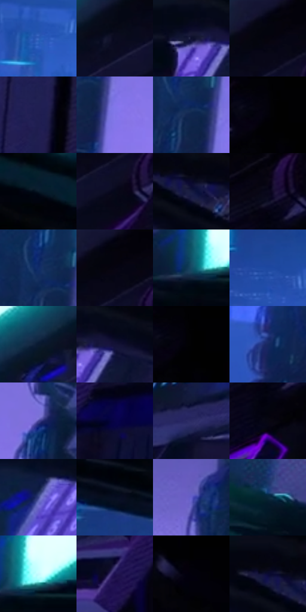

# 电影参考 611

- 状态：常规／活跃；来源世界：miles-home。
- 视角：near-level；景别：detail；场景：industrial。
- 时段：interior-time-unknown（外观依据，中置信度；具体时间／晨昏未知）；光照：cool-interior。
- 材质候选：skin, hair, fabric, plastic, metal, screen（帧级，不是像素分割）。
- 明暗组：very-dark；L* P5/P50/P95：0.47099 / 9.26626 / 55.32415。
- 资格门禁：无附加门禁。
- 原截图 SHA-256：`9b7f94d2f0dc9cf2c3317204a123e2ae93f3203e7479c91ef29a7ba90f3c5f69`；尺寸：2880 × 1204。
- sRGB 像素 SHA-256：`ee77d4012550db35906af284891eec6ebefeebf6f0359ebcd6259d4db0365197`。

## 观察与迁移

冷机房、软管与黑壳，细指示灯不变成全屏色块。

黑手套仅靠少量青色受光建立体积，亮青屏幕与暗紫机架反差明显；键帽、线缆、格栅和绿指示灯是设备细节。屏幕显示／照明不能混称玻璃镜像，黑手不必完整白描边，平面印刷纹理保持低对比。

本公开版保存32个128×128原像素色卡上下文；图集格子并非原场景相邻位置。原rect、图集tile和像素SHA见 `data/palette-crops.json`。上下文不足时不得批准替色，不能以小样推断完整构图。

## 实测色卡

颜色比例分母为保留采样像素，不是材料面积；全部 32 色参与全库匹配。表内四舍五入仅用于阅读，原精度在 JSON。

| ID | HEX | Lab | 原图 xy | 像素数 | 比例 | 明度角色 |
| --- | --- | --- | --- | ---: | ---: | --- |
| 611-S01 | #3161BB | [42.44269, 15.300363, -52.192269] | [220, 536] | 9867 | 5.121777% | midtone |
| 611-S02 | #0B0C21 | [4.009339, 4.998247, -13.397244] | [1720, 136] | 9495 | 4.928678% | deep-shadow |
| 611-S03 | #0E0F2D | [5.640174, 9.500242, -19.977313] | [1228, 440] | 8932 | 4.636435% | deep-shadow |
| 611-S04 | #03030D | [1.02553, 1.426514, -3.882463] | [1812, 36] | 8509 | 4.416864% | deep-shadow |
| 611-S05 | #1F1E50 | [14.394049, 17.226217, -30.673573] | [2048, 440] | 8425 | 4.373261% | deep-shadow |
| 611-S06 | #8277E8 | [55.850747, 32.097917, -56.069104] | [632, 916] | 8299 | 4.307857% | midtone |
| 611-S07 | #0F264E | [15.68315, 7.311772, -27.283725] | [580, 868] | 8184 | 4.248162% | deep-shadow |
| 611-S08 | #020108 | [0.47099, 1.234789, -2.556793] | [2160, 28] | 7863 | 4.081537% | deep-shadow |
| 611-S09 | #030513 | [1.579837, 1.764843, -6.410971] | [40, 128] | 7861 | 4.080499% | deep-shadow |
| 611-S10 | #050819 | [2.49389, 2.556241, -9.368732] | [1836, 164] | 7445 | 3.864561% | deep-shadow |
| 611-S11 | #161B40 | [11.445478, 11.109087, -24.385461] | [1492, 424] | 6947 | 3.606059% | deep-shadow |
| 611-S12 | #06040F | [1.445572, 2.155046, -4.257584] | [2024, 32] | 6910 | 3.586853% | deep-shadow |
| 611-S13 | #102C69 | [19.76518, 14.730232, -38.63641] | [556, 824] | 6687 | 3.471098% | deep-shadow |
| 611-S14 | #03030A | [0.961028, 0.973255, -2.648866] | [1828, 32] | 6226 | 3.231801% | deep-shadow |
| 611-S15 | #164963 | [28.994664, -7.039762, -20.053947] | [1272, 244] | 5959 | 3.093206% | shadow |
| 611-S16 | #1E48A0 | [32.804808, 19.166827, -51.807138] | [96, 476] | 5943 | 3.084901% | shadow |
| 611-S17 | #0A1930 | [8.765166, 3.036323, -17.236519] | [1568, 172] | 5521 | 2.865849% | deep-shadow |
| 611-S18 | #131237 | [7.649065, 13.649604, -24.09344] | [1296, 440] | 5349 | 2.776567% | deep-shadow |
| 611-S19 | #010103 | [0.313747, 0.27807, -0.756814] | [2172, 28] | 5263 | 2.731926% | deep-shadow |
| 611-S20 | #162960 | [18.367524, 13.88872, -34.994772] | [392, 948] | 5175 | 2.686246% | deep-shadow |
| 611-S21 | #4A469A | [34.331365, 25.56439, -45.593108] | [896, 780] | 4992 | 2.591255% | shadow |
| 611-S22 | #080348 | [5.279208, 27.91233, -40.145064] | [1664, 888] | 4815 | 2.499377% | deep-shadow |
| 611-S23 | #2B2B63 | [20.603402, 17.744052, -33.285591] | [1224, 944] | 4699 | 2.439164% | shadow |
| 611-S24 | #070712 | [2.175028, 1.797504, -4.892212] | [2028, 164] | 4672 | 2.425148% | deep-shadow |
| 611-S25 | #374185 | [30.121885, 17.526529, -39.576125] | [1072, 544] | 4487 | 2.329118% | shadow |
| 611-S26 | #040D20 | [3.774785, 2.351266, -13.013308] | [120, 288] | 4457 | 2.313546% | deep-shadow |
| 611-S27 | #635ECA | [45.52571, 31.227688, -55.76491] | [884, 620] | 4418 | 2.293302% | midtone |
| 611-S28 | #08263A | [14.077104, -2.667676, -16.019429] | [688, 244] | 4163 | 2.160936% | deep-shadow |
| 611-S29 | #C7F9FE | [94.757967, -14.727786, -7.613282] | [1320, 228] | 3798 | 1.971471% | highlight |
| 611-S30 | #1D0F50 | [10.422908, 26.962966, -37.162029] | [1468, 992] | 3032 | 1.573855% | deep-shadow |
| 611-S31 | #010006 | [0.17703, 1.095762, -2.178403] | [2560, 44] | 2464 | 1.279017% | deep-shadow |
| 611-S32 | #0A0A33 | [4.701956, 13.774475, -25.948222] | [1456, 400] | 1791 | 0.929675% | deep-shadow |

## 色阶与空间分布

- 采样 ROI：`[0.01, 0.02, 0.98, 0.94]`；步长：4；样本数：192648。
- 排除区：`[]`。
- 深暗、暗、中、亮、高光五段计数：`[137517, 31451, 17809, 3014, 2857]`。
- RGB 各 256 箱、L* 100 箱、13×5 色相明度表和 3×3 空间统计全部保存在 [总数据](../film-library.json)。
- [可视化档案](../../references/library.html)按需绘制直方图，不存 2,094 张重复图表图片。

## 纹理特征占比

**这是分块图像特征的面积占比，不是波点／排线／丝网／错版的精确语义覆盖率。** 窗格、发丝、织物也会产生方向或周期特征。
原图 ROI 像素 3092958；已测块覆盖 3092958（100.0000%）；未测 0。

| 特征 | 块覆盖像素 | 占已测面积 | 阈值敏感范围 |
| --- | ---: | ---: | --- |
| low-contrast | 503646 | 16.2836% | 11.7934% ~ 19.9917% |
| directional-structure | 1071872 | 34.6552% | 12.3408% ~ 50.0171% |
| periodic-structure | 1354496 | 43.7929% | 36.2568% ~ 57.1021% |
| mixed-detail | 162944 | 5.2682% | 1.9326% ~ 10.5654% |

阈值敏感范围不是统计置信区间。逐块坐标、尺度、对比、方向一致性、频谱集中度、频率与角度见 [全量特征记录](../texture-features.jsonl)，以帧号定位。
四种印刷层的真实像素覆盖仍标为 `null`，不能填 0，也不能拿上表代替。不得据这些代理测量删除唯一证据。

[测量方法与保留策略](../../references/library-retention.md) · [分类索引](../archive/README.md)
