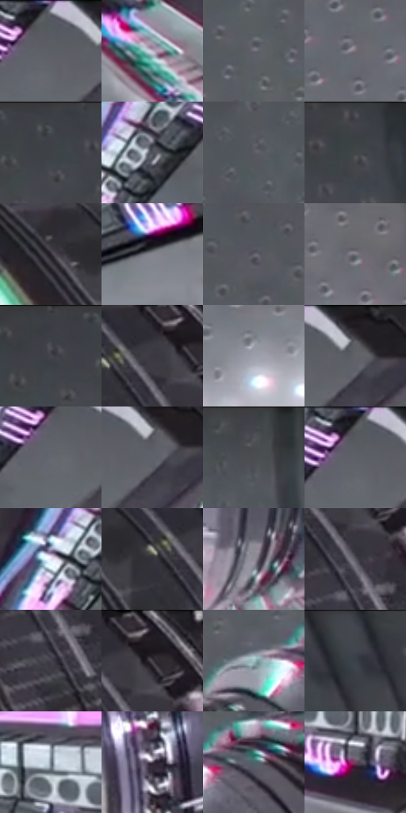

# 电影参考 612

- 状态：常规／活跃；来源世界：miles-home。
- 视角：low-angle；景别：environment-wide；场景：industrial。
- 时段：interior-time-unknown（外观依据，中置信度；具体时间／晨昏未知）；光照：cool-interior。
- 材质候选：metal, glass, screen, fabric（帧级，不是像素分割）。
- 明暗组：dark；L* P5/P50/P95：18.04627 / 39.16864 / 78.44349。
- 资格门禁：无附加门禁。
- 原截图 SHA-256：`43d635e3e965470528ad09f455fed5393676ab7875b00f449a553a77b9c08832`；尺寸：2880 × 1210。
- sRGB 像素 SHA-256：`106409cf106eb1334d66dbed77bb53280536bb18f45f6b2c5be4d3ce91a7c6c9`。

## 观察与迁移

大型机器和玻璃控制室，规则点阵须先辨实体灯阵。

灰金属圆筒由同心环的亮暗交替、窄亮边及暗缝表达，青粉线束、显示面与局部色边是不同层次。墙面凹点、发亮点阵和印刷网点必须分开；这是能量开启前的机械结构参照，不用全机荧光替代金属体积。

本公开版保存32个128×128原像素色卡上下文；图集格子并非原场景相邻位置。原rect、图集tile和像素SHA见 `data/palette-crops.json`。上下文不足时不得批准替色，不能以小样推断完整构图。

## 实测色卡

颜色比例分母为保留采样像素，不是材料面积；全部 32 色参与全库匹配。表内四舍五入仅用于阅读，原精度在 JSON。

| ID | HEX | Lab | 原图 xy | 像素数 | 比例 | 明度角色 |
| --- | --- | --- | --- | ---: | ---: | --- |
| 612-S01 | #54595F | [37.582144, -0.610095, -4.131107] | [2288, 28] | 9642 | 4.968976% | shadow |
| 612-S02 | #C2B8CC | [76.136722, 7.251588, -8.794116] | [2148, 1060] | 9293 | 4.789120% | light |
| 612-S03 | #686972 | [44.604945, 1.54707, -5.154187] | [1400, 372] | 8720 | 4.493826% | midtone |
| 612-S04 | #736C76 | [46.5492, 4.743963, -4.568941] | [832, 824] | 8398 | 4.327884% | midtone |
| 612-S05 | #464A4F | [31.263687, -0.461802, -3.530314] | [716, 32] | 8266 | 4.259859% | shadow |
| 612-S06 | #50545C | [35.632881, 0.246304, -5.190385] | [2148, 108] | 7948 | 4.095978% | shadow |
| 612-S07 | #5A5A63 | [38.527824, 1.981537, -5.15202] | [1284, 240] | 7462 | 3.845520% | shadow |
| 612-S08 | #404248 | [27.991572, 0.581445, -3.913576] | [976, 28] | 7410 | 3.818722% | shadow |
| 612-S09 | #2C2831 | [16.867962, 4.025559, -5.18007] | [2540, 72] | 7272 | 3.747604% | deep-shadow |
| 612-S10 | #84848D | [55.411696, 1.830407, -4.821318] | [2476, 444] | 7168 | 3.694008% | midtone |
| 612-S11 | #63626B | [41.921776, 2.324029, -4.939599] | [852, 380] | 6996 | 3.605368% | midtone |
| 612-S12 | #7B7780 | [50.644027, 3.343084, -4.368727] | [1140, 884] | 6952 | 3.582693% | midtone |
| 612-S13 | #4B4C53 | [32.456446, 1.187143, -4.270215] | [596, 52] | 6731 | 3.468801% | shadow |
| 612-S14 | #3D3842 | [24.366018, 4.469847, -5.388488] | [2700, 72] | 6602 | 3.402321% | shadow |
| 612-S15 | #9B9FAA | [65.48843, 0.778547, -6.195533] | [996, 1068] | 6474 | 3.336357% | light |
| 612-S16 | #5E5F66 | [40.448282, 1.130164, -4.113129] | [2364, 52] | 6425 | 3.311105% | midtone |
| 612-S17 | #63676E | [43.475988, -0.011268, -4.457647] | [2260, 92] | 6169 | 3.179176% | midtone |
| 612-S18 | #5E626A | [41.462226, 0.221907, -5.058079] | [2356, 80] | 6067 | 3.126610% | midtone |
| 612-S19 | #4E5056 | [34.042876, 0.550865, -3.792326] | [1688, 36] | 5971 | 3.077137% | shadow |
| 612-S20 | #5A5E64 | [39.746797, -0.23236, -3.960521] | [2272, 52] | 5941 | 3.061677% | shadow |
| 612-S21 | #E2E3F4 | [90.614502, 2.816424, -8.352389] | [2072, 132] | 5755 | 2.965822% | highlight |
| 612-S22 | #33323B | [21.210218, 2.644761, -5.501119] | [2640, 92] | 5553 | 2.861722% | shadow |
| 612-S23 | #928B98 | [58.828968, 5.138944, -5.961051] | [1968, 952] | 5552 | 2.861207% | midtone |
| 612-S24 | #56555E | [36.524564, 2.389615, -5.059473] | [2728, 144] | 5323 | 2.743192% | shadow |
| 612-S25 | #44434C | [28.811712, 2.502175, -5.259298] | [2728, 220] | 5129 | 2.643215% | shadow |
| 612-S26 | #211C24 | [11.143521, 4.412653, -4.563306] | [2744, 36] | 4428 | 2.281957% | deep-shadow |
| 612-S27 | #A1C1C4 | [75.885495, -10.066428, -5.087526] | [1640, 332] | 3904 | 2.011915% | light |
| 612-S28 | #394047 | [26.710453, -1.126316, -5.232118] | [160, 60] | 3894 | 2.006761% | shadow |
| 612-S29 | #697881 | [49.521265, -3.477106, -6.781859] | [2512, 756] | 3320 | 1.710952% | midtone |
| 612-S30 | #4B4352 | [29.711662, 6.714585, -7.73216] | [1780, 820] | 2614 | 1.347117% | shadow |
| 612-S31 | #4D6369 | [40.444421, -6.69284, -6.099272] | [1748, 328] | 1451 | 0.747769% | midtone |
| 612-S32 | #70425F | [34.330293, 24.453593, -8.675744] | [2596, 856] | 1214 | 0.625631% | shadow |

## 色阶与空间分布

- 采样 ROI：`[0.01, 0.02, 0.98, 0.94]`；步长：4；样本数：194044。
- 排除区：`[]`。
- 深暗、暗、中、亮、高光五段计数：`[12925, 90326, 63343, 19191, 8259]`。
- RGB 各 256 箱、L* 100 箱、13×5 色相明度表和 3×3 空间统计全部保存在 [总数据](../film-library.json)。
- [可视化档案](../../references/library.html)按需绘制直方图，不存 2,094 张重复图表图片。

## 纹理特征占比

**这是分块图像特征的面积占比，不是波点／排线／丝网／错版的精确语义覆盖率。** 窗格、发丝、织物也会产生方向或周期特征。
原图 ROI 像素 3109722；已测块覆盖 3109722（100.0000%）；未测 0。

| 特征 | 块覆盖像素 | 占已测面积 | 阈值敏感范围 |
| --- | ---: | ---: | --- |
| low-contrast | 16384 | 0.5269% | 0.0000% ~ 5.2686% |
| directional-structure | 455936 | 14.6616% | 6.7587% ~ 32.6726% |
| periodic-structure | 1515482 | 48.7337% | 46.7797% ~ 49.0547% |
| mixed-detail | 1121920 | 36.0778% | 20.5477% ~ 38.9179% |

阈值敏感范围不是统计置信区间。逐块坐标、尺度、对比、方向一致性、频谱集中度、频率与角度见 [全量特征记录](../texture-features.jsonl)，以帧号定位。
四种印刷层的真实像素覆盖仍标为 `null`，不能填 0，也不能拿上表代替。不得据这些代理测量删除唯一证据。

[测量方法与保留策略](../../references/library-retention.md) · [分类索引](../archive/README.md)
