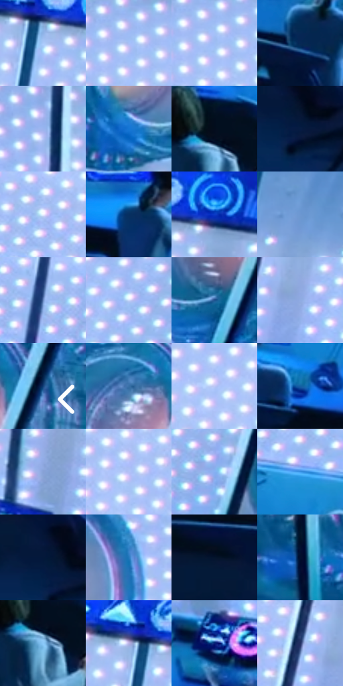

# 电影参考 613

- 状态：常规／活跃；来源世界：miles-home。
- 视角：high-angle；景别：environment-wide；场景：industrial。
- 时段：interior-time-unknown（外观依据，中置信度；具体时间／晨昏未知）；光照：cool-interior。
- 材质候选：metal, glass, screen, fabric（帧级，不是像素分割）。
- 明暗组：middle；L* P5/P50/P95：5.01559 / 57.98374 / 87.49123。
- 资格门禁：无附加门禁。
- 原截图 SHA-256：`c742e1318b181303fc69102597bf1a373eadcea84f3c775425fc2d52eb6e08bf`；尺寸：2880 × 1210。
- sRGB 像素 SHA-256：`6d757e6ee5f24c30baf9fdc2698c8658afaed65b07bd9c7bff1b83e2dc8033d4`。

## 观察与迁移

大型机器和玻璃控制室，规则点阵须先辨实体灯阵。

大面积白青点阵亮墙与深蓝前景地面、人物形成强前后值差，桌面蓝色显示屏成组，白工作服受蓝光后不是纯白。实体灯阵、屏幕图表和玻璃分隔各有功能，不能把整排光点当通用半调纹理。

本公开版保存32个128×128原像素色卡上下文；图集格子并非原场景相邻位置。原rect、图集tile和像素SHA见 `data/palette-crops.json`。上下文不足时不得批准替色，不能以小样推断完整构图。

## 实测色卡

颜色比例分母为保留采样像素，不是材料面积；全部 32 色参与全库匹配。表内四舍五入仅用于阅读，原精度在 JSON。

| ID | HEX | Lab | 原图 xy | 像素数 | 比例 | 明度角色 |
| --- | --- | --- | --- | ---: | ---: | --- |
| 613-S01 | #A9C8FA | [79.978513, 1.092542, -27.942863] | [1632, 168] | 11726 | 6.042959% | light |
| 613-S02 | #A6C0F8 | [77.62712, 4.091775, -30.496728] | [928, 112] | 9993 | 5.149863% | light |
| 613-S03 | #9EBDF5 | [76.225163, 2.776929, -31.084746] | [936, 128] | 9906 | 5.105028% | light |
| 613-S04 | #062855 | [16.561789, 7.80493, -30.618844] | [1012, 840] | 9568 | 4.930840% | deep-shadow |
| 613-S05 | #9AB5EE | [73.602997, 4.276374, -31.367051] | [616, 112] | 9090 | 4.684505% | light |
| 613-S06 | #1576D5 | [49.396083, 9.40567, -55.995707] | [280, 420] | 9013 | 4.644823% | midtone |
| 613-S07 | #030D1C | [3.531885, 0.792629, -10.245421] | [428, 792] | 8505 | 4.383027% | deep-shadow |
| 613-S08 | #061D43 | [11.431838, 7.927635, -26.561218] | [168, 892] | 7511 | 3.870772% | deep-shadow |
| 613-S09 | #ECF2FF | [95.394742, 0.415954, -6.921513] | [944, 520] | 7454 | 3.841397% | highlight |
| 613-S10 | #073061 | [20.130472, 7.401689, -32.830948] | [200, 688] | 7088 | 3.652780% | shadow |
| 613-S11 | #0B3AC6 | [32.196607, 41.966829, -75.379363] | [1728, 132] | 6932 | 3.572386% | shadow |
| 613-S12 | #6C97D1 | [61.587436, 1.227221, -34.254042] | [2212, 184] | 6451 | 3.324504% | light |
| 613-S13 | #6182BA | [54.080285, 3.859412, -33.007841] | [1548, 612] | 6450 | 3.323988% | midtone |
| 613-S14 | #CAD8FB | [86.321385, 2.437288, -18.631837] | [2436, 440] | 6442 | 3.319866% | highlight |
| 613-S15 | #1E5390 | [34.953233, 5.368009, -38.658994] | [2688, 756] | 6256 | 3.224011% | shadow |
| 613-S16 | #8FACE2 | [70.059194, 3.131762, -30.358181] | [2132, 524] | 6067 | 3.126610% | light |
| 613-S17 | #113D76 | [26.051408, 8.172038, -36.818075] | [2812, 588] | 5851 | 3.015295% | shadow |
| 613-S18 | #3971A8 | [46.319162, -0.489728, -34.89875] | [2696, 572] | 5812 | 2.995197% | midtone |
| 613-S19 | #BDC7F7 | [80.949328, 6.682137, -24.739771] | [1484, 280] | 5764 | 2.970460% | highlight |
| 613-S20 | #1360A3 | [39.826921, 3.465727, -42.310317] | [1604, 888] | 5691 | 2.932840% | shadow |
| 613-S21 | #87A1D5 | [66.092093, 3.65509, -29.368567] | [1148, 588] | 5588 | 2.879759% | light |
| 613-S22 | #B2C1F7 | [78.647057, 6.697324, -28.326511] | [1032, 328] | 5365 | 2.764837% | light |
| 613-S23 | #86B1F2 | [71.501047, 2.387016, -36.884738] | [2468, 668] | 4354 | 2.243821% | light |
| 613-S24 | #3C95E7 | [60.088517, 0.830624, -48.984198] | [532, 632] | 4294 | 2.212900% | light |
| 613-S25 | #03183A | [8.806422, 7.110754, -24.435251] | [140, 860] | 4190 | 2.159304% | deep-shadow |
| 613-S26 | #2377BB | [48.431785, -0.18426, -42.644381] | [440, 248] | 3912 | 2.016038% | midtone |
| 613-S27 | #05152F | [6.98899, 4.433025, -19.3508] | [52, 792] | 3782 | 1.949042% | deep-shadow |
| 613-S28 | #020F2D | [4.913178, 6.239857, -21.176101] | [132, 416] | 3033 | 1.563048% | deep-shadow |
| 613-S29 | #8BC8F8 | [78.21118, -7.253455, -29.731067] | [432, 832] | 3000 | 1.546041% | light |
| 613-S30 | #B7B1E3 | [74.226108, 12.316332, -24.26525] | [1596, 136] | 2758 | 1.421327% | light |
| 613-S31 | #062076 | [17.362971, 28.06186, -50.990145] | [2096, 892] | 1187 | 0.611717% | deep-shadow |
| 613-S32 | #212F62 | [20.972226, 12.314335, -32.075308] | [2064, 488] | 1011 | 0.521016% | shadow |

## 色阶与空间分布

- 采样 ROI：`[0.01, 0.02, 0.98, 0.94]`；步长：4；样本数：194044。
- 排除区：`[]`。
- 深暗、暗、中、亮、高光五段计数：`[41451, 25957, 32530, 70631, 23475]`。
- RGB 各 256 箱、L* 100 箱、13×5 色相明度表和 3×3 空间统计全部保存在 [总数据](../film-library.json)。
- [可视化档案](../../references/library.html)按需绘制直方图，不存 2,094 张重复图表图片。

## 纹理特征占比

**这是分块图像特征的面积占比，不是波点／排线／丝网／错版的精确语义覆盖率。** 窗格、发丝、织物也会产生方向或周期特征。
原图 ROI 像素 3109722；已测块覆盖 3109722（100.0000%）；未测 0。

| 特征 | 块覆盖像素 | 占已测面积 | 阈值敏感范围 |
| --- | ---: | ---: | --- |
| low-contrast | 56960 | 1.8317% | 1.8317% ~ 2.5643% |
| directional-structure | 511706 | 16.4550% | 7.3761% ~ 25.6875% |
| periodic-structure | 2461952 | 79.1695% | 70.4639% ~ 84.6263% |
| mixed-detail | 79104 | 2.5438% | 2.0169% ~ 5.4333% |

阈值敏感范围不是统计置信区间。逐块坐标、尺度、对比、方向一致性、频谱集中度、频率与角度见 [全量特征记录](../texture-features.jsonl)，以帧号定位。
四种印刷层的真实像素覆盖仍标为 `null`，不能填 0，也不能拿上表代替。不得据这些代理测量删除唯一证据。

[测量方法与保留策略](../../references/library-retention.md) · [分类索引](../archive/README.md)
