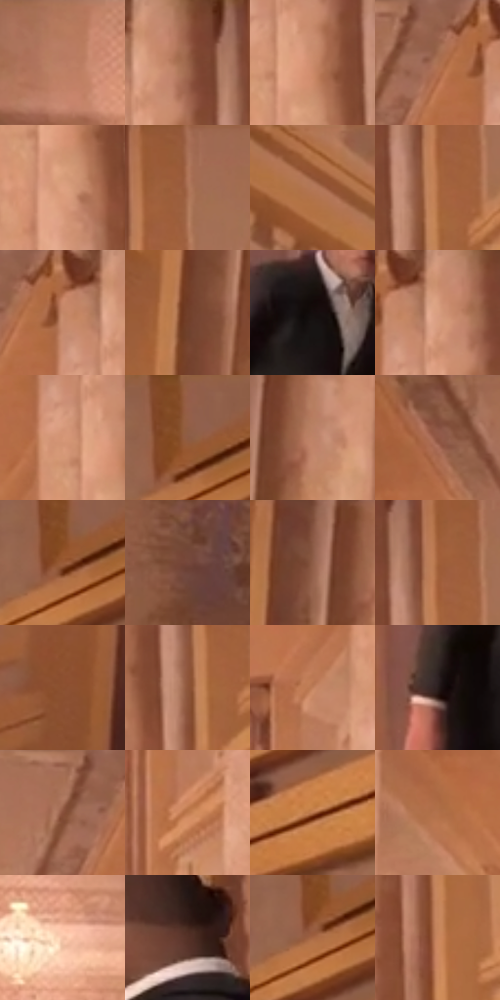

# 电影参考 614

- 状态：常规／活跃；来源世界：miles-home。
- 视角：near-level；景别：environment-wide；场景：interior。
- 时段：interior-time-unknown（外观依据，中置信度；具体时间／晨昏未知）；光照：interior-mixed。
- 材质候选：skin, hair, fabric, stone, wood, metal, glass, ceramic（帧级，不是像素分割）。
- 明暗组：middle；L* P5/P50/P95：13.52364 / 52.51375 / 70.125。
- 资格门禁：无附加门禁。
- 原截图 SHA-256：`524cbabe2ed0f31e8c508187788089eb262ef7bf6b4cac25a11a72b1f6cc83ea`；尺寸：2880 × 1204。
- sRGB 像素 SHA-256：`0257cdcc27a058e3518db7cb6cb04fa35a1fed563939fb0b5c27eebf49b306ea`。

## 观察与迁移

暖厅石柱、金属餐罩和餐具各有高光响应，白布不发塑料亮。

暖象牙色长廊由柱列、墙板和天花框格构成消失点，右侧开门与黑衣人作为暗形。圆柱柔转折不同于线脚硬边，石材细纹低对比；地面是软金色映光和少量白亮区，暖室阴影不必强改蓝紫。

本公开版保存32个128×128原像素色卡上下文；图集格子并非原场景相邻位置。原rect、图集tile和像素SHA见 `data/palette-crops.json`。上下文不足时不得批准替色，不能以小样推断完整构图。

## 实测色卡

颜色比例分母为保留采样像素，不是材料面积；全部 32 色参与全库匹配。表内四舍五入仅用于阅读，原精度在 JSON。

| ID | HEX | Lab | 原图 xy | 像素数 | 比例 | 明度角色 |
| --- | --- | --- | --- | ---: | ---: | --- |
| 614-S01 | #B77B5D | [57.100493, 19.918822, 25.870667] | [964, 28] | 8931 | 4.635916% | midtone |
| 614-S02 | #9B644B | [47.742433, 19.364056, 23.30375] | [1700, 52] | 8302 | 4.309414% | midtone |
| 614-S03 | #CA8B6B | [63.413928, 20.281072, 26.769414] | [1680, 164] | 8236 | 4.275155% | light |
| 614-S04 | #A36A4E | [50.270971, 19.634763, 25.042934] | [1552, 56] | 7983 | 4.143827% | midtone |
| 614-S05 | #DFA183 | [71.432302, 19.29252, 24.721042] | [1668, 232] | 7477 | 3.881172% | light |
| 614-S06 | #AD7356 | [53.835053, 19.538925, 25.337699] | [1824, 60] | 6864 | 3.562975% | midtone |
| 614-S07 | #B17759 | [55.343341, 19.262049, 25.695258] | [204, 60] | 6820 | 3.540135% | midtone |
| 614-S08 | #AF6D45 | [52.379138, 22.2699, 33.071531] | [1780, 164] | 6815 | 3.537540% | midtone |
| 614-S09 | #C38667 | [61.337196, 19.768483, 26.101824] | [1604, 64] | 6675 | 3.464869% | light |
| 614-S10 | #723F2A | [32.481469, 20.062605, 22.401087] | [420, 268] | 6545 | 3.397388% | shadow |
| 614-S11 | #140D0D | [4.206177, 2.559127, 0.90222] | [2128, 796] | 6443 | 3.344442% | deep-shadow |
| 614-S12 | #CC9071 | [64.945742, 18.976074, 25.526579] | [1656, 28] | 6427 | 3.336136% | light |
| 614-S13 | #D59676 | [67.478938, 19.858272, 26.327836] | [1624, 152] | 6180 | 3.207923% | light |
| 614-S14 | #945E46 | [45.282895, 19.329076, 22.858872] | [2480, 40] | 6094 | 3.163282% | midtone |
| 614-S15 | #BD8366 | [59.900498, 18.86452, 24.635685] | [540, 80] | 6024 | 3.126947% | midtone |
| 614-S16 | #804D39 | [38.187436, 19.306182, 20.911825] | [792, 44] | 6020 | 3.124870% | shadow |
| 614-S17 | #995B37 | [44.986467, 21.947403, 31.248209] | [2468, 96] | 5903 | 3.064138% | midtone |
| 614-S18 | #75483B | [35.465594, 17.646424, 15.837371] | [2788, 192] | 5813 | 3.017420% | shadow |
| 614-S19 | #8B5946 | [42.879284, 18.355009, 19.496584] | [468, 40] | 5739 | 2.979008% | midtone |
| 614-S20 | #A3623B | [48.057341, 22.582427, 33.007661] | [1780, 96] | 5517 | 2.863772% | midtone |
| 614-S21 | #8B4F30 | [40.074209, 22.220319, 28.891433] | [308, 1040] | 5514 | 2.862215% | midtone |
| 614-S22 | #8E553A | [42.084474, 20.845146, 25.652304] | [1760, 196] | 5442 | 2.824841% | midtone |
| 614-S23 | #C07F5C | [59.122576, 21.332446, 29.257836] | [1560, 276] | 5343 | 2.773452% | midtone |
| 614-S24 | #2A1E1D | [12.66877, 5.653885, 2.945246] | [2000, 932] | 5250 | 2.725178% | deep-shadow |
| 614-S25 | #A77156 | [52.618952, 18.146835, 23.610988] | [1500, 36] | 5104 | 2.649392% | midtone |
| 614-S26 | #BF7A4E | [57.605673, 22.493208, 34.998713] | [1560, 444] | 5059 | 2.626033% | midtone |
| 614-S27 | #B8744C | [55.283293, 22.716506, 33.041847] | [2488, 232] | 4845 | 2.514950% | midtone |
| 614-S28 | #B2714C | [53.81342, 21.860813, 31.054971] | [732, 176] | 4751 | 2.466156% | midtone |
| 614-S29 | #F5C3A6 | [82.485597, 13.863936, 21.376127] | [1224, 424] | 4570 | 2.372202% | highlight |
| 614-S30 | #553127 | [24.560072, 15.119607, 13.317886] | [2420, 760] | 4213 | 2.186890% | shadow |
| 614-S31 | #A76744 | [49.900366, 22.155157, 30.357766] | [2456, 116] | 4014 | 2.083593% | midtone |
| 614-S32 | #CA875E | [62.249765, 21.246412, 32.392506] | [1776, 404] | 3735 | 1.938769% | light |

## 色阶与空间分布

- 采样 ROI：`[0.01, 0.02, 0.98, 0.94]`；步长：4；样本数：192648。
- 排除区：`[]`。
- 深暗、暗、中、亮、高光五段计数：`[12206, 24122, 110574, 43312, 2434]`。
- RGB 各 256 箱、L* 100 箱、13×5 色相明度表和 3×3 空间统计全部保存在 [总数据](../film-library.json)。
- [可视化档案](../../references/library.html)按需绘制直方图，不存 2,094 张重复图表图片。

## 纹理特征占比

**这是分块图像特征的面积占比，不是波点／排线／丝网／错版的精确语义覆盖率。** 窗格、发丝、织物也会产生方向或周期特征。
原图 ROI 像素 3092958；已测块覆盖 3092958（100.0000%）；未测 0。

| 特征 | 块覆盖像素 | 占已测面积 | 阈值敏感范围 |
| --- | ---: | ---: | --- |
| low-contrast | 43392 | 1.4029% | 1.4029% ~ 1.4029% |
| directional-structure | 1313792 | 42.4769% | 26.8005% ~ 52.1691% |
| periodic-structure | 1593950 | 51.5348% | 44.4001% ~ 63.2507% |
| mixed-detail | 141824 | 4.5854% | 2.0278% ~ 8.5459% |

阈值敏感范围不是统计置信区间。逐块坐标、尺度、对比、方向一致性、频谱集中度、频率与角度见 [全量特征记录](../texture-features.jsonl)，以帧号定位。
四种印刷层的真实像素覆盖仍标为 `null`，不能填 0，也不能拿上表代替。不得据这些代理测量删除唯一证据。

[测量方法与保留策略](../../references/library-retention.md) · [分类索引](../archive/README.md)
