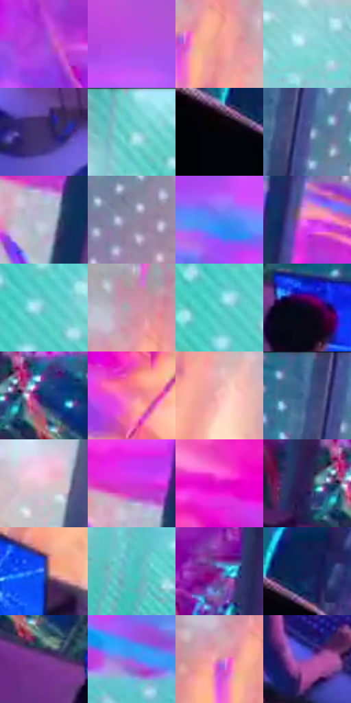

# 电影参考 615

- 状态：条件／活跃；来源世界：miles-home。
- 视角：high-angle；景别：environment-wide；场景：industrial。
- 时段：event-time-unknown（外观依据，中置信度；具体时间／晨昏未知）；光照：event-light。
- 材质候选：glass, metal, fabric（帧级，不是像素分割）。
- 明暗组：middle；L* P5/P50/P95：1.93929 / 54.57302 / 81.55947。
- 资格门禁：energy。
- 原截图 SHA-256：`496946c547eef670428ebe66497a340ade3485528ec45fac715b8d57e2e9d120`；尺寸：2880 × 1200。
- sRGB 像素 SHA-256：`35ef2b9e9e5428795fb3231e39c83228221611be4f49578e30d8c681ab4d5dcb`。

## 观察与迁移

紫红能量束和绿青事件场，不作常规机房光照。

紫红能量束与黄白交汇点明显亮于前景人物和操作台，青色灯阵保持后层；玻璃黑竖框在能量前方仍可辨。能量、机器、玻璃与印刷纹理分开，亮粉紫是事件照明，不作为普通实验室或城市固定色板。

本公开版保存32个128×128原像素色卡上下文；图集格子并非原场景相邻位置。原rect、图集tile和像素SHA见 `data/palette-crops.json`。上下文不足时不得批准替色，不能以小样推断完整构图。

## 实测色卡

颜色比例分母为保留采样像素，不是材料面积；全部 32 色参与全库匹配。表内四舍五入仅用于阅读，原精度在 JSON。

| ID | HEX | Lab | 原图 xy | 像素数 | 比例 | 明度角色 |
| --- | --- | --- | --- | ---: | ---: | --- |
| 615-S01 | #9E48DB | [48.283055, 60.298204, -60.743537] | [684, 428] | 10712 | 5.560400% | midtone |
| 615-S02 | #B54EE6 | [52.934421, 64.831788, -59.327923] | [2384, 732] | 9575 | 4.970205% | midtone |
| 615-S03 | #EF9C92 | [72.366563, 29.810474, 18.088194] | [1780, 172] | 9171 | 4.760496% | light |
| 615-S04 | #96D2DC | [80.595077, -16.705562, -11.084489] | [2212, 240] | 8572 | 4.449566% | highlight |
| 615-S05 | #3F316C | [24.752082, 21.802862, -32.365571] | [964, 1076] | 8324 | 4.320834% | shadow |
| 615-S06 | #77D2D6 | [78.964488, -26.129286, -10.458816] | [2424, 28] | 7719 | 4.006790% | light |
| 615-S07 | #020308 | [0.863146, 0.433668, -1.984157] | [36, 300] | 7429 | 3.856256% | deep-shadow |
| 615-S08 | #454F86 | [35.158311, 11.950783, -32.103833] | [1112, 108] | 7164 | 3.718699% | shadow |
| 615-S09 | #BAB9CC | [75.75907, 4.022271, -9.424148] | [1876, 896] | 6717 | 3.486670% | light |
| 615-S10 | #8D89A5 | [58.292806, 7.314984, -14.247873] | [1228, 236] | 6673 | 3.463830% | midtone |
| 615-S11 | #4E83F3 | [56.406989, 18.316074, -61.469706] | [2140, 828] | 6581 | 3.416075% | midtone |
| 615-S12 | #DE5BDA | [59.957623, 66.629135, -41.058561] | [1080, 424] | 6249 | 3.243740% | midtone |
| 615-S13 | #70C4CA | [74.308573, -23.92249, -10.965809] | [2728, 196] | 6196 | 3.216229% | light |
| 615-S14 | #C59AAD | [68.020633, 19.05297, -3.713435] | [1744, 76] | 6094 | 3.163282% | light |
| 615-S15 | #5BD0CD | [77.125111, -33.433152, -8.470933] | [2700, 208] | 6001 | 3.115008% | light |
| 615-S16 | #0F081F | [3.37953, 7.18787, -12.764665] | [660, 804] | 5875 | 3.049603% | deep-shadow |
| 615-S17 | #173473 | [23.254958, 13.987925, -39.41174] | [520, 660] | 5796 | 3.008596% | shadow |
| 615-S18 | #EE76A5 | [64.847156, 51.15633, -3.327886] | [1340, 664] | 5546 | 2.878826% | light |
| 615-S19 | #FABAB7 | [81.216815, 22.674117, 10.588922] | [1828, 280] | 5306 | 2.754246% | highlight |
| 615-S20 | #4B709C | [46.289187, -0.136102, -27.834423] | [1068, 44] | 5235 | 2.717391% | midtone |
| 615-S21 | #EACBD6 | [84.515008, 12.669132, -1.428554] | [1980, 248] | 5194 | 2.696109% | highlight |
| 615-S22 | #CE32DA | [52.361213, 77.667559, -53.252461] | [1856, 824] | 5187 | 2.692475% | midtone |
| 615-S23 | #DD11C7 | [51.72386, 83.800932, -43.221802] | [1820, 620] | 5072 | 2.632781% | midtone |
| 615-S24 | #311E51 | [16.38258, 22.132795, -28.049547] | [440, 656] | 5051 | 2.621880% | deep-shadow |
| 615-S25 | #2C4BB5 | [35.79548, 26.819579, -59.446297] | [1440, 1040] | 5020 | 2.605789% | shadow |
| 615-S26 | #4DC5C8 | [73.335401, -32.065206, -11.459818] | [2184, 1048] | 4903 | 2.545056% | light |
| 615-S27 | #752188 | [30.99089, 50.515955, -39.659715] | [436, 216] | 4540 | 2.356630% | shadow |
| 615-S28 | #111F51 | [13.785605, 14.231751, -32.38772] | [132, 252] | 4238 | 2.199867% | deep-shadow |
| 615-S29 | #7D3D9B | [37.957536, 43.737533, -40.078781] | [552, 764] | 3995 | 2.073730% | shadow |
| 615-S30 | #8372E4 | [54.511596, 34.125773, -55.967984] | [2552, 988] | 3491 | 1.812113% | midtone |
| 615-S31 | #CD82AA | [63.217783, 34.529367, -9.049862] | [1720, 156] | 3031 | 1.573336% | light |
| 615-S32 | #7C50C3 | [44.178323, 43.015685, -53.770471] | [712, 1040] | 1991 | 1.033491% | midtone |

## 色阶与空间分布

- 采样 ROI：`[0.01, 0.02, 0.98, 0.94]`；步长：4；样本数：192648。
- 排除区：`[]`。
- 深暗、暗、中、亮、高光五段计数：`[23708, 31486, 57635, 65905, 13914]`。
- RGB 各 256 箱、L* 100 箱、13×5 色相明度表和 3×3 空间统计全部保存在 [总数据](../film-library.json)。
- [可视化档案](../../references/library.html)按需绘制直方图，不存 2,094 张重复图表图片。

## 纹理特征占比

**这是分块图像特征的面积占比，不是波点／排线／丝网／错版的精确语义覆盖率。** 窗格、发丝、织物也会产生方向或周期特征。
原图 ROI 像素 3084576；已测块覆盖 3084576（100.0000%）；未测 0。

| 特征 | 块覆盖像素 | 占已测面积 | 阈值敏感范围 |
| --- | ---: | ---: | --- |
| low-contrast | 81920 | 2.6558% | 2.6558% ~ 2.6558% |
| directional-structure | 460032 | 14.9139% | 6.1747% ~ 26.6409% |
| periodic-structure | 2516000 | 81.5671% | 70.3713% ~ 88.8042% |
| mixed-detail | 26624 | 0.8631% | 0.3320% ~ 2.3653% |

阈值敏感范围不是统计置信区间。逐块坐标、尺度、对比、方向一致性、频谱集中度、频率与角度见 [全量特征记录](../texture-features.jsonl)，以帧号定位。
四种印刷层的真实像素覆盖仍标为 `null`，不能填 0，也不能拿上表代替。不得据这些代理测量删除唯一证据。

[测量方法与保留策略](../../references/library-retention.md) · [分类索引](../archive/README.md)
