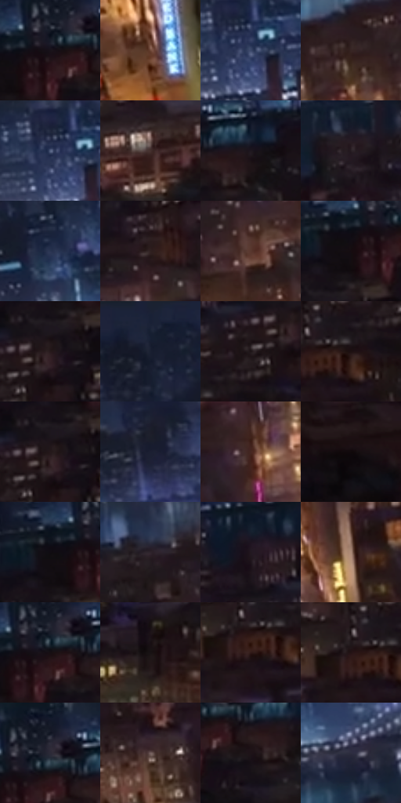

# 电影参考 616

- 状态：常规／活跃；来源世界：miles-home。
- 视角：high-angle；景别：environment-wide；场景：city。
- 时段：night-appearance（外观依据，中置信度；具体时间／晨昏未知）；光照：night-mixed。
- 材质候选：brick, glass, asphalt, sky（帧级，不是像素分割）。
- 明暗组：very-dark；L* P5/P50/P95：3.91386 / 12.06713 / 39.76232。
- 资格门禁：无附加门禁。
- 原截图 SHA-256：`12869ea9c4d86a766167183711acb6647299ce5a44de9561d97fd6445aac2f27`；尺寸：2880 × 1208。
- sRGB 像素 SHA-256：`c6c36ce55071b51cae760ed03354b8ff014c11f5a7a55d60e0c43ca46b713594`。

## 观察与迁移

暗城暖街线与冷空气层，近远楼体保体量。

近处暖棕红街区、暗屋顶与中央金色车流街廊，对比远方冷蓝天际线及河面映光；窗组与路灯保持点群疏密。此处暖近冷远，与此前冷近暖远同样成立，不能把距离绑定一种色温；不凭参考增画道路标线。

本公开版保存32个128×128原像素色卡上下文；图集格子并非原场景相邻位置。原rect、图集tile和像素SHA见 `data/palette-crops.json`。上下文不足时不得批准替色，不能以小样推断完整构图。

## 实测色卡

颜色比例分母为保留采样像素，不是材料面积；全部 32 色参与全库匹配。表内四舍五入仅用于阅读，原精度在 JSON。

| ID | HEX | Lab | 原图 xy | 像素数 | 比例 | 明度角色 |
| --- | --- | --- | --- | ---: | ---: | --- |
| 616-S01 | #181219 | [6.295948, 4.339981, -3.629793] | [2636, 92] | 9647 | 4.989501% | deep-shadow |
| 616-S02 | #704939 | [35.015215, 14.593708, 16.360003] | [1672, 1036] | 7958 | 4.115937% | shadow |
| 616-S03 | #3A4769 | [30.46166, 4.694988, -21.450675] | [1960, 76] | 7516 | 3.887332% | shadow |
| 616-S04 | #372524 | [16.810414, 8.367312, 4.058163] | [1360, 336] | 7336 | 3.794234% | deep-shadow |
| 616-S05 | #21283E | [16.447372, 3.81622, -15.000018] | [1936, 40] | 6955 | 3.597178% | deep-shadow |
| 616-S06 | #44302E | [22.089493, 8.777426, 4.863901] | [2060, 472] | 6885 | 3.560974% | shadow |
| 616-S07 | #1E171E | [8.845363, 5.18118, -3.577609] | [2760, 96] | 6824 | 3.529424% | deep-shadow |
| 616-S08 | #271E23 | [12.488492, 5.46312, -1.746213] | [2220, 184] | 6780 | 3.506667% | deep-shadow |
| 616-S09 | #293451 | [22.020992, 4.451821, -19.148684] | [824, 140] | 6762 | 3.497357% | shadow |
| 616-S10 | #2F201F | [14.0382, 7.078497, 3.536967] | [2116, 316] | 6670 | 3.449774% | deep-shadow |
| 616-S11 | #58372E | [26.748424, 13.535004, 11.727022] | [1836, 388] | 6666 | 3.447705% | shadow |
| 616-S12 | #160C10 | [4.254086, 4.434049, -0.556499] | [2592, 120] | 6604 | 3.415638% | deep-shadow |
| 616-S13 | #27191C | [10.634648, 7.583135, 0.701829] | [2564, 212] | 6318 | 3.267717% | deep-shadow |
| 616-S14 | #192136 | [12.988375, 3.469535, -14.83201] | [704, 28] | 6293 | 3.254787% | deep-shadow |
| 616-S15 | #1E1618 | [8.26951, 4.481211, 0.119158] | [2508, 248] | 6278 | 3.247029% | deep-shadow |
| 616-S16 | #1E1012 | [6.235665, 7.118299, 1.287458] | [2460, 316] | 6259 | 3.237202% | deep-shadow |
| 616-S17 | #24191A | [10.145005, 5.69233, 1.432632] | [2556, 208] | 6141 | 3.176171% | deep-shadow |
| 616-S18 | #191D2D | [11.09811, 3.192232, -11.302449] | [1080, 52] | 6020 | 3.113589% | deep-shadow |
| 616-S19 | #452721 | [19.334569, 13.317113, 9.953623] | [1248, 520] | 5962 | 3.083591% | deep-shadow |
| 616-S20 | #10080B | [2.782173, 2.792604, -0.308864] | [2704, 704] | 5837 | 3.018940% | deep-shadow |
| 616-S21 | #100C12 | [3.764729, 2.383156, -2.500447] | [2572, 104] | 5577 | 2.884466% | deep-shadow |
| 616-S22 | #2E232C | [15.301443, 7.190993, -3.965888] | [1776, 252] | 5366 | 2.775335% | deep-shadow |
| 616-S23 | #221920 | [10.104541, 6.065053, -3.141499] | [2420, 152] | 5323 | 2.753095% | deep-shadow |
| 616-S24 | #AB8877 | [59.525164, 10.791707, 14.203355] | [1548, 608] | 5200 | 2.689479% | midtone |
| 616-S25 | #170F12 | [5.126197, 3.848596, -0.434355] | [2652, 92] | 5056 | 2.615001% | deep-shadow |
| 616-S26 | #181214 | [6.118254, 3.091306, -0.242942] | [2720, 332] | 5018 | 2.595347% | deep-shadow |
| 616-S27 | #301A18 | [12.177287, 10.657118, 6.035433] | [2416, 340] | 4518 | 2.336743% | deep-shadow |
| 616-S28 | #241315 | [8.08449, 9.141609, 2.148364] | [2400, 316] | 4491 | 2.322779% | deep-shadow |
| 616-S29 | #151826 | [8.590122, 3.041619, -10.06474] | [2664, 32] | 4484 | 2.319158% | deep-shadow |
| 616-S30 | #745F5F | [42.344515, 8.48696, 3.195327] | [904, 524] | 4415 | 2.283471% | midtone |
| 616-S31 | #1E1318 | [7.296339, 6.648062, -1.303793] | [2708, 132] | 4343 | 2.246232% | deep-shadow |
| 616-S32 | #2E2E40 | [19.659033, 4.816366, -11.314112] | [980, 252] | 3844 | 1.988146% | deep-shadow |

## 色阶与空间分布

- 采样 ROI：`[0.01, 0.02, 0.98, 0.94]`；步长：4；样本数：193346。
- 排除区：`[]`。
- 深暗、暗、中、亮、高光五段计数：`[146630, 37215, 7304, 1849, 348]`。
- RGB 各 256 箱、L* 100 箱、13×5 色相明度表和 3×3 空间统计全部保存在 [总数据](../film-library.json)。
- [可视化档案](../../references/library.html)按需绘制直方图，不存 2,094 张重复图表图片。

## 纹理特征占比

**这是分块图像特征的面积占比，不是波点／排线／丝网／错版的精确语义覆盖率。** 窗格、发丝、织物也会产生方向或周期特征。
原图 ROI 像素 3104134；已测块覆盖 3104134（100.0000%）；未测 0。

| 特征 | 块覆盖像素 | 占已测面积 | 阈值敏感范围 |
| --- | ---: | ---: | --- |
| low-contrast | 0 | 0.0000% | 0.0000% ~ 0.0000% |
| directional-structure | 16384 | 0.5278% | 0.0000% ~ 1.5834% |
| periodic-structure | 2486534 | 80.1040% | 65.9231% ~ 91.7241% |
| mixed-detail | 601216 | 19.3682% | 6.6925% ~ 34.0769% |

阈值敏感范围不是统计置信区间。逐块坐标、尺度、对比、方向一致性、频谱集中度、频率与角度见 [全量特征记录](../texture-features.jsonl)，以帧号定位。
四种印刷层的真实像素覆盖仍标为 `null`，不能填 0，也不能拿上表代替。不得据这些代理测量删除唯一证据。

[测量方法与保留策略](../../references/library-retention.md) · [分类索引](../archive/README.md)
