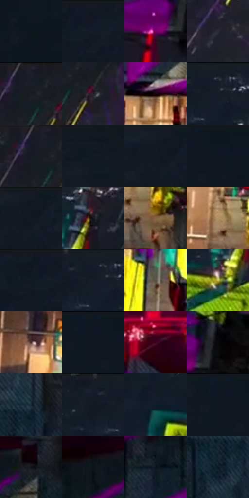

# 电影参考 617

- 状态：条件／活跃；来源世界：miles-home。
- 视角：overhead；景别：environment-wide；场景：city。
- 时段：event-time-unknown（外观依据，中置信度；具体时间／晨昏未知）；光照：event-light。
- 材质候选：brick, glass, metal, asphalt（帧级，不是像素分割）。
- 明暗组：very-dark；L* P5/P50/P95：3.52898 / 9.48091 / 59.31152。
- 资格门禁：glitch。
- 原截图 SHA-256：`95bd7e6f38cbd405fcabe72480dd711c7a76ac99819ed8c6a64efdcda54f339e`；尺寸：2880 × 1218。
- sRGB 像素 SHA-256：`4bef48d6f9e1c7eada6f9165c2ce3a02982ec55179fd522829111541b2741267`。

## 观察与迁移

建筑碎裂、彩块和正常车路并存，不能误为玻璃映色。

黑蓝河面衬中央暖道路，桥体出现品红、黄绿、青色平面和错接碎块。大块几何脱离不是玻璃反光、普通色版偏移或纸纹；仅作强故障事件证据，不据此歪斜、增删普通原照桥梁构件。

本公开版保存32个128×128原像素色卡上下文；图集格子并非原场景相邻位置。原rect、图集tile和像素SHA见 `data/palette-crops.json`。上下文不足时不得批准替色，不能以小样推断完整构图。

## 实测色卡

颜色比例分母为保留采样像素，不是材料面积；全部 32 色参与全库匹配。表内四舍五入仅用于阅读，原精度在 JSON。

| ID | HEX | Lab | 原图 xy | 像素数 | 比例 | 明度角色 |
| --- | --- | --- | --- | ---: | ---: | --- |
| 617-S01 | #0E151E | [6.534335, -0.165543, -7.226002] | [2780, 232] | 12837 | 6.568256% | deep-shadow |
| 617-S02 | #101823 | [7.991644, 0.109431, -8.778447] | [164, 28] | 9661 | 4.943205% | deep-shadow |
| 617-S03 | #760065 | [26.133823, 53.007608, -25.115709] | [864, 868] | 9095 | 4.653602% | shadow |
| 617-S04 | #2A2A36 | [17.527294, 3.154338, -7.70232] | [1828, 264] | 8234 | 4.213058% | deep-shadow |
| 617-S05 | #181D27 | [10.699399, 0.761809, -7.533368] | [1844, 32] | 8224 | 4.207941% | deep-shadow |
| 617-S06 | #231E28 | [12.215368, 4.912021, -5.855312] | [1908, 100] | 7698 | 3.938805% | deep-shadow |
| 617-S07 | #19040F | [2.963205, 8.961226, -1.859446] | [1648, 800] | 7676 | 3.927548% | deep-shadow |
| 617-S08 | #1A202B | [12.136199, 0.654665, -8.240296] | [756, 28] | 7637 | 3.907593% | deep-shadow |
| 617-S09 | #151B24 | [9.566451, 0.069099, -7.070983] | [1816, 32] | 7602 | 3.889685% | deep-shadow |
| 617-S10 | #0F1720 | [7.394256, -0.575091, -7.437114] | [2416, 28] | 7596 | 3.886615% | deep-shadow |
| 617-S11 | #121B24 | [9.318557, -1.062466, -7.472127] | [356, 28] | 7520 | 3.847728% | deep-shadow |
| 617-S12 | #0D171F | [7.201393, -1.562966, -6.984804] | [2632, 28] | 7354 | 3.762792% | deep-shadow |
| 617-S13 | #131925 | [8.715416, 1.171668, -9.138523] | [380, 28] | 7120 | 3.643062% | deep-shadow |
| 617-S14 | #151920 | [8.644645, 0.235014, -5.484381] | [968, 140] | 7082 | 3.623619% | deep-shadow |
| 617-S15 | #846244 | [44.317746, 9.774039, 22.397185] | [1368, 1004] | 7057 | 3.610827% | midtone |
| 617-S16 | #B08D60 | [60.892706, 7.255379, 28.984617] | [1300, 940] | 6635 | 3.394904% | light |
| 617-S17 | #0E1721 | [7.370046, -0.556932, -8.238477] | [108, 28] | 6256 | 3.200982% | deep-shadow |
| 617-S18 | #131D29 | [10.388101, -0.370298, -9.516493] | [736, 36] | 6203 | 3.173864% | deep-shadow |
| 617-S19 | #585144 | [34.756226, 0.439111, 8.700298] | [1456, 120] | 5964 | 3.051576% | shadow |
| 617-S20 | #D4CD5F | [81.009232, -11.711042, 54.670854] | [896, 252] | 5846 | 2.991199% | highlight |
| 617-S21 | #4D302B | [23.224882, 12.525808, 8.657125] | [1308, 68] | 5549 | 2.839235% | shadow |
| 617-S22 | #0F1722 | [7.49546, 0.136076, -8.795974] | [2576, 28] | 5229 | 2.675501% | deep-shadow |
| 617-S23 | #3D051F | [10.556284, 28.591187, -1.182798] | [1436, 372] | 5175 | 2.647871% | deep-shadow |
| 617-S24 | #08070B | [2.057175, 0.821098, -1.430973] | [936, 816] | 5147 | 2.633545% | deep-shadow |
| 617-S25 | #192B35 | [16.460904, -4.050064, -8.753019] | [2120, 568] | 4966 | 2.540933% | deep-shadow |
| 617-S26 | #151D29 | [10.54401, 0.329394, -9.263121] | [676, 28] | 4692 | 2.400737% | deep-shadow |
| 617-S27 | #0F1D29 | [10.109442, -1.664611, -9.969778] | [756, 196] | 3915 | 2.003172% | deep-shadow |
| 617-S28 | #0D1823 | [7.769418, -0.887305, -9.1398] | [2556, 32] | 3836 | 1.962751% | deep-shadow |
| 617-S29 | #121319 | [6.002528, 1.070594, -4.129556] | [1896, 552] | 1446 | 0.739869% | deep-shadow |
| 617-S30 | #0C1619 | [6.522964, -2.96743, -3.417248] | [1776, 552] | 1073 | 0.549018% | deep-shadow |
| 617-S31 | #09151E | [6.2155, -1.595433, -7.738674] | [1620, 616] | 642 | 0.328490% | deep-shadow |
| 617-S32 | #091924 | [7.954742, -2.393798, -9.6243] | [2072, 636] | 473 | 0.242018% | deep-shadow |

## 色阶与空间分布

- 采样 ROI：`[0.01, 0.02, 0.98, 0.94]`；步长：4；样本数：195440。
- 排除区：`[]`。
- 深暗、暗、中、亮、高光五段计数：`[155117, 21206, 9634, 7083, 2400]`。
- RGB 各 256 箱、L* 100 箱、13×5 色相明度表和 3×3 空间统计全部保存在 [总数据](../film-library.json)。
- [可视化档案](../../references/library.html)按需绘制直方图，不存 2,094 张重复图表图片。

## 纹理特征占比

**这是分块图像特征的面积占比，不是波点／排线／丝网／错版的精确语义覆盖率。** 窗格、发丝、织物也会产生方向或周期特征。
原图 ROI 像素 3129280；已测块覆盖 3129280（100.0000%）；未测 0。

| 特征 | 块覆盖像素 | 占已测面积 | 阈值敏感范围 |
| --- | ---: | ---: | --- |
| low-contrast | 1335232 | 42.6690% | 39.6585% ~ 43.1926% |
| directional-structure | 159744 | 5.1048% | 1.0471% ~ 12.4348% |
| periodic-structure | 1437696 | 45.9433% | 41.8857% ~ 45.9433% |
| mixed-detail | 196608 | 6.2829% | 4.5812% ~ 13.8746% |

阈值敏感范围不是统计置信区间。逐块坐标、尺度、对比、方向一致性、频谱集中度、频率与角度见 [全量特征记录](../texture-features.jsonl)，以帧号定位。
四种印刷层的真实像素覆盖仍标为 `null`，不能填 0，也不能拿上表代替。不得据这些代理测量删除唯一证据。

[测量方法与保留策略](../../references/library-retention.md) · [分类索引](../archive/README.md)
