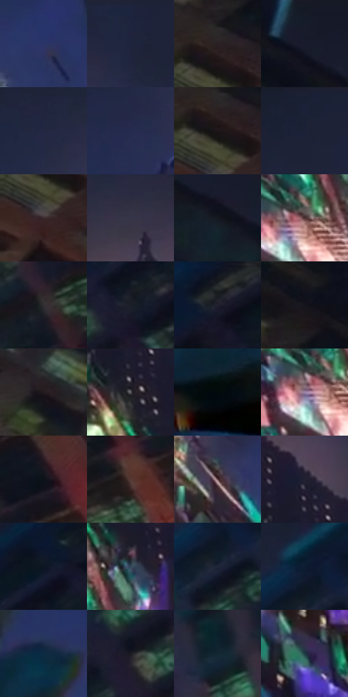

# 电影参考 618

- 状态：条件／活跃；来源世界：miles-home。
- 视角：low-angle；景别：environment-wide；场景：city。
- 时段：event-time-unknown（外观依据，中置信度；具体时间／晨昏未知）；光照：event-light。
- 材质候选：brick, glass, metal, asphalt（帧级，不是像素分割）。
- 明暗组：very-dark；L* P5/P50/P95：5.59005 / 15.41022 / 35.43819。
- 资格门禁：glitch。
- 原截图 SHA-256：`ec0c0e8c99c6ad338ccfc043ed89e61813606128a4950209141aa3d934e7ed63`；尺寸：2880 × 1208。
- sRGB 像素 SHA-256：`b5d5dda838996dc539c94ef316e62ec3991eda6a7580ff5e6eb7b5d078aa7a61`。

## 观察与迁移

建筑碎裂、彩块和正常车路并存，不能误为玻璃映色。

中央高楼碎裂为多色错接平面，两侧相对稳定砖墙和窗组保留正常夜景参照，前景人物深暗带冷边。建筑几何重组远强于窄色边；彩片不是整楼玻璃材质，不作为常规城市微纹理或默认改楼依据。

本公开版保存32个128×128原像素色卡上下文；图集格子并非原场景相邻位置。原rect、图集tile和像素SHA见 `data/palette-crops.json`。上下文不足时不得批准替色，不能以小样推断完整构图。

## 实测色卡

颜色比例分母为保留采样像素，不是材料面积；全部 32 色参与全库匹配。表内四舍五入仅用于阅读，原精度在 JSON。

| ID | HEX | Lab | 原图 xy | 像素数 | 比例 | 明度角色 |
| --- | --- | --- | --- | ---: | ---: | --- |
| 618-S01 | #2B3467 | [23.500318, 12.89035, -31.239959] | [1996, 724] | 15391 | 7.960341% | shadow |
| 618-S02 | #1F253D | [15.229264, 4.990748, -16.220785] | [1760, 60] | 11976 | 6.194077% | deep-shadow |
| 618-S03 | #2A2023 | [13.51164, 5.441945, -0.198502] | [68, 216] | 9911 | 5.126043% | deep-shadow |
| 618-S04 | #161B29 | [9.910866, 2.192566, -10.234818] | [324, 28] | 9110 | 4.711760% | deep-shadow |
| 618-S05 | #222742 | [16.426302, 6.268594, -17.797861] | [1296, 120] | 8545 | 4.419538% | deep-shadow |
| 618-S06 | #252B4F | [18.737049, 8.942744, -23.005505] | [1220, 360] | 8524 | 4.408677% | deep-shadow |
| 618-S07 | #1C1618 | [8.009209, 3.479474, -0.29232] | [64, 248] | 7613 | 3.937501% | deep-shadow |
| 618-S08 | #1B2136 | [13.150598, 4.114465, -14.566277] | [1000, 28] | 7553 | 3.906468% | deep-shadow |
| 618-S09 | #3A2427 | [17.026791, 10.992443, 2.305146] | [44, 324] | 7334 | 3.793200% | deep-shadow |
| 618-S10 | #353448 | [22.586311, 5.625974, -12.178329] | [1532, 108] | 6903 | 3.570283% | shadow |
| 618-S11 | #151821 | [8.328151, 1.320029, -6.718828] | [456, 176] | 6693 | 3.461670% | deep-shadow |
| 618-S12 | #4A2D2E | [22.053089, 13.52497, 4.926481] | [1648, 592] | 6650 | 3.439430% | shadow |
| 618-S13 | #332E32 | [19.590117, 3.153094, -1.744081] | [2496, 752] | 6484 | 3.353573% | deep-shadow |
| 618-S14 | #1B1F29 | [11.776986, 1.122524, -7.32723] | [2588, 296] | 6226 | 3.220134% | deep-shadow |
| 618-S15 | #282C2E | [17.689593, -1.250192, -1.897472] | [2812, 36] | 5610 | 2.901534% | deep-shadow |
| 618-S16 | #13131A | [6.131196, 1.748506, -4.705335] | [100, 108] | 5578 | 2.884983% | deep-shadow |
| 618-S17 | #221B1F | [10.725266, 4.345582, -1.475337] | [480, 452] | 5474 | 2.831194% | deep-shadow |
| 618-S18 | #58585B | [37.49827, 0.645107, -1.728967] | [1652, 372] | 5340 | 2.761888% | shadow |
| 618-S19 | #03090D | [2.201998, -0.976849, -2.164555] | [704, 836] | 5216 | 2.697754% | deep-shadow |
| 618-S20 | #9B84A4 | [58.180744, 14.791759, -13.724111] | [1616, 608] | 5138 | 2.657412% | midtone |
| 618-S21 | #0B121A | [5.223817, -0.367377, -6.114022] | [2716, 844] | 5098 | 2.636724% | deep-shadow |
| 618-S22 | #563934 | [27.166323, 12.145172, 8.32514] | [2600, 968] | 4768 | 2.466045% | shadow |
| 618-S23 | #614245 | [31.504347, 13.925419, 3.597024] | [1812, 716] | 4587 | 2.372431% | shadow |
| 618-S24 | #1F1F2F | [12.45768, 4.620586, -10.600425] | [1648, 256] | 4440 | 2.296401% | deep-shadow |
| 618-S25 | #0E1723 | [7.474276, 0.175496, -9.589747] | [2620, 180] | 3759 | 1.944183% | deep-shadow |
| 618-S26 | #34475A | [29.347788, -1.904181, -13.624173] | [1716, 488] | 3471 | 1.795227% | shadow |
| 618-S27 | #1F2637 | [15.240074, 2.164909, -11.996209] | [2372, 356] | 3260 | 1.686096% | deep-shadow |
| 618-S28 | #0D1D30 | [10.390961, 0.652016, -14.654117] | [2364, 292] | 3138 | 1.622997% | deep-shadow |
| 618-S29 | #0D2B44 | [16.652819, -1.051991, -18.904708] | [848, 688] | 2987 | 1.544899% | deep-shadow |
| 618-S30 | #1B1B23 | [10.093477, 2.221355, -5.473393] | [2512, 396] | 2808 | 1.452319% | deep-shadow |
| 618-S31 | #132732 | [14.510772, -4.186409, -9.658695] | [2184, 852] | 2357 | 1.219058% | deep-shadow |
| 618-S32 | #1F3C43 | [23.432017, -8.622344, -7.689846] | [1588, 904] | 1404 | 0.726159% | shadow |

## 色阶与空间分布

- 采样 ROI：`[0.01, 0.02, 0.98, 0.94]`；步长：4；样本数：193346。
- 排除区：`[]`。
- 深暗、暗、中、亮、高光五段计数：`[137861, 48736, 4689, 1307, 753]`。
- RGB 各 256 箱、L* 100 箱、13×5 色相明度表和 3×3 空间统计全部保存在 [总数据](../film-library.json)。
- [可视化档案](../../references/library.html)按需绘制直方图，不存 2,094 张重复图表图片。

## 纹理特征占比

**这是分块图像特征的面积占比，不是波点／排线／丝网／错版的精确语义覆盖率。** 窗格、发丝、织物也会产生方向或周期特征。
原图 ROI 像素 3104134；已测块覆盖 3104134（100.0000%）；未测 0。

| 特征 | 块覆盖像素 | 占已测面积 | 阈值敏感范围 |
| --- | ---: | ---: | --- |
| low-contrast | 656000 | 21.1331% | 17.7766% ~ 22.1887% |
| directional-structure | 174976 | 5.6369% | 2.1112% ~ 16.7415% |
| periodic-structure | 2207622 | 71.1188% | 63.8985% ~ 71.1188% |
| mixed-detail | 65536 | 2.1112% | 1.5834% ~ 7.2203% |

阈值敏感范围不是统计置信区间。逐块坐标、尺度、对比、方向一致性、频谱集中度、频率与角度见 [全量特征记录](../texture-features.jsonl)，以帧号定位。
四种印刷层的真实像素覆盖仍标为 `null`，不能填 0，也不能拿上表代替。不得据这些代理测量删除唯一证据。

[测量方法与保留策略](../../references/library-retention.md) · [分类索引](../archive/README.md)
