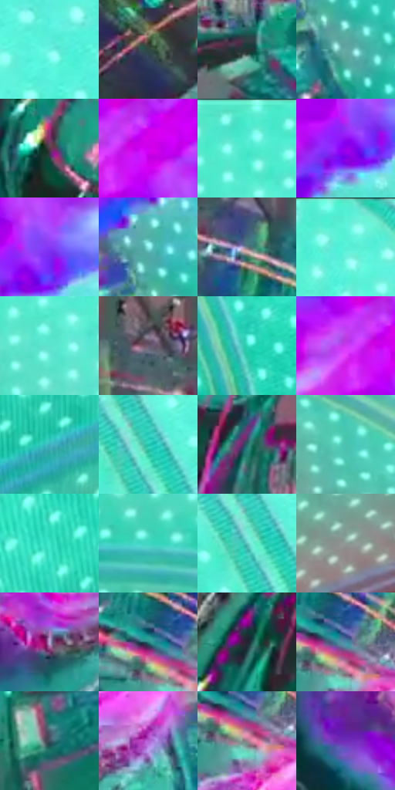

# 电影参考 619

- 状态：条件／活跃；来源世界：miles-home。
- 视角：low-angle；景别：environment-wide；场景：industrial。
- 时段：event-time-unknown（外观依据，中置信度；具体时间／晨昏未知）；光照：event-light。
- 材质候选：glass, metal, fabric（帧级，不是像素分割）。
- 明暗组：middle；L* P5/P50/P95：20.91194 / 58.68739 / 88.08585。
- 资格门禁：energy。
- 原截图 SHA-256：`243ef3755b7cffe9de0358c847f3d9a2e0f122c264f6322e19a18853bf0eb22d`；尺寸：2880 × 1210。
- sRGB 像素 SHA-256：`83554bc8dc0835c7148e485307cea95d6cef4d6f122751f0e1b38426c2ee12c1`。

## 观察与迁移

紫红能量束和绿青事件场，不作常规机房光照。

青绿亮场及白色规则点阵包围圆形机器，斜向紫红能量束由粉白中心向高彩暗边变化。机器环结构、物理灯阵与事件光流分层，饱和彩光是照明状态，不据此把所有金属固有色设为青绿或紫红。

本公开版保存32个128×128原像素色卡上下文；图集格子并非原场景相邻位置。原rect、图集tile和像素SHA见 `data/palette-crops.json`。上下文不足时不得批准替色，不能以小样推断完整构图。

## 实测色卡

颜色比例分母为保留采样像素，不是材料面积；全部 32 色参与全库匹配。表内四舍五入仅用于阅读，原精度在 JSON。

| ID | HEX | Lab | 原图 xy | 像素数 | 比例 | 明度角色 |
| --- | --- | --- | --- | ---: | ---: | --- |
| 619-S01 | #69EFDF | [87.02591, -40.436917, -3.349375] | [2768, 432] | 9164 | 4.722640% | highlight |
| 619-S02 | #304742 | [28.188959, -10.190963, 0.143723] | [544, 640] | 8776 | 4.522686% | shadow |
| 619-S03 | #253434 | [20.428722, -6.162729, -2.019744] | [1176, 660] | 8315 | 4.285111% | shadow |
| 619-S04 | #64A9A6 | [64.83264, -22.50151, -5.303126] | [1888, 1016] | 8003 | 4.124322% | light |
| 619-S05 | #553B49 | [28.222336, 13.989549, -3.981217] | [700, 1096] | 7952 | 4.098040% | shadow |
| 619-S06 | #D001EF | [51.456778, 88.863061, -66.572007] | [2108, 504] | 7809 | 4.024345% | midtone |
| 619-S07 | #4DEBD0 | [84.763157, -47.101368, 1.130452] | [1588, 36] | 7687 | 3.961473% | highlight |
| 619-S08 | #9500EA | [41.735331, 80.799638, -79.993045] | [2136, 644] | 7544 | 3.887778% | midtone |
| 619-S09 | #8637F4 | [44.70407, 69.129354, -80.84011] | [2172, 608] | 7165 | 3.692462% | midtone |
| 619-S10 | #91F2F0 | [89.771531, -29.027942, -8.025908] | [1852, 916] | 6926 | 3.569294% | highlight |
| 619-S11 | #69787F | [49.457392, -3.945367, -5.696114] | [1268, 476] | 6910 | 3.561048% | midtone |
| 619-S12 | #5AF2DA | [87.356039, -45.629607, -0.295233] | [1968, 40] | 6909 | 3.560533% | highlight |
| 619-S13 | #5BE3CF | [82.733905, -41.620831, -1.264986] | [1612, 180] | 6641 | 3.422420% | highlight |
| 619-S14 | #6B5A6D | [40.47942, 10.68294, -8.23709] | [1156, 396] | 6333 | 3.263693% | midtone |
| 619-S15 | #2FD5B9 | [77.096096, -47.322167, 2.116519] | [2172, 1044] | 6193 | 3.191544% | light |
| 619-S16 | #CF38F3 | [54.622777, 80.378998, -63.713285] | [2048, 504] | 6026 | 3.105481% | midtone |
| 619-S17 | #3AADB9 | [65.189415, -27.722001, -15.505645] | [336, 208] | 5964 | 3.073530% | light |
| 619-S18 | #24C6AE | [72.105194, -44.878246, 0.771084] | [2596, 644] | 5857 | 3.018388% | light |
| 619-S19 | #246968 | [40.372235, -21.364641, -5.805545] | [900, 952] | 5604 | 2.888005% | midtone |
| 619-S20 | #49C4B1 | [72.273624, -38.478764, -0.530763] | [1448, 320] | 5553 | 2.861722% | light |
| 619-S21 | #3CE6C8 | [82.764178, -49.211455, 2.398603] | [96, 172] | 5478 | 2.823071% | highlight |
| 619-S22 | #41D8C3 | [78.561697, -43.894713, -1.061438] | [960, 88] | 5399 | 2.782359% | light |
| 619-S23 | #63C7C1 | [74.410991, -30.672696, -5.98553] | [2576, 660] | 5375 | 2.769990% | light |
| 619-S24 | #8C9A96 | [62.413213, -5.794191, 0.393338] | [456, 368] | 4863 | 2.506133% | light |
| 619-S25 | #B7B2DA | [74.170213, 9.783661, -19.453711] | [1580, 1104] | 4444 | 2.290202% | light |
| 619-S26 | #2B807E | [48.830715, -25.313105, -6.36796] | [1360, 604] | 4352 | 2.242790% | midtone |
| 619-S27 | #242433 | [14.821421, 4.162588, -9.778431] | [708, 904] | 4318 | 2.225268% | deep-shadow |
| 619-S28 | #448DA8 | [55.17928, -14.590097, -21.104984] | [1396, 616] | 4293 | 2.212385% | midtone |
| 619-S29 | #3E505E | [33.069262, -3.178433, -10.441835] | [964, 1092] | 4122 | 2.124260% | shadow |
| 619-S30 | #B25FD1 | [54.295021, 51.794636, -45.291764] | [1716, 1056] | 3872 | 1.995424% | midtone |
| 619-S31 | #9E808C | [56.685208, 13.560458, -2.096083] | [1392, 652] | 3706 | 1.909876% | midtone |
| 619-S32 | #6E2DB7 | [35.222693, 54.789372, -61.330929] | [1344, 1048] | 2491 | 1.283729% | shadow |

## 色阶与空间分布

- 采样 ROI：`[0.01, 0.02, 0.98, 0.94]`；步长：4；样本数：194044。
- 排除区：`[]`。
- 深暗、暗、中、亮、高光五段计数：`[8197, 35856, 55278, 49677, 45036]`。
- RGB 各 256 箱、L* 100 箱、13×5 色相明度表和 3×3 空间统计全部保存在 [总数据](../film-library.json)。
- [可视化档案](../../references/library.html)按需绘制直方图，不存 2,094 张重复图表图片。

## 纹理特征占比

**这是分块图像特征的面积占比，不是波点／排线／丝网／错版的精确语义覆盖率。** 窗格、发丝、织物也会产生方向或周期特征。
原图 ROI 像素 3109722；已测块覆盖 3109722（100.0000%）；未测 0。

| 特征 | 块覆盖像素 | 占已测面积 | 阈值敏感范围 |
| --- | ---: | ---: | --- |
| low-contrast | 0 | 0.0000% | 0.0000% ~ 0.0000% |
| directional-structure | 247168 | 7.9482% | 1.4201% ~ 18.2344% |
| periodic-structure | 2862554 | 92.0518% | 81.7656% ~ 95.2335% |
| mixed-detail | 0 | 0.0000% | 0.0000% ~ 3.3464% |

阈值敏感范围不是统计置信区间。逐块坐标、尺度、对比、方向一致性、频谱集中度、频率与角度见 [全量特征记录](../texture-features.jsonl)，以帧号定位。
四种印刷层的真实像素覆盖仍标为 `null`，不能填 0，也不能拿上表代替。不得据这些代理测量删除唯一证据。

[测量方法与保留策略](../../references/library-retention.md) · [分类索引](../archive/README.md)
