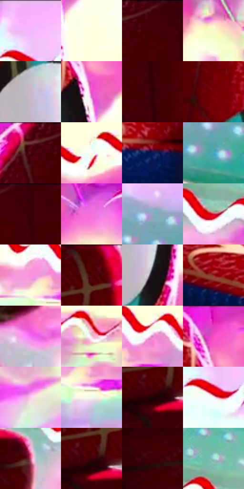

# 电影参考 620

- 状态：条件／活跃；来源世界：miles-home。
- 视角：near-level；景别：medium；场景：portrait。
- 时段：event-time-unknown（外观依据，中置信度；具体时间／晨昏未知）；光照：event-light。
- 材质候选：fabric, metal（帧级，不是像素分割）。
- 明暗组：light；L* P5/P50/P95：5.52012 / 60.59632 / 99.07384。
- 资格门禁：sense, energy。
- 原截图 SHA-256：`6cb3dd200331fe03e79be3334b30c63216513e69c9faf96516c174335bb6e7c4`；尺寸：2880 × 1204。
- sRGB 像素 SHA-256：`863a007b795100ee41f4fb5036e363e8b5f86e0974bd6ac8e6e78d762fe59871`。

## 观察与迁移

强能量背景和头周感应分层，两个门槛都需要证据。

红衣主体明显暗于粉黄高亮能量背景，白眼片、粉色受光边和肩部局部织纹分别突出；头周红白分段波浪是感应图形。单人电影帧提供线形证据；当次明确说出蜘蛛感应时，单人也须有一组头周短线。截图学习本身不触发口令。

本公开版保存32个128×128原像素色卡上下文；图集格子并非原场景相邻位置。原rect、图集tile和像素SHA见 `data/palette-crops.json`。上下文不足时不得批准替色，不能以小样推断完整构图。

## 实测色卡

颜色比例分母为保留采样像素，不是材料面积；全部 32 色参与全库匹配。表内四舍五入仅用于阅读，原精度在 JSON。

| ID | HEX | Lab | 原图 xy | 像素数 | 比例 | 明度角色 |
| --- | --- | --- | --- | ---: | ---: | --- |
| 620-S01 | #F5B7FA | [81.937667, 33.313631, -24.406533] | [2120, 64] | 11216 | 5.822017% | highlight |
| 620-S02 | #FEFFDE | [99.168729, -5.764125, 15.687636] | [1748, 272] | 9948 | 5.163822% | highlight |
| 620-S03 | #410006 | [10.086805, 30.333883, 13.453989] | [1300, 28] | 9429 | 4.894419% | deep-shadow |
| 620-S04 | #F9F9CB | [96.903624, -7.36026, 22.153962] | [2012, 568] | 9429 | 4.894419% | highlight |
| 620-S05 | #C9B6CE | [76.271368, 11.095, -9.618403] | [1572, 308] | 9031 | 4.687824% | light |
| 620-S06 | #EB4AD2 | [59.174185, 75.088673, -37.62856] | [1680, 176] | 8928 | 4.634359% | midtone |
| 620-S07 | #300106 | [5.992785, 23.626078, 6.988037] | [1376, 284] | 8526 | 4.425688% | deep-shadow |
| 620-S08 | #730007 | [22.518846, 44.640649, 31.196751] | [1540, 148] | 8320 | 4.318758% | shadow |
| 620-S09 | #4A0209 | [12.731248, 32.314848, 16.240373] | [1220, 36] | 7619 | 3.954881% | deep-shadow |
| 620-S10 | #FBFDF0 | [98.848434, -2.898383, 5.988096] | [652, 488] | 7310 | 3.794485% | highlight |
| 620-S11 | #0A1B56 | [12.734461, 18.554796, -37.511977] | [548, 820] | 7288 | 3.783065% | deep-shadow |
| 620-S12 | #49A5B7 | [63.130015, -21.807158, -17.466796] | [2788, 1004] | 6963 | 3.614364% | light |
| 620-S13 | #370107 | [7.673799, 26.76379, 9.234656] | [1360, 28] | 6660 | 3.457082% | deep-shadow |
| 620-S14 | #F371DD | [66.587765, 62.978223, -32.178129] | [1828, 96] | 5910 | 3.067771% | light |
| 620-S15 | #92A8BF | [67.929644, -2.507038, -14.313163] | [2672, 924] | 5746 | 2.982642% | light |
| 620-S16 | #C61730 | [42.514853, 64.385774, 34.387813] | [564, 184] | 5689 | 2.953054% | midtone |
| 620-S17 | #F592DB | [72.949706, 47.223114, -21.285979] | [2208, 516] | 5510 | 2.860139% | light |
| 620-S18 | #520003 | [14.406279, 35.230123, 21.267435] | [280, 32] | 5468 | 2.838337% | deep-shadow |
| 620-S19 | #19121D | [6.575973, 6.020974, -6.294272] | [1636, 456] | 5076 | 2.634857% | deep-shadow |
| 620-S20 | #8F2221 | [32.022973, 45.054376, 28.599607] | [2520, 1128] | 5045 | 2.618766% | shadow |
| 620-S21 | #F3A5E6 | [77.089417, 38.585443, -21.024951] | [36, 608] | 4988 | 2.589178% | light |
| 620-S22 | #EECFDE | [86.045449, 13.300307, -3.395606] | [2452, 516] | 4142 | 2.150035% | highlight |
| 620-S23 | #D482BC | [64.640118, 39.818049, -17.014215] | [2304, 492] | 4012 | 2.082555% | light |
| 620-S24 | #D914AF | [49.918784, 79.641609, -32.120116] | [1664, 28] | 3995 | 2.073730% | midtone |
| 620-S25 | #FCC9EE | [86.327312, 23.953935, -11.331519] | [2584, 640] | 3854 | 2.000540% | highlight |
| 620-S26 | #EAFCEC | [97.296027, -8.750822, 5.647201] | [2256, 588] | 3658 | 1.898800% | highlight |
| 620-S27 | #1F0002 | [2.671799, 12.08292, 3.402551] | [232, 168] | 3591 | 1.864021% | deep-shadow |
| 620-S28 | #FEEAF0 | [94.401547, 7.774663, -0.442511] | [2116, 144] | 3323 | 1.724908% | highlight |
| 620-S29 | #BD5475 | [50.033277, 45.546785, 2.198258] | [360, 236] | 3276 | 1.700511% | midtone |
| 620-S30 | #3D0003 | [8.983131, 28.985126, 12.960053] | [244, 152] | 3104 | 1.611229% | deep-shadow |
| 620-S31 | #3E050E | [10.294386, 27.416034, 10.189419] | [32, 276] | 2914 | 1.512603% | deep-shadow |
| 620-S32 | #A0D9D6 | [82.88787, -18.767507, -4.427171] | [528, 92] | 2680 | 1.391138% | highlight |

## 色阶与空间分布

- 采样 ROI：`[0.01, 0.02, 0.98, 0.94]`；步长：4；样本数：192648。
- 排除区：`[]`。
- 深暗、暗、中、亮、高光五段计数：`[60777, 14477, 20041, 43668, 53685]`。
- RGB 各 256 箱、L* 100 箱、13×5 色相明度表和 3×3 空间统计全部保存在 [总数据](../film-library.json)。
- [可视化档案](../../references/library.html)按需绘制直方图，不存 2,094 张重复图表图片。

## 纹理特征占比

**这是分块图像特征的面积占比，不是波点／排线／丝网／错版的精确语义覆盖率。** 窗格、发丝、织物也会产生方向或周期特征。
原图 ROI 像素 3092958；已测块覆盖 3092958（100.0000%）；未测 0。

| 特征 | 块覆盖像素 | 占已测面积 | 阈值敏感范围 |
| --- | ---: | ---: | --- |
| low-contrast | 318208 | 10.2881% | 9.2287% ~ 14.4969% |
| directional-structure | 955486 | 30.8923% | 11.5628% ~ 50.4630% |
| periodic-structure | 1770112 | 57.2304% | 39.7786% ~ 68.2996% |
| mixed-detail | 49152 | 1.5892% | 0.5297% ~ 5.6407% |

阈值敏感范围不是统计置信区间。逐块坐标、尺度、对比、方向一致性、频谱集中度、频率与角度见 [全量特征记录](../texture-features.jsonl)，以帧号定位。
四种印刷层的真实像素覆盖仍标为 `null`，不能填 0，也不能拿上表代替。不得据这些代理测量删除唯一证据。

[测量方法与保留策略](../../references/library-retention.md) · [分类索引](../archive/README.md)
