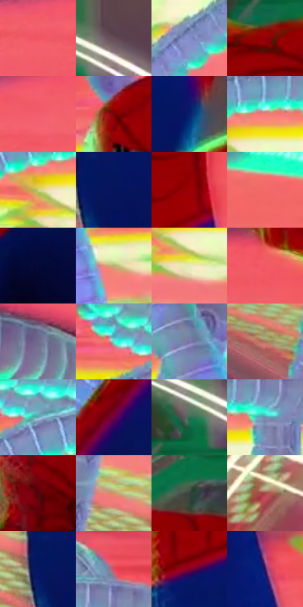

# 电影参考 621

- 状态：条件／活跃；来源世界：miles-home。
- 视角：low-angle；景别：medium；场景：industrial。
- 时段：event-time-unknown（外观依据，中置信度；具体时间／晨昏未知）；光照：event-light。
- 材质候选：fabric, plastic, metal, stone（帧级，不是像素分割）。
- 明暗组：middle；L* P5/P50/P95：10.75017 / 52.44717 / 86.44709。
- 资格门禁：energy。
- 原截图 SHA-256：`28d15e61e82e65e739ae5813b9ce5b25982e332f0dfa1277c9fb0109b6207413`；尺寸：2880 × 1204。
- sRGB 像素 SHA-256：`9e55b7ea4bc63524b77181b23d762661176d358c6c3c3915321b7e1d742ee863`。

## 观察与迁移

设备、软管、铁桶及火花保持材料差别，火花不泛化为光点。

深红与蓝色身体被珊瑚粉橙背景托出，局部绿受光边与浅青分节机械管分别建立层次。管道弯曲和蛛丝是实体，不当头周感应线；彩光使材料变色但体块保留，不自动移植管线、设备与动作。

本公开版保存32个128×128原像素色卡上下文；图集格子并非原场景相邻位置。原rect、图集tile和像素SHA见 `data/palette-crops.json`。上下文不足时不得批准替色，不能以小样推断完整构图。

## 实测色卡

颜色比例分母为保留采样像素，不是材料面积；全部 32 色参与全库匹配。表内四舍五入仅用于阅读，原精度在 JSON。

| ID | HEX | Lab | 原图 xy | 像素数 | 比例 | 明度角色 |
| --- | --- | --- | --- | ---: | ---: | --- |
| 621-S01 | #EF5461 | [57.616874, 60.256022, 25.777915] | [1676, 156] | 11708 | 6.077405% | midtone |
| 621-S02 | #664D57 | [35.63736, 12.30941, -1.796578] | [1756, 820] | 10948 | 5.682904% | shadow |
| 621-S03 | #838CCA | [59.747958, 11.628447, -33.082808] | [1776, 584] | 10504 | 5.452431% | midtone |
| 621-S04 | #8E0205 | [28.920407, 51.550279, 40.21617] | [1636, 988] | 10204 | 5.296707% | shadow |
| 621-S05 | #F25E6D | [59.881657, 57.900772, 21.920202] | [1844, 116] | 9857 | 5.116586% | midtone |
| 621-S06 | #770302 | [23.64746, 45.006145, 34.689647] | [1192, 460] | 9244 | 4.798389% | shadow |
| 621-S07 | #0B1D6E | [15.876821, 27.195355, -48.263512] | [668, 1008] | 8279 | 4.297475% | deep-shadow |
| 621-S08 | #F27A75 | [65.030493, 45.532279, 24.264675] | [2116, 492] | 7986 | 4.145384% | light |
| 621-S09 | #C3D27A | [81.347148, -18.503648, 41.833595] | [2044, 540] | 6739 | 3.498090% | highlight |
| 621-S10 | #06145B | [11.233605, 25.383621, -43.364512] | [2428, 796] | 6566 | 3.408289% | deep-shadow |
| 621-S11 | #9D0206 | [32.318302, 55.544235, 43.818478] | [2560, 216] | 6557 | 3.403617% | shadow |
| 621-S12 | #F3696A | [61.829666, 53.121084, 26.258561] | [72, 144] | 6478 | 3.362610% | light |
| 621-S13 | #060A37 | [4.801162, 15.049306, -28.7407] | [2028, 1080] | 6333 | 3.287343% | deep-shadow |
| 621-S14 | #B8B173 | [71.46906, -6.801526, 32.640744] | [568, 632] | 6151 | 3.192870% | light |
| 621-S15 | #E6E8BE | [90.896012, -7.54875, 20.264808] | [2088, 592] | 6007 | 3.118122% | highlight |
| 621-S16 | #F05F61 | [59.505656, 55.951582, 28.266706] | [2204, 44] | 5950 | 3.088535% | midtone |
| 621-S17 | #6F6C8B | [46.933056, 8.092809, -16.565568] | [920, 156] | 5785 | 3.002886% | midtone |
| 621-S18 | #4DEBCD | [84.688168, -47.849898, 2.598724] | [1892, 412] | 5573 | 2.892841% | highlight |
| 621-S19 | #7A73A4 | [50.779416, 13.733852, -25.297655] | [420, 436] | 5508 | 2.859101% | midtone |
| 621-S20 | #AF725C | [53.945565, 21.535851, 22.103227] | [2088, 772] | 5323 | 2.763070% | midtone |
| 621-S21 | #70ABBD | [66.704898, -14.448735, -15.247237] | [1984, 436] | 5273 | 2.737116% | light |
| 621-S22 | #700146 | [23.370333, 47.570523, -8.801] | [508, 1008] | 5055 | 2.623957% | shadow |
| 621-S23 | #336C52 | [41.27566, -25.495909, 8.911334] | [1680, 868] | 4670 | 2.424110% | midtone |
| 621-S24 | #6F8CAB | [57.148196, -2.450187, -19.621032] | [2208, 492] | 4073 | 2.114219% | midtone |
| 621-S25 | #4C0A0D | [14.305323, 30.183322, 16.678057] | [1284, 944] | 3876 | 2.011960% | deep-shadow |
| 621-S26 | #D49268 | [66.180342, 20.252588, 32.223673] | [2276, 720] | 3733 | 1.937731% | light |
| 621-S27 | #36403B | [26.059629, -5.312866, 1.677605] | [988, 1000] | 3320 | 1.723350% | shadow |
| 621-S28 | #AA494C | [43.995802, 40.105465, 18.169661] | [224, 1120] | 3055 | 1.585794% | midtone |
| 621-S29 | #051863 | [13.144497, 25.807461, -45.554804] | [2380, 792] | 2960 | 1.536481% | deep-shadow |
| 621-S30 | #D35165 | [52.594408, 52.740179, 15.884745] | [2240, 392] | 2598 | 1.348574% | midtone |
| 621-S31 | #81012B | [26.345872, 49.525127, 14.519042] | [2416, 340] | 1275 | 0.661829% | shadow |
| 621-S32 | #2E125B | [14.222966, 31.693754, -38.324439] | [2644, 444] | 1060 | 0.550226% | deep-shadow |

## 色阶与空间分布

- 采样 ROI：`[0.01, 0.02, 0.98, 0.94]`；步长：4；样本数：192648。
- 排除区：`[]`。
- 深暗、暗、中、亮、高光五段计数：`[29752, 46348, 58760, 43868, 13920]`。
- RGB 各 256 箱、L* 100 箱、13×5 色相明度表和 3×3 空间统计全部保存在 [总数据](../film-library.json)。
- [可视化档案](../../references/library.html)按需绘制直方图，不存 2,094 张重复图表图片。

## 纹理特征占比

**这是分块图像特征的面积占比，不是波点／排线／丝网／错版的精确语义覆盖率。** 窗格、发丝、织物也会产生方向或周期特征。
原图 ROI 像素 3092958；已测块覆盖 3092958（100.0000%）；未测 0。

| 特征 | 块覆盖像素 | 占已测面积 | 阈值敏感范围 |
| --- | ---: | ---: | --- |
| low-contrast | 214144 | 6.9236% | 6.0504% ~ 9.8246% |
| directional-structure | 968832 | 31.3238% | 16.2392% ~ 47.0954% |
| periodic-structure | 1877214 | 60.6932% | 46.8542% ~ 71.8173% |
| mixed-detail | 32768 | 1.0594% | 0.0000% ~ 2.1189% |

阈值敏感范围不是统计置信区间。逐块坐标、尺度、对比、方向一致性、频谱集中度、频率与角度见 [全量特征记录](../texture-features.jsonl)，以帧号定位。
四种印刷层的真实像素覆盖仍标为 `null`，不能填 0，也不能拿上表代替。不得据这些代理测量删除唯一证据。

[测量方法与保留策略](../../references/library-retention.md) · [分类索引](../archive/README.md)
