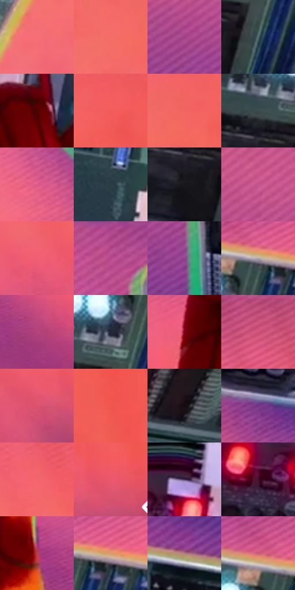

# 电影参考 622

- 状态：条件／活跃；来源世界：miles-home。
- 视角：low-angle；景别：detail；场景：industrial。
- 时段：event-time-unknown（外观依据，中置信度；具体时间／晨昏未知）；光照：event-light。
- 材质候选：fabric, plastic, metal, stone（帧级，不是像素分割）。
- 明暗组：middle；L* P5/P50/P95：8.40291 / 48.97322 / 63.69587。
- 资格门禁：energy。
- 原截图 SHA-256：`7b4abf83bd1100c6e5f6f7d650801327d4caaa83fcaaaec46738ec9ad68fb613`；尺寸：2880 × 1200。
- sRGB 像素 SHA-256：`edf9af0cb2caeaa3c45f9f8136e333ece42390cf67e3c279af118d6e16eb4b3d`。

## 观察与迁移

设备、软管、铁桶及火花保持材料差别，火花不泛化为光点。

暗绿电路板保留元件、线束、白插座的尺度关系，红绿指示灯为局部自发亮点；红手套右面受暖橙光，粉橙背景更平整并有斜纹。电路元件不是可随意铺满照片的科技花纹，亮灯与材质高光分开。

本公开版保存32个128×128原像素色卡上下文；图集格子并非原场景相邻位置。原rect、图集tile和像素SHA见 `data/palette-crops.json`。上下文不足时不得批准替色，不能以小样推断完整构图。

## 实测色卡

颜色比例分母为保留采样像素，不是材料面积；全部 32 色参与全库匹配。表内四舍五入仅用于阅读，原精度在 JSON。

| ID | HEX | Lab | 原图 xy | 像素数 | 比例 | 明度角色 |
| --- | --- | --- | --- | ---: | ---: | --- |
| 622-S01 | #F36E79 | [63.004375, 52.005213, 19.283669] | [2312, 488] | 12684 | 6.584029% | light |
| 622-S02 | #F36E66 | [62.651877, 50.507215, 29.592052] | [2464, 368] | 11645 | 6.044703% | light |
| 622-S03 | #A34086 | [43.027557, 48.992846, -18.995017] | [260, 208] | 10801 | 5.606599% | midtone |
| 622-S04 | #50676B | [41.949035, -7.518931, -5.058916] | [1572, 456] | 9938 | 5.158631% | midtone |
| 622-S05 | #4E0103 | [13.522704, 33.684515, 19.918793] | [1224, 592] | 9817 | 5.095822% | deep-shadow |
| 622-S06 | #F15C5A | [59.06562, 57.133866, 31.726319] | [2656, 296] | 9305 | 4.830053% | midtone |
| 622-S07 | #F26460 | [60.641533, 54.346365, 30.359712] | [2552, 328] | 9148 | 4.748557% | light |
| 622-S08 | #3D4A4C | [30.427279, -4.666525, -2.923325] | [1472, 372] | 7777 | 4.036896% | shadow |
| 622-S09 | #DC5A86 | [56.340353, 54.830254, 1.840675] | [560, 672] | 7623 | 3.956958% | midtone |
| 622-S10 | #2B3B46 | [23.945668, -3.254908, -8.84102] | [1076, 308] | 7473 | 3.879096% | shadow |
| 622-S11 | #19181F | [8.643916, 2.408901, -4.693878] | [1468, 472] | 6944 | 3.604501% | deep-shadow |
| 622-S12 | #C3538C | [51.478929, 50.830934, -9.316759] | [244, 84] | 6769 | 3.513662% | midtone |
| 622-S13 | #F05F74 | [59.866891, 57.36761, 17.793882] | [2564, 524] | 6471 | 3.358976% | midtone |
| 622-S14 | #B4498B | [47.410499, 50.692886, -15.084189] | [544, 60] | 6445 | 3.345480% | midtone |
| 622-S15 | #8B458D | [40.685247, 40.561543, -27.165741] | [576, 288] | 6201 | 3.218824% | midtone |
| 622-S16 | #B3AAAA | [70.3408, 3.219342, 1.157142] | [1628, 236] | 6014 | 3.121756% | light |
| 622-S17 | #B3447D | [45.908211, 50.755605, -8.902592] | [2060, 1020] | 5586 | 2.899589% | midtone |
| 622-S18 | #222537 | [15.163672, 3.955805, -12.093594] | [1556, 336] | 5564 | 2.888169% | deep-shadow |
| 622-S19 | #77000C | [23.504721, 45.835797, 30.426939] | [784, 912] | 5422 | 2.814460% | shadow |
| 622-S20 | #C74D76 | [50.40649, 52.213662, 2.334264] | [2148, 52] | 5203 | 2.700781% | midtone |
| 622-S21 | #DB5370 | [54.47047, 55.425948, 12.148964] | [2700, 592] | 5015 | 2.603193% | midtone |
| 622-S22 | #F0564D | [57.772466, 58.593548, 37.424565] | [2792, 404] | 4931 | 2.559591% | midtone |
| 622-S23 | #160A10 | [3.839848, 5.280282, -1.161381] | [1756, 688] | 4768 | 2.474980% | deep-shadow |
| 622-S24 | #723384 | [33.160003, 40.921293, -33.737374] | [732, 660] | 4752 | 2.466675% | shadow |
| 622-S25 | #F3666E | [61.384574, 54.785906, 23.385888] | [2400, 232] | 4504 | 2.337943% | light |
| 622-S26 | #EB586E | [57.820407, 58.268683, 18.358861] | [2780, 552] | 4285 | 2.224264% | midtone |
| 622-S27 | #432E59 | [23.231958, 19.415373, -22.373349] | [1056, 468] | 2358 | 1.223994% | shadow |
| 622-S28 | #450F2B | [14.296677, 28.49346, -4.361804] | [736, 504] | 1925 | 0.999232% | deep-shadow |
| 622-S29 | #B73B52 | [43.955344, 51.411163, 14.807587] | [1364, 880] | 1782 | 0.925003% | midtone |
| 622-S30 | #D99A68 | [68.653796, 17.969956, 35.487411] | [1684, 236] | 910 | 0.472364% | light |
| 622-S31 | #AE7D77 | [57.07486, 18.186881, 10.820327] | [812, 80] | 547 | 0.283938% | midtone |
| 622-S32 | #C85D6F | [53.231719, 44.291733, 10.570613] | [1584, 208] | 41 | 0.021282% | midtone |

## 色阶与空间分布

- 采样 ROI：`[0.01, 0.02, 0.98, 0.94]`；步长：4；样本数：192648。
- 排除区：`[]`。
- 深暗、暗、中、亮、高光五段计数：`[32248, 32590, 80268, 46485, 1057]`。
- RGB 各 256 箱、L* 100 箱、13×5 色相明度表和 3×3 空间统计全部保存在 [总数据](../film-library.json)。
- [可视化档案](../../references/library.html)按需绘制直方图，不存 2,094 张重复图表图片。

## 纹理特征占比

**这是分块图像特征的面积占比，不是波点／排线／丝网／错版的精确语义覆盖率。** 窗格、发丝、织物也会产生方向或周期特征。
原图 ROI 像素 3084576；已测块覆盖 3084576（100.0000%）；未测 0。

| 特征 | 块覆盖像素 | 占已测面积 | 阈值敏感范围 |
| --- | ---: | ---: | --- |
| low-contrast | 527136 | 17.0894% | 7.3792% ~ 21.2474% |
| directional-structure | 1092864 | 35.4300% | 20.1840% ~ 43.9700% |
| periodic-structure | 1381376 | 44.7833% | 44.7833% ~ 52.3109% |
| mixed-detail | 83200 | 2.6973% | 0.8631% ~ 6.2577% |

阈值敏感范围不是统计置信区间。逐块坐标、尺度、对比、方向一致性、频谱集中度、频率与角度见 [全量特征记录](../texture-features.jsonl)，以帧号定位。
四种印刷层的真实像素覆盖仍标为 `null`，不能填 0，也不能拿上表代替。不得据这些代理测量删除唯一证据。

[测量方法与保留策略](../../references/library-retention.md) · [分类索引](../archive/README.md)
