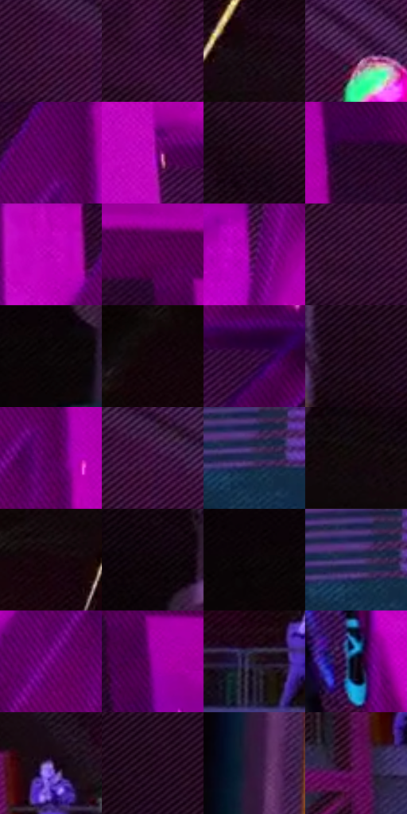

# 电影参考 623

- 状态：条件／活跃；来源世界：miles-home。
- 视角：low-angle；景别：environment-wide；场景：industrial。
- 时段：event-time-unknown（外观依据，中置信度；具体时间／晨昏未知）；光照：event-light。
- 材质候选：fabric, plastic, metal, stone（帧级，不是像素分割）。
- 明暗组：very-dark；L* P5/P50/P95：1.69267 / 12.66296 / 43.8507。
- 资格门禁：energy。
- 原截图 SHA-256：`db5f448ed726c6ee6434b17c6f41609b1777b010ff1ecd9c9cf2299d5110a5e1`；尺寸：2880 × 1200。
- sRGB 像素 SHA-256：`e3f2875ba61710ae36d89b86b58fc376954eaf23d31282d5cb9bb87debee5d37`。

## 观察与迁移

设备、软管、铁桶及火花保持材料差别，火花不泛化为光点。

深紫黑工业空间中，右侧品红桁架是大结构色面，人物局部多彩碎片为异常事件；细黄火花与青色短迹另列。背景细排线、实体斜撑、局部破碎不可混为动作线，异常头部不得用于普通面部重构。

本公开版保存32个128×128原像素色卡上下文；图集格子并非原场景相邻位置。原rect、图集tile和像素SHA见 `data/palette-crops.json`。上下文不足时不得批准替色，不能以小样推断完整构图。

## 实测色卡

颜色比例分母为保留采样像素，不是材料面积；全部 32 色参与全库匹配。表内四舍五入仅用于阅读，原精度在 JSON。

| ID | HEX | Lab | 原图 xy | 像素数 | 比例 | 明度角色 |
| --- | --- | --- | --- | ---: | ---: | --- |
| 623-S01 | #401941 | [16.340643, 25.604847, -16.978699] | [1096, 108] | 12448 | 6.461526% | deep-shadow |
| 623-S02 | #360F36 | [11.906886, 25.536838, -16.275231] | [856, 68] | 8956 | 4.648893% | deep-shadow |
| 623-S03 | #190B13 | [4.453862, 6.941944, -2.01121] | [984, 404] | 7577 | 3.933080% | deep-shadow |
| 623-S04 | #592D5A | [25.978124, 27.674119, -18.519767] | [1636, 364] | 7526 | 3.906607% | shadow |
| 623-S05 | #600066 | [21.750129, 49.057205, -33.019748] | [2080, 44] | 7106 | 3.688593% | shadow |
| 623-S06 | #C117C1 | [46.714438, 77.235602, -48.008286] | [2304, 380] | 6976 | 3.621112% | midtone |
| 623-S07 | #230D1B | [6.54321, 13.651829, -4.6533] | [1164, 388] | 6875 | 3.568685% | deep-shadow |
| 623-S08 | #270527 | [6.200509, 22.553394, -14.36262] | [2328, 104] | 6857 | 3.559341% | deep-shadow |
| 623-S09 | #B602B6 | [43.312235, 76.065207, -47.110892] | [1960, 64] | 6778 | 3.518334% | midtone |
| 623-S10 | #AD00AE | [41.123605, 73.591303, -45.967386] | [2572, 24] | 6770 | 3.514181% | midtone |
| 623-S11 | #410246 | [13.288593, 36.986467, -25.309321] | [2028, 520] | 6230 | 3.233877% | deep-shadow |
| 623-S12 | #2C0D2C | [9.035136, 21.218715, -13.604713] | [1016, 116] | 6213 | 3.225053% | deep-shadow |
| 623-S13 | #0F0A0C | [3.118121, 1.794095, -0.270431] | [124, 316] | 6204 | 3.220381% | deep-shadow |
| 623-S14 | #110309 | [1.843133, 4.878957, -0.845288] | [648, 680] | 6172 | 3.203771% | deep-shadow |
| 623-S15 | #300435 | [8.758927, 29.093746, -20.627269] | [2524, 408] | 6113 | 3.173145% | deep-shadow |
| 623-S16 | #170412 | [2.824604, 8.550436, -3.795199] | [548, 116] | 6091 | 3.161725% | deep-shadow |
| 623-S17 | #4F0056 | [17.15259, 43.23957, -29.941873] | [2116, 136] | 5974 | 3.100992% | deep-shadow |
| 623-S18 | #4A1E4B | [19.60857, 28.171753, -18.622895] | [1148, 96] | 5873 | 3.048565% | deep-shadow |
| 623-S19 | #1E2C4C | [18.360344, 5.207659, -21.607188] | [336, 504] | 5833 | 3.027802% | deep-shadow |
| 623-S20 | #150A0E | [3.68765, 4.46677, -0.335466] | [580, 344] | 5795 | 3.008077% | deep-shadow |
| 623-S21 | #17040B | [2.648443, 7.312531, -0.426099] | [1184, 688] | 5763 | 2.991466% | deep-shadow |
| 623-S22 | #0D0407 | [1.695984, 2.838502, -0.281951] | [132, 156] | 5695 | 2.956169% | deep-shadow |
| 623-S23 | #080305 | [1.153638, 1.585532, -0.296056] | [32, 296] | 5477 | 2.843009% | deep-shadow |
| 623-S24 | #473476 | [27.027147, 25.069308, -35.062101] | [320, 492] | 5446 | 2.826917% | shadow |
| 623-S25 | #740281 | [27.687592, 56.718176, -40.604612] | [2024, 200] | 5180 | 2.688842% | shadow |
| 623-S26 | #9A019F | [36.736104, 68.059863, -44.19184] | [2632, 152] | 5155 | 2.675865% | shadow |
| 623-S27 | #221B26 | [11.020617, 6.137257, -6.211928] | [1240, 1040] | 4670 | 2.424110% | deep-shadow |
| 623-S28 | #150E1C | [5.034457, 5.984853, -7.870931] | [1900, 756] | 4468 | 2.319256% | deep-shadow |
| 623-S29 | #715793 | [41.897074, 23.515491, -29.122771] | [1752, 968] | 4019 | 2.086188% | midtone |
| 623-S30 | #1C0319 | [3.452716, 13.25591, -7.736006] | [612, 28] | 4002 | 2.077364% | deep-shadow |
| 623-S31 | #321A3C | [14.077339, 19.057801, -17.180445] | [172, 868] | 3417 | 1.773701% | deep-shadow |
| 623-S32 | #5C1054 | [21.156406, 41.106633, -22.056312] | [1680, 1120] | 989 | 0.513372% | shadow |

## 色阶与空间分布

- 采样 ROI：`[0.01, 0.02, 0.98, 0.94]`；步长：4；样本数：192648。
- 排除区：`[]`。
- 深暗、暗、中、亮、高光五段计数：`[135220, 36158, 20146, 787, 337]`。
- RGB 各 256 箱、L* 100 箱、13×5 色相明度表和 3×3 空间统计全部保存在 [总数据](../film-library.json)。
- [可视化档案](../../references/library.html)按需绘制直方图，不存 2,094 张重复图表图片。

## 纹理特征占比

**这是分块图像特征的面积占比，不是波点／排线／丝网／错版的精确语义覆盖率。** 窗格、发丝、织物也会产生方向或周期特征。
原图 ROI 像素 3084576；已测块覆盖 3084576（100.0000%）；未测 0。

| 特征 | 块覆盖像素 | 占已测面积 | 阈值敏感范围 |
| --- | ---: | ---: | --- |
| low-contrast | 272384 | 8.8305% | 4.5812% ~ 10.9552% |
| directional-structure | 1271808 | 41.2312% | 28.1514% ~ 54.5102% |
| periodic-structure | 1458464 | 47.2825% | 40.3774% ~ 52.2621% |
| mixed-detail | 81920 | 2.6558% | 0.5312% ~ 8.6313% |

阈值敏感范围不是统计置信区间。逐块坐标、尺度、对比、方向一致性、频谱集中度、频率与角度见 [全量特征记录](../texture-features.jsonl)，以帧号定位。
四种印刷层的真实像素覆盖仍标为 `null`，不能填 0，也不能拿上表代替。不得据这些代理测量删除唯一证据。

[测量方法与保留策略](../../references/library-retention.md) · [分类索引](../archive/README.md)
