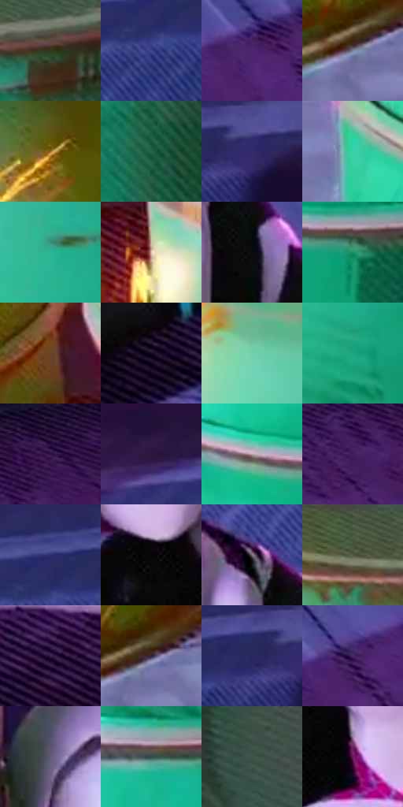

# 电影参考 624

- 状态：条件／活跃；来源世界：miles-home。
- 视角：high-angle；景别：full-body；场景：industrial。
- 时段：event-time-unknown（外观依据，中置信度；具体时间／晨昏未知）；光照：event-light。
- 材质候选：fabric, plastic, metal, stone（帧级，不是像素分割）。
- 明暗组：dark；L* P5/P50/P95：3.47386 / 32.62973 / 77.45162。
- 资格门禁：energy。
- 原截图 SHA-256：`ed5f7e5665fd28a26959f0f656d6da346a595b9ccb82cff44069cc8a9cd2180c`；尺寸：2880 × 1206。
- sRGB 像素 SHA-256：`38d2a3a8111e19bf09dac24d9aeb28b9e4f8712c05b2a92805e8aaed2a287949`。

## 观察与迁移

设备、软管、铁桶及火花保持材料差别，火花不泛化为光点。

绿桶宽受光面与金属环边表达圆柱，白帽人物以淡紫青受光区和黑躯干分离，右侧地面大投影仍为暗形。地板菱形结构、阴影排线、黄色接触火花和黑损伤痕分别处理；不在无事件照片增加弹痕或破损。

本公开版保存32个128×128原像素色卡上下文；图集格子并非原场景相邻位置。原rect、图集tile和像素SHA见 `data/palette-crops.json`。上下文不足时不得批准替色，不能以小样推断完整构图。

## 实测色卡

颜色比例分母为保留采样像素，不是材料面积；全部 32 色参与全库匹配。表内四舍五入仅用于阅读，原精度在 JSON。

| ID | HEX | Lab | 原图 xy | 像素数 | 比例 | 明度角色 |
| --- | --- | --- | --- | ---: | ---: | --- |
| 624-S01 | #30391B | [22.421775, -9.734269, 17.397552] | [1124, 96] | 22015 | 11.386323% | shadow |
| 624-S02 | #3F458E | [32.403343, 19.754878, -41.430023] | [2296, 132] | 19568 | 10.120716% | shadow |
| 624-S03 | #4D246F | [23.62906, 34.279829, -36.009953] | [2232, 480] | 16549 | 8.559267% | shadow |
| 624-S04 | #78819D | [54.161828, 3.076501, -16.058532] | [372, 908] | 10309 | 5.331892% | midtone |
| 624-S05 | #A77228 | [52.292417, 14.196415, 47.24578] | [272, 728] | 8124 | 4.201794% | midtone |
| 624-S06 | #236545 | [38.010203, -29.171654, 12.100744] | [1144, 368] | 7648 | 3.955603% | shadow |
| 624-S07 | #565199 | [38.132591, 21.127673, -38.845405] | [2620, 32] | 7333 | 3.792683% | shadow |
| 624-S08 | #36CFA8 | [74.972043, -48.325153, 8.186305] | [596, 944] | 6896 | 3.566663% | light |
| 624-S09 | #28B695 | [66.576647, -44.244552, 6.454529] | [924, 308] | 6808 | 3.521149% | light |
| 624-S10 | #E1C5B0 | [81.333579, 6.62739, 14.172028] | [572, 624] | 6690 | 3.460118% | highlight |
| 624-S11 | #0B0A10 | [2.941444, 1.251175, -2.581025] | [1816, 524] | 6554 | 3.389778% | deep-shadow |
| 624-S12 | #1B8F67 | [52.791275, -40.754425, 12.664046] | [992, 1028] | 6197 | 3.205135% | midtone |
| 624-S13 | #6A4527 | [32.848595, 12.502439, 24.385276] | [484, 512] | 6192 | 3.202549% | shadow |
| 624-S14 | #180B25 | [5.122569, 11.927774, -14.676319] | [1992, 968] | 5755 | 2.976529% | deep-shadow |
| 624-S15 | #75CFAD | [76.934026, -34.877026, 8.557589] | [716, 188] | 5651 | 2.922740% | light |
| 624-S16 | #1DA47E | [60.173555, -43.638325, 10.062869] | [928, 488] | 5540 | 2.865330% | light |
| 624-S17 | #34154A | [14.178344, 26.518602, -26.780784] | [2788, 352] | 5336 | 2.759819% | deep-shadow |
| 624-S18 | #220F38 | [8.715369, 20.101614, -23.00687] | [1944, 28] | 5236 | 2.708098% | deep-shadow |
| 624-S19 | #BE9EAB | [68.272048, 13.970226, -2.30647] | [812, 984] | 5019 | 2.595864% | light |
| 624-S20 | #431D60 | [19.706487, 31.735808, -32.617668] | [2636, 424] | 4946 | 2.558108% | deep-shadow |
| 624-S21 | #2E3070 | [23.217222, 19.63609, -37.485914] | [2304, 64] | 4635 | 2.397257% | shadow |
| 624-S22 | #060507 | [1.46875, 0.5395, -0.664544] | [1576, 592] | 3868 | 2.000559% | deep-shadow |
| 624-S23 | #7B6E7B | [47.998205, 7.608032, -5.326396] | [1748, 400] | 2919 | 1.509729% | midtone |
| 624-S24 | #535943 | [36.7228, -6.746317, 11.976018] | [864, 64] | 2838 | 1.467835% | shadow |
| 624-S25 | #39204C | [17.57455, 21.754972, -22.683617] | [1552, 864] | 2568 | 1.328189% | deep-shadow |
| 624-S26 | #322233 | [15.805403, 11.304199, -8.131015] | [404, 888] | 2319 | 1.199404% | deep-shadow |
| 624-S27 | #262C5F | [20.20076, 14.401201, -31.326643] | [2556, 52] | 1987 | 1.027691% | shadow |
| 624-S28 | #452A62 | [23.008939, 25.090237, -28.624535] | [2116, 512] | 1064 | 0.550309% | shadow |
| 624-S29 | #615B7A | [40.293043, 9.456421, -16.577798] | [1472, 340] | 953 | 0.492899% | midtone |
| 624-S30 | #364D4C | [30.910486, -9.049736, -2.265806] | [912, 628] | 831 | 0.429799% | shadow |
| 624-S31 | #405649 | [34.449991, -11.485324, 4.855555] | [2780, 1116] | 703 | 0.363597% | shadow |
| 624-S32 | #6C1C5F | [26.2901, 42.748737, -21.079772] | [1664, 676] | 295 | 0.152576% | shadow |

## 色阶与空间分布

- 采样 ROI：`[0.01, 0.02, 0.98, 0.94]`；步长：4；样本数：193346。
- 排除区：`[]`。
- 深暗、暗、中、亮、高光五段计数：`[43670, 79341, 33554, 31437, 5344]`。
- RGB 各 256 箱、L* 100 箱、13×5 色相明度表和 3×3 空间统计全部保存在 [总数据](../film-library.json)。
- [可视化档案](../../references/library.html)按需绘制直方图，不存 2,094 张重复图表图片。

## 纹理特征占比

**这是分块图像特征的面积占比，不是波点／排线／丝网／错版的精确语义覆盖率。** 窗格、发丝、织物也会产生方向或周期特征。
原图 ROI 像素 3098546；已测块覆盖 3098546（100.0000%）；未测 0。

| 特征 | 块覆盖像素 | 占已测面积 | 阈值敏感范围 |
| --- | ---: | ---: | --- |
| low-contrast | 13568 | 0.4379% | 0.4379% ~ 0.4379% |
| directional-structure | 1337600 | 43.1686% | 20.4400% ~ 66.0707% |
| periodic-structure | 1600178 | 51.6429% | 32.6115% ~ 71.7318% |
| mixed-detail | 147200 | 4.7506% | 0.8799% ~ 7.3903% |

阈值敏感范围不是统计置信区间。逐块坐标、尺度、对比、方向一致性、频谱集中度、频率与角度见 [全量特征记录](../texture-features.jsonl)，以帧号定位。
四种印刷层的真实像素覆盖仍标为 `null`，不能填 0，也不能拿上表代替。不得据这些代理测量删除唯一证据。

[测量方法与保留策略](../../references/library-retention.md) · [分类索引](../archive/README.md)
