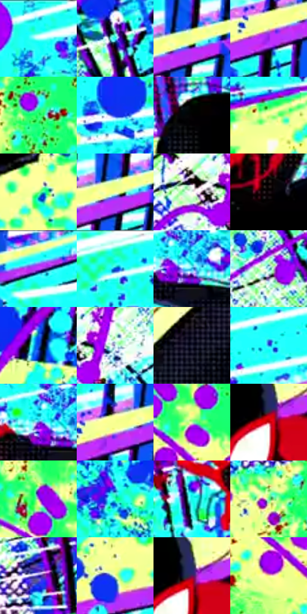

# 电影参考 625

- 状态：条件／活跃；来源世界：miles-home。
- 视角：graphic-nonphysical；景别：full-body；场景：graphic。
- 时段：graphic-no-physical-time（外观依据，中置信度；具体时间／晨昏未知）；光照：graphic-field。
- 材质候选：fabric（帧级，不是像素分割）。
- 明暗组：very-light；L* P5/P50/P95：1.60795 / 88.47189 / 97.75198。
- 资格门禁：impact。
- 原截图 SHA-256：`c527e79ac4b87041bee71ed495eeed91eddc99398ace787775a1d0393f95f476`；尺寸：2880 × 1206。
- sRGB 像素 SHA-256：`f69b6ec33049c6abb9c78ca3e2140f59e5728d22bb8f1c31c319dfeacb168451`。

## 观察与迁移

高彩泼点插帧，不能作日常天空或建筑色卡。

黑红人物剪影稳定，青、黄绿、蓝紫大底以泼点、半调网点、白色平行线和结构残线组织冲击。大圆斑与实景照明不同，属于强平面化事件插帧，不把全部图形背景当实际建筑表面或默认照片调色。

本公开版保存32个128×128原像素色卡上下文；图集格子并非原场景相邻位置。原rect、图集tile和像素SHA见 `data/palette-crops.json`。上下文不足时不得批准替色，不能以小样推断完整构图。

## 实测色卡

颜色比例分母为保留采样像素，不是材料面积；全部 32 色参与全库匹配。表内四舍五入仅用于阅读，原精度在 JSON。

| ID | HEX | Lab | 原图 xy | 像素数 | 比例 | 明度角色 |
| --- | --- | --- | --- | ---: | ---: | --- |
| 625-S01 | #1BFEF6 | [90.67197, -49.497292, -10.103017] | [1464, 36] | 12212 | 6.316138% | highlight |
| 625-S02 | #3AFBFA | [90.224643, -45.06111, -12.815517] | [596, 236] | 10044 | 5.194832% | highlight |
| 625-S03 | #F9FF96 | [97.57697, -16.817191, 49.39368] | [2340, 72] | 10035 | 5.190177% | highlight |
| 625-S04 | #981DE8 | [43.330326, 76.757064, -76.225157] | [2248, 124] | 9867 | 5.103286% | midtone |
| 625-S05 | #2CFB6D | [87.304838, -75.992037, 53.907181] | [132, 732] | 9522 | 4.924850% | highlight |
| 625-S06 | #1731F0 | [35.335656, 61.391601, -94.322841] | [2596, 184] | 9394 | 4.858647% | shadow |
| 625-S07 | #030202 | [0.606656, 0.261464, 0.092205] | [1408, 260] | 8726 | 4.513153% | deep-shadow |
| 625-S08 | #E2F987 | [94.171177, -24.175675, 51.931288] | [776, 460] | 8724 | 4.512118% | highlight |
| 625-S09 | #92FB84 | [90.215077, -52.818149, 47.470113] | [1792, 916] | 7167 | 3.706826% | highlight |
| 625-S10 | #FAFFA1 | [97.800528, -15.273349, 44.381153] | [2328, 80] | 6856 | 3.545975% | highlight |
| 625-S11 | #F0F9F1 | [97.076092, -4.385857, 2.807877] | [124, 168] | 6802 | 3.518045% | highlight |
| 625-S12 | #1B0F14 | [5.64741, 6.342983, -0.888399] | [1520, 732] | 6739 | 3.485461% | deep-shadow |
| 625-S13 | #F3FF96 | [97.13748, -19.088672, 48.748736] | [2480, 28] | 6707 | 3.468911% | highlight |
| 625-S14 | #35E9E5 | [84.321887, -43.4688, -10.631937] | [1680, 60] | 6283 | 3.249615% | highlight |
| 625-S15 | #33B5E8 | [69.164768, -17.639631, -35.311468] | [1068, 244] | 5818 | 3.009113% | light |
| 625-S16 | #8ED5E1 | [81.166357, -19.175835, -12.94287] | [472, 228] | 5744 | 2.970840% | highlight |
| 625-S17 | #0A4EDC | [39.032955, 37.491521, -76.838139] | [2224, 792] | 5462 | 2.824987% | shadow |
| 625-S18 | #D1DDE7 | [87.502929, -2.097629, -6.265844] | [216, 160] | 5081 | 2.627931% | highlight |
| 625-S19 | #25263B | [15.979252, 5.622202, -13.61287] | [1308, 864] | 5001 | 2.586555% | deep-shadow |
| 625-S20 | #1E7FDB | [52.471514, 6.679799, -54.449868] | [1880, 76] | 4891 | 2.529662% | midtone |
| 625-S21 | #576BD5 | [48.690273, 24.359536, -57.008435] | [1024, 228] | 4792 | 2.478458% | midtone |
| 625-S22 | #F8FF8F | [97.414561, -17.89402, 52.500223] | [2264, 88] | 4503 | 2.328985% | highlight |
| 625-S23 | #BFFAA1 | [92.583491, -34.161469, 36.851412] | [328, 876] | 4234 | 2.189857% | highlight |
| 625-S24 | #C61D22 | [42.769121, 62.800521, 42.587652] | [1560, 356] | 4234 | 2.189857% | midtone |
| 625-S25 | #AB74BF | [56.98848, 34.823208, -30.863879] | [256, 808] | 4171 | 2.157272% | midtone |
| 625-S26 | #21FEB5 | [89.176077, -65.375261, 21.33581] | [2456, 676] | 4158 | 2.150549% | highlight |
| 625-S27 | #13FAEB | [89.158955, -51.153103, -6.630904] | [888, 316] | 4067 | 2.103483% | highlight |
| 625-S28 | #64FC91 | [89.097346, -62.808264, 39.464784] | [428, 572] | 3559 | 1.840741% | highlight |
| 625-S29 | #3830A7 | [28.756261, 40.422231, -62.5855] | [572, 408] | 3233 | 1.672132% | shadow |
| 625-S30 | #F3FDB5 | [97.082306, -14.499664, 33.452937] | [2304, 1052] | 2650 | 1.370600% | highlight |
| 625-S31 | #5C145B | [22.057365, 40.971416, -25.309428] | [1568, 336] | 2176 | 1.125444% | shadow |
| 625-S32 | #FAEA9A | [92.356041, -5.670333, 40.816267] | [280, 960] | 494 | 0.255501% | highlight |

## 色阶与空间分布

- 采样 ROI：`[0.01, 0.02, 0.98, 0.94]`；步长：4；样本数：193346。
- 排除区：`[]`。
- 深暗、暗、中、亮、高光五段计数：`[19652, 22387, 24731, 14307, 112269]`。
- RGB 各 256 箱、L* 100 箱、13×5 色相明度表和 3×3 空间统计全部保存在 [总数据](../film-library.json)。
- [可视化档案](../../references/library.html)按需绘制直方图，不存 2,094 张重复图表图片。

## 纹理特征占比

**这是分块图像特征的面积占比，不是波点／排线／丝网／错版的精确语义覆盖率。** 窗格、发丝、织物也会产生方向或周期特征。
原图 ROI 像素 3098546；已测块覆盖 3098546（100.0000%）；未测 0。

| 特征 | 块覆盖像素 | 占已测面积 | 阈值敏感范围 |
| --- | ---: | ---: | --- |
| low-contrast | 0 | 0.0000% | 0.0000% ~ 0.0000% |
| directional-structure | 158336 | 5.1100% | 2.6438% ~ 10.2200% |
| periodic-structure | 2547122 | 82.2038% | 71.6285% ~ 86.6074% |
| mixed-detail | 393088 | 12.6862% | 3.1726% ~ 25.7277% |

阈值敏感范围不是统计置信区间。逐块坐标、尺度、对比、方向一致性、频谱集中度、频率与角度见 [全量特征记录](../texture-features.jsonl)，以帧号定位。
四种印刷层的真实像素覆盖仍标为 `null`，不能填 0，也不能拿上表代替。不得据这些代理测量删除唯一证据。

[测量方法与保留策略](../../references/library-retention.md) · [分类索引](../archive/README.md)
