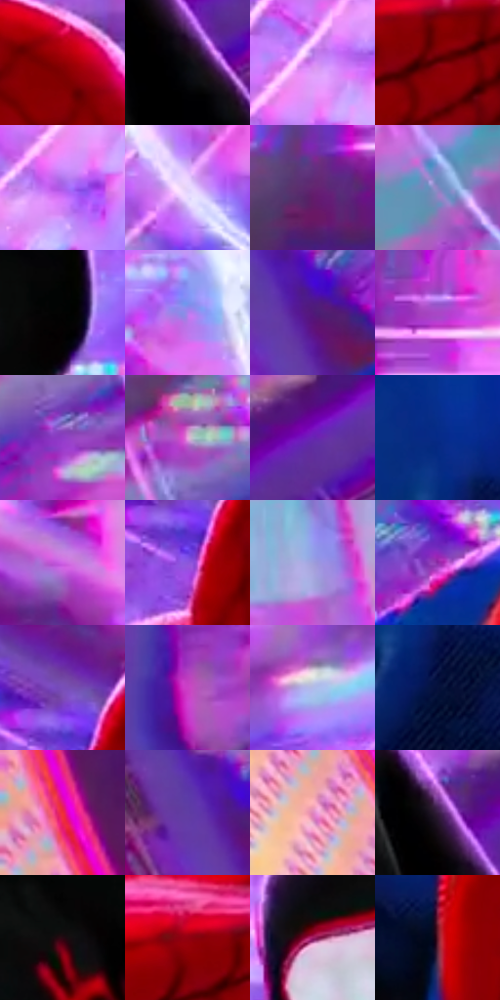

# 电影参考 626

- 状态：条件／活跃；来源世界：miles-home。
- 视角：near-level；景别：medium；场景：industrial。
- 时段：event-time-unknown（外观依据，中置信度；具体时间／晨昏未知）；光照：event-light。
- 材质候选：fabric, metal, glass（帧级，不是像素分割）。
- 明暗组：middle；L* P5/P50/P95：1.7245 / 41.69908 / 79.04205。
- 资格门禁：energy。
- 原截图 SHA-256：`a3a966f373310cb23c3189c917119d7177ca08e11e20f3eba4050e4f6d134615`；尺寸：2880 × 1204。
- sRGB 像素 SHA-256：`1a252303a1d97f8c36672d2365e45b07ebc9f3b303468546a48eba47a9ff24c7`。

## 观察与迁移

碰撞空间彩光和多层设备，普通物体固有色须另找稳定帧。

红蓝与黑红人物在亮粉紫机械背景前保持清楚暗形，肩部接触和倾身关系是动作核心；亮边对应背后强光。圆形机器结构、白色曲线效果和细纹分层，不因背景强烈就给肩部轻接触加爆炸冲击。

本公开版保存32个128×128原像素色卡上下文；图集格子并非原场景相邻位置。原rect、图集tile和像素SHA见 `data/palette-crops.json`。上下文不足时不得批准替色，不能以小样推断完整构图。

## 实测色卡

颜色比例分母为保留采样像素，不是材料面积；全部 32 色参与全库匹配。表内四舍五入仅用于阅读，原精度在 JSON。

| ID | HEX | Lab | 原图 xy | 像素数 | 比例 | 明度角色 |
| --- | --- | --- | --- | ---: | ---: | --- |
| 626-S01 | #910104 | [29.543835, 52.495346, 41.40548] | [1304, 228] | 13881 | 7.205369% | shadow |
| 626-S02 | #090A0F | [2.796966, 0.536181, -2.26326] | [2452, 916] | 13305 | 6.906378% | deep-shadow |
| 626-S03 | #D784F8 | [67.819593, 50.807407, -45.42033] | [2320, 72] | 10317 | 5.355363% | light |
| 626-S04 | #670205 | [19.797496, 40.760762, 28.216587] | [996, 520] | 9438 | 4.899091% | deep-shadow |
| 626-S05 | #AB60EA | [55.035294, 54.987452, -58.269993] | [2296, 148] | 9155 | 4.752191% | midtone |
| 626-S06 | #E7D5FC | [87.778449, 13.306778, -16.749498] | [2624, 524] | 7214 | 3.744653% | highlight |
| 626-S07 | #632570 | [27.146583, 39.627936, -30.836548] | [1416, 1120] | 6918 | 3.591005% | shadow |
| 626-S08 | #8587C2 | [58.234484, 12.997588, -30.907494] | [432, 384] | 6850 | 3.555708% | midtone |
| 626-S09 | #020202 | [0.548347, -3.5e-05, 6.6e-05] | [2080, 436] | 6699 | 3.477327% | deep-shadow |
| 626-S10 | #AB80ED | [61.835078, 38.55725, -49.109279] | [2448, 284] | 6682 | 3.468502% | light |
| 626-S11 | #50187A | [22.874721, 43.473365, -44.25836] | [340, 664] | 6652 | 3.452930% | shadow |
| 626-S12 | #A948C6 | [48.445689, 58.321017, -48.360571] | [1520, 1012] | 6585 | 3.418151% | midtone |
| 626-S13 | #8D3DC6 | [42.879604, 57.076996, -57.505003] | [280, 304] | 6356 | 3.299282% | midtone |
| 626-S14 | #EAA9E0 | [76.831479, 32.49602, -18.247448] | [368, 148] | 6289 | 3.264503% | light |
| 626-S15 | #6825B2 | [32.875732, 55.900784, -62.229631] | [2552, 804] | 6168 | 3.201694% | shadow |
| 626-S16 | #062A88 | [21.840651, 28.4553, -55.021354] | [392, 936] | 6162 | 3.198580% | shadow |
| 626-S17 | #D063E6 | [59.932326, 61.692509, -47.958168] | [1036, 76] | 6143 | 3.188717% | midtone |
| 626-S18 | #8C56DC | [48.757162, 49.789218, -60.653565] | [1020, 280] | 5854 | 3.038703% | midtone |
| 626-S19 | #9F9FDC | [67.526388, 13.445479, -30.882409] | [1704, 928] | 5610 | 2.912047% | light |
| 626-S20 | #8C2AA6 | [37.815745, 57.929796, -46.801624] | [656, 480] | 5142 | 2.669117% | shadow |
| 626-S21 | #784EB8 | [42.615337, 40.310336, -49.893575] | [1008, 200] | 4827 | 2.505606% | midtone |
| 626-S22 | #CB40C7 | [52.385736, 69.556657, -42.368089] | [100, 124] | 4747 | 2.464080% | midtone |
| 626-S23 | #B1BBE8 | [76.504582, 6.14108, -23.53925] | [1732, 236] | 4724 | 2.452141% | light |
| 626-S24 | #06123B | [7.108461, 12.819848, -27.902113] | [428, 1048] | 4539 | 2.356111% | deep-shadow |
| 626-S25 | #E92B53 | [51.475004, 71.033722, 25.852293] | [60, 684] | 4091 | 2.123562% | midtone |
| 626-S26 | #5F3EA3 | [35.047135, 37.917616, -49.767034] | [288, 652] | 4088 | 2.122005% | shadow |
| 626-S27 | #E088BC | [67.343899, 40.641895, -12.79589] | [96, 912] | 3278 | 1.701549% | light |
| 626-S28 | #361D40 | [15.660615, 19.516914, -17.457517] | [2416, 836] | 3140 | 1.629916% | deep-shadow |
| 626-S29 | #260A12 | [6.07853, 15.01625, 1.205473] | [2004, 768] | 2949 | 1.530771% | deep-shadow |
| 626-S30 | #930110 | [30.06951, 53.218677, 36.724008] | [936, 476] | 2565 | 1.331444% | shadow |
| 626-S31 | #9D1D64 | [35.924305, 55.926688, -8.724141] | [1760, 484] | 1542 | 0.800424% | shadow |
| 626-S32 | #651B2B | [22.743377, 34.225724, 8.637617] | [660, 744] | 738 | 0.383082% | shadow |

## 色阶与空间分布

- 采样 ROI：`[0.01, 0.02, 0.98, 0.94]`；步长：4；样本数：192648。
- 排除区：`[]`。
- 深暗、暗、中、亮、高光五段计数：`[36613, 56112, 51888, 39327, 8708]`。
- RGB 各 256 箱、L* 100 箱、13×5 色相明度表和 3×3 空间统计全部保存在 [总数据](../film-library.json)。
- [可视化档案](../../references/library.html)按需绘制直方图，不存 2,094 张重复图表图片。

## 纹理特征占比

**这是分块图像特征的面积占比，不是波点／排线／丝网／错版的精确语义覆盖率。** 窗格、发丝、织物也会产生方向或周期特征。
原图 ROI 像素 3092958；已测块覆盖 3092958（100.0000%）；未测 0。

| 特征 | 块覆盖像素 | 占已测面积 | 阈值敏感范围 |
| --- | ---: | ---: | --- |
| low-contrast | 48256 | 1.5602% | 0.3435% ~ 1.5602% |
| directional-structure | 960128 | 31.0424% | 12.5270% ~ 50.8655% |
| periodic-structure | 2068190 | 66.8677% | 48.4475% ~ 84.8533% |
| mixed-detail | 16384 | 0.5297% | 0.3435% ~ 1.0594% |

阈值敏感范围不是统计置信区间。逐块坐标、尺度、对比、方向一致性、频谱集中度、频率与角度见 [全量特征记录](../texture-features.jsonl)，以帧号定位。
四种印刷层的真实像素覆盖仍标为 `null`，不能填 0，也不能拿上表代替。不得据这些代理测量删除唯一证据。

[测量方法与保留策略](../../references/library-retention.md) · [分类索引](../archive/README.md)
