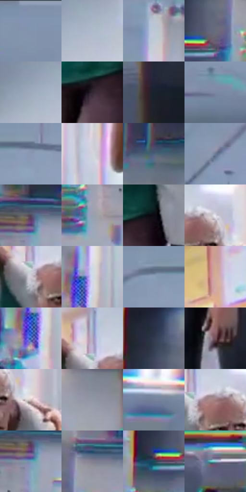

# 电影参考 627

- 状态：常规／活跃；来源世界：miles-home。
- 视角：near-level；景别：environment-wide；场景：interior。
- 时段：daylight-time-unspecified（外观依据，中置信度；具体时间／晨昏未知）；光照：neutral-day。
- 材质候选：skin, fabric, plastic, metal, paint（帧级，不是像素分割）。
- 明暗组：light；L* P5/P50/P95：11.3823 / 60.56099 / 86.35748。
- 资格门禁：无附加门禁。
- 原截图 SHA-256：`a108f40813368e2e35c94f56376edda76cdc6e64081702800bf78d4cca0a5b6a`；尺寸：2880 × 1214。
- sRGB 像素 SHA-256：`ec7296c630f09f784c13c9cd7e877085092c2c74020008308011b173f5c24eed`。

## 观察与迁移

中性医疗室、白衣与床架，与事件彩光区分。

冷中性灰白医院有帘布、床位、天花和暗柜，青绿衣服与人物肤色仍可分；设备、墙边出现明显多色色缘。普通空间结构可借鉴，但此事件状态的强分色不默认为白室基调，白布、金属与皮肤不共用高光。

本公开版保存32个128×128原像素色卡上下文；图集格子并非原场景相邻位置。原rect、图集tile和像素SHA见 `data/palette-crops.json`。上下文不足时不得批准替色，不能以小样推断完整构图。

## 实测色卡

颜色比例分母为保留采样像素，不是材料面积；全部 32 色参与全库匹配。表内四舍五入仅用于阅读，原精度在 JSON。

| ID | HEX | Lab | 原图 xy | 像素数 | 比例 | 明度角色 |
| --- | --- | --- | --- | ---: | ---: | --- |
| 627-S01 | #8192AC | [60.07132, -0.121382, -15.635725] | [456, 28] | 15420 | 7.918169% | light |
| 627-S02 | #AEB9CC | [74.859871, 0.071418, -10.86024] | [2300, 144] | 10976 | 5.636175% | light |
| 627-S03 | #BEC8D6 | [80.241426, -0.657945, -8.129158] | [1772, 212] | 9756 | 5.009705% | highlight |
| 627-S04 | #676B7E | [45.503861, 2.772443, -11.032848] | [140, 744] | 8887 | 4.563474% | midtone |
| 627-S05 | #9EA9BD | [68.981295, 0.326257, -11.541145] | [2220, 140] | 8857 | 4.548069% | light |
| 627-S06 | #302731 | [16.994597, 6.453701, -4.944818] | [1612, 908] | 8686 | 4.460260% | deep-shadow |
| 627-S07 | #18222D | [12.782622, -0.854003, -8.709849] | [2480, 1072] | 8644 | 4.438693% | deep-shadow |
| 627-S08 | #7C88A2 | [56.586316, 1.550351, -15.237115] | [756, 424] | 6872 | 3.528771% | midtone |
| 627-S09 | #8B97B5 | [62.471777, 2.387673, -17.019708] | [1144, 104] | 6682 | 3.431206% | light |
| 627-S10 | #D2D3DB | [84.691702, 1.138547, -4.055163] | [1336, 728] | 6511 | 3.343398% | highlight |
| 627-S11 | #4D5E77 | [39.436269, 0.136508, -16.195945] | [396, 1132] | 6505 | 3.340317% | shadow |
| 627-S12 | #6D7998 | [50.911433, 2.962133, -18.173858] | [868, 204] | 6201 | 3.184213% | midtone |
| 627-S13 | #4D4752 | [31.098639, 4.926366, -5.632397] | [384, 668] | 6108 | 3.136457% | shadow |
| 627-S14 | #9A9FB2 | [65.655271, 2.129741, -10.431284] | [280, 824] | 6041 | 3.102053% | light |
| 627-S15 | #0D0C12 | [3.542503, 1.386532, -2.851605] | [1688, 864] | 5979 | 3.070216% | deep-shadow |
| 627-S16 | #E6E4EE | [90.999723, 2.479826, -4.609244] | [1724, 504] | 5907 | 3.033244% | highlight |
| 627-S17 | #CFCAD5 | [82.006702, 3.74122, -4.839305] | [1616, 528] | 5552 | 2.850952% | highlight |
| 627-S18 | #CFDAE9 | [86.647698, -0.788317, -8.603399] | [1128, 832] | 5347 | 2.745684% | highlight |
| 627-S19 | #8A9FBA | [64.758551, -1.209386, -16.368985] | [1040, 100] | 5126 | 2.632201% | light |
| 627-S20 | #D4AE95 | [73.830864, 10.17386, 18.0384] | [2676, 116] | 5015 | 2.575202% | light |
| 627-S21 | #3B66B5 | [43.897044, 11.373862, -46.33749] | [1100, 884] | 4818 | 2.474043% | midtone |
| 627-S22 | #B4ABC2 | [71.367309, 7.611419, -10.554814] | [1616, 464] | 4815 | 2.472502% | light |
| 627-S23 | #313A4E | [24.414345, 1.926337, -13.394008] | [88, 648] | 4772 | 2.450422% | shadow |
| 627-S24 | #76565C | [40.048809, 14.23444, 1.744849] | [1832, 1052] | 4517 | 2.319479% | midtone |
| 627-S25 | #D0BEBE | [78.435683, 6.344567, 2.307345] | [1776, 568] | 4351 | 2.234238% | light |
| 627-S26 | #9196A4 | [62.093849, 1.084227, -7.94601] | [680, 736] | 4027 | 2.067864% | light |
| 627-S27 | #76819A | [53.904313, 1.688318, -14.725047] | [236, 216] | 3500 | 1.797250% | midtone |
| 627-S28 | #9F7D80 | [55.682675, 13.620684, 3.408041] | [1664, 512] | 3363 | 1.726900% | midtone |
| 627-S29 | #6A9CB7 | [61.876392, -9.54194, -19.24222] | [384, 708] | 3264 | 1.676064% | light |
| 627-S30 | #837F91 | [54.078168, 5.207638, -9.135014] | [212, 676] | 2922 | 1.500447% | midtone |
| 627-S31 | #1F405D | [26.004305, -1.884, -20.836697] | [32, 780] | 2670 | 1.371045% | shadow |
| 627-S32 | #7EC6CA | [75.504455, -21.432878, -9.116578] | [132, 984] | 2651 | 1.361288% | light |

## 色阶与空间分布

- 采样 ROI：`[0.01, 0.02, 0.98, 0.94]`；步长：4；样本数：194742。
- 排除区：`[]`。
- 深暗、暗、中、亮、高光五段计数：`[22086, 22315, 47974, 72009, 30358]`。
- RGB 各 256 箱、L* 100 箱、13×5 色相明度表和 3×3 空间统计全部保存在 [总数据](../film-library.json)。
- [可视化档案](../../references/library.html)按需绘制直方图，不存 2,094 张重复图表图片。

## 纹理特征占比

**这是分块图像特征的面积占比，不是波点／排线／丝网／错版的精确语义覆盖率。** 窗格、发丝、织物也会产生方向或周期特征。
原图 ROI 像素 3120898；已测块覆盖 3120898（100.0000%）；未测 0。

| 特征 | 块覆盖像素 | 占已测面积 | 阈值敏感范围 |
| --- | ---: | ---: | --- |
| low-contrast | 126592 | 4.0563% | 2.0999% ~ 5.1062% |
| directional-structure | 1326336 | 42.4985% | 32.2328% ~ 55.9429% |
| periodic-structure | 1656066 | 53.0638% | 41.5757% ~ 60.8482% |
| mixed-detail | 11904 | 0.3814% | 0.3814% ~ 1.8128% |

阈值敏感范围不是统计置信区间。逐块坐标、尺度、对比、方向一致性、频谱集中度、频率与角度见 [全量特征记录](../texture-features.jsonl)，以帧号定位。
四种印刷层的真实像素覆盖仍标为 `null`，不能填 0，也不能拿上表代替。不得据这些代理测量删除唯一证据。

[测量方法与保留策略](../../references/library-retention.md) · [分类索引](../archive/README.md)
