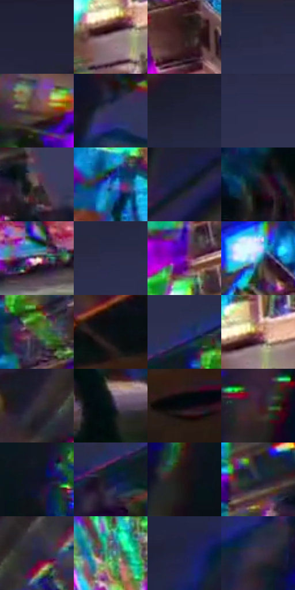

# 电影参考 628

- 状态：条件／活跃；来源世界：miles-home。
- 视角：low-angle；景别：environment-wide；场景：city。
- 时段：event-time-unknown（外观依据，中置信度；具体时间／晨昏未知）；光照：event-light。
- 材质候选：brick, glass, metal, asphalt（帧级，不是像素分割）。
- 明暗组：very-dark；L* P5/P50/P95：4.22013 / 19.23051 / 68.58592。
- 资格门禁：glitch。
- 原截图 SHA-256：`3439355c3c8223dded426d1996874669708e806579aefb7ecbee279ba4c04ec6`；尺寸：2880 × 1202。
- sRGB 像素 SHA-256：`29142bd856240699081cb5685b8072dc9567412d8bff5899da5c5bffdb8c18a9`。

## 观察与迁移

建筑碎裂、彩块和正常车路并存，不能误为玻璃映色。

夜间医院砖立面被青、品红、黄绿大方片错接覆盖，深灰蓝天空和前景橙车构成稳定大色区。彩块为几何异常，不是正常幕墙反光；保留受影响／未受影响区域区别，不把全楼碎裂当建筑绘制常规。

本公开版保存32个128×128原像素色卡上下文；图集格子并非原场景相邻位置。原rect、图集tile和像素SHA见 `data/palette-crops.json`。上下文不足时不得批准替色，不能以小样推断完整构图。

## 实测色卡

颜色比例分母为保留采样像素，不是材料面积；全部 32 色参与全库匹配。表内四舍五入仅用于阅读，原精度在 JSON。

| ID | HEX | Lab | 原图 xy | 像素数 | 比例 | 明度角色 |
| --- | --- | --- | --- | ---: | ---: | --- |
| 628-S01 | #202137 | [13.653614, 6.166038, -14.45753] | [2560, 28] | 10708 | 5.558324% | deep-shadow |
| 628-S02 | #9B838A | [57.111231, 10.355867, -0.351109] | [1264, 932] | 9140 | 4.744404% | midtone |
| 628-S03 | #30201E | [14.14656, 7.398375, 4.429774] | [1372, 404] | 8319 | 4.318238% | deep-shadow |
| 628-S04 | #262944 | [17.530542, 6.804276, -17.417573] | [1648, 44] | 8269 | 4.292284% | deep-shadow |
| 628-S05 | #60383D | [28.518503, 18.493778, 4.512559] | [708, 780] | 8156 | 4.233628% | shadow |
| 628-S06 | #36345B | [23.656176, 11.766725, -23.113221] | [504, 504] | 8085 | 4.196773% | shadow |
| 628-S07 | #1C1E2C | [11.66996, 3.228653, -9.667438] | [1028, 32] | 8001 | 4.153171% | deep-shadow |
| 628-S08 | #2E304F | [21.053019, 8.117831, -19.30158] | [1728, 124] | 7949 | 4.126178% | shadow |
| 628-S09 | #6B5C5D | [40.525487, 6.251683, 1.671708] | [2144, 384] | 7691 | 3.992255% | midtone |
| 628-S10 | #205CA6 | [39.092882, 8.407487, -45.250934] | [1160, 1092] | 7480 | 3.882729% | shadow |
| 628-S11 | #10192D | [8.948038, 3.282269, -14.721771] | [624, 200] | 6782 | 3.520410% | deep-shadow |
| 628-S12 | #121723 | [7.792667, 1.598748, -9.07209] | [2572, 920] | 6695 | 3.475250% | deep-shadow |
| 628-S13 | #D0C9BD | [81.21341, 0.349229, 6.858517] | [1820, 1068] | 6598 | 3.424899% | highlight |
| 628-S14 | #2A2C4A | [19.173486, 7.98848, -18.907515] | [1496, 112] | 6385 | 3.314335% | deep-shadow |
| 628-S15 | #7E11B6 | [34.424497, 65.716289, -61.948433] | [1604, 460] | 6182 | 3.208961% | shadow |
| 628-S16 | #48BBCB | [70.334519, -27.156375, -17.624373] | [1304, 284] | 6054 | 3.142519% | light |
| 628-S17 | #406938 | [40.374713, -24.978309, 23.084251] | [1100, 428] | 5851 | 3.037145% | midtone |
| 628-S18 | #080F15 | [4.041233, -0.776828, -4.106225] | [2664, 432] | 5793 | 3.007039% | deep-shadow |
| 628-S19 | #1F316C | [22.196202, 14.470629, -36.610138] | [1016, 324] | 5386 | 2.795773% | shadow |
| 628-S20 | #A2634C | [48.4218, 22.988549, 23.779455] | [1292, 896] | 5332 | 2.767742% | midtone |
| 628-S21 | #362F37 | [20.413216, 4.95472, -3.92777] | [2700, 172] | 4936 | 2.562186% | shadow |
| 628-S22 | #0D1419 | [5.92591, -1.311084, -4.287209] | [2320, 1076] | 4869 | 2.527407% | deep-shadow |
| 628-S23 | #04090D | [2.260306, -0.71535, -2.072417] | [2740, 540] | 4819 | 2.501453% | deep-shadow |
| 628-S24 | #3E1E36 | [16.597924, 19.529013, -8.886235] | [232, 1000] | 4326 | 2.245546% | deep-shadow |
| 628-S25 | #0F1123 | [5.634413, 4.417509, -12.421819] | [560, 944] | 4277 | 2.220111% | deep-shadow |
| 628-S26 | #0F1D42 | [11.779797, 8.916805, -25.277465] | [944, 404] | 4053 | 2.103837% | deep-shadow |
| 628-S27 | #1D1316 | [7.090113, 5.638242, -0.130391] | [380, 1008] | 3935 | 2.042585% | deep-shadow |
| 628-S28 | #232D36 | [17.920138, -1.646089, -7.164735] | [2032, 328] | 3726 | 1.934097% | deep-shadow |
| 628-S29 | #262342 | [15.525934, 10.460836, -19.192332] | [2820, 140] | 3690 | 1.915410% | deep-shadow |
| 628-S30 | #40837F | [50.515592, -22.272618, -4.379296] | [1588, 784] | 3409 | 1.769549% | midtone |
| 628-S31 | #1F224A | [15.113343, 12.019229, -25.409995] | [68, 688] | 3148 | 1.634068% | deep-shadow |
| 628-S32 | #3F3447 | [23.564361, 9.198617, -9.922053] | [348, 608] | 2604 | 1.351688% | shadow |

## 色阶与空间分布

- 采样 ROI：`[0.01, 0.02, 0.98, 0.94]`；步长：4；样本数：192648。
- 排除区：`[]`。
- 深暗、暗、中、亮、高光五段计数：`[101601, 49600, 26292, 10264, 4891]`。
- RGB 各 256 箱、L* 100 箱、13×5 色相明度表和 3×3 空间统计全部保存在 [总数据](../film-library.json)。
- [可视化档案](../../references/library.html)按需绘制直方图，不存 2,094 张重复图表图片。

## 纹理特征占比

**这是分块图像特征的面积占比，不是波点／排线／丝网／错版的精确语义覆盖率。** 窗格、发丝、织物也会产生方向或周期特征。
原图 ROI 像素 3087370；已测块覆盖 3087370（100.0000%）；未测 0。

| 特征 | 块覆盖像素 | 占已测面积 | 阈值敏感范围 |
| --- | ---: | ---: | --- |
| low-contrast | 419968 | 13.6028% | 7.7653% ~ 17.8482% |
| directional-structure | 279818 | 9.0633% | 1.2023% ~ 22.1852% |
| periodic-structure | 2289280 | 74.1498% | 69.5188% ~ 75.6427% |
| mixed-detail | 98304 | 3.1841% | 0.5307% ~ 5.3068% |

阈值敏感范围不是统计置信区间。逐块坐标、尺度、对比、方向一致性、频谱集中度、频率与角度见 [全量特征记录](../texture-features.jsonl)，以帧号定位。
四种印刷层的真实像素覆盖仍标为 `null`，不能填 0，也不能拿上表代替。不得据这些代理测量删除唯一证据。

[测量方法与保留策略](../../references/library-retention.md) · [分类索引](../archive/README.md)
