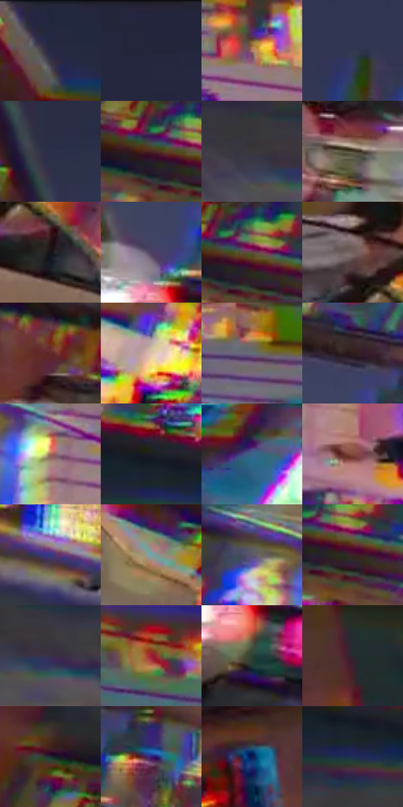

# 电影参考 629

- 状态：条件／活跃；来源世界：miles-home。
- 视角：low-angle；景别：environment-wide；场景：city。
- 时段：event-time-unknown（外观依据，中置信度；具体时间／晨昏未知）；光照：event-light。
- 材质候选：brick, glass, metal, asphalt（帧级，不是像素分割）。
- 明暗组：dark；L* P5/P50/P95：8.48367 / 24.22154 / 65.03529。
- 资格门禁：glitch。
- 原截图 SHA-256：`079e004d35e8d14992f937811209fd4e7658d52e579f6372bf1bf37ed1f47ea3`；尺寸：2880 × 1208。
- sRGB 像素 SHA-256：`ad7dd23012e7098717761136f69f9b3e3ca52596cea1c308132c28cd32e5280d`。

## 观察与迁移

建筑碎裂、彩块和正常车路并存，不能误为玻璃映色。

倾斜街景仍保留灰白车辆、门面及大块暗蓝灰天空，招牌和建筑边有强多重彩缘，左上局部立面碎裂。实体透视、宽色版错位、破碎及运动状态分别记录；不能把所有重边笼统称作运动模糊。

本公开版保存32个128×128原像素色卡上下文；图集格子并非原场景相邻位置。原rect、图集tile和像素SHA见 `data/palette-crops.json`。上下文不足时不得批准替色，不能以小样推断完整构图。

## 实测色卡

颜色比例分母为保留采样像素，不是材料面积；全部 32 色参与全库匹配。表内四舍五入仅用于阅读，原精度在 JSON。

| ID | HEX | Lab | 原图 xy | 像素数 | 比例 | 明度角色 |
| --- | --- | --- | --- | ---: | ---: | --- |
| 629-S01 | #252940 | [17.222613, 5.11819, -15.150661] | [972, 56] | 13385 | 6.922822% | deep-shadow |
| 629-S02 | #22253B | [15.376058, 5.291153, -14.5732] | [1332, 28] | 13069 | 6.759385% | deep-shadow |
| 629-S03 | #B17E74 | [57.589674, 18.421709, 13.317763] | [2200, 656] | 10668 | 5.517570% | midtone |
| 629-S04 | #333851 | [24.083878, 4.888473, -15.875021] | [1736, 504] | 9701 | 5.017430% | shadow |
| 629-S05 | #2B2F48 | [20.101308, 5.539339, -16.09495] | [1296, 256] | 8631 | 4.464018% | shadow |
| 629-S06 | #4B2625 | [20.107935, 17.243222, 8.407888] | [824, 628] | 8480 | 4.385920% | shadow |
| 629-S07 | #3A3838 | [23.715794, 0.864746, 0.309491] | [620, 996] | 7851 | 4.060596% | shadow |
| 629-S08 | #4F4432 | [29.48054, 1.571171, 12.651224] | [1356, 932] | 7582 | 3.921467% | shadow |
| 629-S09 | #171317 | [6.411324, 2.712831, -1.938533] | [528, 620] | 7581 | 3.920950% | deep-shadow |
| 629-S10 | #4C4060 | [29.532653, 12.566454, -17.025702] | [1536, 896] | 7524 | 3.891469% | shadow |
| 629-S11 | #5E4943 | [33.028369, 7.90097, 6.996585] | [864, 624] | 7325 | 3.788545% | shadow |
| 629-S12 | #73615E | [42.767419, 6.696986, 4.39978] | [456, 508] | 7004 | 3.622521% | midtone |
| 629-S13 | #632B2E | [25.498089, 25.629896, 10.3125] | [1236, 776] | 6822 | 3.528390% | shadow |
| 629-S14 | #DEC2AF | [80.297572, 6.948836, 13.207091] | [1000, 796] | 6598 | 3.412535% | highlight |
| 629-S15 | #60707B | [46.317936, -3.352045, -8.069341] | [2108, 492] | 6505 | 3.364435% | midtone |
| 629-S16 | #2E1C1E | [12.641047, 9.235314, 2.250156] | [1572, 792] | 6262 | 3.238753% | deep-shadow |
| 629-S17 | #9F6756 | [49.185275, 20.477089, 18.875632] | [1936, 748] | 6134 | 3.172551% | midtone |
| 629-S18 | #1B1D23 | [10.799101, 0.739172, -4.408399] | [772, 876] | 5357 | 2.770681% | deep-shadow |
| 629-S19 | #3A648A | [40.973296, -2.74552, -25.452592] | [384, 208] | 5294 | 2.738096% | midtone |
| 629-S20 | #844A3E | [38.114053, 23.26862, 17.876389] | [2008, 940] | 4638 | 2.398808% | shadow |
| 629-S21 | #333C87 | [28.601058, 20.79778, -43.281756] | [1812, 1088] | 4596 | 2.377086% | shadow |
| 629-S22 | #76A4A7 | [64.315342, -14.610981, -6.527363] | [672, 680] | 4531 | 2.343467% | light |
| 629-S23 | #5B5769 | [37.950582, 5.615423, -9.725006] | [1820, 704] | 4454 | 2.303642% | shadow |
| 629-S24 | #3A212B | [16.314611, 13.740726, -1.570598] | [888, 652] | 3894 | 2.014006% | deep-shadow |
| 629-S25 | #373144 | [21.675686, 7.319419, -10.864043] | [684, 1016] | 3555 | 1.838673% | shadow |
| 629-S26 | #991F32 | [33.950948, 50.028878, 20.705921] | [2760, 520] | 3246 | 1.678856% | shadow |
| 629-S27 | #2D4032 | [25.121512, -11.042717, 6.161481] | [1560, 1012] | 2940 | 1.520590% | shadow |
| 629-S28 | #2A2A31 | [17.319705, 1.774118, -4.523406] | [2696, 800] | 2934 | 1.517487% | deep-shadow |
| 629-S29 | #1E2C2F | [16.905086, -4.977306, -3.850476] | [764, 504] | 2685 | 1.388702% | deep-shadow |
| 629-S30 | #2E1A73 | [18.174707, 34.767271, -47.63441] | [1660, 868] | 1992 | 1.030277% | deep-shadow |
| 629-S31 | #12154B | [10.354608, 19.358068, -33.859852] | [2480, 812] | 1109 | 0.573583% | deep-shadow |
| 629-S32 | #1E3053 | [20.10053, 5.051693, -23.558379] | [788, 932] | 999 | 0.516690% | shadow |

## 色阶与空间分布

- 采样 ROI：`[0.01, 0.02, 0.98, 0.94]`；步长：4；样本数：193346。
- 排除区：`[]`。
- 深暗、暗、中、亮、高光五段计数：`[67165, 79343, 33548, 9564, 3726]`。
- RGB 各 256 箱、L* 100 箱、13×5 色相明度表和 3×3 空间统计全部保存在 [总数据](../film-library.json)。
- [可视化档案](../../references/library.html)按需绘制直方图，不存 2,094 张重复图表图片。

## 纹理特征占比

**这是分块图像特征的面积占比，不是波点／排线／丝网／错版的精确语义覆盖率。** 窗格、发丝、织物也会产生方向或周期特征。
原图 ROI 像素 3104134；已测块覆盖 3104134（100.0000%）；未测 0。

| 特征 | 块覆盖像素 | 占已测面积 | 阈值敏感范围 |
| --- | ---: | ---: | --- |
| low-contrast | 502272 | 16.1807% | 14.5973% ~ 16.1807% |
| directional-structure | 825600 | 26.5968% | 15.9210% ~ 40.6292% |
| periodic-structure | 1759878 | 56.6947% | 44.7735% ~ 66.3149% |
| mixed-detail | 16384 | 0.5278% | 0.0000% ~ 1.5834% |

阈值敏感范围不是统计置信区间。逐块坐标、尺度、对比、方向一致性、频谱集中度、频率与角度见 [全量特征记录](../texture-features.jsonl)，以帧号定位。
四种印刷层的真实像素覆盖仍标为 `null`，不能填 0，也不能拿上表代替。不得据这些代理测量删除唯一证据。

[测量方法与保留策略](../../references/library-retention.md) · [分类索引](../archive/README.md)
