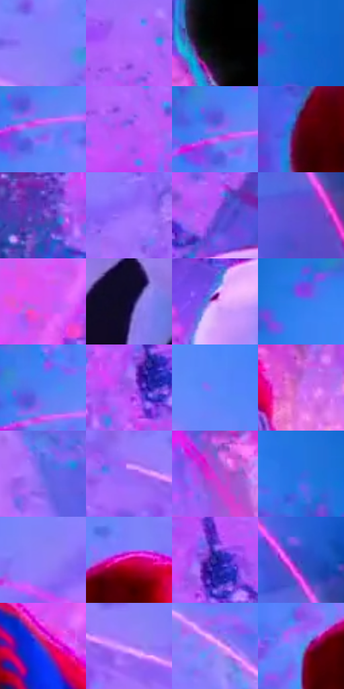

# 电影参考 630

- 状态：条件／活跃；来源世界：miles-home。
- 视角：near-level；景别：medium；场景：industrial。
- 时段：event-time-unknown（外观依据，中置信度；具体时间／晨昏未知）；光照：event-light。
- 材质候选：fabric, metal, glass（帧级，不是像素分割）。
- 明暗组：middle；L* P5/P50/P95：3.14285 / 53.60877 / 64.22851。
- 资格门禁：energy。
- 原截图 SHA-256：`45dce580aa411098acc0d82127f984f5c4f554c54f4cdbdd2a71014929a57946`；尺寸：2880 × 1204。
- sRGB 像素 SHA-256：`0f31397d3ae943ee52b00dacd989058472538927456b55fa40558d90c4cd7590`。

## 观察与迁移

碰撞空间彩光和多层设备，普通物体固有色须另找稳定帧。

三名背影以红蓝、黑红、白黑形成前景色块，蓝底与粉紫粒子包围漂移城市碎片和细粉曲线。城市悬浮属于碰撞事件，不作为日常空气透视；黑色身体在高彩背景前仍是暗锚点，粒子不是通用纸纹。

本公开版保存32个128×128原像素色卡上下文；图集格子并非原场景相邻位置。原rect、图集tile和像素SHA见 `data/palette-crops.json`。上下文不足时不得批准替色，不能以小样推断完整构图。

## 实测色卡

颜色比例分母为保留采样像素，不是材料面积；全部 32 色参与全库匹配。表内四舍五入仅用于阅读，原精度在 JSON。

| ID | HEX | Lab | 原图 xy | 像素数 | 比例 | 明度角色 |
| --- | --- | --- | --- | ---: | ---: | --- |
| 630-S01 | #827EF9 | [58.51323, 32.918224, -61.243858] | [2048, 144] | 11415 | 5.925315% | midtone |
| 630-S02 | #AE68FA | [57.847596, 55.30794, -62.64532] | [1332, 212] | 9174 | 4.762053% | midtone |
| 630-S03 | #050305 | [0.978712, 0.801034, -0.572471] | [1340, 640] | 8842 | 4.589718% | deep-shadow |
| 630-S04 | #1566CF | [44.468286, 17.255539, -60.518312] | [2788, 308] | 8552 | 4.439184% | midtone |
| 630-S05 | #6F7FF3 | [57.101541, 26.531085, -60.2612] | [300, 436] | 8516 | 4.420497% | midtone |
| 630-S06 | #B557F6 | [55.373897, 64.197601, -64.360535] | [1352, 276] | 8287 | 4.301628% | midtone |
| 630-S07 | #8769F1 | [53.603597, 43.842151, -64.678752] | [268, 416] | 8176 | 4.244010% | midtone |
| 630-S08 | #580115 | [16.26166, 37.305113, 15.094583] | [80, 940] | 7909 | 4.105415% | deep-shadow |
| 630-S09 | #5A3BB8 | [35.52068, 44.655938, -61.529855] | [1708, 492] | 7637 | 3.964225% | shadow |
| 630-S10 | #9E6FFB | [57.65715, 48.224098, -63.59284] | [888, 268] | 7628 | 3.959553% | midtone |
| 630-S11 | #8050DF | [46.516108, 51.257298, -66.045159] | [2100, 556] | 7564 | 3.926332% | midtone |
| 630-S12 | #604FD1 | [42.278225, 41.789094, -65.062549] | [2792, 808] | 7340 | 3.810058% | midtone |
| 630-S13 | #D554F2 | [58.880913, 71.597327, -56.28076] | [724, 852] | 7260 | 3.768531% | midtone |
| 630-S14 | #0F0A32 | [4.957743, 14.697081, -24.780042] | [2212, 1036] | 6854 | 3.557784% | deep-shadow |
| 630-S15 | #E997F3 | [73.499888, 45.147591, -33.685367] | [2016, 688] | 6767 | 3.512624% | light |
| 630-S16 | #357CED | [53.258309, 17.305431, -63.246528] | [288, 156] | 6100 | 3.166397% | midtone |
| 630-S17 | #4C80F6 | [55.710826, 20.907401, -64.254812] | [292, 380] | 5909 | 3.067252% | midtone |
| 630-S18 | #9D52E7 | [50.654181, 58.129334, -63.719301] | [1808, 464] | 5904 | 3.064657% | midtone |
| 630-S19 | #5D86FA | [58.298424, 21.264131, -62.264084] | [2292, 104] | 5756 | 2.987833% | midtone |
| 630-S20 | #D36EF1 | [62.804411, 59.362862, -49.506154] | [1648, 804] | 5294 | 2.748017% | light |
| 630-S21 | #6268E5 | [49.680345, 33.470136, -64.43347] | [2568, 912] | 5279 | 2.740231% | midtone |
| 630-S22 | #9966F3 | [54.808768, 49.936026, -63.763382] | [1912, 192] | 4668 | 2.423072% | midtone |
| 630-S23 | #C241DA | [52.189633, 70.471966, -53.63156] | [1040, 808] | 4565 | 2.369607% | midtone |
| 630-S24 | #346BDF | [47.714289, 22.701908, -64.339535] | [2660, 192] | 4436 | 2.302645% | midtone |
| 630-S25 | #8F7EF9 | [59.52479, 35.827106, -59.567452] | [576, 400] | 4380 | 2.273577% | midtone |
| 630-S26 | #CA005F | [43.340102, 70.557311, 6.37894] | [360, 596] | 3844 | 1.995349% | midtone |
| 630-S27 | #2E2A99 | [25.369066, 38.05327, -59.674891] | [1840, 428] | 3130 | 1.624725% | shadow |
| 630-S28 | #374AC2 | [37.120551, 33.55912, -64.896644] | [2788, 688] | 3129 | 1.624206% | shadow |
| 630-S29 | #832CA7 | [36.775058, 55.520856, -49.147986] | [672, 964] | 3062 | 1.589427% | shadow |
| 630-S30 | #B07FF8 | [62.663903, 43.070133, -53.836421] | [2016, 208] | 2624 | 1.362070% | light |
| 630-S31 | #9B87F5 | [62.412641, 32.468212, -52.701911] | [2516, 456] | 1852 | 0.961339% | light |
| 630-S32 | #4E94F2 | [60.963812, 7.750353, -53.63527] | [252, 640] | 795 | 0.412670% | light |

## 色阶与空间分布

- 采样 ROI：`[0.01, 0.02, 0.98, 0.94]`；步长：4；样本数：192648。
- 排除区：`[]`。
- 深暗、暗、中、亮、高光五段计数：`[22250, 19919, 129988, 20120, 371]`。
- RGB 各 256 箱、L* 100 箱、13×5 色相明度表和 3×3 空间统计全部保存在 [总数据](../film-library.json)。
- [可视化档案](../../references/library.html)按需绘制直方图，不存 2,094 张重复图表图片。

## 纹理特征占比

**这是分块图像特征的面积占比，不是波点／排线／丝网／错版的精确语义覆盖率。** 窗格、发丝、织物也会产生方向或周期特征。
原图 ROI 像素 3092958；已测块覆盖 3092958（100.0000%）；未测 0。

| 特征 | 块覆盖像素 | 占已测面积 | 阈值敏感范围 |
| --- | ---: | ---: | --- |
| low-contrast | 119552 | 3.8653% | 1.4029% ~ 5.9842% |
| directional-structure | 454144 | 14.6832% | 5.6117% ~ 21.2922% |
| periodic-structure | 2443102 | 78.9892% | 76.7751% ~ 78.9892% |
| mixed-detail | 76160 | 2.4624% | 0.5297% ~ 9.7874% |

阈值敏感范围不是统计置信区间。逐块坐标、尺度、对比、方向一致性、频谱集中度、频率与角度见 [全量特征记录](../texture-features.jsonl)，以帧号定位。
四种印刷层的真实像素覆盖仍标为 `null`，不能填 0，也不能拿上表代替。不得据这些代理测量删除唯一证据。

[测量方法与保留策略](../../references/library-retention.md) · [分类索引](../archive/README.md)
