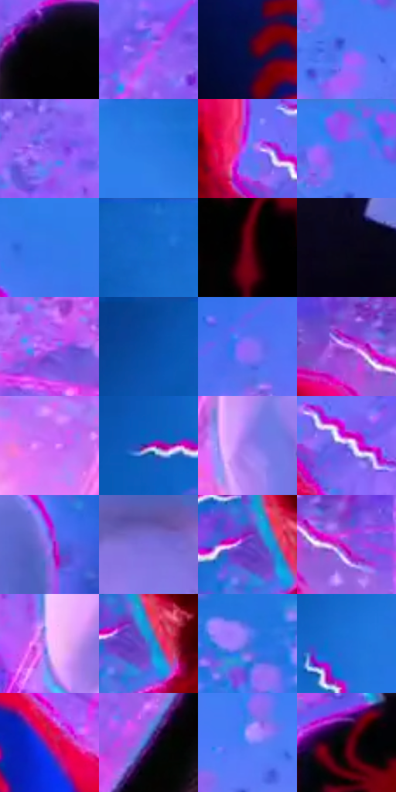

# 电影参考 631

- 状态：条件／活跃；来源世界：miles-home。
- 视角：near-level；景别：medium；场景：industrial。
- 时段：event-time-unknown（外观依据，中置信度；具体时间／晨昏未知）；光照：event-light。
- 材质候选：fabric, metal（帧级，不是像素分割）。
- 明暗组：middle；L* P5/P50/P95：1.2741 / 50.43577 / 65.70151。
- 资格门禁：sense, energy。
- 原截图 SHA-256：`94aea2e39453d0d7b30dd39676abd777ffabd6e6aaf050fe73aa80b058aa5100`；尺寸：2880 × 1202。
- sRGB 像素 SHA-256：`126e32390d26869decb8540bbae3a7449c33f70dc095d46685623b06097edcc8`。

## 观察与迁移

多人感应波与能量背景，人数按实际可辨头部而非角色数目。

三名背影各自有独立白粉分段放射波浪，蓝粉场域与粒子退居后层；可与630比较感应图形出现前后，但取景也改变。波浪不连成一条装饰线，仅当本次照片明确口令且人数符合规则启用。

本公开版保存32个128×128原像素色卡上下文；图集格子并非原场景相邻位置。原rect、图集tile和像素SHA见 `data/palette-crops.json`。上下文不足时不得批准替色，不能以小样推断完整构图。

## 实测色卡

颜色比例分母为保留采样像素，不是材料面积；全部 32 色参与全库匹配。表内四舍五入仅用于阅读，原精度在 JSON。

| ID | HEX | Lab | 原图 xy | 像素数 | 比例 | 明度角色 |
| --- | --- | --- | --- | ---: | ---: | --- |
| 631-S01 | #020203 | [0.568134, 0.139009, -0.378358] | [1364, 508] | 9632 | 4.999792% | deep-shadow |
| 631-S02 | #9F5AF3 | [53.117187, 57.457296, -66.459393] | [824, 556] | 9149 | 4.749076% | midtone |
| 631-S03 | #120F37 | [6.73844, 15.41533, -25.5699] | [304, 936] | 8907 | 4.623458% | deep-shadow |
| 631-S04 | #5F75F5 | [53.755734, 30.250509, -66.805457] | [1360, 136] | 8843 | 4.590237% | midtone |
| 631-S05 | #8858EC | [49.820251, 52.038088, -67.992601] | [1828, 440] | 8386 | 4.353017% | midtone |
| 631-S06 | #2577E2 | [50.774824, 14.837504, -61.108623] | [2324, 44] | 7966 | 4.135003% | midtone |
| 631-S07 | #766CF6 | [53.198483, 40.115396, -68.18673] | [488, 684] | 7801 | 4.049354% | midtone |
| 631-S08 | #3F7BF2 | [53.632521, 20.870805, -65.410756] | [1348, 60] | 7648 | 3.969935% | midtone |
| 631-S09 | #3377EA | [51.650051, 19.107951, -64.16751] | [2264, 172] | 7515 | 3.900897% | midtone |
| 631-S10 | #1566CD | [44.329692, 16.466969, -59.594945] | [444, 32] | 7485 | 3.885325% | midtone |
| 631-S11 | #750115 | [23.199707, 45.334639, 24.879029] | [1292, 900] | 6869 | 3.565570% | shadow |
| 631-S12 | #090616 | [2.224276, 3.625505, -7.455795] | [2364, 1012] | 6452 | 3.349113% | deep-shadow |
| 631-S13 | #BE56F5 | [56.283254, 66.348054, -62.28179] | [992, 772] | 6297 | 3.268656% | midtone |
| 631-S14 | #0948A1 | [32.402, 18.081103, -53.085727] | [272, 40] | 6172 | 3.203771% | shadow |
| 631-S15 | #9068F7 | [54.599362, 47.944336, -66.370039] | [760, 336] | 6105 | 3.168992% | midtone |
| 631-S16 | #D28BF7 | [68.666383, 45.551833, -43.582483] | [1588, 676] | 6052 | 3.141481% | light |
| 631-S17 | #CA6AF4 | [61.130493, 59.637773, -53.891752] | [1868, 980] | 5651 | 2.933329% | light |
| 631-S18 | #2253BC | [38.120334, 23.18403, -59.79465] | [44, 584] | 5647 | 2.931253% | shadow |
| 631-S19 | #9A7DF0 | [59.732392, 36.608505, -54.206981] | [2028, 1008] | 5551 | 2.881421% | midtone |
| 631-S20 | #6C5DD1 | [46.470536, 35.86761, -58.223654] | [560, 728] | 5401 | 2.803559% | midtone |
| 631-S21 | #807CF1 | [57.418114, 31.308824, -58.580098] | [2692, 856] | 5135 | 2.665483% | midtone |
| 631-S22 | #7B6EDE | [52.547975, 32.910793, -55.77504] | [2332, 704] | 4617 | 2.396599% | midtone |
| 631-S23 | #703DC4 | [39.185245, 50.909464, -62.49859] | [224, 652] | 4436 | 2.302645% | shadow |
| 631-S24 | #BF37D7 | [50.353837, 72.767282, -54.887833] | [1668, 704] | 4262 | 2.212325% | midtone |
| 631-S25 | #EFC7FF | [85.209343, 23.864268, -22.148709] | [2096, 712] | 4221 | 2.191043% | highlight |
| 631-S26 | #476BD4 | [47.760053, 21.247307, -57.981577] | [256, 664] | 4107 | 2.131867% | midtone |
| 631-S27 | #586CDD | [49.518103, 26.589828, -60.21112] | [820, 120] | 4069 | 2.112142% | midtone |
| 631-S28 | #206FD9 | [47.858139, 16.067892, -60.733301] | [240, 372] | 4040 | 2.097089% | midtone |
| 631-S29 | #CC0464 | [44.014426, 71.003204, 4.260578] | [616, 916] | 3872 | 2.009883% | midtone |
| 631-S30 | #2D2882 | [22.60701, 31.212762, -49.927341] | [1036, 1008] | 3784 | 1.964204% | shadow |
| 631-S31 | #5480F5 | [56.00025, 21.75066, -63.217034] | [1756, 144] | 3430 | 1.780449% | midtone |
| 631-S32 | #350210 | [7.569093, 26.112909, 4.919678] | [1280, 764] | 3146 | 1.633030% | deep-shadow |

## 色阶与空间分布

- 采样 ROI：`[0.01, 0.02, 0.98, 0.94]`；步长：4；样本数：192648。
- 排除区：`[]`。
- 深暗、暗、中、亮、高光五段计数：`[31794, 21077, 122105, 14810, 2862]`。
- RGB 各 256 箱、L* 100 箱、13×5 色相明度表和 3×3 空间统计全部保存在 [总数据](../film-library.json)。
- [可视化档案](../../references/library.html)按需绘制直方图，不存 2,094 张重复图表图片。

## 纹理特征占比

**这是分块图像特征的面积占比，不是波点／排线／丝网／错版的精确语义覆盖率。** 窗格、发丝、织物也会产生方向或周期特征。
原图 ROI 像素 3087370；已测块覆盖 3087370（100.0000%）；未测 0。

| 特征 | 块覆盖像素 | 占已测面积 | 阈值敏感范围 |
| --- | ---: | ---: | --- |
| low-contrast | 148992 | 4.8259% | 2.2637% ~ 7.2844% |
| directional-structure | 375168 | 12.1517% | 2.5995% ~ 25.8954% |
| periodic-structure | 2308864 | 74.7842% | 67.8356% ~ 74.7842% |
| mixed-detail | 254346 | 8.2383% | 2.6534% ~ 22.2805% |

阈值敏感范围不是统计置信区间。逐块坐标、尺度、对比、方向一致性、频谱集中度、频率与角度见 [全量特征记录](../texture-features.jsonl)，以帧号定位。
四种印刷层的真实像素覆盖仍标为 `null`，不能填 0，也不能拿上表代替。不得据这些代理测量删除唯一证据。

[测量方法与保留策略](../../references/library-retention.md) · [分类索引](../archive/README.md)
