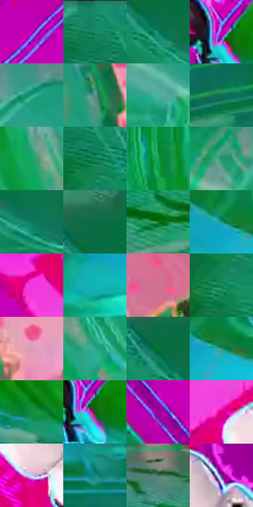

# 电影参考 632

- 状态：条件／活跃；来源世界：miles-home。
- 视角：rolled-or-dutch；景别：environment-wide；场景：industrial。
- 时段：event-time-unknown（外观依据，中置信度；具体时间／晨昏未知）；光照：event-light。
- 材质候选：fabric, metal, glass（帧级，不是像素分割）。
- 明暗组：middle；L* P5/P50/P95：38.33353 / 50.26006 / 68.62635。
- 资格门禁：energy。
- 原截图 SHA-256：`a96704d9d60c9d8f983d6d573d5fa66c862c988f1df9581008b7d3fc3c9f41c8`；尺寸：2880 × 1206。
- sRGB 像素 SHA-256：`4fb1d9f9c3c061a21e2787ba13c65ef90f056c6286b27e3552d667d0ce811a1a`。

## 观察与迁移

碰撞空间彩光和多层设备，普通物体固有色须另找稳定帧。

黑白人物落在品红机械板附近，绿青大圆筒用较平的双色面和青色轮廓概括，仍留机械曲率和接触暗形。事件彩场不等于普通墙面固有色；设备不是建筑，落脚接触、实体边框和印刷细纹分别处理。

本公开版保存32个128×128原像素色卡上下文；图集格子并非原场景相邻位置。原rect、图集tile和像素SHA见 `data/palette-crops.json`。上下文不足时不得批准替色，不能以小样推断完整构图。

## 实测色卡

颜色比例分母为保留采样像素，不是材料面积；全部 32 色参与全库匹配。表内四舍五入仅用于阅读，原精度在 JSON。

| ID | HEX | Lab | 原图 xy | 像素数 | 比例 | 明度角色 |
| --- | --- | --- | --- | ---: | ---: | --- |
| 632-S01 | #CB02BC | [47.460674, 80.445139, -43.794931] | [1752, 84] | 10719 | 5.543947% | midtone |
| 632-S02 | #158A66 | [51.029785, -39.528656, 10.760854] | [144, 32] | 10304 | 5.329306% | midtone |
| 632-S03 | #0A7A5A | [45.249267, -36.709533, 9.604115] | [380, 224] | 10030 | 5.187591% | midtone |
| 632-S04 | #BF04B1 | [44.716432, 76.685791, -41.822393] | [1564, 732] | 9953 | 5.147766% | midtone |
| 632-S05 | #26A282 | [59.764254, -40.792057, 7.259032] | [2276, 124] | 9086 | 4.699347% | midtone |
| 632-S06 | #5C9186 | [56.333484, -20.250236, 0.260339] | [2656, 348] | 8323 | 4.304718% | midtone |
| 632-S07 | #51AC9F | [64.767985, -30.358794, -1.582267] | [2448, 444] | 8143 | 4.211621% | light |
| 632-S08 | #0F6F54 | [41.389868, -33.095241, 7.736055] | [340, 840] | 7999 | 4.137143% | midtone |
| 632-S09 | #17A56B | [60.025869, -48.996996, 20.36146] | [2020, 672] | 7733 | 3.999566% | light |
| 632-S10 | #0C7B4C | [45.310486, -40.33957, 17.833364] | [196, 140] | 6612 | 3.419776% | midtone |
| 632-S11 | #149E52 | [57.279519, -51.568962, 30.171647] | [1904, 548] | 6600 | 3.413569% | midtone |
| 632-S12 | #259067 | [53.295459, -39.869591, 13.392026] | [2104, 164] | 6507 | 3.365469% | midtone |
| 632-S13 | #107B63 | [45.874029, -34.271561, 5.191377] | [496, 292] | 6119 | 3.164793% | midtone |
| 632-S14 | #0C6C44 | [39.948379, -36.093096, 15.260755] | [364, 124] | 5915 | 3.059282% | shadow |
| 632-S15 | #0C7928 | [44.096819, -45.811174, 35.494401] | [884, 1108] | 5747 | 2.972391% | midtone |
| 632-S16 | #199984 | [56.735908, -37.700841, 1.740014] | [320, 528] | 5596 | 2.894293% | midtone |
| 632-S17 | #F237DF | [58.919861, 84.171347, -45.304223] | [912, 92] | 4977 | 2.574142% | midtone |
| 632-S18 | #11B5B8 | [66.994216, -35.665707, -12.294388] | [260, 624] | 4925 | 2.547247% | light |
| 632-S19 | #D27192 | [59.516725, 41.778543, -0.69926] | [2796, 820] | 4903 | 2.535868% | midtone |
| 632-S20 | #128758 | [49.689473, -41.915833, 16.910996] | [176, 236] | 4842 | 2.504319% | midtone |
| 632-S21 | #DD9AB7 | [70.805113, 29.25512, -4.888736] | [2792, 472] | 4717 | 2.439668% | light |
| 632-S22 | #2DAA8D | [62.699785, -40.535487, 5.328191] | [2136, 776] | 4667 | 2.413807% | light |
| 632-S23 | #0B6F37 | [40.759737, -40.064703, 23.789215] | [340, 172] | 4600 | 2.379154% | midtone |
| 632-S24 | #2B967B | [55.841335, -36.632556, 5.617337] | [376, 552] | 4475 | 2.314504% | midtone |
| 632-S25 | #118C39 | [50.885053, -49.556035, 35.105171] | [1772, 816] | 4431 | 2.291746% | midtone |
| 632-S26 | #344D26 | [29.856299, -17.855929, 20.080563] | [1584, 760] | 4285 | 2.216234% | shadow |
| 632-S27 | #A1009B | [37.743789, 68.752148, -40.081872] | [984, 376] | 4044 | 2.091587% | shadow |
| 632-S28 | #DC0185 | [48.178234, 77.474534, -9.613017] | [1140, 216] | 3977 | 2.056934% | midtone |
| 632-S29 | #C2C3DD | [79.45386, 4.738529, -13.033315] | [1236, 368] | 3966 | 2.051245% | light |
| 632-S30 | #13897C | [51.248059, -33.239748, -1.674694] | [884, 684] | 3938 | 2.036763% | midtone |
| 632-S31 | #41705C | [43.484028, -21.103504, 6.13136] | [1392, 968] | 2831 | 1.464214% | midtone |
| 632-S32 | #7E1D97 | [33.025805, 56.631888, -45.551542] | [1320, 252] | 2382 | 1.231988% | shadow |

## 色阶与空间分布

- 采样 ROI：`[0.01, 0.02, 0.98, 0.94]`；步长：4；样本数：193346。
- 排除区：`[]`。
- 深暗、暗、中、亮、高光五段计数：`[1698, 14538, 138683, 35779, 2648]`。
- RGB 各 256 箱、L* 100 箱、13×5 色相明度表和 3×3 空间统计全部保存在 [总数据](../film-library.json)。
- [可视化档案](../../references/library.html)按需绘制直方图，不存 2,094 张重复图表图片。

## 纹理特征占比

**这是分块图像特征的面积占比，不是波点／排线／丝网／错版的精确语义覆盖率。** 窗格、发丝、织物也会产生方向或周期特征。
原图 ROI 像素 3098546；已测块覆盖 3098546（100.0000%）；未测 0。

| 特征 | 块覆盖像素 | 占已测面积 | 阈值敏感范围 |
| --- | ---: | ---: | --- |
| low-contrast | 32768 | 1.0575% | 0.5288% ~ 1.9374% |
| directional-structure | 1758514 | 56.7529% | 26.8033% ~ 68.7368% |
| periodic-structure | 1274496 | 41.1321% | 29.6769% ~ 67.5579% |
| mixed-detail | 32768 | 1.0575% | 1.0575% ~ 3.7013% |

阈值敏感范围不是统计置信区间。逐块坐标、尺度、对比、方向一致性、频谱集中度、频率与角度见 [全量特征记录](../texture-features.jsonl)，以帧号定位。
四种印刷层的真实像素覆盖仍标为 `null`，不能填 0，也不能拿上表代替。不得据这些代理测量删除唯一证据。

[测量方法与保留策略](../../references/library-retention.md) · [分类索引](../archive/README.md)
