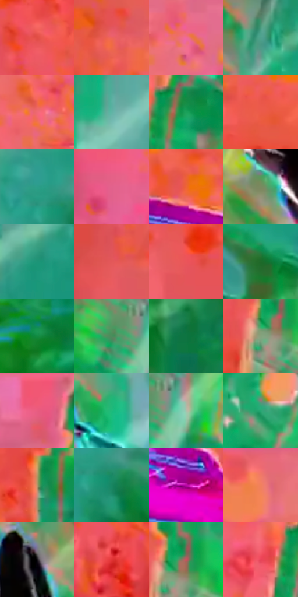

# 电影参考 633

- 状态：条件／活跃；来源世界：miles-home。
- 视角：rolled-or-dutch；景别：environment-wide；场景：industrial。
- 时段：event-time-unknown（外观依据，中置信度；具体时间／晨昏未知）；光照：event-light。
- 材质候选：fabric, metal, glass（帧级，不是像素分割）。
- 明暗组：middle；L* P5/P50/P95：40.84201 / 58.35648 / 69.4098。
- 资格门禁：energy。
- 原截图 SHA-256：`54dd919a9fa0b46df36597d010ac1eec31031669c3078ed8963c4cc884ea3124`；尺寸：2880 × 1198。
- sRGB 像素 SHA-256：`fdaf1af8311af39e0ac6ee4833207af2b03202afa10f79378028d97bace22608`。

## 观察与迁移

碰撞空间彩光和多层设备，普通物体固有色须另找稳定帧。

左侧橙粉粒子场与右侧绿青机械大体积对分，品红板和白黑跳跃人物相隔较远。青色机械管线为实体弯曲，大圆粒子为事件背景；不能按颜色把所有曲线称为速度线，也不将背景大点普遍铺到脸上。

本公开版保存32个128×128原像素色卡上下文；图集格子并非原场景相邻位置。原rect、图集tile和像素SHA见 `data/palette-crops.json`。上下文不足时不得批准替色，不能以小样推断完整构图。

## 实测色卡

颜色比例分母为保留采样像素，不是材料面积；全部 32 色参与全库匹配。表内四舍五入仅用于阅读，原精度在 JSON。

| ID | HEX | Lab | 原图 xy | 像素数 | 比例 | 明度角色 |
| --- | --- | --- | --- | ---: | ---: | --- |
| 633-S01 | #E14E45 | [53.911011, 56.540265, 36.703827] | [1176, 1000] | 11951 | 6.203542% | midtone |
| 633-S02 | #ED6360 | [59.687538, 53.086056, 28.97833] | [664, 128] | 10378 | 5.387027% | midtone |
| 633-S03 | #EF6997 | [62.24748, 55.959984, 0.894198] | [1080, 84] | 10149 | 5.268157% | light |
| 633-S04 | #4DA18D | [60.771815, -30.520757, 2.656616] | [2232, 128] | 9383 | 4.870541% | light |
| 633-S05 | #F16975 | [61.734732, 53.30516, 19.793155] | [1052, 324] | 8846 | 4.591794% | light |
| 633-S06 | #60B4A6 | [67.932307, -28.986204, -0.762779] | [2400, 252] | 8697 | 4.514451% | light |
| 633-S07 | #1AA15A | [58.457867, -50.648294, 27.47052] | [1440, 464] | 8564 | 4.445413% | midtone |
| 633-S08 | #EC5A49 | [57.685679, 55.372807, 39.373556] | [940, 596] | 8284 | 4.300071% | midtone |
| 633-S09 | #2C9D89 | [58.465135, -35.935183, 1.450595] | [2620, 260] | 7981 | 4.142789% | midtone |
| 633-S10 | #E2628C | [58.790294, 53.775309, 1.99935] | [80, 660] | 7865 | 4.082575% | midtone |
| 633-S11 | #EE6535 | [59.659463, 50.317043, 51.934337] | [608, 368] | 7221 | 3.748287% | midtone |
| 633-S12 | #7A8A60 | [55.235803, -13.545455, 20.639367] | [1880, 404] | 6937 | 3.600868% | midtone |
| 633-S13 | #1C9577 | [55.146409, -39.168215, 6.867409] | [2724, 116] | 6504 | 3.376106% | midtone |
| 633-S14 | #E35859 | [56.124183, 54.118771, 28.08868] | [104, 284] | 6357 | 3.299801% | midtone |
| 633-S15 | #EB555A | [56.980368, 58.109503, 28.873939] | [844, 856] | 6339 | 3.290457% | midtone |
| 633-S16 | #1D6B2A | [39.484632, -38.079901, 29.308697] | [2608, 740] | 6190 | 3.213114% | shadow |
| 633-S17 | #118C43 | [51.012504, -48.012686, 30.161866] | [2064, 904] | 6027 | 3.128504% | midtone |
| 633-S18 | #498D5C | [53.208996, -32.984314, 19.662919] | [1468, 904] | 5968 | 3.097878% | midtone |
| 633-S19 | #0E7441 | [42.710412, -39.754055, 20.675231] | [2716, 840] | 5410 | 2.808231% | midtone |
| 633-S20 | #85A27D | [63.596186, -17.294043, 16.008516] | [1368, 720] | 5288 | 2.744903% | light |
| 633-S21 | #EC5B7D | [58.789312, 58.583562, 10.958448] | [1432, 60] | 5000 | 2.595407% | midtone |
| 633-S22 | #1EBA7C | [67.161761, -52.72207, 20.864949] | [2160, 400] | 4676 | 2.427225% | light |
| 633-S23 | #B0BEAB | [75.449494, -8.368186, 7.956288] | [1548, 904] | 4544 | 2.358706% | light |
| 633-S24 | #28A774 | [61.087156, -45.971371, 16.912382] | [1640, 112] | 4481 | 2.326004% | light |
| 633-S25 | #AF9568 | [63.019019, 3.300239, 27.364715] | [1320, 992] | 4371 | 2.268905% | light |
| 633-S26 | #198562 | [49.328695, -37.988498, 10.689874] | [2668, 312] | 3833 | 1.989639% | midtone |
| 633-S27 | #BA08A5 | [43.258831, 73.775553, -37.056692] | [736, 504] | 3705 | 1.923197% | midtone |
| 633-S28 | #F27D67 | [65.38016, 42.929915, 32.512153] | [932, 52] | 2903 | 1.506893% | light |
| 633-S29 | #1A161B | [7.881855, 3.258619, -2.794945] | [2052, 304] | 1816 | 0.942652% | deep-shadow |
| 633-S30 | #E03535 | [50.281793, 64.512416, 41.492025] | [1212, 1120] | 1431 | 0.742806% | midtone |
| 633-S31 | #CA515D | [50.961314, 49.05078, 18.185297] | [1400, 688] | 1211 | 0.628608% | midtone |
| 633-S32 | #E84459 | [54.044514, 63.667122, 25.56976] | [1344, 480] | 338 | 0.175450% | midtone |

## 色阶与空间分布

- 采样 ROI：`[0.01, 0.02, 0.98, 0.94]`；步长：4；样本数：192648。
- 排除区：`[]`。
- 深暗、暗、中、亮、高光五段计数：`[1542, 6920, 111886, 71177, 1123]`。
- RGB 各 256 箱、L* 100 箱、13×5 色相明度表和 3×3 空间统计全部保存在 [总数据](../film-library.json)。
- [可视化档案](../../references/library.html)按需绘制直方图，不存 2,094 张重复图表图片。

## 纹理特征占比

**这是分块图像特征的面积占比，不是波点／排线／丝网／错版的精确语义覆盖率。** 窗格、发丝、织物也会产生方向或周期特征。
原图 ROI 像素 3081782；已测块覆盖 3081782（100.0000%）；未测 0。

| 特征 | 块覆盖像素 | 占已测面积 | 阈值敏感范围 |
| --- | ---: | ---: | --- |
| low-contrast | 89600 | 2.9074% | 0.3281% ~ 4.4234% |
| directional-structure | 324864 | 10.5414% | 4.2531% ~ 21.2407% |
| periodic-structure | 2650934 | 86.0195% | 77.8995% ~ 88.6653% |
| mixed-detail | 16384 | 0.5316% | 0.5316% ~ 2.6582% |

阈值敏感范围不是统计置信区间。逐块坐标、尺度、对比、方向一致性、频谱集中度、频率与角度见 [全量特征记录](../texture-features.jsonl)，以帧号定位。
四种印刷层的真实像素覆盖仍标为 `null`，不能填 0，也不能拿上表代替。不得据这些代理测量删除唯一证据。

[测量方法与保留策略](../../references/library-retention.md) · [分类索引](../archive/README.md)
