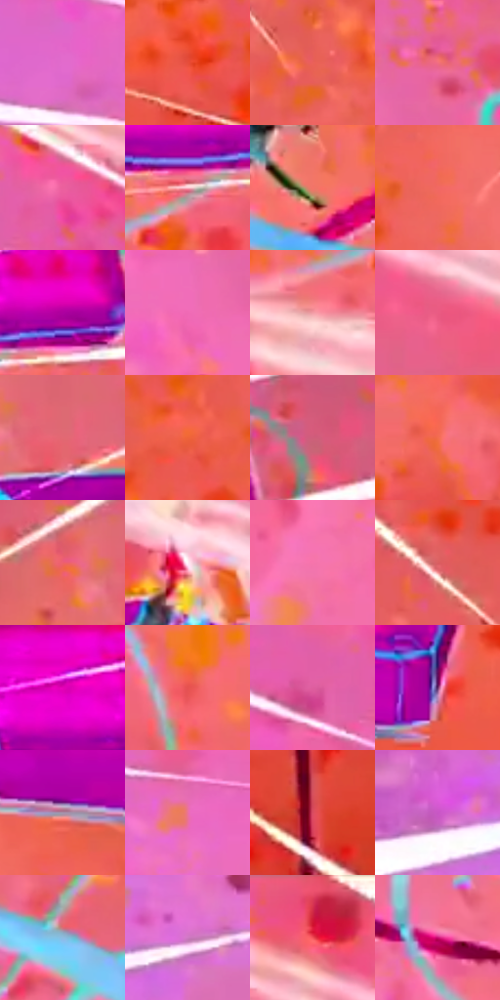

# 电影参考 634

- 状态：条件／活跃；来源世界：miles-home。
- 视角：graphic-nonphysical；景别：environment-wide；场景：industrial。
- 时段：event-time-unknown（外观依据，中置信度；具体时间／晨昏未知）；光照：event-light。
- 材质候选：fabric, metal, glass（帧级，不是像素分割）。
- 明暗组：light；L* P5/P50/P95：43.37692 / 60.30069 / 83.61153。
- 资格门禁：energy。
- 原截图 SHA-256：`7d11430541e19b4730c8287d87b0018a1b4d8c01320fa7fbdde0a25f8f512620`；尺寸：2880 × 1202。
- sRGB 像素 SHA-256：`76bd8ca65b28d97af90e57f2ed630b354086ae0dd662528fe8ba40f47725bb03`。

## 观察与迁移

碰撞空间彩光和多层设备，普通物体固有色须另找稳定帧。

橙粉颗粒背景中品红板分裂，白色收尖线从边缘向动作汇聚，斜穿画面的亮双线增强速度方向。青色机械附肢和实体碎块不等于图形线；这是有受力／破损证据的强冲击，与637的碰拳强度不同。

本公开版保存32个128×128原像素色卡上下文；图集格子并非原场景相邻位置。原rect、图集tile和像素SHA见 `data/palette-crops.json`。上下文不足时不得批准替色，不能以小样推断完整构图。

## 实测色卡

颜色比例分母为保留采样像素，不是材料面积；全部 32 色参与全库匹配。表内四舍五入仅用于阅读，原精度在 JSON。

| ID | HEX | Lab | 原图 xy | 像素数 | 比例 | 明度角色 |
| --- | --- | --- | --- | ---: | ---: | --- |
| 634-S01 | #E26BCD | [62.587611, 58.43515, -29.588898] | [296, 396] | 20769 | 10.780802% | light |
| 634-S02 | #E64E3A | [54.639611, 57.700446, 43.793698] | [2440, 872] | 14370 | 7.459200% | midtone |
| 634-S03 | #EB6059 | [58.746211, 53.292664, 31.687687] | [1368, 164] | 11486 | 5.962169% | midtone |
| 634-S04 | #F16E81 | [62.879459, 52.043517, 14.486762] | [768, 508] | 9319 | 4.837320% | light |
| 634-S05 | #EB609D | [60.307977, 59.426185, -5.488702] | [492, 160] | 8029 | 4.167705% | light |
| 634-S06 | #FCC3CE | [84.061846, 21.945708, 2.378533] | [2504, 556] | 7874 | 4.087247% | highlight |
| 634-S07 | #F47467 | [63.924146, 48.07757, 30.702587] | [1380, 692] | 7747 | 4.021324% | light |
| 634-S08 | #F16863 | [61.226985, 52.389302, 29.383718] | [1800, 136] | 7739 | 4.017171% | light |
| 634-S09 | #AD009F | [40.228618, 71.41522, -38.410712] | [2600, 500] | 7265 | 3.771127% | midtone |
| 634-S10 | #EF6AB5 | [63.342145, 59.176673, -14.668672] | [676, 588] | 6969 | 3.617479% | light |
| 634-S11 | #F29DA6 | [73.381805, 32.796739, 8.552851] | [2392, 660] | 6724 | 3.490304% | light |
| 634-S12 | #E95B83 | [58.460963, 58.198981, 6.918246] | [824, 276] | 6696 | 3.475769% | midtone |
| 634-S13 | #E26973 | [59.447111, 47.963051, 17.453424] | [2400, 188] | 6240 | 3.239068% | midtone |
| 634-S14 | #EE6338 | [59.335237, 51.340939, 50.158987] | [1688, 288] | 6006 | 3.117603% | midtone |
| 634-S15 | #CF5E7B | [54.766374, 47.496591, 5.798024] | [2708, 332] | 5693 | 2.955131% | midtone |
| 634-S16 | #F26D4B | [61.936202, 48.97448, 43.464817] | [1760, 1088] | 5388 | 2.796811% | light |
| 634-S17 | #ED606D | [59.415523, 55.381765, 21.156415] | [2304, 156] | 5165 | 2.681056% | midtone |
| 634-S18 | #FFF2F9 | [96.658373, 5.550719, -1.794978] | [1768, 576] | 5151 | 2.673788% | highlight |
| 634-S19 | #F674AB | [65.770824, 55.43634, -5.248902] | [1000, 904] | 4870 | 2.527927% | light |
| 634-S20 | #D95F61 | [55.890311, 48.058056, 22.849029] | [1072, 84] | 4537 | 2.355072% | midtone |
| 634-S21 | #E700B9 | [52.393289, 85.168251, -33.919472] | [2480, 456] | 3970 | 2.060753% | midtone |
| 634-S22 | #E65250 | [55.524524, 57.121719, 32.609144] | [1444, 1056] | 3899 | 2.023899% | midtone |
| 634-S23 | #DF5E9E | [58.194032, 56.777545, -9.409095] | [384, 188] | 3676 | 1.908143% | midtone |
| 634-S24 | #642A66 | [27.641218, 35.323587, -23.610707] | [2132, 856] | 3352 | 1.739961% | shadow |
| 634-S25 | #A494AE | [63.448908, 10.868374, -11.404477] | [1720, 868] | 3301 | 1.713488% | light |
| 634-S26 | #EB719F | [63.326176, 51.84689, -2.188818] | [468, 508] | 2960 | 1.536481% | light |
| 634-S27 | #D94B61 | [52.565633, 56.91231, 18.391624] | [2328, 1128] | 2699 | 1.401001% | midtone |
| 634-S28 | #CA62C5 | [57.390828, 54.574139, -33.372795] | [32, 908] | 2695 | 1.398924% | midtone |
| 634-S29 | #8DBCE2 | [74.264972, -6.161686, -23.916363] | [1064, 592] | 2666 | 1.383871% | light |
| 634-S30 | #CF79C2 | [62.369942, 43.958819, -23.917002] | [328, 880] | 2128 | 1.104605% | light |
| 634-S31 | #CE2541 | [45.4015, 64.314702, 27.953529] | [588, 40] | 1906 | 0.989369% | midtone |
| 634-S32 | #CA096E | [44.06239, 70.891144, -1.964287] | [1100, 760] | 1359 | 0.705432% | midtone |

## 色阶与空间分布

- 采样 ROI：`[0.01, 0.02, 0.98, 0.94]`；步长：4；样本数：192648。
- 排除区：`[]`。
- 深暗、暗、中、亮、高光五段计数：`[335, 5628, 85410, 89053, 12222]`。
- RGB 各 256 箱、L* 100 箱、13×5 色相明度表和 3×3 空间统计全部保存在 [总数据](../film-library.json)。
- [可视化档案](../../references/library.html)按需绘制直方图，不存 2,094 张重复图表图片。

## 纹理特征占比

**这是分块图像特征的面积占比，不是波点／排线／丝网／错版的精确语义覆盖率。** 窗格、发丝、织物也会产生方向或周期特征。
原图 ROI 像素 3087370；已测块覆盖 3087370（100.0000%）；未测 0。

| 特征 | 块覆盖像素 | 占已测面积 | 阈值敏感范围 |
| --- | ---: | ---: | --- |
| low-contrast | 16384 | 0.5307% | 0.0000% ~ 1.0614% |
| directional-structure | 1684096 | 54.5479% | 42.9145% ~ 62.4542% |
| periodic-structure | 1343754 | 43.5242% | 36.6793% ~ 52.5043% |
| mixed-detail | 43136 | 1.3972% | 0.8665% ~ 3.5199% |

阈值敏感范围不是统计置信区间。逐块坐标、尺度、对比、方向一致性、频谱集中度、频率与角度见 [全量特征记录](../texture-features.jsonl)，以帧号定位。
四种印刷层的真实像素覆盖仍标为 `null`，不能填 0，也不能拿上表代替。不得据这些代理测量删除唯一证据。

[测量方法与保留策略](../../references/library-retention.md) · [分类索引](../archive/README.md)
