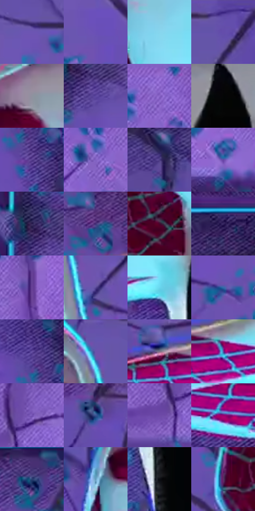

# 电影参考 635

- 状态：条件／活跃；来源世界：miles-home。
- 视角：near-level；景别：medium；场景：industrial。
- 时段：event-time-unknown（外观依据，中置信度；具体时间／晨昏未知）；光照：event-light。
- 材质候选：fabric, metal, glass（帧级，不是像素分割）。
- 明暗组：dark；L* P5/P50/P95：5.76074 / 39.36647 / 78.90187。
- 资格门禁：energy。
- 原截图 SHA-256：`ada64d5ba6782626a2f1571393919dba058d43b2b9a67a35082fec319b92e4cc`；尺寸：2880 × 1206。
- sRGB 像素 SHA-256：`92846f8a277fc9f83563960ef3f30f9af17c577773c7e56a1699e9e162d52ed8`。

## 观察与迁移

碰撞空间彩光和多层设备，普通物体固有色须另找稳定帧。

白帽面罩被青光染亮，黑躯干稳定，紫墙出现分叉裂缝与小碎屑；红帽内图案仍独立可读。实体损伤、网纹和青边三者不可替换；不得为模仿纹理在普通原照墙面增加裂缝。

本公开版保存32个128×128原像素色卡上下文；图集格子并非原场景相邻位置。原rect、图集tile和像素SHA见 `data/palette-crops.json`。上下文不足时不得批准替色，不能以小样推断完整构图。

## 实测色卡

颜色比例分母为保留采样像素，不是材料面积；全部 32 色参与全库匹配。表内四舍五入仅用于阅读，原精度在 JSON。

| ID | HEX | Lab | 原图 xy | 像素数 | 比例 | 明度角色 |
| --- | --- | --- | --- | ---: | ---: | --- |
| 635-S01 | #6C55B2 | [42.610392, 31.632382, -46.448263] | [992, 144] | 11101 | 5.741520% | midtone |
| 635-S02 | #6A50B6 | [41.497862, 35.268098, -50.593012] | [1008, 412] | 10558 | 5.460677% | midtone |
| 635-S03 | #87D5ED | [81.209215, -17.90859, -19.3072] | [1320, 332] | 9292 | 4.805892% | highlight |
| 635-S04 | #6450AC | [40.286448, 30.955344, -46.674058] | [1812, 48] | 9241 | 4.779514% | midtone |
| 635-S05 | #8F929F | [60.693571, 1.572613, -7.211485] | [1352, 120] | 9073 | 4.692624% | light |
| 635-S06 | #5D48A0 | [36.928518, 30.622504, -44.944008] | [548, 360] | 7840 | 4.054907% | shadow |
| 635-S07 | #916BD1 | [53.100227, 36.579178, -47.418134] | [2492, 44] | 7739 | 4.002669% | midtone |
| 635-S08 | #040506 | [1.332346, -0.122543, -0.470397] | [1620, 756] | 7629 | 3.945776% | deep-shadow |
| 635-S09 | #573E8F | [32.819506, 30.313777, -41.259961] | [2112, 256] | 7467 | 3.861988% | shadow |
| 635-S10 | #8262C3 | [48.785838, 34.216587, -46.359165] | [2428, 128] | 7182 | 3.714584% | midtone |
| 635-S11 | #4C3B82 | [30.09784, 25.530289, -37.65355] | [212, 560] | 7078 | 3.660795% | shadow |
| 635-S12 | #6149A5 | [37.882786, 32.441191, -46.38505] | [2500, 296] | 6937 | 3.587868% | shadow |
| 635-S13 | #2C1F51 | [16.051179, 20.097469, -28.613568] | [504, 296] | 6675 | 3.452360% | deep-shadow |
| 635-S14 | #442E76 | [25.231455, 28.099293, -37.965456] | [2612, 644] | 6658 | 3.443567% | shadow |
| 635-S15 | #48062E | [13.859534, 33.263753, -7.148596] | [1268, 516] | 6041 | 3.124450% | deep-shadow |
| 635-S16 | #382862 | [20.980502, 22.727343, -31.957302] | [2780, 420] | 5827 | 3.013768% | shadow |
| 635-S17 | #684398 | [36.412326, 34.197631, -40.883693] | [2600, 184] | 5719 | 2.957910% | shadow |
| 635-S18 | #594897 | [35.969722, 26.972418, -41.074798] | [1700, 236] | 5593 | 2.892742% | shadow |
| 635-S19 | #68D7EE | [80.578737, -25.338786, -20.911198] | [1084, 856] | 5182 | 2.680169% | highlight |
| 635-S20 | #326BA8 | [44.260279, 2.018835, -38.166075] | [1812, 296] | 5051 | 2.612415% | midtone |
| 635-S21 | #654FA3 | [39.584656, 29.232621, -42.442648] | [2084, 160] | 4963 | 2.566901% | shadow |
| 635-S22 | #6A53AB | [41.517102, 30.356938, -44.080303] | [1640, 96] | 4835 | 2.500698% | midtone |
| 635-S23 | #797085 | [48.693974, 7.809025, -10.251319] | [756, 796] | 4676 | 2.418462% | midtone |
| 635-S24 | #5952A4 | [39.306254, 24.630742, -43.546176] | [856, 832] | 4314 | 2.231233% | shadow |
| 635-S25 | #7552B4 | [42.930459, 36.218989, -47.060326] | [284, 236] | 4240 | 2.192960% | midtone |
| 635-S26 | #385393 | [36.238887, 10.783706, -38.363943] | [2164, 1040] | 4194 | 2.169168% | shadow |
| 635-S27 | #6D49A8 | [39.314869, 36.233259, -45.808164] | [220, 296] | 4061 | 2.100380% | shadow |
| 635-S28 | #96036E | [33.300128, 60.229777, -19.242061] | [1952, 868] | 3959 | 2.047624% | shadow |
| 635-S29 | #2B3E72 | [27.222626, 10.032837, -32.343293] | [2416, 460] | 3280 | 1.696441% | shadow |
| 635-S30 | #649EBF | [62.442202, -9.907164, -22.896566] | [1216, 208] | 3135 | 1.621445% | light |
| 635-S31 | #0B0C12 | [3.412222, 0.802255, -3.057473] | [1156, 1040] | 2331 | 1.205611% | deep-shadow |
| 635-S32 | #5D2E64 | [27.301345, 30.553739, -22.92449] | [1152, 504] | 1475 | 0.762881% | shadow |

## 色阶与空间分布

- 采样 ROI：`[0.01, 0.02, 0.98, 0.94]`；步长：4；样本数：193346。
- 排除区：`[]`。
- 深暗、暗、中、亮、高光五段计数：`[23716, 80323, 67249, 13505, 8553]`。
- RGB 各 256 箱、L* 100 箱、13×5 色相明度表和 3×3 空间统计全部保存在 [总数据](../film-library.json)。
- [可视化档案](../../references/library.html)按需绘制直方图，不存 2,094 张重复图表图片。

## 纹理特征占比

**这是分块图像特征的面积占比，不是波点／排线／丝网／错版的精确语义覆盖率。** 窗格、发丝、织物也会产生方向或周期特征。
原图 ROI 像素 3098546；已测块覆盖 3098546（100.0000%）；未测 0。

| 特征 | 块覆盖像素 | 占已测面积 | 阈值敏感范围 |
| --- | ---: | ---: | --- |
| low-contrast | 204416 | 6.5972% | 5.5396% ~ 6.8879% |
| directional-structure | 1042816 | 33.6550% | 15.0656% ~ 53.5704% |
| periodic-structure | 1780402 | 57.4593% | 40.5388% ~ 67.2150% |
| mixed-detail | 70912 | 2.2886% | 0.3511% ~ 10.8314% |

阈值敏感范围不是统计置信区间。逐块坐标、尺度、对比、方向一致性、频谱集中度、频率与角度见 [全量特征记录](../texture-features.jsonl)，以帧号定位。
四种印刷层的真实像素覆盖仍标为 `null`，不能填 0，也不能拿上表代替。不得据这些代理测量删除唯一证据。

[测量方法与保留策略](../../references/library-retention.md) · [分类索引](../archive/README.md)
