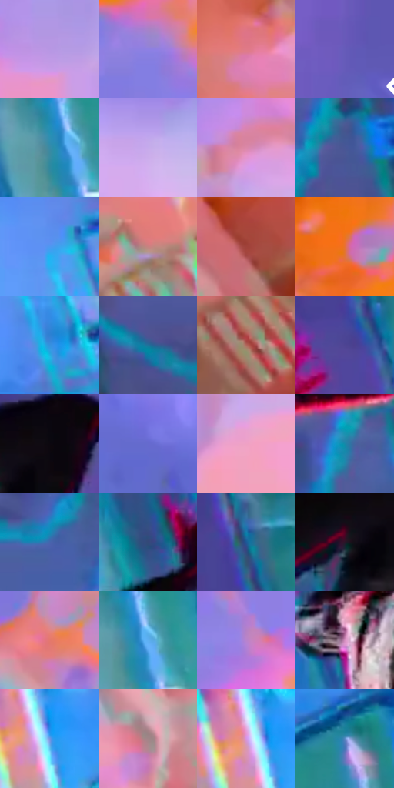

# 电影参考 636

- 状态：条件／活跃；来源世界：miles-home。
- 视角：rolled-or-dutch；景别：full-body；场景：industrial。
- 时段：event-time-unknown（外观依据，中置信度；具体时间／晨昏未知）；光照：event-light。
- 材质候选：fabric, metal, glass（帧级，不是像素分割）。
- 明暗组：middle；L* P5/P50/P95：14.22268 / 56.78347 / 73.7948。
- 资格门禁：energy。
- 原截图 SHA-256：`c15be3a200062b772b371cc42ae4c5124ac1a92142e102f193d1e29767badeb4`；尺寸：2880 × 1210。
- sRGB 像素 SHA-256：`98df2bd01eabcaf88f38872e3d274622e84595f39d52f7139ac3decb8325f001`。

## 观察与迁移

碰撞空间彩光和多层设备，普通物体固有色须另找稳定帧。

黑红人物贴近青蓝车厢面，白亮眼片及局部冷色边／擦痕式高光与暗躯干分离；左侧是珊瑚粉、淡紫大粒子背景。车窗门框为实体矩形结构，玻璃内形象成因不作确定推断，彩边不一概称发光。

本公开版保存32个128×128原像素色卡上下文；图集格子并非原场景相邻位置。原rect、图集tile和像素SHA见 `data/palette-crops.json`。上下文不足时不得批准替色，不能以小样推断完整构图。

## 实测色卡

颜色比例分母为保留采样像素，不是材料面积；全部 32 色参与全库匹配。表内四舍五入仅用于阅读，原精度在 JSON。

| ID | HEX | Lab | 原图 xy | 像素数 | 比例 | 明度角色 |
| --- | --- | --- | --- | ---: | ---: | --- |
| 636-S01 | #B797E3 | [67.833208, 26.771574, -34.104507] | [780, 268] | 11514 | 5.933706% | light |
| 636-S02 | #8E80E2 | [58.675846, 28.10701, -48.162725] | [164, 480] | 10061 | 5.184907% | midtone |
| 636-S03 | #DF7A88 | [62.834076, 40.541197, 10.051725] | [1268, 724] | 8971 | 4.623178% | light |
| 636-S04 | #665BB9 | [43.957405, 28.55799, -48.420381] | [2780, 556] | 8402 | 4.329946% | midtone |
| 636-S05 | #398AA6 | [53.812106, -15.625854, -22.085453] | [1472, 428] | 8357 | 4.306755% | midtone |
| 636-S06 | #C7ABEB | [74.359558, 22.340284, -28.290336] | [232, 816] | 7946 | 4.094948% | light |
| 636-S07 | #DC89AB | [66.558154, 36.172917, -4.464097] | [636, 392] | 7626 | 3.930036% | light |
| 636-S08 | #485796 | [38.542657, 12.798932, -36.45182] | [2356, 1016] | 7494 | 3.862011% | shadow |
| 636-S09 | #4F97F1 | [61.777364, 5.794098, -51.789966] | [1768, 864] | 7489 | 3.859434% | light |
| 636-S10 | #C88280 | [61.486191, 26.761144, 12.300766] | [1308, 864] | 7463 | 3.846035% | light |
| 636-S11 | #A0423A | [40.699136, 38.478504, 24.505702] | [776, 1040] | 7091 | 3.654326% | midtone |
| 636-S12 | #E7713A | [60.87819, 42.155907, 50.441423] | [80, 332] | 6993 | 3.603822% | light |
| 636-S13 | #3392DE | [58.538918, -1.687431, -46.450507] | [1868, 1136] | 6899 | 3.555379% | midtone |
| 636-S14 | #20719B | [44.916833, -8.884972, -29.507003] | [2092, 1116] | 6534 | 3.367278% | midtone |
| 636-S15 | #B1655C | [51.185901, 29.55636, 18.451536] | [1128, 1060] | 6488 | 3.343572% | midtone |
| 636-S16 | #4E4493 | [33.689463, 25.532265, -42.355572] | [2312, 208] | 6295 | 3.244110% | shadow |
| 636-S17 | #0C080F | [2.586303, 2.15125, -2.549104] | [2344, 464] | 6107 | 3.147224% | deep-shadow |
| 636-S18 | #666ACE | [48.99196, 25.782649, -52.479333] | [2592, 844] | 5899 | 3.040032% | midtone |
| 636-S19 | #EFA1C6 | [74.774841, 34.125074, -7.074161] | [644, 516] | 5572 | 2.871514% | light |
| 636-S20 | #1B86A8 | [51.959403, -16.612551, -26.152977] | [2268, 860] | 5271 | 2.716394% | midtone |
| 636-S21 | #4467AE | [44.209959, 9.898325, -41.718415] | [2088, 764] | 5118 | 2.637546% | midtone |
| 636-S22 | #344879 | [31.218413, 7.869308, -30.365346] | [2108, 288] | 5090 | 2.623116% | shadow |
| 636-S23 | #1D5A98 | [37.552352, 3.850824, -39.351385] | [2320, 76] | 5059 | 2.607141% | shadow |
| 636-S24 | #291627 | [10.496603, 13.06099, -7.66358] | [2272, 512] | 4640 | 2.391210% | deep-shadow |
| 636-S25 | #E4786E | [62.555709, 40.804995, 24.557782] | [532, 148] | 4584 | 2.362351% | light |
| 636-S26 | #5FB0F2 | [69.391606, -5.419773, -40.309368] | [1500, 424] | 4518 | 2.328338% | light |
| 636-S27 | #B883CD | [62.364986, 33.448546, -30.339588] | [312, 620] | 3857 | 1.987694% | light |
| 636-S28 | #D892C3 | [68.822818, 33.788722, -14.574064] | [1720, 344] | 2983 | 1.537280% | light |
| 636-S29 | #7D96E3 | [63.10794, 11.230671, -41.811136] | [1240, 120] | 2672 | 1.377007% | light |
| 636-S30 | #A38588 | [58.358436, 11.925689, 2.711241] | [476, 892] | 2559 | 1.318773% | midtone |
| 636-S31 | #D697E1 | [70.77899, 35.900581, -28.207903] | [1212, 104] | 2312 | 1.191482% | light |
| 636-S32 | #5D87C4 | [55.724244, 3.04268, -36.150712] | [1432, 192] | 2180 | 1.123457% | midtone |

## 色阶与空间分布

- 采样 ROI：`[0.01, 0.02, 0.98, 0.94]`；步长：4；样本数：194044。
- 排除区：`[]`。
- 深暗、暗、中、亮、高光五段计数：`[10620, 24487, 78367, 79659, 911]`。
- RGB 各 256 箱、L* 100 箱、13×5 色相明度表和 3×3 空间统计全部保存在 [总数据](../film-library.json)。
- [可视化档案](../../references/library.html)按需绘制直方图，不存 2,094 张重复图表图片。

## 纹理特征占比

**这是分块图像特征的面积占比，不是波点／排线／丝网／错版的精确语义覆盖率。** 窗格、发丝、织物也会产生方向或周期特征。
原图 ROI 像素 3109722；已测块覆盖 3109722（100.0000%）；未测 0。

| 特征 | 块覆盖像素 | 占已测面积 | 阈值敏感范围 |
| --- | ---: | ---: | --- |
| low-contrast | 116096 | 3.7333% | 2.3133% ~ 6.2771% |
| directional-structure | 631168 | 20.2966% | 9.3930% ~ 34.5466% |
| periodic-structure | 2362458 | 75.9701% | 63.1401% ~ 83.2762% |
| mixed-detail | 0 | 0.0000% | 0.0000% ~ 1.0537% |

阈值敏感范围不是统计置信区间。逐块坐标、尺度、对比、方向一致性、频谱集中度、频率与角度见 [全量特征记录](../texture-features.jsonl)，以帧号定位。
四种印刷层的真实像素覆盖仍标为 `null`，不能填 0，也不能拿上表代替。不得据这些代理测量删除唯一证据。

[测量方法与保留策略](../../references/library-retention.md) · [分类索引](../archive/README.md)
