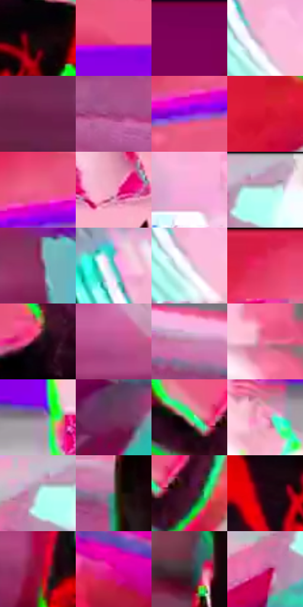

# 电影参考 637

- 状态：条件／活跃；来源世界：miles-home。
- 视角：near-level；景别：medium；场景：graphic。
- 时段：event-time-unknown（外观依据，中置信度；具体时间／晨昏未知）；光照：event-light。
- 材质候选：fabric（帧级，不是像素分割）。
- 明暗组：middle；L* P5/P50/P95：3.42365 / 50.34583 / 87.68616。
- 资格门禁：energy, caption。
- 原截图 SHA-256：`d2c5e770ba4ac9e86442d7595d17a41e0b7765c344fafdca6390435fcd8dbd67`；尺寸：2880 × 1208。
- sRGB 像素 SHA-256：`65cb8c36aec4f9ad6b90fa7645d7fe5944fe8c0a99c96abdf559300da9e612fd`。

## 观察与迁移

碰拳动作轻，背景强彩光不表示拍击力度强；拟声字需确认。

红黑和白黑两人碰拳，粉红圆形机器作背景，鲜绿身体边在本事件中较强；细网纹退后，DAP文字在手部接触附近。碰拳属轻接触，不因荧光场景升级爆点；文字、整圈绿边和背景设备不默认移植到照片。

本公开版保存32个128×128原像素色卡上下文；图集格子并非原场景相邻位置。原rect、图集tile和像素SHA见 `data/palette-crops.json`。上下文不足时不得批准替色，不能以小样推断完整构图。

## 实测色卡

颜色比例分母为保留采样像素，不是材料面积；全部 32 色参与全库匹配。表内四舍五入仅用于阅读，原精度在 JSON。

| ID | HEX | Lab | 原图 xy | 像素数 | 比例 | 明度角色 |
| --- | --- | --- | --- | ---: | ---: | --- |
| 637-S01 | #13080A | [3.01749, 3.796352, 0.483116] | [960, 508] | 11185 | 5.784966% | deep-shadow |
| 637-S02 | #EB537E | [57.424459, 61.683018, 8.417927] | [1256, 220] | 10836 | 5.604460% | midtone |
| 637-S03 | #750153 | [25.042256, 50.216172, -14.938739] | [1800, 28] | 9710 | 5.022085% | shadow |
| 637-S04 | #F9BDDD | [82.784471, 26.412618, -7.5617] | [324, 676] | 8708 | 4.503843% | highlight |
| 637-S05 | #6C204A | [25.910946, 37.896401, -7.741897] | [2244, 944] | 8537 | 4.415400% | shadow |
| 637-S06 | #9E407B | [41.794434, 45.828748, -14.220213] | [1660, 1116] | 8463 | 4.377127% | midtone |
| 637-S07 | #8E11D7 | [39.677598, 74.352868, -72.545913] | [504, 328] | 8381 | 4.334716% | shadow |
| 637-S08 | #D2122E | [44.710954, 68.175314, 38.666687] | [1080, 708] | 7434 | 3.844921% | midtone |
| 637-S09 | #EE5C8B | [59.617059, 60.118767, 4.011148] | [556, 264] | 7414 | 3.834576% | midtone |
| 637-S10 | #F2A6C4 | [76.154053, 32.220309, -3.903605] | [1972, 408] | 7395 | 3.824749% | light |
| 637-S11 | #F7ABD9 | [78.410716, 34.573606, -11.936746] | [1496, 168] | 6996 | 3.618384% | light |
| 637-S12 | #BEABC2 | [72.207348, 11.027714, -9.213029] | [240, 28] | 6700 | 3.465290% | light |
| 637-S13 | #8E3061 | [35.457568, 44.566999, -7.789052] | [2472, 744] | 6690 | 3.460118% | shadow |
| 637-S14 | #57B7B7 | [68.974811, -28.095835, -8.635651] | [252, 560] | 6564 | 3.394950% | light |
| 637-S15 | #F4EDF7 | [94.532971, 4.107101, -3.977648] | [324, 708] | 6431 | 3.326161% | highlight |
| 637-S16 | #E52E61 | [51.244296, 70.06876, 16.955265] | [860, 60] | 6412 | 3.316334% | midtone |
| 637-S17 | #2B0A18 | [7.197004, 18.65176, -1.191465] | [832, 400] | 6351 | 3.284785% | deep-shadow |
| 637-S18 | #BA5591 | [50.666938, 47.730976, -13.644224] | [320, 848] | 6008 | 3.107383% | midtone |
| 637-S19 | #C37CA2 | [60.451897, 33.013627, -8.737746] | [1640, 964] | 5041 | 2.607243% | light |
| 637-S20 | #ED7AA0 | [65.330627, 48.247266, 0.208026] | [1476, 812] | 4867 | 2.517249% | light |
| 637-S21 | #8C758D | [52.086658, 13.439989, -9.69708] | [1808, 340] | 4808 | 2.486734% | midtone |
| 637-S22 | #70375B | [31.654181, 30.136705, -10.158673] | [2548, 284] | 4780 | 2.472252% | shadow |
| 637-S23 | #42EC6E | [83.057588, -68.405501, 48.451881] | [1144, 556] | 4517 | 2.336226% | highlight |
| 637-S24 | #ED92B8 | [70.889092, 39.225124, -5.116158] | [1648, 372] | 3872 | 2.002627% | light |
| 637-S25 | #B1DDDD | [85.138256, -14.209205, -4.711465] | [196, 72] | 3785 | 1.957630% | highlight |
| 637-S26 | #5B7A71 | [48.679295, -13.1478, 1.318283] | [1800, 1020] | 3712 | 1.919874% | midtone |
| 637-S27 | #4F0D2B | [16.129991, 32.547606, -1.407683] | [1224, 580] | 3424 | 1.770918% | deep-shadow |
| 637-S28 | #1E0410 | [3.616186, 11.956723, -1.373682] | [792, 536] | 3377 | 1.746610% | deep-shadow |
| 637-S29 | #960A3D | [31.897896, 54.611796, 10.67701] | [424, 1008] | 3291 | 1.702130% | shadow |
| 637-S30 | #E00290 | [49.385246, 79.252674, -14.373665] | [2768, 768] | 3210 | 1.660236% | midtone |
| 637-S31 | #403438 | [23.106717, 6.162901, -0.504021] | [1832, 740] | 2334 | 1.207162% | shadow |
| 637-S32 | #CC3E8C | [49.71292, 62.252544, -11.824966] | [140, 140] | 2113 | 1.092859% | midtone |

## 色阶与空间分布

- 采样 ROI：`[0.01, 0.02, 0.98, 0.94]`；步长：4；样本数：193346。
- 排除区：`[]`。
- 深暗、暗、中、亮、高光五段计数：`[24729, 43204, 60584, 42426, 22403]`。
- RGB 各 256 箱、L* 100 箱、13×5 色相明度表和 3×3 空间统计全部保存在 [总数据](../film-library.json)。
- [可视化档案](../../references/library.html)按需绘制直方图，不存 2,094 张重复图表图片。

## 纹理特征占比

**这是分块图像特征的面积占比，不是波点／排线／丝网／错版的精确语义覆盖率。** 窗格、发丝、织物也会产生方向或周期特征。
原图 ROI 像素 3104134；已测块覆盖 3104134（100.0000%）；未测 0。

| 特征 | 块覆盖像素 | 占已测面积 | 阈值敏感范围 |
| --- | ---: | ---: | --- |
| low-contrast | 32768 | 1.0556% | 1.0556% ~ 2.1112% |
| directional-structure | 1487488 | 47.9196% | 27.2978% ~ 61.4035% |
| periodic-structure | 1583878 | 51.0248% | 37.5408% ~ 70.0631% |
| mixed-detail | 0 | 0.0000% | 0.0000% ~ 0.5278% |

阈值敏感范围不是统计置信区间。逐块坐标、尺度、对比、方向一致性、频谱集中度、频率与角度见 [全量特征记录](../texture-features.jsonl)，以帧号定位。
四种印刷层的真实像素覆盖仍标为 `null`，不能填 0，也不能拿上表代替。不得据这些代理测量删除唯一证据。

[测量方法与保留策略](../../references/library-retention.md) · [分类索引](../archive/README.md)
