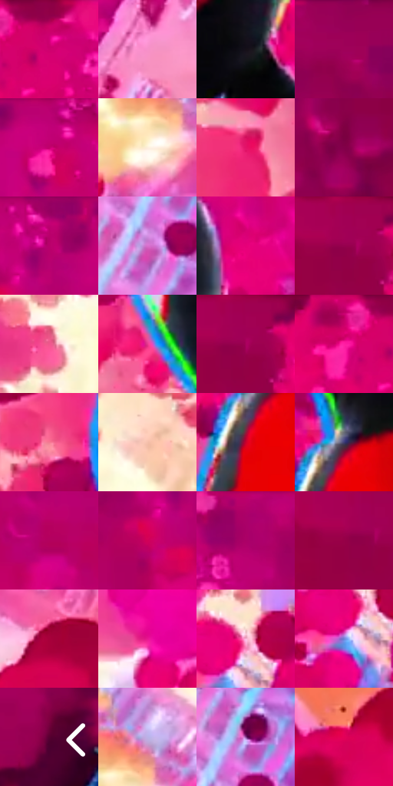

# 电影参考 638

- 状态：条件／活跃；来源世界：miles-home。
- 视角：near-level；景别：medium；场景：industrial。
- 时段：event-time-unknown（外观依据，中置信度；具体时间／晨昏未知）；光照：event-light。
- 材质候选：skin, hair, fabric, metal, glass（帧级，不是像素分割）。
- 明暗组：middle；L* P5/P50/P95：14.82328 / 44.40253 / 86.30682。
- 资格门禁：energy。
- 原截图 SHA-256：`611cf01f04b9f3d59c1ad314f9316127833ebc5499187fdaa27331f2d3c12a70`；尺寸：2880 × 1206。
- sRGB 像素 SHA-256：`0a2f1b7deefb8e119e2a0174ccd7b23c5188795fcaf4de91a3edb1bdb1780612`。

## 观察与迁移

事件彩光下人物、设备与粒子，皮肤和衣料仍保持体块。

黑红人物压住粉紫高彩事件背景，白眼与窄冷暖边缘是焦点；背景圆形粒子、碎片和能量亮面不是建筑纹理或日常散景，不移植到普通照片。

本公开版保存32个128×128原像素色卡上下文；图集格子并非原场景相邻位置。原rect、图集tile和像素SHA见 `data/palette-crops.json`。上下文不足时不得批准替色，不能以小样推断完整构图。

## 实测色卡

颜色比例分母为保留采样像素，不是材料面积；全部 32 色参与全库匹配。表内四舍五入仅用于阅读，原精度在 JSON。

| ID | HEX | Lab | 原图 xy | 像素数 | 比例 | 明度角色 |
| --- | --- | --- | --- | ---: | ---: | --- |
| 638-S01 | #D10076 | [45.451879, 73.905925, -4.71648] | [1204, 52] | 11614 | 6.006848% | midtone |
| 638-S02 | #F791C9 | [72.392392, 45.581887, -12.179423] | [2048, 1036] | 9170 | 4.742793% | light |
| 638-S03 | #151018 | [5.383292, 3.80696, -4.223781] | [1256, 516] | 8401 | 4.345060% | deep-shadow |
| 638-S04 | #960156 | [32.212101, 57.928965, -5.38165] | [2200, 28] | 8395 | 4.341957% | shadow |
| 638-S05 | #BF016D | [41.540764, 69.140031, -5.315706] | [1864, 60] | 8243 | 4.263341% | midtone |
| 638-S06 | #FCEFDC | [94.990991, 1.27845, 10.759795] | [260, 1004] | 7966 | 4.120075% | highlight |
| 638-S07 | #E31068 | [49.137504, 75.438422, 9.703194] | [948, 612] | 7745 | 4.005772% | midtone |
| 638-S08 | #820049 | [27.375378, 52.256438, -4.418868] | [2328, 156] | 7741 | 4.003703% | shadow |
| 638-S09 | #C00076 | [42.027293, 70.282738, -10.192135] | [1724, 32] | 7589 | 3.925088% | midtone |
| 638-S10 | #DA6FCC | [62.199494, 54.056822, -29.711419] | [2392, 1012] | 7525 | 3.891986% | light |
| 638-S11 | #E60078 | [49.718639, 78.580667, 0.811293] | [1364, 332] | 7184 | 3.715619% | midtone |
| 638-S12 | #A20055 | [34.680249, 60.706161, -0.79539] | [956, 40] | 7082 | 3.662863% | shadow |
| 638-S13 | #F1568E | [59.264196, 63.800487, 1.810319] | [564, 696] | 6947 | 3.593040% | midtone |
| 638-S14 | #E8398D | [54.037494, 71.403593, -5.4487] | [1052, 524] | 6634 | 3.431155% | midtone |
| 638-S15 | #A8005D | [36.209708, 62.75559, -3.576424] | [972, 60] | 6276 | 3.245994% | shadow |
| 638-S16 | #BD0062 | [40.741582, 67.869409, 0.394962] | [1124, 28] | 6230 | 3.222203% | midtone |
| 638-S17 | #F57993 | [65.903011, 49.956267, 8.560605] | [964, 392] | 6054 | 3.131174% | light |
| 638-S18 | #F5C0AB | [81.86815, 16.073472, 17.861343] | [724, 656] | 5775 | 2.986873% | highlight |
| 638-S19 | #C8012C | [41.979792, 67.37465, 36.29115] | [1212, 756] | 5709 | 2.952738% | midtone |
| 638-S20 | #3D3B73 | [27.729811, 16.832822, -32.091445] | [1236, 688] | 5211 | 2.695168% | shadow |
| 638-S21 | #B3015D | [38.548495, 65.112924, 0.126928] | [2028, 364] | 5063 | 2.618622% | shadow |
| 638-S22 | #D10058 | [44.609346, 71.677304, 12.767288] | [1668, 144] | 4865 | 2.516214% | midtone |
| 638-S23 | #AC0068 | [37.43123, 64.654739, -8.706375] | [2012, 36] | 4784 | 2.474321% | shadow |
| 638-S24 | #960147 | [31.721706, 56.633617, 3.791423] | [932, 72] | 4677 | 2.418979% | shadow |
| 638-S25 | #A7003A | [35.050365, 60.011335, 17.524986] | [668, 124] | 4325 | 2.236922% | shadow |
| 638-S26 | #E71691 | [51.395481, 78.987426, -11.805602] | [720, 984] | 4213 | 2.178995% | midtone |
| 638-S27 | #F8B7DB | [81.258868, 28.912054, -8.761882] | [880, 1032] | 4152 | 2.147446% | highlight |
| 638-S28 | #6C84D6 | [56.628167, 13.870539, -44.838141] | [852, 1084] | 4014 | 2.076071% | midtone |
| 638-S29 | #580131 | [17.078319, 39.500884, -4.109409] | [2812, 596] | 3357 | 1.736266% | deep-shadow |
| 638-S30 | #BBB1E6 | [74.648971, 14.224562, -25.220387] | [296, 920] | 3097 | 1.601792% | light |
| 638-S31 | #894595 | [40.808162, 41.567392, -31.836391] | [2424, 932] | 1757 | 0.908734% | midtone |
| 638-S32 | #E30057 | [48.290478, 75.729421, 19.010066] | [204, 200] | 1551 | 0.802189% | midtone |

## 色阶与空间分布

- 采样 ROI：`[0.01, 0.02, 0.98, 0.94]`；步长：4；样本数：193346。
- 排除区：`[]`。
- 深暗、暗、中、亮、高光五段计数：`[11421, 58934, 78437, 29064, 15490]`。
- RGB 各 256 箱、L* 100 箱、13×5 色相明度表和 3×3 空间统计全部保存在 [总数据](../film-library.json)。
- [可视化档案](../../references/library.html)按需绘制直方图，不存 2,094 张重复图表图片。

## 纹理特征占比

**这是分块图像特征的面积占比，不是波点／排线／丝网／错版的精确语义覆盖率。** 窗格、发丝、织物也会产生方向或周期特征。
原图 ROI 像素 3098546；已测块覆盖 3098546（100.0000%）；未测 0。

| 特征 | 块覆盖像素 | 占已测面积 | 阈值敏感范围 |
| --- | ---: | ---: | --- |
| low-contrast | 125568 | 4.0525% | 2.9950% ~ 6.1675% |
| directional-structure | 262144 | 8.4602% | 2.1151% ~ 14.4501% |
| periodic-structure | 2612530 | 84.3147% | 80.4399% ~ 85.4631% |
| mixed-detail | 98304 | 3.1726% | 2.1151% ~ 6.2543% |

阈值敏感范围不是统计置信区间。逐块坐标、尺度、对比、方向一致性、频谱集中度、频率与角度见 [全量特征记录](../texture-features.jsonl)，以帧号定位。
四种印刷层的真实像素覆盖仍标为 `null`，不能填 0，也不能拿上表代替。不得据这些代理测量删除唯一证据。

[测量方法与保留策略](../../references/library-retention.md) · [分类索引](../archive/README.md)
