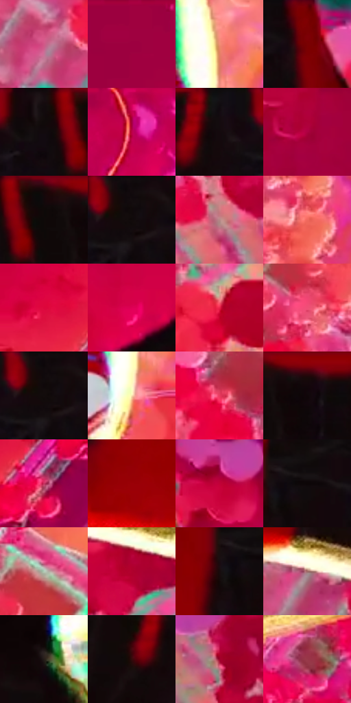

# 电影参考 639

- 状态：条件／活跃；来源世界：miles-home。
- 视角：rolled-or-dutch；景别：close-up；场景：industrial。
- 时段：event-time-unknown（外观依据，中置信度；具体时间／晨昏未知）；光照：event-light。
- 材质候选：skin, hair, fabric, metal, glass（帧级，不是像素分割）。
- 明暗组：dark；L* P5/P50/P95：2.49677 / 38.97401 / 77.30598。
- 资格门禁：energy。
- 原截图 SHA-256：`524e5634268bc4e4d4e8337a9c0f4629bf42134e3f4d182cc8cb8b316eeca161`；尺寸：2880 × 1206。
- sRGB 像素 SHA-256：`6ad713a4433398440665a5af533a4bc7c8e96fb77bc8cdc74edfb1b9694f9b2e`。

## 观察与迁移

事件彩光下人物、设备与粒子，皮肤和衣料仍保持体块。

倒置黑红近景以金白窄受光边转入带网点的阴影，蓝绿侧缘另作局部分色观察；衣服蛛网结构不等于裂纹，粉橙碎片不当稳定立面。

本公开版保存32个128×128原像素色卡上下文；图集格子并非原场景相邻位置。原rect、图集tile和像素SHA见 `data/palette-crops.json`。上下文不足时不得批准替色，不能以小样推断完整构图。

## 实测色卡

颜色比例分母为保留采样像素，不是材料面积；全部 32 色参与全库匹配。表内四舍五入仅用于阅读，原精度在 JSON。

| ID | HEX | Lab | 原图 xy | 像素数 | 比例 | 明度角色 |
| --- | --- | --- | --- | ---: | ---: | --- |
| 639-S01 | #D25988 | [54.686437, 52.315034, -1.937968] | [2104, 744] | 10276 | 5.314824% | midtone |
| 639-S02 | #9F013F | [33.464843, 58.231629, 11.816057] | [292, 28] | 9574 | 4.951745% | shadow |
| 639-S03 | #F09074 | [69.281989, 33.496753, 30.386322] | [1756, 888] | 8668 | 4.483155% | light |
| 639-S04 | #7D0106 | [24.940497, 47.14776, 34.802579] | [1888, 52] | 8337 | 4.311959% | shadow |
| 639-S05 | #120A0C | [3.362455, 2.889865, 0.11566] | [1252, 40] | 8195 | 4.238515% | deep-shadow |
| 639-S06 | #C4004B | [41.60675, 67.888321, 16.425816] | [552, 36] | 8082 | 4.180071% | midtone |
| 639-S07 | #130B0F | [3.724263, 3.382312, -0.822081] | [1632, 40] | 7635 | 3.948879% | deep-shadow |
| 639-S08 | #B00041 | [37.141799, 62.576964, 16.102863] | [2720, 60] | 7388 | 3.821129% | shadow |
| 639-S09 | #14080A | [3.110338, 4.212749, 0.629832] | [1332, 32] | 6957 | 3.598213% | deep-shadow |
| 639-S10 | #10090A | [2.95796, 2.249455, 0.365526] | [1744, 48] | 6755 | 3.493737% | deep-shadow |
| 639-S11 | #B58887 | [60.9427, 17.02981, 7.242141] | [2392, 856] | 6712 | 3.471497% | light |
| 639-S12 | #F06A5E | [61.348224, 50.77547, 32.320727] | [852, 1072] | 6605 | 3.416155% | light |
| 639-S13 | #DD063B | [46.741619, 72.535577, 33.906797] | [64, 1016] | 6587 | 3.406846% | midtone |
| 639-S14 | #DF0055 | [47.428831, 74.704441, 18.948499] | [772, 140] | 6257 | 3.236167% | midtone |
| 639-S15 | #E92249 | [50.633635, 72.469745, 30.781086] | [2160, 920] | 6075 | 3.142036% | midtone |
| 639-S16 | #EF4F77 | [57.347069, 63.854929, 12.52512] | [728, 900] | 6016 | 3.111520% | midtone |
| 639-S17 | #100A0C | [3.19584, 2.142641, -0.147622] | [1736, 28] | 5821 | 3.010665% | deep-shadow |
| 639-S18 | #FAE4AF | [91.192784, -0.193418, 28.65407] | [1744, 1008] | 5820 | 3.010148% | highlight |
| 639-S19 | #E93A60 | [53.167182, 67.709583, 20.282551] | [588, 1000] | 5629 | 2.911361% | midtone |
| 639-S20 | #0F0608 | [2.252434, 2.824503, 0.14061] | [1416, 64] | 5412 | 2.799127% | deep-shadow |
| 639-S21 | #C93462 | [46.656654, 60.717118, 9.182917] | [172, 1084] | 5316 | 2.749475% | midtone |
| 639-S22 | #9B0007 | [31.775526, 55.318364, 42.833162] | [1896, 432] | 5251 | 2.715857% | shadow |
| 639-S23 | #C10238 | [40.68685, 66.015515, 27.103395] | [2160, 96] | 5208 | 2.693617% | midtone |
| 639-S24 | #0D0607 | [2.08814, 2.037381, 0.290685] | [1064, 84] | 5097 | 2.636207% | deep-shadow |
| 639-S25 | #B2CBB6 | [79.359064, -12.424335, 7.652637] | [796, 748] | 4893 | 2.530696% | light |
| 639-S26 | #B0002E | [36.800021, 61.65547, 27.836056] | [2372, 624] | 4459 | 2.306228% | shadow |
| 639-S27 | #180B0D | [4.178916, 5.296636, 0.911696] | [1008, 104] | 4089 | 2.114861% | deep-shadow |
| 639-S28 | #9E6966 | [49.897548, 20.85062, 10.390954] | [2164, 544] | 3905 | 2.019695% | midtone |
| 639-S29 | #251E19 | [11.904948, 2.36345, 4.690501] | [1544, 500] | 3654 | 1.889876% | deep-shadow |
| 639-S30 | #330B0B | [8.717926, 20.128016, 8.996435] | [1564, 104] | 3430 | 1.774022% | deep-shadow |
| 639-S31 | #9F022D | [33.148877, 57.116674, 23.205934] | [2592, 1000] | 2866 | 1.482317% | shadow |
| 639-S32 | #983949 | [37.993757, 41.11714, 11.379986] | [492, 668] | 2377 | 1.229402% | shadow |

## 色阶与空间分布

- 采样 ROI：`[0.01, 0.02, 0.98, 0.94]`；步长：4；样本数：193346。
- 排除区：`[]`。
- 深暗、暗、中、亮、高光五段计数：`[57312, 42330, 63757, 22395, 7552]`。
- RGB 各 256 箱、L* 100 箱、13×5 色相明度表和 3×3 空间统计全部保存在 [总数据](../film-library.json)。
- [可视化档案](../../references/library.html)按需绘制直方图，不存 2,094 张重复图表图片。

## 纹理特征占比

**这是分块图像特征的面积占比，不是波点／排线／丝网／错版的精确语义覆盖率。** 窗格、发丝、织物也会产生方向或周期特征。
原图 ROI 像素 3098546；已测块覆盖 3098546（100.0000%）；未测 0。

| 特征 | 块覆盖像素 | 占已测面积 | 阈值敏感范围 |
| --- | ---: | ---: | --- |
| low-contrast | 354816 | 11.4510% | 6.2543% ~ 16.2099% |
| directional-structure | 633216 | 20.4359% | 8.8114% ~ 28.6276% |
| periodic-structure | 2028594 | 65.4692% | 65.1181% ~ 69.6952% |
| mixed-detail | 81920 | 2.6438% | 0.0000% ~ 5.2835% |

阈值敏感范围不是统计置信区间。逐块坐标、尺度、对比、方向一致性、频谱集中度、频率与角度见 [全量特征记录](../texture-features.jsonl)，以帧号定位。
四种印刷层的真实像素覆盖仍标为 `null`，不能填 0，也不能拿上表代替。不得据这些代理测量删除唯一证据。

[测量方法与保留策略](../../references/library-retention.md) · [分类索引](../archive/README.md)
