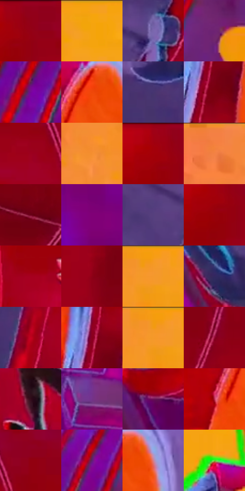

# 电影参考 640

- 状态：条件／活跃；来源世界：miles-home。
- 视角：low-angle；景别：environment-wide；场景：industrial。
- 时段：event-time-unknown（外观依据，中置信度；具体时间／晨昏未知）；光照：event-light。
- 材质候选：skin, hair, fabric, metal, glass（帧级，不是像素分割）。
- 明暗组：dark；L* P5/P50/P95：21.28239 / 31.68857 / 73.46506。
- 资格门禁：energy。
- 原截图 SHA-256：`a1c6135df8e286f70bf57dd52e4360210ea8a9e8ed69e86397c16ccffb984391`；尺寸：2880 × 1202。
- sRGB 像素 SHA-256：`2f6851352c8e9c0ac713ded8bd57075f3f25540aef3d0e949b0b39844de194cc`。

## 观察与迁移

事件彩光下人物、设备与粒子，皮肤和衣料仍保持体块。

紫色近管、灰紫孔环和红色筒体维持遮挡层级，橙色背景与青绿边缘对比；孔洞、铆钉和接缝属于实体结构，不能与印刷网点混为一层。

本公开版保存32个128×128原像素色卡上下文；图集格子并非原场景相邻位置。原rect、图集tile和像素SHA见 `data/palette-crops.json`。上下文不足时不得批准替色，不能以小样推断完整构图。

## 实测色卡

颜色比例分母为保留采样像素，不是材料面积；全部 32 色参与全库匹配。表内四舍五入仅用于阅读，原精度在 JSON。

| ID | HEX | Lab | 原图 xy | 像素数 | 比例 | 明度角色 |
| --- | --- | --- | --- | ---: | ---: | --- |
| 640-S01 | #920017 | [29.849425, 53.2768, 32.534263] | [2288, 36] | 14657 | 7.608177% | shadow |
| 640-S02 | #F5A40E | [73.545591, 20.367801, 75.794759] | [724, 48] | 11498 | 5.968398% | light |
| 640-S03 | #7A67AE | [48.125679, 23.516393, -35.272418] | [1712, 844] | 10722 | 5.565591% | midtone |
| 640-S04 | #6E2373 | [28.786709, 43.979265, -30.036134] | [384, 792] | 10147 | 5.267119% | shadow |
| 640-S05 | #760795 | [29.846735, 59.806039, -49.535797] | [132, 904] | 9767 | 5.069868% | shadow |
| 640-S06 | #EF4607 | [54.816233, 62.548468, 64.498808] | [1372, 96] | 9137 | 4.742847% | midtone |
| 640-S07 | #463571 | [26.849363, 22.653451, -32.173831] | [1636, 300] | 9057 | 4.701321% | shadow |
| 640-S08 | #7A0112 | [24.335722, 46.596264, 28.303112] | [1184, 420] | 8449 | 4.385719% | shadow |
| 640-S09 | #9D001E | [32.400931, 56.31502, 31.706313] | [2416, 156] | 8397 | 4.358727% | shadow |
| 640-S10 | #F58F31 | [68.956805, 32.081587, 62.857664] | [364, 172] | 8062 | 4.184835% | light |
| 640-S11 | #A10010 | [33.172145, 57.005748, 40.5025] | [2236, 36] | 7835 | 4.067003% | shadow |
| 640-S12 | #F4823D | [66.167458, 38.783093, 55.05296] | [160, 48] | 7594 | 3.941904% | light |
| 640-S13 | #6E031A | [21.78387, 43.170521, 19.504948] | [2288, 900] | 6140 | 3.187160% | shadow |
| 640-S14 | #800077 | [29.214982, 57.54392, -31.700503] | [800, 1096] | 5828 | 3.025207% | shadow |
| 640-S15 | #55407E | [32.043041, 23.685068, -32.004511] | [1600, 880] | 5357 | 2.780719% | shadow |
| 640-S16 | #970008 | [30.876089, 54.288295, 41.376197] | [2244, 104] | 4823 | 2.503530% | shadow |
| 640-S17 | #A6011E | [34.447359, 58.476316, 34.432993] | [1980, 192] | 4787 | 2.484843% | shadow |
| 640-S18 | #870014 | [27.305737, 50.313964, 30.999509] | [2820, 328] | 4774 | 2.478095% | shadow |
| 640-S19 | #F69A21 | [71.431978, 26.335064, 70.325782] | [576, 32] | 4616 | 2.396080% | light |
| 640-S20 | #332760 | [20.040552, 21.440579, -32.181929] | [1440, 976] | 4528 | 2.350401% | shadow |
| 640-S21 | #C30120 | [40.786844, 65.810385, 41.589853] | [1844, 588] | 4481 | 2.326004% | midtone |
| 640-S22 | #88001D | [27.640385, 50.862135, 25.814774] | [1172, 344] | 4058 | 2.106432% | shadow |
| 640-S23 | #F29B14 | [71.128982, 23.910411, 72.914908] | [552, 36] | 4024 | 2.088784% | light |
| 640-S24 | #920731 | [30.608438, 53.273826, 16.770642] | [2464, 728] | 3809 | 1.977181% | shadow |
| 640-S25 | #330D1B | [9.569213, 20.728655, 0.160272] | [1972, 484] | 3625 | 1.881670% | deep-shadow |
| 640-S26 | #75338A | [33.951379, 43.007957, -36.163166] | [1192, 976] | 3242 | 1.682862% | shadow |
| 640-S27 | #6D0F55 | [24.479762, 45.706585, -17.278943] | [1528, 1104] | 2853 | 1.480939% | shadow |
| 640-S28 | #BA2C4D | [42.429027, 57.417114, 15.933184] | [1280, 188] | 2506 | 1.300818% | midtone |
| 640-S29 | #920010 | [29.788852, 53.11167, 36.401722] | [2524, 88] | 2342 | 1.215689% | shadow |
| 640-S30 | #5D2270 | [25.687296, 39.528708, -33.220912] | [244, 800] | 1915 | 0.994041% | shadow |
| 640-S31 | #D2808B | [62.51352, 32.994044, 7.654062] | [1444, 96] | 1872 | 0.971720% | light |
| 640-S32 | #59D72E | [76.630456, -63.001572, 66.874145] | [932, 460] | 1746 | 0.906316% | light |

## 色阶与空间分布

- 采样 ROI：`[0.01, 0.02, 0.98, 0.94]`；步长：4；样本数：192648。
- 排除区：`[]`。
- 深暗、暗、中、亮、高光五段计数：`[7378, 123547, 21152, 39695, 876]`。
- RGB 各 256 箱、L* 100 箱、13×5 色相明度表和 3×3 空间统计全部保存在 [总数据](../film-library.json)。
- [可视化档案](../../references/library.html)按需绘制直方图，不存 2,094 张重复图表图片。

## 纹理特征占比

**这是分块图像特征的面积占比，不是波点／排线／丝网／错版的精确语义覆盖率。** 窗格、发丝、织物也会产生方向或周期特征。
原图 ROI 像素 3087370；已测块覆盖 3087370（100.0000%）；未测 0。

| 特征 | 块覆盖像素 | 占已测面积 | 阈值敏感范围 |
| --- | ---: | ---: | --- |
| low-contrast | 840576 | 27.2263% | 22.3092% ~ 30.7462% |
| directional-structure | 1189760 | 38.5364% | 26.3349% ~ 43.9264% |
| periodic-structure | 988928 | 32.0314% | 32.0314% ~ 35.4062% |
| mixed-detail | 68106 | 2.2060% | 0.5307% ~ 7.5127% |

阈值敏感范围不是统计置信区间。逐块坐标、尺度、对比、方向一致性、频谱集中度、频率与角度见 [全量特征记录](../texture-features.jsonl)，以帧号定位。
四种印刷层的真实像素覆盖仍标为 `null`，不能填 0，也不能拿上表代替。不得据这些代理测量删除唯一证据。

[测量方法与保留策略](../../references/library-retention.md) · [分类索引](../archive/README.md)
