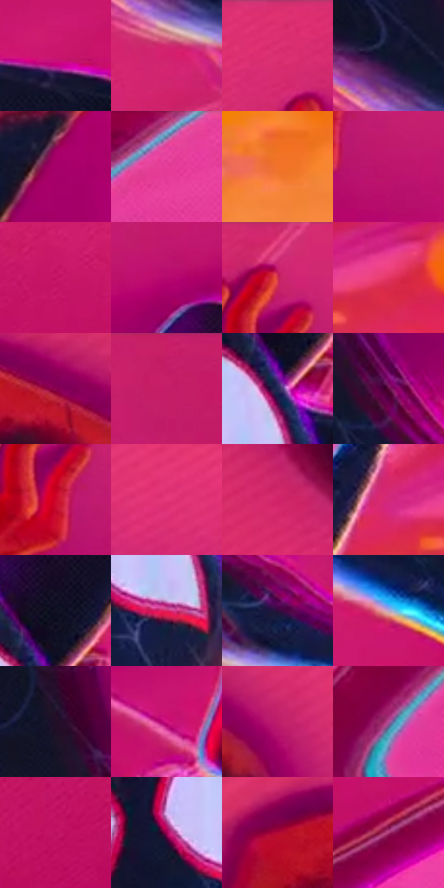

# 电影参考 641

- 状态：条件／活跃；来源世界：miles-home。
- 视角：rolled-or-dutch；景别：full-body；场景：industrial。
- 时段：event-time-unknown（外观依据，中置信度；具体时间／晨昏未知）；光照：event-light。
- 材质候选：skin, hair, fabric, metal, glass（帧级，不是像素分割）。
- 明暗组：middle；L* P5/P50/P95：7.00363 / 44.12877 / 61.06838。
- 资格门禁：energy。
- 原截图 SHA-256：`02b7f5d47056d808d161e4cfa527941ea9d3b609fe11a00ae95bf4716c18fddd`；尺寸：2880 × 1198。
- sRGB 像素 SHA-256：`a0be3168a9f9fdfe09b9477f90eeb3fa97774eccb538ebe023db06096f6b92cd`。

## 观察与迁移

事件彩光下人物、设备与粒子，皮肤和衣料仍保持体块。

黑红身体在粉紫机械面上形成大暗形，局部脚缘出现黄红重叠轮廓，躯干腿侧偏青；运动拖形与错版分开，面板排线不改变孔洞及拼缝几何。

本公开版保存32个128×128原像素色卡上下文；图集格子并非原场景相邻位置。原rect、图集tile和像素SHA见 `data/palette-crops.json`。上下文不足时不得批准替色，不能以小样推断完整构图。

## 实测色卡

颜色比例分母为保留采样像素，不是材料面积；全部 32 色参与全库匹配。表内四舍五入仅用于阅读，原精度在 JSON。

| ID | HEX | Lab | 原图 xy | 像素数 | 比例 | 明度角色 |
| --- | --- | --- | --- | ---: | ---: | --- |
| 641-S01 | #C9146C | [44.238929, 69.220931, -0.483726] | [1288, 760] | 12647 | 6.564823% | midtone |
| 641-S02 | #D2206E | [46.796194, 69.424163, 2.215756] | [552, 652] | 12050 | 6.254931% | midtone |
| 641-S03 | #DA2F6F | [49.605721, 67.932815, 5.844622] | [1596, 32] | 11554 | 5.997467% | midtone |
| 641-S04 | #12152E | [7.787407, 7.413976, -17.288779] | [536, 540] | 11180 | 5.803330% | deep-shadow |
| 641-S05 | #A70069 | [36.43801, 63.673029, -10.942671] | [1728, 316] | 11058 | 5.740002% | shadow |
| 641-S06 | #E945A0 | [56.21014, 69.826196, -13.395882] | [2760, 44] | 8677 | 4.504070% | midtone |
| 641-S07 | #F1732A | [62.621343, 44.440556, 59.683213] | [2772, 1064] | 7901 | 4.101262% | light |
| 641-S08 | #BD156E | [41.975299, 66.444602, -5.339633] | [1908, 208] | 7529 | 3.908164% | midtone |
| 641-S09 | #C41264 | [42.901503, 67.679562, 2.44774] | [420, 968] | 7366 | 3.823554% | midtone |
| 641-S10 | #B50A6E | [39.864354, 66.108851, -8.660821] | [2208, 256] | 7216 | 3.745692% | shadow |
| 641-S11 | #C72070 | [44.728609, 66.906766, -2.294533] | [1836, 52] | 7061 | 3.665234% | midtone |
| 641-S12 | #E33664 | [51.717424, 67.521235, 15.726506] | [2748, 752] | 6720 | 3.488227% | midtone |
| 641-S13 | #8B044F | [29.767679, 54.273387, -4.65863] | [444, 136] | 6088 | 3.160168% | shadow |
| 641-S14 | #C81E68 | [44.534027, 66.883981, 2.411048] | [2304, 24] | 6037 | 3.133695% | midtone |
| 641-S15 | #242754 | [17.763996, 13.399778, -27.92925] | [2136, 724] | 5923 | 3.074519% | deep-shadow |
| 641-S16 | #620F45 | [21.463649, 40.678226, -11.294426] | [664, 520] | 5277 | 2.739193% | shadow |
| 641-S17 | #CE062C | [43.416231, 68.372343, 38.200768] | [1836, 164] | 5277 | 2.739193% | midtone |
| 641-S18 | #E3377A | [52.367954, 68.940467, 3.370611] | [840, 216] | 5142 | 2.669117% | midtone |
| 641-S19 | #CF2368 | [46.272492, 67.547856, 5.090741] | [208, 424] | 5087 | 2.640567% | midtone |
| 641-S20 | #D32878 | [47.91355, 68.73942, -2.266953] | [2628, 748] | 5074 | 2.633819% | midtone |
| 641-S21 | #101022 | [5.385434, 4.953885, -12.031895] | [2148, 640] | 4980 | 2.585026% | deep-shadow |
| 641-S22 | #D82763 | [48.203573, 68.537927, 11.15037] | [2112, 836] | 4308 | 2.236203% | midtone |
| 641-S23 | #2E0E3C | [10.712843, 25.141441, -22.569689] | [768, 648] | 4154 | 2.156264% | deep-shadow |
| 641-S24 | #BBA7C9 | [71.159151, 13.584802, -14.660754] | [988, 812] | 4081 | 2.118371% | light |
| 641-S25 | #220F28 | [7.542117, 15.384215, -13.080655] | [544, 372] | 3898 | 2.023379% | deep-shadow |
| 641-S26 | #D11581 | [46.552408, 72.79105, -9.833215] | [1780, 648] | 3726 | 1.934097% | midtone |
| 641-S27 | #BE1C69 | [42.461478, 64.923996, -1.471375] | [596, 180] | 2974 | 1.543748% | midtone |
| 641-S28 | #AE4D95 | [47.595631, 48.505146, -20.871135] | [2572, 176] | 2559 | 1.328329% | midtone |
| 641-S29 | #BD1160 | [41.323153, 65.843255, 2.50472] | [96, 1088] | 2456 | 1.274864% | midtone |
| 641-S30 | #A10255 | [34.556509, 60.219454, -1.001644] | [2016, 784] | 1772 | 0.919812% | shadow |
| 641-S31 | #B20A36 | [37.755129, 61.349185, 24.037342] | [280, 128] | 1642 | 0.852332% | shadow |
| 641-S32 | #A73672 | [41.328429, 51.737334, -9.223099] | [576, 1092] | 1234 | 0.640546% | midtone |

## 色阶与空间分布

- 采样 ROI：`[0.01, 0.02, 0.98, 0.94]`；步长：4；样本数：192648。
- 排除区：`[]`。
- 深暗、暗、中、亮、高光五段计数：`[31210, 30915, 119947, 9752, 824]`。
- RGB 各 256 箱、L* 100 箱、13×5 色相明度表和 3×3 空间统计全部保存在 [总数据](../film-library.json)。
- [可视化档案](../../references/library.html)按需绘制直方图，不存 2,094 张重复图表图片。

## 纹理特征占比

**这是分块图像特征的面积占比，不是波点／排线／丝网／错版的精确语义覆盖率。** 窗格、发丝、织物也会产生方向或周期特征。
原图 ROI 像素 3081782；已测块覆盖 3081782（100.0000%）；未测 0。

| 特征 | 块覆盖像素 | 占已测面积 | 阈值敏感范围 |
| --- | ---: | ---: | --- |
| low-contrast | 482816 | 15.6668% | 8.4273% ~ 17.2617% |
| directional-structure | 995200 | 32.2930% | 18.6406% ~ 46.2943% |
| periodic-structure | 1423542 | 46.1922% | 42.0886% ~ 54.2000% |
| mixed-detail | 180224 | 5.8480% | 3.1898% ~ 9.8976% |

阈值敏感范围不是统计置信区间。逐块坐标、尺度、对比、方向一致性、频谱集中度、频率与角度见 [全量特征记录](../texture-features.jsonl)，以帧号定位。
四种印刷层的真实像素覆盖仍标为 `null`，不能填 0，也不能拿上表代替。不得据这些代理测量删除唯一证据。

[测量方法与保留策略](../../references/library-retention.md) · [分类索引](../archive/README.md)
