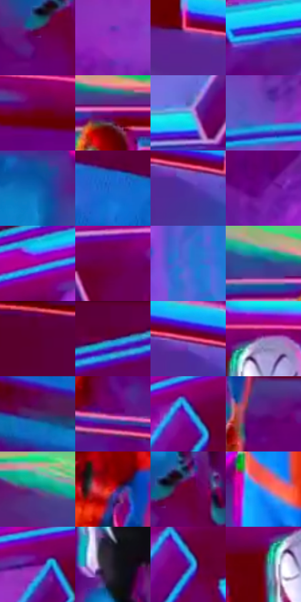

# 电影参考 642

- 状态：条件／活跃；来源世界：miles-home。
- 视角：high-angle；景别：environment-wide；场景：industrial。
- 时段：event-time-unknown（外观依据，中置信度；具体时间／晨昏未知）；光照：event-light。
- 材质候选：skin, hair, fabric, metal, glass（帧级，不是像素分割）。
- 明暗组：dark；L* P5/P50/P95：18.12813 / 31.43951 / 66.3134。
- 资格门禁：energy。
- 原截图 SHA-256：`f5727ea2a112beddba537ec87af9b433904ec4a816a6ffc79d3428c5bda36bf3`；尺寸：2880 × 1208。
- sRGB 像素 SHA-256：`f489d9f03b69d69704994ca742eb8fb970769f09e910315cab25859f65031a3b`。

## 观察与迁移

事件彩光下人物、设备与粒子，皮肤和衣料仍保持体块。

蓝紫圆形台面托住两个人物，紫色投影稳定脚下接触，红墙与青色块边形成环境色关系；机械圆弧不是动作弧线，绿色亮边不作通用皮肤颜色。

本公开版保存32个128×128原像素色卡上下文；图集格子并非原场景相邻位置。原rect、图集tile和像素SHA见 `data/palette-crops.json`。上下文不足时不得批准替色，不能以小样推断完整构图。

## 实测色卡

颜色比例分母为保留采样像素，不是材料面积；全部 32 色参与全库匹配。表内四舍五入仅用于阅读，原精度在 JSON。

| ID | HEX | Lab | 原图 xy | 像素数 | 比例 | 明度角色 |
| --- | --- | --- | --- | ---: | ---: | --- |
| 642-S01 | #630563 | [22.522868, 47.950695, -29.77722] | [1812, 908] | 18035 | 9.327837% | shadow |
| 642-S02 | #8D2DC0 | [40.156254, 62.289582, -58.415336] | [96, 892] | 10935 | 5.655664% | midtone |
| 642-S03 | #67289B | [31.271807, 48.920723, -50.998297] | [2372, 628] | 10813 | 5.592565% | shadow |
| 642-S04 | #1A89DB | [55.300563, 0.370219, -49.939256] | [636, 572] | 10389 | 5.373269% | midtone |
| 642-S05 | #69010F | [20.284354, 41.838153, 24.522149] | [2024, 328] | 10130 | 5.239312% | shadow |
| 642-S06 | #640276 | [23.872377, 52.139308, -39.928903] | [1584, 148] | 8559 | 4.426779% | shadow |
| 642-S07 | #38BDDA | [71.073129, -25.759362, -24.729417] | [1120, 476] | 7920 | 4.096283% | light |
| 642-S08 | #6849BD | [40.21557, 40.906947, -56.774854] | [340, 1004] | 7818 | 4.043528% | midtone |
| 642-S09 | #0E61B1 | [40.920995, 8.158509, -48.834335] | [1296, 612] | 7381 | 3.817509% | midtone |
| 642-S10 | #166ACE | [45.541524, 14.335657, -58.209703] | [2776, 720] | 7192 | 3.719756% | midtone |
| 642-S11 | #4D2F9F | [29.696661, 41.663964, -56.132557] | [2540, 676] | 7144 | 3.694930% | shadow |
| 642-S12 | #64088B | [26.001951, 55.00959, -49.737634] | [472, 864] | 6421 | 3.320989% | shadow |
| 642-S13 | #960393 | [35.315323, 65.284612, -39.19909] | [596, 356] | 6192 | 3.202549% | shadow |
| 642-S14 | #6A004C | [22.25539, 47.141309, -14.716413] | [1280, 316] | 6106 | 3.158069% | shadow |
| 642-S15 | #3A6BD1 | [46.995625, 18.266057, -57.531207] | [700, 936] | 5827 | 3.013768% | midtone |
| 642-S16 | #31468D | [31.705436, 15.866546, -41.986685] | [1476, 112] | 5583 | 2.887569% | shadow |
| 642-S17 | #5A0033 | [17.52188, 40.507364, -4.832128] | [2440, 44] | 5564 | 2.877742% | deep-shadow |
| 642-S18 | #5E003F | [18.967629, 42.830435, -11.041558] | [832, 40] | 5555 | 2.873088% | deep-shadow |
| 642-S19 | #D9548B | [55.031332, 57.086093, -3.076396] | [2520, 636] | 4726 | 2.444323% | midtone |
| 642-S20 | #A979C1 | [57.999457, 31.828373, -30.449917] | [1800, 276] | 4525 | 2.340364% | midtone |
| 642-S21 | #492D6C | [24.876987, 27.136286, -32.102308] | [2556, 1084] | 4189 | 2.166582% | shadow |
| 642-S22 | #831372 | [30.657175, 54.03987, -26.197196] | [1492, 1048] | 3881 | 2.007282% | shadow |
| 642-S23 | #394CC0 | [37.558947, 31.824473, -63.007991] | [480, 460] | 3781 | 1.955562% | shadow |
| 642-S24 | #5A147F | [24.342115, 47.906388, -44.976264] | [1664, 604] | 3771 | 1.950389% | shadow |
| 642-S25 | #8DC0A6 | [73.619296, -22.148942, 7.744448] | [1312, 28] | 3652 | 1.888842% | light |
| 642-S26 | #CB1336 | [43.408108, 66.538659, 32.083464] | [1584, 452] | 3634 | 1.879532% | midtone |
| 642-S27 | #680032 | [20.728576, 43.878247, 0.978203] | [1856, 876] | 3377 | 1.746610% | shadow |
| 642-S28 | #6B83D8 | [56.401088, 14.853639, -46.32575] | [1448, 592] | 2976 | 1.539210% | midtone |
| 642-S29 | #6D027E | [26.161358, 55.045923, -41.239691] | [796, 376] | 2203 | 1.139408% | shadow |
| 642-S30 | #1F1926 | [10.003746, 6.327082, -7.795916] | [1812, 652] | 2172 | 1.123375% | deep-shadow |
| 642-S31 | #4A1293 | [23.653582, 50.951228, -58.707735] | [500, 496] | 1928 | 0.997176% | shadow |
| 642-S32 | #62102A | [20.577398, 37.368516, 6.234955] | [1736, 332] | 967 | 0.500140% | shadow |

## 色阶与空间分布

- 采样 ROI：`[0.01, 0.02, 0.98, 0.94]`；步长：4；样本数：193346。
- 排除区：`[]`。
- 深暗、暗、中、亮、高光五段计数：`[25718, 102954, 47861, 14561, 2252]`。
- RGB 各 256 箱、L* 100 箱、13×5 色相明度表和 3×3 空间统计全部保存在 [总数据](../film-library.json)。
- [可视化档案](../../references/library.html)按需绘制直方图，不存 2,094 张重复图表图片。

## 纹理特征占比

**这是分块图像特征的面积占比，不是波点／排线／丝网／错版的精确语义覆盖率。** 窗格、发丝、织物也会产生方向或周期特征。
原图 ROI 像素 3104134；已测块覆盖 3104134（100.0000%）；未测 0。

| 特征 | 块覆盖像素 | 占已测面积 | 阈值敏感范围 |
| --- | ---: | ---: | --- |
| low-contrast | 166912 | 5.3771% | 4.4905% ~ 6.2636% |
| directional-structure | 1578886 | 50.8640% | 43.8868% ~ 62.0470% |
| periodic-structure | 1330816 | 42.8724% | 33.4625% ~ 47.0208% |
| mixed-detail | 27520 | 0.8866% | 0.0000% ~ 2.8287% |

阈值敏感范围不是统计置信区间。逐块坐标、尺度、对比、方向一致性、频谱集中度、频率与角度见 [全量特征记录](../texture-features.jsonl)，以帧号定位。
四种印刷层的真实像素覆盖仍标为 `null`，不能填 0，也不能拿上表代替。不得据这些代理测量删除唯一证据。

[测量方法与保留策略](../../references/library-retention.md) · [分类索引](../archive/README.md)
