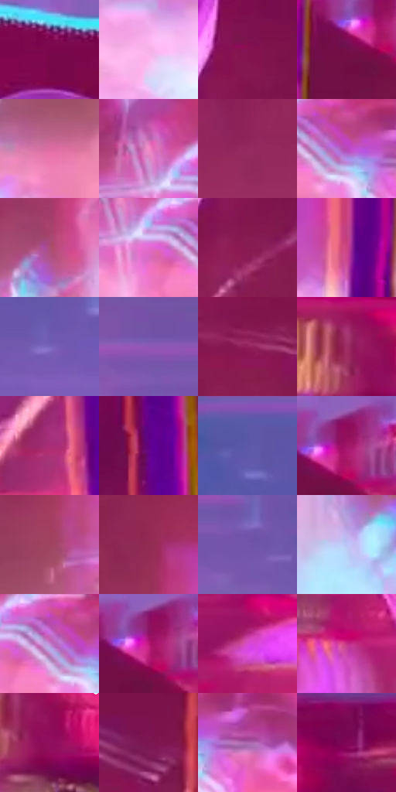

# 电影参考 643

- 状态：条件／活跃；来源世界：miles-home。
- 视角：low-angle；景别：medium；场景：industrial。
- 时段：event-time-unknown（外观依据，中置信度；具体时间／晨昏未知）；光照：event-light。
- 材质候选：skin, hair, fabric, metal, glass（帧级，不是像素分割）。
- 明暗组：middle；L* P5/P50/P95：25.18388 / 42.0724 / 77.5815。
- 资格门禁：energy。
- 原截图 SHA-256：`b0d940cf0cc4f8db7079ec3218ab1e0f5f1059468a1c583045c45d2b0a27d025`；尺寸：2880 × 1204。
- sRGB 像素 SHA-256：`1645636732c61145fda1a00d5a39a9037dcd5681a2ef3983ac12e748483b41bf`。

## 观察与迁移

事件彩光下人物、设备与粒子，皮肤和衣料仍保持体块。

巨大黑衣躯干与浅色头领形成极端面积差，底部青粉雾光遮蔽暗衣并改变可见颜色；这不是布料自发光，也不授权普通人像套用该角色头身比。

本公开版保存32个128×128原像素色卡上下文；图集格子并非原场景相邻位置。原rect、图集tile和像素SHA见 `data/palette-crops.json`。上下文不足时不得批准替色，不能以小样推断完整构图。

## 实测色卡

颜色比例分母为保留采样像素，不是材料面积；全部 32 色参与全库匹配。表内四舍五入仅用于阅读，原精度在 JSON。

| ID | HEX | Lab | 原图 xy | 像素数 | 比例 | 明度角色 |
| --- | --- | --- | --- | ---: | ---: | --- |
| 643-S01 | #79074A | [25.899327, 48.952366, -7.504345] | [1444, 108] | 9882 | 5.129563% | shadow |
| 643-S02 | #F6B2E9 | [80.358711, 33.233625, -17.669718] | [852, 1100] | 9308 | 4.831610% | highlight |
| 643-S03 | #831150 | [28.919503, 50.110518, -6.765189] | [1604, 372] | 9170 | 4.759977% | shadow |
| 643-S04 | #730F49 | [25.163514, 45.675021, -8.063464] | [2244, 336] | 8743 | 4.538329% | shadow |
| 643-S05 | #DC6CA0 | [60.321921, 49.503264, -7.43891] | [1696, 1020] | 8591 | 4.459429% | light |
| 643-S06 | #F28CC7 | [70.705425, 46.194862, -13.663787] | [2312, 812] | 7777 | 4.036896% | light |
| 643-S07 | #94295F | [35.419166, 48.99801, -6.459059] | [988, 692] | 7775 | 4.035858% | shadow |
| 643-S08 | #B849B8 | [49.998955, 58.954328, -37.644924] | [2456, 880] | 7452 | 3.868195% | midtone |
| 643-S09 | #AC4F79 | [46.638303, 42.759187, -5.498817] | [1308, 872] | 7182 | 3.728043% | midtone |
| 643-S10 | #E36BCD | [62.724017, 58.719445, -29.366965] | [2348, 876] | 6883 | 3.572838% | light |
| 643-S11 | #881C53 | [31.092183, 48.755532, -5.388625] | [1588, 492] | 6673 | 3.463830% | shadow |
| 643-S12 | #CB4580 | [50.114405, 57.914066, -4.033084] | [2108, 832] | 6358 | 3.300320% | midtone |
| 643-S13 | #7B66BD | [48.744147, 28.398851, -43.002856] | [460, 136] | 6316 | 3.278518% | midtone |
| 643-S14 | #8F57B5 | [46.964466, 40.513396, -41.047522] | [2448, 84] | 6296 | 3.268137% | midtone |
| 643-S15 | #92205B | [33.775861, 51.129284, -6.383394] | [1880, 468] | 6282 | 3.260870% | shadow |
| 643-S16 | #9D2E65 | [37.956255, 50.414893, -6.313893] | [2752, 648] | 6135 | 3.184565% | shadow |
| 643-S17 | #A92E76 | [40.733929, 55.844894, -12.570214] | [620, 644] | 5847 | 3.035069% | midtone |
| 643-S18 | #610281 | [24.225509, 53.773007, -46.379227] | [656, 288] | 5625 | 2.919833% | shadow |
| 643-S19 | #5D58A8 | [41.426614, 23.087644, -42.516563] | [144, 76] | 5562 | 2.887131% | midtone |
| 643-S20 | #A11569 | [36.243655, 59.350482, -11.352394] | [2292, 296] | 5520 | 2.865330% | shadow |
| 643-S21 | #9F4360 | [41.581931, 41.136226, 2.19499] | [1780, 880] | 5390 | 2.797849% | midtone |
| 643-S22 | #922C52 | [35.049647, 45.756574, 1.305145] | [1780, 736] | 5349 | 2.776567% | shadow |
| 643-S23 | #7256AB | [43.022495, 30.665188, -41.633651] | [2592, 148] | 5258 | 2.729330% | midtone |
| 643-S24 | #BAC5F4 | [80.124279, 6.179725, -24.413659] | [1428, 988] | 4973 | 2.581392% | highlight |
| 643-S25 | #C384D0 | [63.884408, 36.930395, -29.576623] | [2416, 872] | 4393 | 2.280325% | light |
| 643-S26 | #BB197A | [42.258813, 66.465001, -12.422009] | [2280, 304] | 4348 | 2.256966% | midtone |
| 643-S27 | #D84BCD | [56.129384, 69.491343, -39.768754] | [2488, 464] | 4061 | 2.107990% | midtone |
| 643-S28 | #C53087 | [46.626984, 64.54947, -13.592492] | [236, 500] | 3960 | 2.055562% | midtone |
| 643-S29 | #90105D | [32.015005, 54.963034, -10.370204] | [2796, 688] | 3167 | 1.643931% | shadow |
| 643-S30 | #7B1750 | [27.856229, 46.401051, -8.527375] | [2048, 476] | 3053 | 1.584756% | shadow |
| 643-S31 | #AC66AC | [53.225364, 39.031504, -25.749861] | [2540, 896] | 2888 | 1.499107% | midtone |
| 643-S32 | #7E0654 | [27.316998, 51.436734, -11.948031] | [2748, 316] | 2431 | 1.261887% | shadow |

## 色阶与空间分布

- 采样 ROI：`[0.01, 0.02, 0.98, 0.94]`；步长：4；样本数：192648。
- 排除区：`[]`。
- 深暗、暗、中、亮、高光五段计数：`[774, 83720, 72166, 29008, 6980]`。
- RGB 各 256 箱、L* 100 箱、13×5 色相明度表和 3×3 空间统计全部保存在 [总数据](../film-library.json)。
- [可视化档案](../../references/library.html)按需绘制直方图，不存 2,094 张重复图表图片。

## 纹理特征占比

**这是分块图像特征的面积占比，不是波点／排线／丝网／错版的精确语义覆盖率。** 窗格、发丝、织物也会产生方向或周期特征。
原图 ROI 像素 3092958；已测块覆盖 3092958（100.0000%）；未测 0。

| 特征 | 块覆盖像素 | 占已测面积 | 阈值敏感范围 |
| --- | ---: | ---: | --- |
| low-contrast | 245760 | 7.9458% | 3.7080% ~ 11.6538% |
| directional-structure | 864640 | 27.9551% | 12.3408% ~ 46.7477% |
| periodic-structure | 1982558 | 64.0991% | 49.5442% ~ 75.4756% |
| mixed-detail | 0 | 0.0000% | 0.0000% ~ 0.5297% |

阈值敏感范围不是统计置信区间。逐块坐标、尺度、对比、方向一致性、频谱集中度、频率与角度见 [全量特征记录](../texture-features.jsonl)，以帧号定位。
四种印刷层的真实像素覆盖仍标为 `null`，不能填 0，也不能拿上表代替。不得据这些代理测量删除唯一证据。

[测量方法与保留策略](../../references/library-retention.md) · [分类索引](../archive/README.md)
