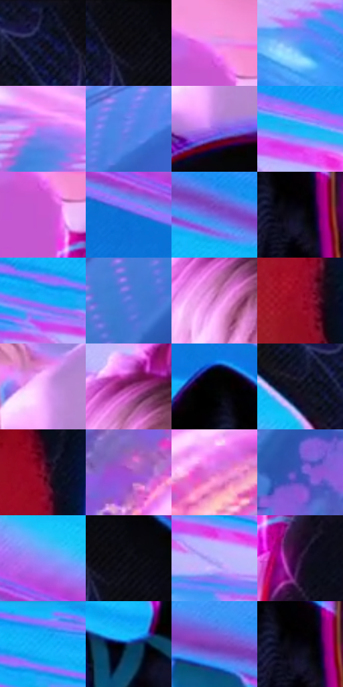

# 电影参考 644

- 状态：条件／活跃；来源世界：miles-home。
- 视角：rolled-or-dutch；景别：medium；场景：industrial。
- 时段：event-time-unknown（外观依据，中置信度；具体时间／晨昏未知）；光照：event-light。
- 材质候选：skin, hair, fabric, metal, glass（帧级，不是像素分割）。
- 明暗组：middle；L* P5/P50/P95：2.20873 / 51.43274 / 74.56508。
- 资格门禁：energy。
- 原截图 SHA-256：`95757553abd698dc3aefaea34e28742ecdd4192414265e36b3888b688159c938`；尺寸：2880 × 1202。
- sRGB 像素 SHA-256：`9e27096d3c6fe6df395612f2130d1af1380f3473f93ffefd7b764ef90fc1baa9`。

## 观察与迁移

事件彩光下人物、设备与粒子，皮肤和衣料仍保持体块。

裸脸亮部偏粉，背景偏蓝，黑衣前景以细网与局部方向性亮纹表达转折；发束大面与布料微纹不同，后方能量弧不画到普通人物脸上。

本公开版保存32个128×128原像素色卡上下文；图集格子并非原场景相邻位置。原rect、图集tile和像素SHA见 `data/palette-crops.json`。上下文不足时不得批准替色，不能以小样推断完整构图。

## 实测色卡

颜色比例分母为保留采样像素，不是材料面积；全部 32 色参与全库匹配。表内四舍五入仅用于阅读，原精度在 JSON。

| ID | HEX | Lab | 原图 xy | 像素数 | 比例 | 明度角色 |
| --- | --- | --- | --- | ---: | ---: | --- |
| 644-S01 | #10132E | [6.98323, 8.240217, -18.578288] | [2064, 60] | 11106 | 5.764918% | deep-shadow |
| 644-S02 | #0A0A12 | [2.938188, 1.38032, -3.756843] | [2144, 28] | 8594 | 4.460986% | deep-shadow |
| 644-S03 | #E690ED | [71.477402, 46.771189, -33.566997] | [904, 692] | 8410 | 4.365475% | light |
| 644-S04 | #5099F5 | [62.572561, 6.140516, -52.724286] | [2796, 976] | 8331 | 4.324467% | light |
| 644-S05 | #AB7DF3 | [61.477386, 41.676759, -52.994799] | [76, 300] | 7924 | 4.113201% | light |
| 644-S06 | #6A83EE | [57.527905, 21.548286, -56.82303] | [316, 620] | 7663 | 3.977721% | midtone |
| 644-S07 | #9D66E4 | [54.31414, 47.115006, -56.145962] | [1176, 640] | 7527 | 3.907126% | midtone |
| 644-S08 | #15B8F8 | [70.324859, -15.819537, -42.223616] | [584, 120] | 7456 | 3.870271% | light |
| 644-S09 | #C856D0 | [55.574301, 61.538316, -42.510892] | [908, 764] | 6926 | 3.595158% | midtone |
| 644-S10 | #106CD5 | [46.494268, 15.515059, -60.674469] | [1572, 184] | 6872 | 3.567128% | midtone |
| 644-S11 | #7167DB | [49.886885, 33.960981, -58.395311] | [2672, 476] | 6774 | 3.516258% | midtone |
| 644-S12 | #0F0E1E | [4.600896, 4.267634, -10.136996] | [1956, 452] | 6472 | 3.359495% | deep-shadow |
| 644-S13 | #1CAAF9 | [66.390914, -7.499138, -48.942693] | [212, 120] | 6424 | 3.334579% | light |
| 644-S14 | #4C75D7 | [50.877448, 16.869171, -54.663732] | [84, 792] | 6319 | 3.280076% | midtone |
| 644-S15 | #CA73C0 | [60.449832, 45.172414, -25.786384] | [628, 324] | 6215 | 3.226091% | light |
| 644-S16 | #9A0F2C | [32.691309, 53.888583, 23.044601] | [2256, 1064] | 5995 | 3.111893% | shadow |
| 644-S17 | #F3B3FD | [80.954166, 35.358529, -27.529784] | [1160, 548] | 5942 | 3.084382% | highlight |
| 644-S18 | #9A3984 | [40.350635, 49.228141, -22.020469] | [644, 252] | 5738 | 2.978489% | midtone |
| 644-S19 | #020204 | [0.587921, 0.278053, -0.756781] | [1884, 364] | 5732 | 2.975375% | deep-shadow |
| 644-S20 | #0B0B19 | [3.438462, 2.92001, -7.947199] | [1992, 104] | 5689 | 2.953054% | deep-shadow |
| 644-S21 | #730F2A | [24.176673, 42.795138, 11.762441] | [2280, 880] | 5666 | 2.941115% | shadow |
| 644-S22 | #9F50CA | [48.726406, 53.003118, -50.294226] | [264, 1104] | 5326 | 2.764628% | midtone |
| 644-S23 | #E276DA | [65.113164, 55.33086, -32.969235] | [488, 1128] | 5204 | 2.701300% | light |
| 644-S24 | #3D52B7 | [38.627979, 25.317336, -55.984696] | [128, 928] | 5150 | 2.673269% | shadow |
| 644-S25 | #868FF7 | [62.86592, 23.278848, -53.181305] | [1596, 76] | 4776 | 2.479133% | light |
| 644-S26 | #07080D | [2.239155, 0.469709, -2.082319] | [2180, 32] | 4668 | 2.423072% | deep-shadow |
| 644-S27 | #B4AEFD | [74.231808, 19.173472, -38.355661] | [380, 196] | 4636 | 2.406462% | light |
| 644-S28 | #2E1639 | [12.287268, 19.521699, -17.915467] | [996, 868] | 3983 | 2.067501% | deep-shadow |
| 644-S29 | #2297F4 | [60.782532, 1.923187, -55.092705] | [272, 40] | 3923 | 2.036356% | light |
| 644-S30 | #18346D | [22.840061, 11.624044, -36.232525] | [2464, 596] | 2774 | 1.439932% | shadow |
| 644-S31 | #7F42B6 | [40.873466, 47.933394, -51.47799] | [2524, 420] | 2701 | 1.402039% | midtone |
| 644-S32 | #040410 | [1.355328, 1.817376, -4.946252] | [1948, 440] | 1732 | 0.899049% | deep-shadow |

## 色阶与空间分布

- 采样 ROI：`[0.01, 0.02, 0.98, 0.94]`；步长：4；样本数：192648。
- 排除区：`[]`。
- 深暗、暗、中、亮、高光五段计数：`[50059, 17997, 65214, 56256, 3122]`。
- RGB 各 256 箱、L* 100 箱、13×5 色相明度表和 3×3 空间统计全部保存在 [总数据](../film-library.json)。
- [可视化档案](../../references/library.html)按需绘制直方图，不存 2,094 张重复图表图片。

## 纹理特征占比

**这是分块图像特征的面积占比，不是波点／排线／丝网／错版的精确语义覆盖率。** 窗格、发丝、织物也会产生方向或周期特征。
原图 ROI 像素 3087370；已测块覆盖 3087370（100.0000%）；未测 0。

| 特征 | 块覆盖像素 | 占已测面积 | 阈值敏感范围 |
| --- | ---: | ---: | --- |
| low-contrast | 125056 | 4.0506% | 3.1841% ~ 5.1119% |
| directional-structure | 1086080 | 35.1782% | 13.2670% ~ 44.3904% |
| periodic-structure | 1789962 | 57.9769% | 52.4255% ~ 72.9396% |
| mixed-detail | 86272 | 2.7944% | 0.0000% ~ 8.6816% |

阈值敏感范围不是统计置信区间。逐块坐标、尺度、对比、方向一致性、频谱集中度、频率与角度见 [全量特征记录](../texture-features.jsonl)，以帧号定位。
四种印刷层的真实像素覆盖仍标为 `null`，不能填 0，也不能拿上表代替。不得据这些代理测量删除唯一证据。

[测量方法与保留策略](../../references/library-retention.md) · [分类索引](../archive/README.md)
