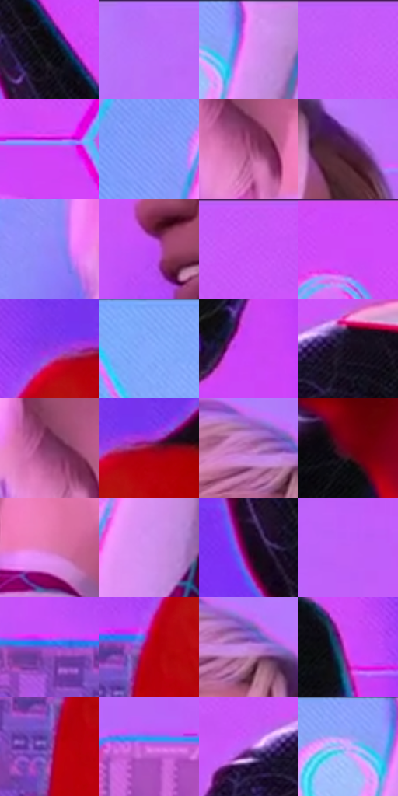

# 电影参考 645

- 状态：条件／活跃；来源世界：miles-home。
- 视角：near-level；景别：medium；场景：industrial。
- 时段：event-time-unknown（外观依据，中置信度；具体时间／晨昏未知）；光照：event-light。
- 材质候选：skin, hair, fabric, metal, glass（帧级，不是像素分割）。
- 明暗组：middle；L* P5/P50/P95：3.60421 / 56.6529 / 71.05474。
- 资格门禁：energy。
- 原截图 SHA-256：`f96def792b73630de7ead856ca4e03c44286ff1dad7d2ccdfcdbe435e9483bfc`；尺寸：2880 × 1202。
- sRGB 像素 SHA-256：`6b56fc0985417f4241dee582dfc94259eda30c0e80f7362846b0e462ba989f3c`。

## 观察与迁移

事件彩光下人物、设备与粒子，皮肤和衣料仍保持体块。

两张侧脸承受相近粉紫环境光却保持不同肤色基础和明度；白色衣领留淡紫褶皱，黑红服装保留低明度锚点。安静对话不自动增加头周感应线。

本公开版保存32个128×128原像素色卡上下文；图集格子并非原场景相邻位置。原rect、图集tile和像素SHA见 `data/palette-crops.json`。上下文不足时不得批准替色，不能以小样推断完整构图。

## 实测色卡

颜色比例分母为保留采样像素，不是材料面积；全部 32 色参与全库匹配。表内四舍五入仅用于阅读，原精度在 JSON。

| ID | HEX | Lab | 原图 xy | 像素数 | 比例 | 明度角色 |
| --- | --- | --- | --- | ---: | ---: | --- |
| 645-S01 | #0B0A10 | [2.941444, 1.251175, -2.581025] | [2388, 84] | 12724 | 6.604792% | deep-shadow |
| 645-S02 | #BA6AF9 | [59.513493, 56.84704, -59.348217] | [1192, 36] | 12417 | 6.445434% | midtone |
| 645-S03 | #E88DF7 | [71.502501, 50.769664, -38.972708] | [392, 52] | 11972 | 6.214443% | light |
| 645-S04 | #C45BFA | [58.151344, 66.457498, -62.016951] | [1616, 36] | 11419 | 5.927391% | midtone |
| 645-S05 | #D141F7 | [56.140555, 78.658867, -63.486566] | [2720, 308] | 9035 | 4.689901% | midtone |
| 645-S06 | #829BF9 | [65.768441, 15.954854, -49.696308] | [184, 404] | 8780 | 4.557535% | light |
| 645-S07 | #A85282 | [46.93888, 41.168446, -10.55184] | [640, 580] | 8422 | 4.371704% | midtone |
| 645-S08 | #492040 | [19.307738, 24.433517, -11.559866] | [1104, 256] | 7902 | 4.101781% | deep-shadow |
| 645-S09 | #9183F8 | [60.806196, 33.132669, -56.959969] | [472, 504] | 7355 | 3.817844% | light |
| 645-S10 | #BE49F9 | [54.608107, 72.559024, -67.205646] | [1620, 588] | 7337 | 3.808500% | midtone |
| 645-S11 | #C755F9 | [57.539585, 69.503976, -62.423545] | [1736, 48] | 6987 | 3.626822% | midtone |
| 645-S12 | #D048FA | [57.024729, 76.605975, -63.740169] | [2704, 28] | 6980 | 3.623188% | midtone |
| 645-S13 | #923AEA | [45.739396, 67.41803, -73.452688] | [1744, 888] | 6874 | 3.568166% | midtone |
| 645-S14 | #80AAFB | [69.683108, 7.48914, -44.630592] | [112, 32] | 6694 | 3.474731% | light |
| 645-S15 | #CD44F7 | [55.917184, 76.884967, -63.876228] | [2188, 472] | 6443 | 3.344442% | midtone |
| 645-S16 | #1B1223 | [7.108681, 8.907401, -10.050175] | [1828, 192] | 5948 | 3.087496% | deep-shadow |
| 645-S17 | #7F3967 | [34.839642, 36.238066, -12.774347] | [616, 540] | 5480 | 2.844566% | shadow |
| 645-S18 | #8F0D2E | [30.221919, 51.363214, 18.133121] | [1804, 896] | 5360 | 2.782276% | shadow |
| 645-S19 | #AE63AA | [52.758414, 40.89872, -25.28806] | [960, 164] | 5212 | 2.705452% | midtone |
| 645-S20 | #680219 | [20.273157, 41.699564, 18.049153] | [2260, 700] | 5076 | 2.634857% | shadow |
| 645-S21 | #DD78B4 | [63.428209, 46.679764, -14.211687] | [748, 632] | 4941 | 2.564781% | light |
| 645-S22 | #D391EE | [69.663938, 40.791257, -37.090263] | [308, 444] | 4444 | 2.306798% | light |
| 645-S23 | #1C0820 | [4.740972, 13.416513, -11.359325] | [2408, 352] | 4332 | 2.248661% | deep-shadow |
| 645-S24 | #C060F8 | [58.36768, 62.868631, -60.589398] | [1276, 520] | 3937 | 2.043624% | midtone |
| 645-S25 | #7D55D9 | [46.797755, 46.337937, -62.188671] | [1548, 1016] | 3821 | 1.983410% | midtone |
| 645-S26 | #B90019 | [38.529782, 63.26983, 42.492202] | [1680, 1024] | 3014 | 1.564511% | shadow |
| 645-S27 | #BF80DB | [63.035748, 40.130677, -37.075543] | [1004, 176] | 2950 | 1.531290% | light |
| 645-S28 | #D748F7 | [57.845659, 77.441875, -60.701657] | [2184, 264] | 2072 | 1.075537% | midtone |
| 645-S29 | #7A40A3 | [38.636071, 43.245087, -43.82641] | [1652, 1088] | 1729 | 0.897492% | shadow |
| 645-S30 | #D064E2 | [59.903947, 60.477823, -45.765192] | [1108, 1016] | 1414 | 0.733981% | midtone |
| 645-S31 | #B45DDD | [54.817023, 55.794438, -51.24723] | [1728, 196] | 1137 | 0.590196% | midtone |
| 645-S32 | #C5A8FF | [74.250417, 27.830444, -39.299326] | [320, 56] | 440 | 0.228396% | light |

## 色阶与空间分布

- 采样 ROI：`[0.01, 0.02, 0.98, 0.94]`；步长：4；样本数：192648。
- 排除区：`[]`。
- 深暗、暗、中、亮、高光五段计数：`[28991, 20264, 94372, 48953, 68]`。
- RGB 各 256 箱、L* 100 箱、13×5 色相明度表和 3×3 空间统计全部保存在 [总数据](../film-library.json)。
- [可视化档案](../../references/library.html)按需绘制直方图，不存 2,094 张重复图表图片。

## 纹理特征占比

**这是分块图像特征的面积占比，不是波点／排线／丝网／错版的精确语义覆盖率。** 窗格、发丝、织物也会产生方向或周期特征。
原图 ROI 像素 3087370；已测块覆盖 3087370（100.0000%）；未测 0。

| 特征 | 块覆盖像素 | 占已测面积 | 阈值敏感范围 |
| --- | ---: | ---: | --- |
| low-contrast | 585482 | 18.9638% | 16.8411% ~ 22.4837% |
| directional-structure | 837120 | 27.1143% | 11.4801% ~ 45.1159% |
| periodic-structure | 1582848 | 51.2685% | 37.5123% ~ 57.4957% |
| mixed-detail | 81920 | 2.6534% | 0.5307% ~ 8.5406% |

阈值敏感范围不是统计置信区间。逐块坐标、尺度、对比、方向一致性、频谱集中度、频率与角度见 [全量特征记录](../texture-features.jsonl)，以帧号定位。
四种印刷层的真实像素覆盖仍标为 `null`，不能填 0，也不能拿上表代替。不得据这些代理测量删除唯一证据。

[测量方法与保留策略](../../references/library-retention.md) · [分类索引](../archive/README.md)
