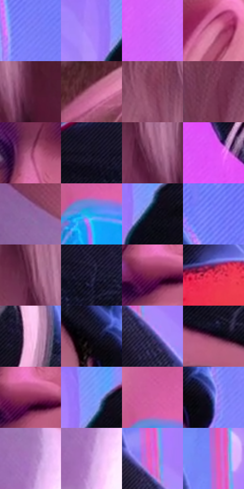

# 电影参考 646

- 状态：条件／活跃；来源世界：miles-home。
- 视角：near-level；景别：close-up；场景：industrial。
- 时段：event-time-unknown（外观依据，中置信度；具体时间／晨昏未知）；光照：event-light。
- 材质候选：skin, hair, fabric, metal, glass（帧级，不是像素分割）。
- 明暗组：middle；L* P5/P50/P95：4.15806 / 51.72542 / 70.43371。
- 资格门禁：energy。
- 原截图 SHA-256：`1410255781da0ba9800f0c1cd159f1e6bc92d3b9fc5af6d3de3ed265793b259f`；尺寸：2880 × 1208。
- sRGB 像素 SHA-256：`697c8ce5d6d060a372d4ac11d5db0eb38838665a35783e0ce20c4afd9c03d857`。

## 观察与迁移

事件彩光下人物、设备与粒子，皮肤和衣料仍保持体块。

正面偏侧的脸以粉紫体面和眼部亮点读取，鼻下、颊侧与下颌选择性短排线，中央亮面更净；前景侧脸较软，青色边缘不等于整张面部RGB平移。

本公开版保存32个128×128原像素色卡上下文；图集格子并非原场景相邻位置。原rect、图集tile和像素SHA见 `data/palette-crops.json`。上下文不足时不得批准替色，不能以小样推断完整构图。

## 实测色卡

颜色比例分母为保留采样像素，不是材料面积；全部 32 色参与全库匹配。表内四舍五入仅用于阅读，原精度在 JSON。

| ID | HEX | Lab | 原图 xy | 像素数 | 比例 | 明度角色 |
| --- | --- | --- | --- | ---: | ---: | --- |
| 646-S01 | #7B80FA | [58.554535, 30.548442, -61.756725] | [2532, 268] | 14843 | 7.676911% | midtone |
| 646-S02 | #AB80FA | [62.505491, 41.735934, -55.21784] | [1832, 124] | 14691 | 7.598295% | light |
| 646-S03 | #D164FA | [61.283889, 65.335905, -56.912772] | [1568, 836] | 13187 | 6.820415% | light |
| 646-S04 | #DF84A9 | [65.793923, 39.56059, -4.422806] | [924, 412] | 10937 | 5.656698% | light |
| 646-S05 | #561D37 | [20.570776, 29.299959, -3.191842] | [356, 428] | 10013 | 5.178799% | shadow |
| 646-S06 | #B9658C | [53.510963, 38.512901, -6.435222] | [840, 80] | 8844 | 4.574183% | midtone |
| 646-S07 | #86415E | [37.221883, 33.024637, -3.395013] | [208, 92] | 8032 | 4.154211% | shadow |
| 646-S08 | #773653 | [32.225973, 31.954623, -4.024199] | [76, 88] | 7952 | 4.112834% | shadow |
| 646-S09 | #A65077 | [45.877086, 39.933132, -5.512479] | [2040, 476] | 7793 | 4.030598% | midtone |
| 646-S10 | #151122 | [6.104461, 6.391125, -10.889625] | [2052, 104] | 7418 | 3.836645% | deep-shadow |
| 646-S11 | #8B4D70 | [41.164592, 30.971541, -8.668587] | [284, 400] | 6889 | 3.563042% | midtone |
| 646-S12 | #E153F9 | [60.813106, 75.845769, -56.984389] | [1372, 412] | 6813 | 3.523735% | light |
| 646-S13 | #8B67A1 | [49.207208, 25.599321, -25.847013] | [436, 884] | 6612 | 3.419776% | midtone |
| 646-S14 | #15ABEE | [66.100667, -12.328386, -43.401625] | [784, 920] | 6598 | 3.412535% | light |
| 646-S15 | #0D0C19 | [3.781905, 3.068828, -7.429635] | [1912, 144] | 6405 | 3.312714% | deep-shadow |
| 646-S16 | #6F79F8 | [55.916194, 31.690406, -64.93487] | [2484, 76] | 6144 | 3.177723% | midtone |
| 646-S17 | #642A46 | [26.180818, 29.640294, -4.801797] | [252, 344] | 5650 | 2.922222% | shadow |
| 646-S18 | #1F1B36 | [11.562366, 9.941648, -17.039306] | [2160, 132] | 5482 | 2.835331% | deep-shadow |
| 646-S19 | #782448 | [28.704567, 39.729211, -2.004497] | [2036, 628] | 5309 | 2.745855% | shadow |
| 646-S20 | #DF264B | [48.991482, 69.135425, 27.105038] | [2560, 984] | 4743 | 2.453115% | midtone |
| 646-S21 | #F4B9E5 | [81.614944, 28.179547, -13.649948] | [1476, 216] | 4736 | 2.449495% | highlight |
| 646-S22 | #0A0812 | [2.546032, 2.181442, -4.329479] | [2400, 396] | 4546 | 2.351225% | deep-shadow |
| 646-S23 | #37376A | [25.517769, 14.933087, -29.900129] | [1656, 372] | 3718 | 1.922977% | shadow |
| 646-S24 | #3E102B | [13.042499, 25.625538, -6.393123] | [2200, 292] | 3670 | 1.898152% | deep-shadow |
| 646-S25 | #8B2E57 | [34.257335, 43.250072, -3.22597] | [2056, 620] | 3466 | 1.792641% | shadow |
| 646-S26 | #7B96F7 | [63.946859, 16.683627, -51.511335] | [1896, 92] | 2562 | 1.325086% | light |
| 646-S27 | #D360A2 | [56.905783, 52.695016, -13.847969] | [780, 844] | 2477 | 1.281123% | midtone |
| 646-S28 | #586EC4 | [48.524114, 17.077842, -47.549271] | [2476, 428] | 1175 | 0.607719% | midtone |
| 646-S29 | #A97BBE | [58.338676, 30.060791, -28.217521] | [576, 1032] | 1113 | 0.575652% | midtone |
| 646-S30 | #C393D8 | [67.596894, 30.319833, -28.303269] | [580, 1108] | 734 | 0.379630% | light |
| 646-S31 | #DF6CD6 | [62.735483, 58.601533, -34.455425] | [1616, 280] | 584 | 0.302049% | light |
| 646-S32 | #BE69D2 | [57.755529, 50.162674, -40.299154] | [1592, 128] | 210 | 0.108614% | midtone |

## 色阶与空间分布

- 采样 ROI：`[0.01, 0.02, 0.98, 0.94]`；步长：4；样本数：193346。
- 排除区：`[]`。
- 深暗、暗、中、亮、高光五段计数：`[32677, 41578, 64475, 52129, 2487]`。
- RGB 各 256 箱、L* 100 箱、13×5 色相明度表和 3×3 空间统计全部保存在 [总数据](../film-library.json)。
- [可视化档案](../../references/library.html)按需绘制直方图，不存 2,094 张重复图表图片。

## 纹理特征占比

**这是分块图像特征的面积占比，不是波点／排线／丝网／错版的精确语义覆盖率。** 窗格、发丝、织物也会产生方向或周期特征。
原图 ROI 像素 3104134；已测块覆盖 3104134（100.0000%）；未测 0。

| 特征 | 块覆盖像素 | 占已测面积 | 阈值敏感范围 |
| --- | ---: | ---: | --- |
| low-contrast | 368896 | 11.8840% | 6.1606% ~ 14.5437% |
| directional-structure | 949638 | 30.5927% | 16.0241% ~ 52.2412% |
| periodic-structure | 1604736 | 51.6967% | 40.0148% ~ 59.7419% |
| mixed-detail | 180864 | 5.8266% | 1.5834% ~ 9.6903% |

阈值敏感范围不是统计置信区间。逐块坐标、尺度、对比、方向一致性、频谱集中度、频率与角度见 [全量特征记录](../texture-features.jsonl)，以帧号定位。
四种印刷层的真实像素覆盖仍标为 `null`，不能填 0，也不能拿上表代替。不得据这些代理测量删除唯一证据。

[测量方法与保留策略](../../references/library-retention.md) · [分类索引](../archive/README.md)
