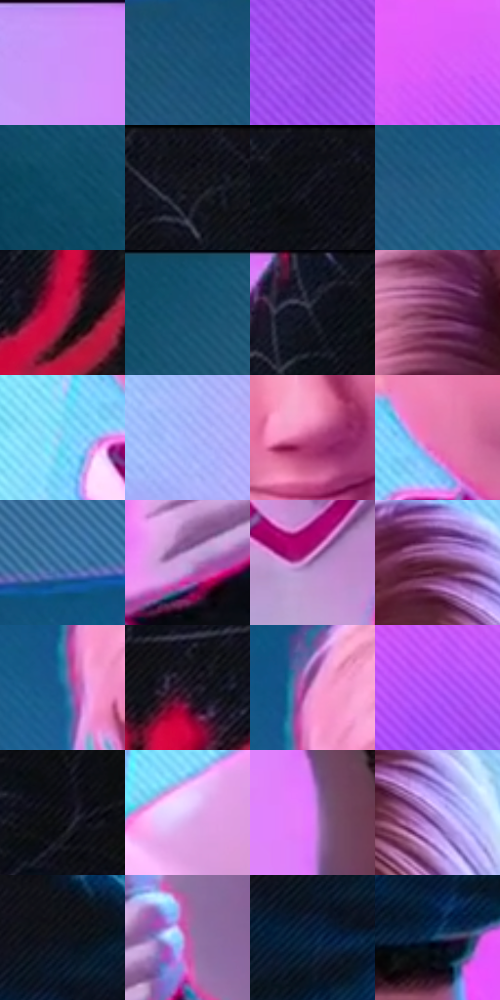

# 电影参考 647

- 状态：条件／活跃；来源世界：miles-home。
- 视角：near-level；景别：medium；场景：industrial。
- 时段：event-time-unknown（外观依据，中置信度；具体时间／晨昏未知）；光照：event-light。
- 材质候选：skin, hair, fabric, metal, glass（帧级，不是像素分割）。
- 明暗组：middle；L* P5/P50/P95：4.48807 / 43.60385 / 78.21138。
- 资格门禁：energy。
- 原截图 SHA-256：`fe19fdf586039365517bcf084c3159b0f51f9043c9d024e8e7e327a81256f066`；尺寸：2880 × 1212。
- sRGB 像素 SHA-256：`cb31f2cc70d3757354bca217f6f6dc3757986b97ea1a167398709384e706bd15`。

## 观察与迁移

事件彩光下人物、设备与粒子，皮肤和衣料仍保持体块。

浅色发束为宽粉白亮面，白衣是柔和紫灰折面，红白接触手部维持清楚遮挡；背景粉色面板与深青侧面分区，普通握持不添加冲击爆点。

本公开版保存32个128×128原像素色卡上下文；图集格子并非原场景相邻位置。原rect、图集tile和像素SHA见 `data/palette-crops.json`。上下文不足时不得批准替色，不能以小样推断完整构图。

## 实测色卡

颜色比例分母为保留采样像素，不是材料面积；全部 32 色参与全库匹配。表内四舍五入仅用于阅读，原精度在 JSON。

| ID | HEX | Lab | 原图 xy | 像素数 | 比例 | 明度角色 |
| --- | --- | --- | --- | ---: | ---: | --- |
| 647-S01 | #CC92FB | [69.7254, 40.969694, -44.149684] | [1604, 40] | 13201 | 6.803096% | light |
| 647-S02 | #1B5578 | [34.159716, -5.737059, -25.184045] | [412, 272] | 10166 | 5.239018% | shadow |
| 647-S03 | #9E50EF | [50.964324, 61.156874, -67.709212] | [2780, 484] | 9733 | 5.015873% | midtone |
| 647-S04 | #DC5EFA | [61.761796, 70.507039, -56.065887] | [2596, 136] | 9098 | 4.688627% | light |
| 647-S05 | #084660 | [27.506714, -7.988842, -20.475416] | [40, 592] | 8786 | 4.527839% | shadow |
| 647-S06 | #13131A | [6.131196, 1.748506, -4.705335] | [2184, 32] | 8707 | 4.487127% | deep-shadow |
| 647-S07 | #0E0F16 | [4.452547, 1.154676, -4.163769] | [1952, 28] | 8282 | 4.268104% | deep-shadow |
| 647-S08 | #265E84 | [37.989903, -5.114269, -26.535956] | [520, 364] | 7592 | 3.912515% | shadow |
| 647-S09 | #C21044 | [41.627811, 65.331146, 20.803563] | [2524, 1136] | 7328 | 3.776463% | midtone |
| 647-S10 | #12506F | [31.836136, -7.259044, -23.223501] | [104, 28] | 7264 | 3.743481% | shadow |
| 647-S11 | #101624 | [7.328433, 1.957629, -10.557319] | [1860, 28] | 6778 | 3.493022% | deep-shadow |
| 647-S12 | #7E3F65 | [35.851295, 32.326771, -9.988598] | [932, 204] | 6704 | 3.454887% | shadow |
| 647-S13 | #7ED6FA | [81.525582, -17.014972, -25.776295] | [792, 732] | 6505 | 3.352332% | highlight |
| 647-S14 | #A4B2F8 | [73.87432, 11.245138, -36.302629] | [1336, 220] | 6354 | 3.274515% | light |
| 647-S15 | #B6467E | [46.756194, 50.915087, -8.190182] | [1044, 632] | 6208 | 3.199274% | midtone |
| 647-S16 | #E37AB1 | [64.505653, 47.18292, -10.812194] | [876, 676] | 6202 | 3.196182% | light |
| 647-S17 | #3A6E9F | [45.016068, -1.634399, -31.653602] | [620, 156] | 5446 | 2.806580% | midtone |
| 647-S18 | #C39ED7 | [70.149655, 24.039672, -23.83517] | [1340, 1108] | 5368 | 2.766383% | light |
| 647-S19 | #9C6FAA | [53.319133, 28.463174, -24.595328] | [1048, 924] | 5330 | 2.746800% | midtone |
| 647-S20 | #58213F | [22.022911, 29.099664, -6.505361] | [1080, 144] | 5078 | 2.616932% | shadow |
| 647-S21 | #196191 | [39.240037, -3.772308, -32.468117] | [684, 344] | 5027 | 2.590650% | shadow |
| 647-S22 | #241928 | [10.729985, 9.022089, -8.107329] | [2388, 1112] | 4978 | 2.565398% | deep-shadow |
| 647-S23 | #E696D5 | [71.854023, 39.354974, -19.809574] | [708, 264] | 4921 | 2.536023% | light |
| 647-S24 | #B254F9 | [54.704828, 65.586094, -67.126511] | [2660, 244] | 4670 | 2.406671% | midtone |
| 647-S25 | #0A0910 | [2.68557, 1.383569, -2.96183] | [1936, 268] | 4221 | 2.175280% | deep-shadow |
| 647-S26 | #E3C3FB | [83.086705, 21.408934, -23.344392] | [684, 920] | 4172 | 2.150028% | highlight |
| 647-S27 | #E07EF8 | [67.686048, 56.296228, -45.558129] | [1792, 416] | 4045 | 2.084579% | light |
| 647-S28 | #A489D5 | [62.15786, 25.751912, -35.294704] | [1144, 208] | 3725 | 1.919668% | light |
| 647-S29 | #0C101B | [4.768008, 1.350214, -7.563494] | [2360, 100] | 2639 | 1.360001% | deep-shadow |
| 647-S30 | #BB5BA6 | [52.732186, 48.346884, -22.851919] | [1468, 1012] | 2524 | 1.300736% | midtone |
| 647-S31 | #0A2442 | [13.939967, 2.699894, -21.828568] | [2340, 180] | 2207 | 1.137371% | deep-shadow |
| 647-S32 | #234A6A | [30.14458, -2.705269, -22.676984] | [2284, 416] | 785 | 0.404547% | shadow |

## 色阶与空间分布

- 采样 ROI：`[0.01, 0.02, 0.98, 0.94]`；步长：4；样本数：194044。
- 排除区：`[]`。
- 深暗、暗、中、亮、高光五段计数：`[39547, 49014, 45522, 52257, 7704]`。
- RGB 各 256 箱、L* 100 箱、13×5 色相明度表和 3×3 空间统计全部保存在 [总数据](../film-library.json)。
- [可视化档案](../../references/library.html)按需绘制直方图，不存 2,094 张重复图表图片。

## 纹理特征占比

**这是分块图像特征的面积占比，不是波点／排线／丝网／错版的精确语义覆盖率。** 窗格、发丝、织物也会产生方向或周期特征。
原图 ROI 像素 3115310；已测块覆盖 3115310（100.0000%）；未测 0。

| 特征 | 块覆盖像素 | 占已测面积 | 阈值敏感范围 |
| --- | ---: | ---: | --- |
| low-contrast | 292352 | 9.3844% | 3.9033% ~ 15.6050% |
| directional-structure | 1392000 | 44.6826% | 22.8364% ~ 63.3239% |
| periodic-structure | 1365422 | 43.8294% | 31.7210% ~ 55.9255% |
| mixed-detail | 65536 | 2.1037% | 1.0518% ~ 5.6331% |

阈值敏感范围不是统计置信区间。逐块坐标、尺度、对比、方向一致性、频谱集中度、频率与角度见 [全量特征记录](../texture-features.jsonl)，以帧号定位。
四种印刷层的真实像素覆盖仍标为 `null`，不能填 0，也不能拿上表代替。不得据这些代理测量删除唯一证据。

[测量方法与保留策略](../../references/library-retention.md) · [分类索引](../archive/README.md)
