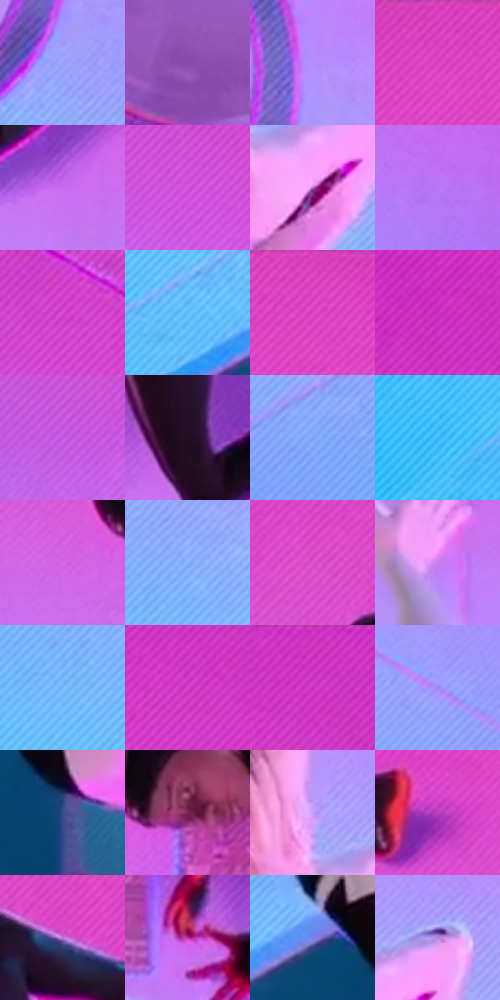

# 电影参考 648

- 状态：条件／活跃；来源世界：miles-home。
- 视角：high-angle；景别：environment-wide；场景：industrial。
- 时段：event-time-unknown（外观依据，中置信度；具体时间／晨昏未知）；光照：event-light。
- 材质候选：skin, hair, fabric, metal, glass（帧级，不是像素分割）。
- 明暗组：middle；L* P5/P50/P95：30.23794 / 58.46677 / 73.65338。
- 资格门禁：energy。
- 原截图 SHA-256：`24622fac845b62bb28feacd3c7de6ff5ee3164faa6f103352cb950cd097b003f`；尺寸：2880 × 1208。
- sRGB 像素 SHA-256：`1b05bd723e2f23ad82a2ca0684d964f6a12fc1f42b619f0efbc1acd09c5dce9c`。

## 观察与迁移

事件彩光下人物、设备与粒子，皮肤和衣料仍保持体块。

近处跃起人物与后方人物以尺度和遮挡分层，粉紫蓝机械板、圆孔与细排线保持各自角色；速度不靠把整座机械空间替换为抽象背景。

本公开版保存32个128×128原像素色卡上下文；图集格子并非原场景相邻位置。原rect、图集tile和像素SHA见 `data/palette-crops.json`。上下文不足时不得批准替色，不能以小样推断完整构图。

## 实测色卡

颜色比例分母为保留采样像素，不是材料面积；全部 32 色参与全库匹配。表内四舍五入仅用于阅读，原精度在 JSON。

| ID | HEX | Lab | 原图 xy | 像素数 | 比例 | 明度角色 |
| --- | --- | --- | --- | ---: | ---: | --- |
| 648-S01 | #9BA4FC | [69.856365, 17.762934, -44.782409] | [384, 616] | 12263 | 6.342515% | light |
| 648-S02 | #8A4BB2 | [43.726636, 44.977453, -44.475643] | [148, 592] | 10703 | 5.535672% | midtone |
| 648-S03 | #B48DFA | [66.255004, 36.866528, -49.22199] | [404, 480] | 10198 | 5.274482% | light |
| 648-S04 | #DE47C5 | [56.158304, 71.180946, -35.080688] | [1184, 36] | 10123 | 5.235691% | midtone |
| 648-S05 | #C86CF0 | [61.042465, 57.347349, -51.829768] | [1620, 616] | 9186 | 4.751068% | light |
| 648-S06 | #D555DF | [58.011336, 67.792824, -47.02911] | [536, 208] | 8514 | 4.403505% | midtone |
| 648-S07 | #AD68B9 | [54.33184, 40.793587, -31.540842] | [1244, 892] | 8452 | 4.371438% | midtone |
| 648-S08 | #BA77F7 | [61.953349, 49.696812, -54.352242] | [2528, 832] | 8293 | 4.289202% | light |
| 648-S09 | #D847D3 | [55.898225, 71.922228, -43.551597] | [668, 96] | 7847 | 4.058527% | midtone |
| 648-S10 | #5EBBFA | [72.772092, -9.090335, -39.372867] | [588, 1016] | 7495 | 3.876470% | light |
| 648-S11 | #D741BC | [53.879809, 70.312015, -33.539084] | [1532, 40] | 7396 | 3.825267% | midtone |
| 648-S12 | #CD32C3 | [50.923849, 73.856243, -42.35183] | [2696, 92] | 7087 | 3.665450% | midtone |
| 648-S13 | #C357DF | [55.834005, 62.645732, -50.639967] | [348, 208] | 6877 | 3.556836% | midtone |
| 648-S14 | #230F23 | [7.410336, 14.451798, -9.492126] | [1452, 544] | 6571 | 3.398570% | deep-shadow |
| 648-S15 | #7EA6F8 | [68.37467, 8.422216, -45.061831] | [1824, 1040] | 6476 | 3.349436% | light |
| 648-S16 | #3BB9F9 | [71.188776, -13.236603, -41.375173] | [352, 1076] | 5990 | 3.098073% | light |
| 648-S17 | #D568E6 | [61.448022, 60.635202, -45.520599] | [912, 440] | 5930 | 3.067040% | light |
| 648-S18 | #89B0FC | [71.821797, 6.497456, -41.788097] | [520, 764] | 5717 | 2.956875% | light |
| 648-S19 | #DD50CE | [57.625286, 68.931465, -37.936739] | [920, 240] | 5363 | 2.773784% | midtone |
| 648-S20 | #CB80F2 | [65.393882, 48.358853, -46.032819] | [784, 552] | 5259 | 2.719994% | light |
| 648-S21 | #77BAFC | [73.587272, -3.120708, -39.104898] | [464, 836] | 5218 | 2.698789% | light |
| 648-S22 | #D741CC | [54.647532, 72.699355, -41.5417] | [2392, 112] | 4672 | 2.416393% | midtone |
| 648-S23 | #D33BC7 | [53.062053, 73.023087, -41.216318] | [2424, 48] | 4572 | 2.364673% | midtone |
| 648-S24 | #9F8AF5 | [63.45766, 31.773974, -51.023611] | [2268, 964] | 4309 | 2.228647% | light |
| 648-S25 | #354D8A | [33.771196, 10.870459, -36.824759] | [884, 1048] | 4300 | 2.223992% | shadow |
| 648-S26 | #7B2652 | [29.929909, 41.058885, -6.726529] | [1024, 404] | 3384 | 1.750230% | shadow |
| 648-S27 | #C69FFC | [72.11467, 32.391043, -40.997856] | [1176, 788] | 3373 | 1.744541% | light |
| 648-S28 | #B941C2 | [49.485777, 64.237231, -44.252455] | [1928, 372] | 2323 | 1.201473% | midtone |
| 648-S29 | #B86FD4 | [58.333357, 45.770265, -40.570465] | [1504, 316] | 2030 | 1.049931% | midtone |
| 648-S30 | #BF32A2 | [46.93334, 65.914148, -29.430903] | [1144, 564] | 1820 | 0.941318% | midtone |
| 648-S31 | #7586E8 | [58.654654, 20.23006, -51.653608] | [792, 972] | 848 | 0.438592% | midtone |
| 648-S32 | #B588DF | [63.965942, 33.649509, -37.926196] | [1296, 808] | 757 | 0.391526% | light |

## 色阶与空间分布

- 采样 ROI：`[0.01, 0.02, 0.98, 0.94]`；步长：4；样本数：193346。
- 排除区：`[]`。
- 深暗、暗、中、亮、高光五段计数：`[6732, 8219, 91325, 86989, 81]`。
- RGB 各 256 箱、L* 100 箱、13×5 色相明度表和 3×3 空间统计全部保存在 [总数据](../film-library.json)。
- [可视化档案](../../references/library.html)按需绘制直方图，不存 2,094 张重复图表图片。

## 纹理特征占比

**这是分块图像特征的面积占比，不是波点／排线／丝网／错版的精确语义覆盖率。** 窗格、发丝、织物也会产生方向或周期特征。
原图 ROI 像素 3104134；已测块覆盖 3104134（100.0000%）；未测 0。

| 特征 | 块覆盖像素 | 占已测面积 | 阈值敏感范围 |
| --- | ---: | ---: | --- |
| low-contrast | 27520 | 0.8866% | 0.3587% ~ 3.9627% |
| directional-structure | 1589248 | 51.1978% | 39.5859% ~ 60.3479% |
| periodic-structure | 1342726 | 43.2561% | 37.1821% ~ 48.5342% |
| mixed-detail | 144640 | 4.6596% | 2.1112% ~ 7.9172% |

阈值敏感范围不是统计置信区间。逐块坐标、尺度、对比、方向一致性、频谱集中度、频率与角度见 [全量特征记录](../texture-features.jsonl)，以帧号定位。
四种印刷层的真实像素覆盖仍标为 `null`，不能填 0，也不能拿上表代替。不得据这些代理测量删除唯一证据。

[测量方法与保留策略](../../references/library-retention.md) · [分类索引](../archive/README.md)
