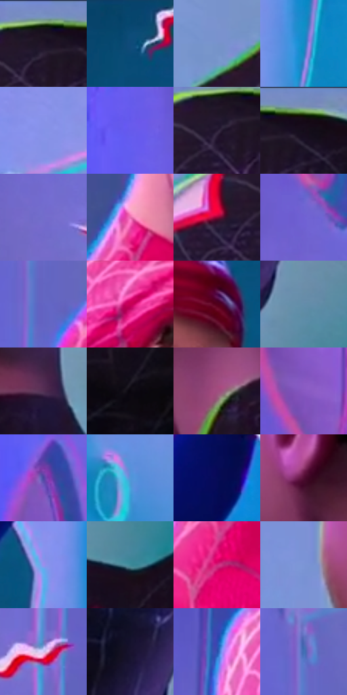

# 电影参考 649

- 状态：条件／活跃；来源世界：miles-home。
- 视角：near-level；景别：medium；场景：portrait。
- 时段：event-time-unknown（外观依据，中置信度；具体时间／晨昏未知）；光照：event-light。
- 材质候选：skin, hair, fabric, metal（帧级，不是像素分割）。
- 明暗组：middle；L* P5/P50/P95：4.3963 / 45.60196 / 63.72008。
- 资格门禁：sense, energy。
- 原截图 SHA-256：`3dee1ab2ef731c44aacc8ca33834e040b5df6be7110286ef8bc53223839ad4ba`；尺寸：2880 × 1212。
- sRGB 像素 SHA-256：`e7cfa35652ce3408f7fec2cb4c35c5d0c8e5049218424070fe825c534898d92e`。

## 观察与迁移

双人头周感应明确，不能从截图自动启用模式。

青蓝机械空间中两头周围可见红白分段感应线，成年面部胡茬和阴影短线区别于面罩网格；角色身份不改变镜头所在世界，应用仍须当次明确口令和人数门槛。

本公开版保存32个128×128原像素色卡上下文；图集格子并非原场景相邻位置。原rect、图集tile和像素SHA见 `data/palette-crops.json`。上下文不足时不得批准替色，不能以小样推断完整构图。

## 实测色卡

颜色比例分母为保留采样像素，不是材料面积；全部 32 色参与全库匹配。表内四舍五入仅用于阅读，原精度在 JSON。

| ID | HEX | Lab | 原图 xy | 像素数 | 比例 | 明度角色 |
| --- | --- | --- | --- | ---: | ---: | --- |
| 649-S01 | #1B1021 | [6.444167, 9.495737, -9.54542] | [2220, 56] | 11507 | 5.930098% | deep-shadow |
| 649-S02 | #0F4A79 | [30.348614, 0.357073, -31.838816] | [1124, 68] | 10825 | 5.578632% | shadow |
| 649-S03 | #7693CC | [60.84941, 4.58299, -32.560155] | [2000, 1020] | 10422 | 5.370947% | light |
| 649-S04 | #138BC6 | [54.739278, -9.063148, -38.988889] | [1532, 708] | 10065 | 5.186968% | midtone |
| 649-S05 | #8492E8 | [62.749572, 16.727694, -45.10892] | [1808, 320] | 9849 | 5.075653% | light |
| 649-S06 | #665AEC | [47.224308, 44.69169, -72.34659] | [100, 404] | 9076 | 4.677290% | midtone |
| 649-S07 | #261933 | [11.595815, 12.93891, -14.771449] | [2196, 92] | 8714 | 4.490734% | deep-shadow |
| 649-S08 | #150B1A | [4.275848, 6.776332, -7.421244] | [2292, 64] | 8211 | 4.231515% | deep-shadow |
| 649-S09 | #736DCB | [50.561395, 26.088358, -48.201054] | [344, 528] | 8171 | 4.210901% | midtone |
| 649-S10 | #E76EAE | [62.676539, 53.927854, -11.791363] | [732, 660] | 7950 | 4.097009% | light |
| 649-S11 | #8C0835 | [29.432383, 51.797824, 12.298074] | [2100, 136] | 7121 | 3.669786% | shadow |
| 649-S12 | #6F61D3 | [47.791276, 34.724068, -57.226109] | [256, 304] | 6837 | 3.523428% | midtone |
| 649-S13 | #6364C3 | [46.586126, 25.376386, -50.026978] | [340, 1056] | 6821 | 3.515182% | midtone |
| 649-S14 | #C80154 | [42.680237, 69.265616, 12.328579] | [828, 256] | 6759 | 3.483231% | midtone |
| 649-S15 | #52001B | [14.809072, 36.320041, 8.55451] | [1080, 284] | 6713 | 3.459525% | deep-shadow |
| 649-S16 | #648DAB | [56.779908, -6.11672, -20.242151] | [2668, 548] | 6255 | 3.223496% | midtone |
| 649-S17 | #522F54 | [25.159387, 22.73257, -15.918158] | [2452, 748] | 6159 | 3.174022% | shadow |
| 649-S18 | #0A060F | [2.070963, 2.399923, -3.316394] | [2256, 500] | 6021 | 3.102904% | deep-shadow |
| 649-S19 | #A14E80 | [45.061745, 40.595536, -12.27356] | [2228, 792] | 5487 | 2.827709% | midtone |
| 649-S20 | #8859C2 | [47.331566, 40.661616, -48.064398] | [244, 152] | 4724 | 2.434499% | midtone |
| 649-S21 | #4C46A0 | [34.911175, 27.95051, -48.271112] | [132, 776] | 4717 | 2.430892% | shadow |
| 649-S22 | #5496D8 | [60.473852, -1.140683, -39.984169] | [1680, 548] | 4675 | 2.409247% | light |
| 649-S23 | #060B57 | [8.703963, 29.556574, -44.849004] | [1548, 168] | 4380 | 2.257220% | deep-shadow |
| 649-S24 | #510E33 | [17.002653, 33.785257, -5.813111] | [2076, 668] | 3946 | 2.033559% | deep-shadow |
| 649-S25 | #9E8DEE | [63.746314, 27.978847, -46.718534] | [1456, 492] | 3446 | 1.775886% | light |
| 649-S26 | #408A98 | [53.52723, -18.706214, -14.420137] | [2636, 848] | 3422 | 1.763518% | midtone |
| 649-S27 | #CF287C | [47.290317, 68.123107, -5.715606] | [616, 964] | 3265 | 1.682608% | midtone |
| 649-S28 | #7C96D6 | [62.466201, 7.25298, -35.602433] | [1920, 660] | 2818 | 1.452248% | light |
| 649-S29 | #D3C3ED | [81.287934, 13.495402, -18.725041] | [540, 508] | 2114 | 1.089444% | highlight |
| 649-S30 | #19132E | [7.855325, 11.18258, -17.138059] | [2572, 444] | 1950 | 1.004927% | deep-shadow |
| 649-S31 | #2E50AE | [36.69222, 21.120979, -53.843278] | [668, 236] | 1162 | 0.598833% | shadow |
| 649-S32 | #4170B5 | [47.035631, 6.149346, -41.324697] | [324, 936] | 462 | 0.238090% | midtone |

## 色阶与空间分布

- 采样 ROI：`[0.01, 0.02, 0.98, 0.94]`；步长：4；样本数：194044。
- 排除区：`[]`。
- 深暗、暗、中、亮、高光五段计数：`[52157, 32372, 78055, 30222, 1238]`。
- RGB 各 256 箱、L* 100 箱、13×5 色相明度表和 3×3 空间统计全部保存在 [总数据](../film-library.json)。
- [可视化档案](../../references/library.html)按需绘制直方图，不存 2,094 张重复图表图片。

## 纹理特征占比

**这是分块图像特征的面积占比，不是波点／排线／丝网／错版的精确语义覆盖率。** 窗格、发丝、织物也会产生方向或周期特征。
原图 ROI 像素 3115310；已测块覆盖 3115310（100.0000%）；未测 0。

| 特征 | 块覆盖像素 | 占已测面积 | 阈值敏感范围 |
| --- | ---: | ---: | --- |
| low-contrast | 270976 | 8.6982% | 4.4909% ~ 10.1239% |
| directional-structure | 1133952 | 36.3993% | 24.5662% ~ 50.7019% |
| periodic-structure | 1534894 | 49.2694% | 43.7555% ~ 57.1993% |
| mixed-detail | 175488 | 5.6331% | 1.0518% ~ 8.1107% |

阈值敏感范围不是统计置信区间。逐块坐标、尺度、对比、方向一致性、频谱集中度、频率与角度见 [全量特征记录](../texture-features.jsonl)，以帧号定位。
四种印刷层的真实像素覆盖仍标为 `null`，不能填 0，也不能拿上表代替。不得据这些代理测量删除唯一证据。

[测量方法与保留策略](../../references/library-retention.md) · [分类索引](../archive/README.md)
