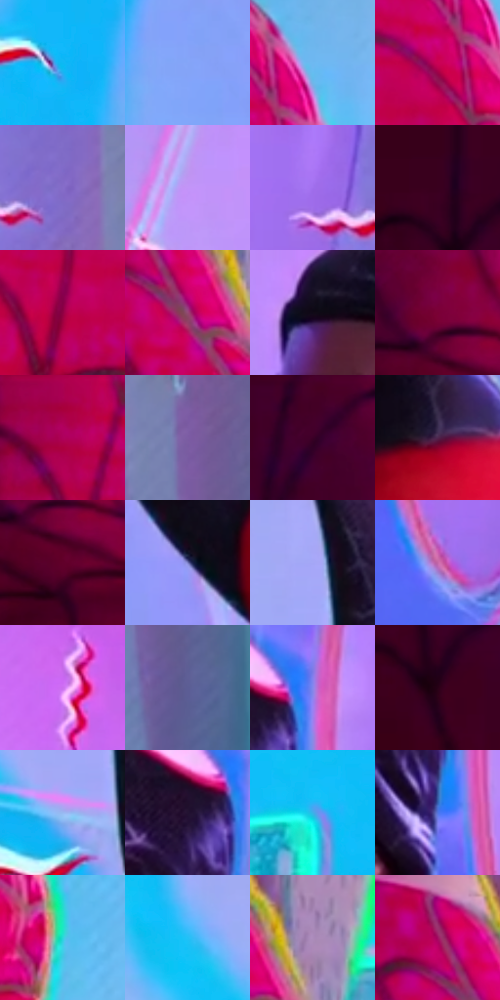

# 电影参考 650

- 状态：条件／活跃；来源世界：miles-home。
- 视角：near-level；景别：medium；场景：portrait。
- 时段：event-time-unknown（外观依据，中置信度；具体时间／晨昏未知）；光照：event-light。
- 材质候选：skin, hair, fabric, metal（帧级，不是像素分割）。
- 明暗组：middle；L* P5/P50/P95：5.70797 / 51.1824 / 73.68662。
- 资格门禁：sense, energy。
- 原截图 SHA-256：`e006c3b2f340043ddacaf7d0cac0f6a090fa77fb3650fa0d1c13be7c95202409`；尺寸：2880 × 1202。
- sRGB 像素 SHA-256：`7fae7d0c8efa1b8fab41a5af432c14d3c2e0dd185332b7e1ab9cb5ec689bfe5a`。

## 观察与迁移

双人头周感应明确，不能从截图自动启用模式。

反打脸部保持粉紫体面、局部绿边和黑红身体分区，头周红白线是条件图形；与649只是不同取景的视觉对照，不能据此测定感应闪烁周期。

本公开版保存32个128×128原像素色卡上下文；图集格子并非原场景相邻位置。原rect、图集tile和像素SHA见 `data/palette-crops.json`。上下文不足时不得批准替色，不能以小样推断完整构图。

## 实测色卡

颜色比例分母为保留采样像素，不是材料面积；全部 32 色参与全库匹配。表内四舍五入仅用于阅读，原精度在 JSON。

| ID | HEX | Lab | 原图 xy | 像素数 | 比例 | 明度角色 |
| --- | --- | --- | --- | ---: | ---: | --- |
| 650-S01 | #0FB8F4 | [70.112472, -17.429899, -40.391926] | [1432, 836] | 12362 | 6.416885% | light |
| 650-S02 | #85A5F7 | [68.467442, 10.328827, -44.343643] | [1548, 852] | 10529 | 5.465408% | light |
| 650-S03 | #6DB9F1 | [72.426184, -7.939231, -35.003145] | [876, 76] | 9654 | 5.011212% | light |
| 650-S04 | #CA0055 | [43.087432, 69.884587, 12.324729] | [816, 152] | 8692 | 4.511856% | midtone |
| 650-S05 | #856DC9 | [51.995258, 30.157193, -44.684699] | [2612, 532] | 8251 | 4.282941% | midtone |
| 650-S06 | #C394F8 | [69.15427, 36.674315, -43.47205] | [1716, 152] | 8201 | 4.256987% | light |
| 650-S07 | #A16FED | [57.133484, 45.402211, -56.647755] | [2472, 520] | 7676 | 3.984469% | midtone |
| 650-S08 | #3A001D | [8.895368, 29.96344, -2.186199] | [48, 108] | 7386 | 3.833935% | deep-shadow |
| 650-S09 | #8F0042 | [29.997204, 54.724943, 4.453647] | [732, 244] | 7141 | 3.706761% | shadow |
| 650-S10 | #964874 | [41.815482, 38.1799, -9.997664] | [732, 984] | 7108 | 3.689631% | midtone |
| 650-S11 | #100917 | [3.318645, 4.784021, -6.532586] | [1888, 376] | 6773 | 3.515739% | deep-shadow |
| 650-S12 | #7A0134 | [24.978366, 48.337376, 6.206573] | [460, 472] | 6762 | 3.510029% | shadow |
| 650-S13 | #AC004E | [36.599652, 62.468158, 6.793221] | [556, 44] | 6713 | 3.484594% | shadow |
| 650-S14 | #7C5DA4 | [45.350701, 27.52757, -33.750928] | [2720, 616] | 6588 | 3.419708% | midtone |
| 650-S15 | #440027 | [11.795451, 33.694302, -5.193065] | [272, 40] | 6553 | 3.401541% | deep-shadow |
| 650-S16 | #4F264D | [22.247521, 25.642649, -15.799651] | [2200, 912] | 5802 | 3.011710% | shadow |
| 650-S17 | #61002A | [18.840044, 41.425591, 3.75057] | [488, 552] | 5719 | 2.968627% | deep-shadow |
| 650-S18 | #7479BD | [53.015938, 15.093487, -36.300641] | [1696, 660] | 5635 | 2.925024% | midtone |
| 650-S19 | #A5A6F6 | [70.818406, 17.72489, -39.966626] | [1464, 152] | 5552 | 2.881940% | light |
| 650-S20 | #C468A7 | [56.514367, 44.759112, -17.539486] | [2328, 736] | 5477 | 2.843009% | midtone |
| 650-S21 | #CB6FEE | [61.860226, 56.223457, -49.401016] | [2080, 88] | 5166 | 2.681575% | light |
| 650-S22 | #5C5D95 | [41.647275, 14.002775, -30.851319] | [2772, 856] | 5109 | 2.651987% | midtone |
| 650-S23 | #8687ED | [60.345652, 25.078159, -51.668854] | [2256, 356] | 5094 | 2.644201% | light |
| 650-S24 | #280016 | [4.599286, 21.494755, -3.561716] | [96, 392] | 4485 | 2.328080% | deep-shadow |
| 650-S25 | #99B9F1 | [74.710431, 2.58298, -31.287683] | [1432, 268] | 3941 | 2.045700% | light |
| 650-S26 | #221331 | [9.219029, 15.212305, -17.106242] | [2192, 392] | 3913 | 2.031166% | deep-shadow |
| 650-S27 | #3AB2E9 | [68.474753, -14.957467, -36.918587] | [1192, 932] | 3655 | 1.897243% | light |
| 650-S28 | #5375E0 | [51.770427, 21.159174, -58.294083] | [2228, 520] | 3652 | 1.895685% | midtone |
| 650-S29 | #2AD8DB | [78.876051, -39.670836, -13.474252] | [948, 268] | 3064 | 1.590466% | light |
| 650-S30 | #21C1F7 | [73.006157, -20.291267, -37.495443] | [1256, 112] | 3049 | 1.582679% | light |
| 650-S31 | #AC8CBC | [62.640773, 20.997757, -20.451133] | [812, 940] | 1945 | 1.009613% | light |
| 650-S32 | #A30F62 | [36.007817, 60.17186, -7.1989] | [688, 912] | 1001 | 0.519601% | shadow |

## 色阶与空间分布

- 采样 ROI：`[0.01, 0.02, 0.98, 0.94]`；步长：4；样本数：192648。
- 排除区：`[]`。
- 深暗、暗、中、亮、高光五段计数：`[35111, 31445, 55189, 69053, 1850]`。
- RGB 各 256 箱、L* 100 箱、13×5 色相明度表和 3×3 空间统计全部保存在 [总数据](../film-library.json)。
- [可视化档案](../../references/library.html)按需绘制直方图，不存 2,094 张重复图表图片。

## 纹理特征占比

**这是分块图像特征的面积占比，不是波点／排线／丝网／错版的精确语义覆盖率。** 窗格、发丝、织物也会产生方向或周期特征。
原图 ROI 像素 3087370；已测块覆盖 3087370（100.0000%）；未测 0。

| 特征 | 块覆盖像素 | 占已测面积 | 阈值敏感范围 |
| --- | ---: | ---: | --- |
| low-contrast | 484224 | 15.6840% | 12.2553% ~ 18.1426% |
| directional-structure | 946944 | 30.6715% | 16.7329% ~ 47.0396% |
| periodic-structure | 1563914 | 50.6552% | 39.8385% ~ 58.9512% |
| mixed-detail | 92288 | 2.9892% | 0.8665% ~ 6.1733% |

阈值敏感范围不是统计置信区间。逐块坐标、尺度、对比、方向一致性、频谱集中度、频率与角度见 [全量特征记录](../texture-features.jsonl)，以帧号定位。
四种印刷层的真实像素覆盖仍标为 `null`，不能填 0，也不能拿上表代替。不得据这些代理测量删除唯一证据。

[测量方法与保留策略](../../references/library-retention.md) · [分类索引](../archive/README.md)
