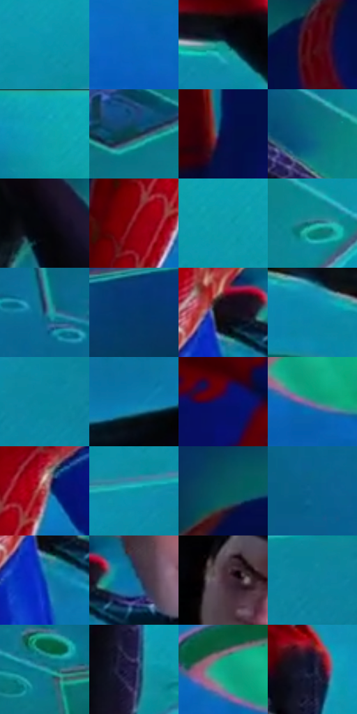

# 电影参考 651

- 状态：条件／活跃；来源世界：miles-home。
- 视角：low-angle；景别：full-body；场景：industrial。
- 时段：event-time-unknown（外观依据，中置信度；具体时间／晨昏未知）；光照：event-light。
- 材质候选：skin, hair, fabric, metal, glass（帧级，不是像素分割）。
- 明暗组：middle；L* P5/P50/P95：3.46066 / 41.34922 / 60.93115。
- 资格门禁：energy。
- 原截图 SHA-256：`b713d9a4dc54e0f3708a03c19dc8e51c72a29dea277c3b6b38b91a36ca4f3c7c`；尺寸：2880 × 1210。
- sRGB 像素 SHA-256：`b00e85d7469f844bc04e529ccb0f30d5450eb4901a798786485ed8db77b4b0d9`。

## 观察与迁移

事件彩光下人物、设备与粒子，皮肤和衣料仍保持体块。

两人在青蓝板面与绿色圆孔旁呈水平姿态，光色比强粉红片段收敛，红蓝与黑红服装仍保持不同大色块；按原照保留身体结构，不套用倒置姿态或设备。

本公开版保存32个128×128原像素色卡上下文；图集格子并非原场景相邻位置。原rect、图集tile和像素SHA见 `data/palette-crops.json`。上下文不足时不得批准替色，不能以小样推断完整构图。

## 实测色卡

颜色比例分母为保留采样像素，不是材料面积；全部 32 色参与全库匹配。表内四舍五入仅用于阅读，原精度在 JSON。

| ID | HEX | Lab | 原图 xy | 像素数 | 比例 | 明度角色 |
| --- | --- | --- | --- | ---: | ---: | --- |
| 651-S01 | #0A93AC | [55.995664, -23.186085, -22.244456] | [2600, 292] | 11667 | 6.012554% | midtone |
| 651-S02 | #0967BC | [43.341154, 8.502865, -51.376076] | [1096, 1060] | 11290 | 5.818268% | midtone |
| 651-S03 | #178D89 | [52.989171, -30.872017, -6.644859] | [2004, 940] | 11007 | 5.672425% | midtone |
| 651-S04 | #47020A | [11.993282, 31.434926, 14.706695] | [596, 432] | 9154 | 4.717487% | deep-shadow |
| 651-S05 | #0FA6B5 | [62.259735, -29.545351, -17.771266] | [1960, 28] | 8677 | 4.471666% | light |
| 651-S06 | #0F3D44 | [23.189786, -12.527694, -8.784454] | [1676, 404] | 8605 | 4.434561% | shadow |
| 651-S07 | #051044 | [7.407112, 18.399545, -33.831487] | [492, 596] | 8281 | 4.267589% | deep-shadow |
| 651-S08 | #0C6882 | [40.555752, -14.792558, -21.37443] | [1864, 208] | 8111 | 4.179980% | midtone |
| 651-S09 | #05050A | [1.469802, 0.695132, -1.891953] | [1480, 472] | 8048 | 4.147513% | deep-shadow |
| 651-S10 | #77020C | [23.648933, 45.417745, 30.572085] | [784, 916] | 7108 | 3.663087% | shadow |
| 651-S11 | #109BAF | [58.64465, -25.998983, -19.892821] | [2280, 212] | 6770 | 3.488899% | midtone |
| 651-S12 | #157B81 | [46.85475, -24.687177, -11.145778] | [2200, 392] | 6514 | 3.356971% | midtone |
| 651-S13 | #1B4F75 | [32.052746, -3.102231, -26.624012] | [200, 648] | 6492 | 3.345633% | shadow |
| 651-S14 | #063869 | [23.292281, 5.10235, -32.954459] | [444, 136] | 6417 | 3.306982% | shadow |
| 651-S15 | #170C18 | [4.616435, 6.714163, -5.318928] | [1028, 696] | 6205 | 3.197728% | deep-shadow |
| 651-S16 | #0B88AB | [52.528324, -17.649812, -27.016603] | [1692, 908] | 6039 | 3.112181% | midtone |
| 651-S17 | #06869E | [51.33092, -21.414361, -21.351331] | [2724, 444] | 5941 | 3.061677% | midtone |
| 651-S18 | #0E7AB0 | [48.442125, -7.726175, -36.287354] | [1432, 724] | 5933 | 3.057554% | midtone |
| 651-S19 | #06126E | [13.209601, 33.92822, -52.684189] | [948, 368] | 5061 | 2.608171% | deep-shadow |
| 651-S20 | #5A798B | [49.144479, -6.383357, -13.347879] | [1472, 1108] | 4759 | 2.452537% | midtone |
| 651-S21 | #9D474D | [41.551579, 36.372992, 13.901303] | [864, 856] | 4757 | 2.451506% | midtone |
| 651-S22 | #0493A6 | [55.729666, -25.474457, -19.226435] | [2616, 380] | 4724 | 2.434499% | midtone |
| 651-S23 | #09575D | [33.273262, -19.041352, -9.701382] | [800, 212] | 4634 | 2.388118% | shadow |
| 651-S24 | #0D618F | [38.92746, -5.562782, -31.76978] | [88, 796] | 4634 | 2.388118% | shadow |
| 651-S25 | #0647A7 | [32.554994, 21.114989, -56.443324] | [1028, 768] | 4548 | 2.343798% | shadow |
| 651-S26 | #0B6FA1 | [44.249446, -7.116486, -34.11937] | [1128, 696] | 3513 | 1.810414% | midtone |
| 651-S27 | #482F3B | [22.746617, 13.580158, -2.952589] | [1988, 656] | 3508 | 1.807837% | shadow |
| 651-S28 | #0F82A1 | [50.261044, -17.771987, -24.736255] | [2804, 420] | 2481 | 1.278576% | midtone |
| 651-S29 | #309FAE | [60.318286, -25.476582, -16.737673] | [84, 112] | 2480 | 1.278061% | light |
| 651-S30 | #1F1B44 | [12.559673, 14.936568, -25.356809] | [2208, 940] | 2473 | 1.274453% | deep-shadow |
| 651-S31 | #0FA687 | [60.888288, -43.20364, 6.027292] | [1432, 1060] | 2159 | 1.112634% | light |
| 651-S32 | #0A1027 | [5.252943, 5.071078, -16.087353] | [2216, 584] | 2054 | 1.058523% | deep-shadow |

## 色阶与空间分布

- 采样 ROI：`[0.01, 0.02, 0.98, 0.94]`；步长：4；样本数：194044。
- 排除区：`[]`。
- 深暗、暗、中、亮、高光五段计数：`[46087, 45679, 89819, 12440, 19]`。
- RGB 各 256 箱、L* 100 箱、13×5 色相明度表和 3×3 空间统计全部保存在 [总数据](../film-library.json)。
- [可视化档案](../../references/library.html)按需绘制直方图，不存 2,094 张重复图表图片。

## 纹理特征占比

**这是分块图像特征的面积占比，不是波点／排线／丝网／错版的精确语义覆盖率。** 窗格、发丝、织物也会产生方向或周期特征。
原图 ROI 像素 3109722；已测块覆盖 3109722（100.0000%）；未测 0。

| 特征 | 块覆盖像素 | 占已测面积 | 阈值敏感范围 |
| --- | ---: | ---: | --- |
| low-contrast | 372608 | 11.9820% | 6.9645% ~ 16.4028% |
| directional-structure | 1252570 | 40.2792% | 30.2235% ~ 55.5582% |
| periodic-structure | 1356288 | 43.6144% | 37.4773% ~ 46.4093% |
| mixed-detail | 128256 | 4.1244% | 0.0000% ~ 6.9645% |

阈值敏感范围不是统计置信区间。逐块坐标、尺度、对比、方向一致性、频谱集中度、频率与角度见 [全量特征记录](../texture-features.jsonl)，以帧号定位。
四种印刷层的真实像素覆盖仍标为 `null`，不能填 0，也不能拿上表代替。不得据这些代理测量删除唯一证据。

[测量方法与保留策略](../../references/library-retention.md) · [分类索引](../archive/README.md)
