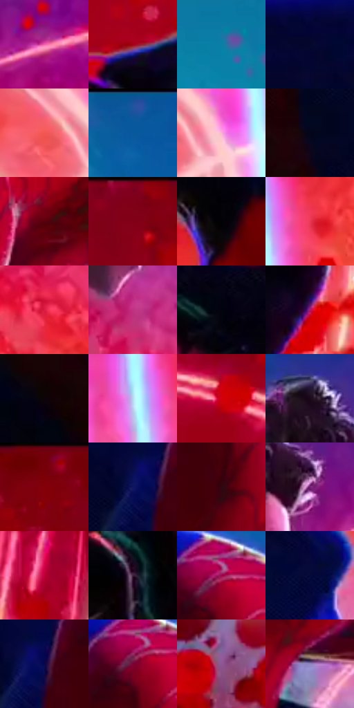

# 电影参考 652

- 状态：条件／活跃；来源世界：miles-home。
- 视角：low-angle；景别：medium；场景：industrial。
- 时段：event-time-unknown（外观依据，中置信度；具体时间／晨昏未知）；光照：event-light。
- 材质候选：skin, hair, fabric, metal, glass（帧级，不是像素分割）。
- 明暗组：dark；L* P5/P50/P95：0.90272 / 33.28224 / 74.36038。
- 资格门禁：energy。
- 原截图 SHA-256：`320c97e794d96f50c65546d5223b0fc617214f85cadfe85689e05d1987e1c2be`；尺寸：2880 × 1210。
- sRGB 像素 SHA-256：`8f8727c643699e742b6e2ef65cf7f998fbe9a8d4d1a7b3b8a820bba609ee7443`。

## 观察与迁移

事件彩光下人物、设备与粒子，皮肤和衣料仍保持体块。

粉红橙事件背景、左上青蓝面、白黄弧与纵向亮条并存，脸保持中间调，身体留深暗；能量弧不是普通动作线，粒子不转成全景装饰光球。

本公开版保存32个128×128原像素色卡上下文；图集格子并非原场景相邻位置。原rect、图集tile和像素SHA见 `data/palette-crops.json`。上下文不足时不得批准替色，不能以小样推断完整构图。

## 实测色卡

颜色比例分母为保留采样像素，不是材料面积；全部 32 色参与全库匹配。表内四舍五入仅用于阅读，原精度在 JSON。

| ID | HEX | Lab | 原图 xy | 像素数 | 比例 | 明度角色 |
| --- | --- | --- | --- | ---: | ---: | --- |
| 652-S01 | #EE65A8 | [61.925917, 59.451648, -9.375284] | [1504, 224] | 11168 | 5.755396% | light |
| 652-S02 | #A10218 | [33.326464, 56.903132, 36.426031] | [2164, 412] | 10383 | 5.350848% | shadow |
| 652-S03 | #0D7FA6 | [49.514879, -14.400284, -28.80196] | [432, 144] | 9889 | 5.096267% | midtone |
| 652-S04 | #04072D | [3.316437, 10.263014, -23.700605] | [572, 296] | 9194 | 4.738101% | deep-shadow |
| 652-S05 | #F25854 | [58.510909, 58.797017, 34.468146] | [1396, 1080] | 8152 | 4.201109% | midtone |
| 652-S06 | #1E539E | [35.848862, 10.952001, -45.684827] | [848, 32] | 7865 | 4.053204% | shadow |
| 652-S07 | #F6B5CF | [80.262952, 27.370394, -3.78502] | [1492, 1096] | 7830 | 4.035167% | highlight |
| 652-S08 | #04071B | [2.320265, 3.262824, -11.240579] | [340, 476] | 7476 | 3.852734% | deep-shadow |
| 652-S09 | #56010E | [15.656853, 36.420791, 18.400722] | [996, 436] | 7186 | 3.703284% | deep-shadow |
| 652-S10 | #7E0116 | [25.310972, 47.795877, 27.099728] | [2072, 40] | 6648 | 3.426027% | shadow |
| 652-S11 | #020205 | [0.607707, 0.417097, -1.135205] | [1980, 628] | 6638 | 3.420874% | deep-shadow |
| 652-S12 | #EA3957 | [53.072053, 67.748059, 25.562576] | [1748, 756] | 6629 | 3.416235% | midtone |
| 652-S13 | #DC1D41 | [47.599191, 69.713569, 31.276011] | [1368, 692] | 6561 | 3.381192% | midtone |
| 652-S14 | #BF3282 | [45.596036, 61.784775, -12.215184] | [1272, 532] | 6458 | 3.328111% | midtone |
| 652-S15 | #02030D | [0.967221, 1.165015, -3.974602] | [1832, 384] | 6201 | 3.195667% | deep-shadow |
| 652-S16 | #AB186D | [38.581899, 61.544791, -10.159483] | [2604, 980] | 5923 | 3.052400% | shadow |
| 652-S17 | #0D0309 | [1.539479, 3.51715, -1.325116] | [288, 620] | 5705 | 2.940055% | deep-shadow |
| 652-S18 | #B6D9F0 | [84.924908, -6.516215, -15.051328] | [1668, 740] | 5557 | 2.863783% | highlight |
| 652-S19 | #D1000F | [43.645414, 69.072993, 52.980834] | [2064, 228] | 5511 | 2.840078% | midtone |
| 652-S20 | #1A081A | [4.226422, 10.427054, -7.431704] | [1272, 76] | 5453 | 2.810187% | deep-shadow |
| 652-S21 | #820008 | [26.054292, 48.72669, 35.447683] | [2276, 60] | 5388 | 2.776690% | shadow |
| 652-S22 | #0F1562 | [12.730588, 28.133688, -45.560417] | [712, 376] | 5360 | 2.762260% | deep-shadow |
| 652-S23 | #30060F | [7.165862, 21.841885, 4.734481] | [844, 404] | 5210 | 2.684958% | deep-shadow |
| 652-S24 | #712070 | [28.67965, 45.414966, -28.258942] | [1380, 184] | 5185 | 2.672074% | shadow |
| 652-S25 | #BF0139 | [40.241321, 65.677183, 25.834535] | [2748, 444] | 4948 | 2.549937% | midtone |
| 652-S26 | #3D1D3B | [16.438236, 20.838913, -12.665071] | [2188, 1076] | 4146 | 2.136629% | deep-shadow |
| 652-S27 | #9E054B | [33.748209, 58.304069, 4.283592] | [868, 264] | 3793 | 1.954711% | shadow |
| 652-S28 | #050A3B | [5.103396, 17.125572, -31.16374] | [1088, 888] | 3284 | 1.692400% | deep-shadow |
| 652-S29 | #0A064B | [6.346307, 27.96469, -40.483404] | [744, 364] | 2835 | 1.461009% | deep-shadow |
| 652-S30 | #7C0336 | [25.617094, 48.608681, 5.793277] | [852, 284] | 2786 | 1.435757% | shadow |
| 652-S31 | #8F5696 | [45.217558, 34.314459, -25.48618] | [196, 1052] | 2635 | 1.357939% | midtone |
| 652-S32 | #8C83C0 | [57.668008, 16.902822, -30.609202] | [836, 628] | 2047 | 1.054915% | midtone |

## 色阶与空间分布

- 采样 ROI：`[0.01, 0.02, 0.98, 0.94]`；步长：4；样本数：194044。
- 排除区：`[]`。
- 深暗、暗、中、亮、高光五段计数：`[67122, 50113, 53456, 16556, 6797]`。
- RGB 各 256 箱、L* 100 箱、13×5 色相明度表和 3×3 空间统计全部保存在 [总数据](../film-library.json)。
- [可视化档案](../../references/library.html)按需绘制直方图，不存 2,094 张重复图表图片。

## 纹理特征占比

**这是分块图像特征的面积占比，不是波点／排线／丝网／错版的精确语义覆盖率。** 窗格、发丝、织物也会产生方向或周期特征。
原图 ROI 像素 3109722；已测块覆盖 3109722（100.0000%）；未测 0。

| 特征 | 块覆盖像素 | 占已测面积 | 阈值敏感范围 |
| --- | ---: | ---: | --- |
| low-contrast | 388224 | 12.4842% | 9.3230% ~ 13.5379% |
| directional-structure | 974810 | 31.3472% | 19.9126% ~ 45.8936% |
| periodic-structure | 1718912 | 55.2754% | 44.2566% ~ 63.5488% |
| mixed-detail | 27776 | 0.8932% | 0.5269% ~ 3.0007% |

阈值敏感范围不是统计置信区间。逐块坐标、尺度、对比、方向一致性、频谱集中度、频率与角度见 [全量特征记录](../texture-features.jsonl)，以帧号定位。
四种印刷层的真实像素覆盖仍标为 `null`，不能填 0，也不能拿上表代替。不得据这些代理测量删除唯一证据。

[测量方法与保留策略](../../references/library-retention.md) · [分类索引](../archive/README.md)
